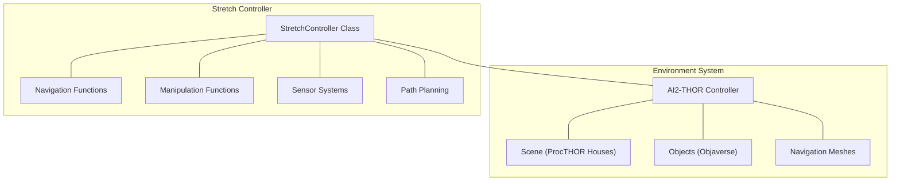
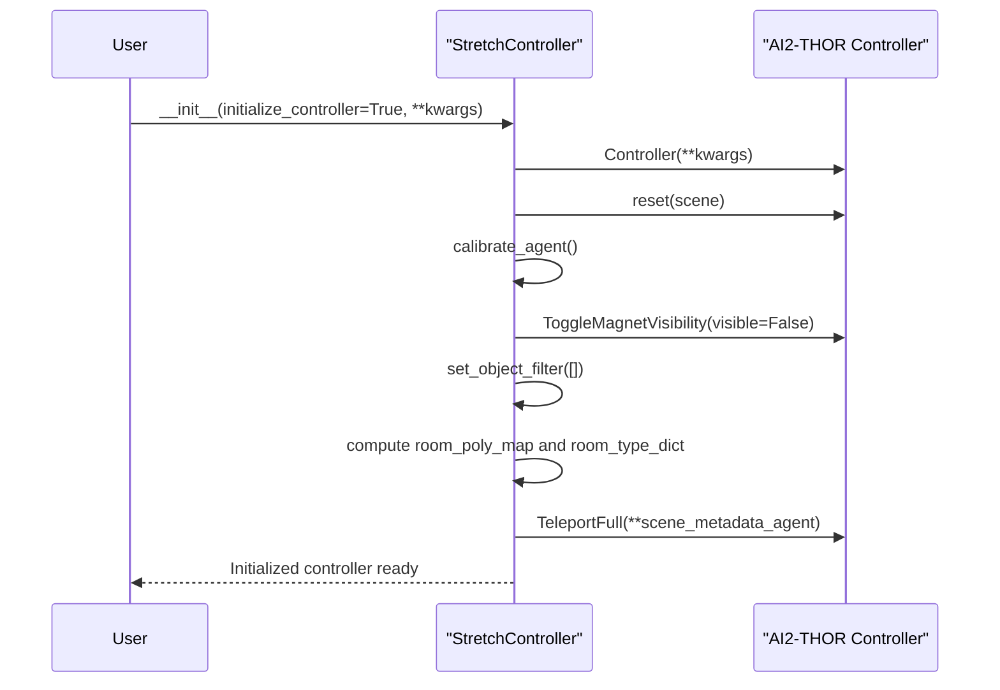
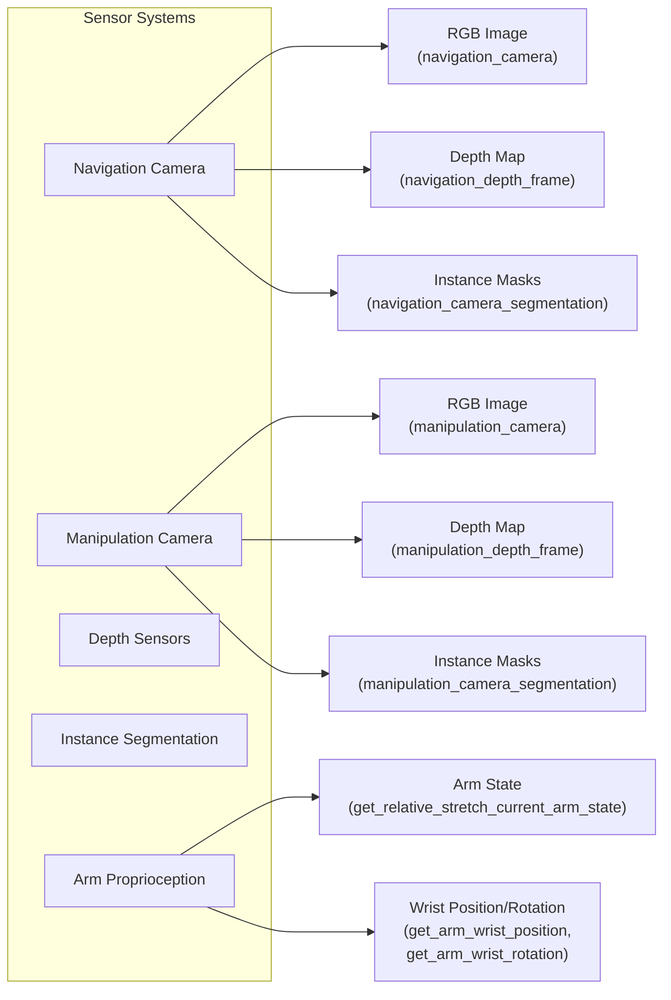
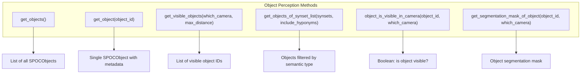
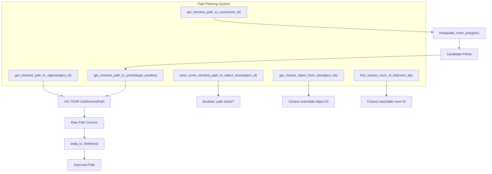

<!-- source: DeepWiki mcp.deepwiki.com · repo allenai/spoc-robot-training · page 6 Environment and Robot Control · fetched 2026-10-26 -->

# Environment and Robot Control

<details>
<summary>Relevant source files</summary>

The following files were used as context for generating this wiki page:

- [README.md](README.md)
- [environment/stretch_controller.py](environment/stretch_controller.py)
- [how_to_use_data.ipynb](how_to_use_data.ipynb)

</details>


This document provides a comprehensive overview of the environment (AI2-THOR) and the Stretch robot controller used in the SPOC system. It covers the environment's configuration, the robot controller's features, and the action space available to the robot. For information about system architecture as a whole, see [System Architecture](#2).

## 1. Environment Overview

The SPOC system utilizes AI2-THOR as its simulation environment. AI2-THOR is a framework for interactive visual AI that provides a 3D simulation platform for training and testing embodied AI agents. In our system, it serves as the foundation for robot navigation and manipulation tasks.

The environment is powered by AI2-THOR and is configured to work specifically with the Stretch robot model. The simulation provides:

- Realistic physics simulation
- Realistic lighting and rendering
- Object interaction capabilities
- Navigation mesh generation for pathfinding



Sources: [environment/stretch_controller.py:1-65](), [README.md:107-122]()

## 2. StretchController

The `StretchController` class is the central interface for controlling the Stretch robot in the AI2-THOR environment. It encapsulates the AI2-THOR controller and provides high-level methods for navigation, manipulation, and perception.

### 2.1 Initialization and Configuration

The controller initializes the AI2-THOR environment and configures it for the Stretch robot:



The initialization process includes:
- Creating an AI2-THOR controller
- Resetting to the specified scene
- Calibrating the agent with realistic camera settings
- Preparing navigation meshes for path planning
- Computing room polygons for spatial reasoning

Sources: [environment/stretch_controller.py:51-65](), [environment/stretch_controller.py:251-302]()

### 2.2 Sensor Systems

The Stretch robot has two primary camera sensors:

1. **Navigation Camera**: Front-facing camera used for navigation and environmental awareness
2. **Manipulation Camera**: Camera focused on the manipulation area (typically looking at the robot's arm)

Both cameras provide RGB images, and optionally depth and instance segmentation information.



Methods to access these sensors:
- `navigation_camera` and `manipulation_camera` for RGB images
- `navigation_depth_frame` and `manipulation_depth_frame` for depth information
- `navigation_camera_segmentation` and `manipulation_camera_segmentation` for instance masks
- `get_relative_stretch_current_arm_state()` for arm proprioception data
- `get_arm_wrist_position()` and `get_arm_wrist_rotation()` for wrist information

Sources: [environment/stretch_controller.py:113-182](), [environment/stretch_controller.py:652-673]()

## 3. Action Space

The robot's action space is defined by a set of discrete actions that control its movement and interaction capabilities. These actions are categorized into navigation, arm control, and object interaction.

```mermaid
graph TD
    subgraph "Robot Action Space"
        subgraph "Navigation Actions"
            MOVE_AHEAD["move_ahead (m)"]
            MOVE_BACK["move_back (b)"]
            ROTATE_LEFT["rotate_left (l)"]
            ROTATE_RIGHT["rotate_right (r)"]
            ROTATE_LEFT_SMALL["rotate_left_small (ls)"]
            ROTATE_RIGHT_SMALL["rotate_right_small (rs)"]
        end
        
        subgraph "Arm Control Actions"
            ARM_UP["move_arm_up (yp)"]
            ARM_DOWN["move_arm_down (ym)"]
            ARM_OUT["move_arm_out (zp)"]
            ARM_IN["move_arm_in (zm)"]
            ARM_UP_SMALL["move_arm_up_small (yps)"]
            ARM_DOWN_SMALL["move_arm_down_small (yms)"]
            ARM_OUT_SMALL["move_arm_out_small (zps)"]
            ARM_IN_SMALL["move_arm_in_small (zms)"]
            WRIST_OPEN["wrist_open (wp)"]
            WRIST_CLOSE["wrist_close (wm)"]
        end
        
        subgraph "Interaction Actions"
            PICKUP["pickup (p)"]
            DROPOFF["dropoff (d)"]
            END["end (end)"]
            SUB_DONE["sub_done (sub_done)"]
        end
    end

    AGENT_STEP["agent_step(action)"] --> MOVE_AHEAD
    AGENT_STEP --> MOVE_BACK
    AGENT_STEP --> ROTATE_LEFT
    AGENT_STEP --> ROTATE_RIGHT
    AGENT_STEP --> ROTATE_LEFT_SMALL
    AGENT_STEP --> ROTATE_RIGHT_SMALL
    AGENT_STEP --> ARM_UP
    AGENT_STEP --> ARM_DOWN
    AGENT_STEP --> ARM_OUT
    AGENT_STEP --> ARM_IN
    AGENT_STEP --> ARM_UP_SMALL
    AGENT_STEP --> ARM_DOWN_SMALL
    AGENT_STEP --> ARM_OUT_SMALL
    AGENT_STEP --> ARM_IN_SMALL
    AGENT_STEP --> WRIST_OPEN
    AGENT_STEP --> WRIST_CLOSE
    AGENT_STEP --> PICKUP
    AGENT_STEP --> DROPOFF
```



The action space is implemented through the `agent_step(action)` method which processes these commands:

| Action Category | Actions | Description |
|----------------|---------|-------------|
| Navigation | `move_ahead`, `move_back` | Move the base forward or backward by 0.2 meters |
| Navigation | `rotate_left`, `rotate_right` | Rotate the base by 30° |
| Navigation | `rotate_left_small`, `rotate_right_small` | Rotate the base by 6° |
| Arm Control | `move_arm_up`, `move_arm_down` | Move the arm up or down by 0.1 meters |
| Arm Control | `move_arm_out`, `move_arm_in` | Extend or retract the arm by 0.1 meters |
| Arm Control | `move_arm_*_small` variants | Same movements but by 0.02 meters |
| Wrist Control | `wrist_open`, `wrist_close` | Rotate the wrist by 10° |
| Interaction | `pickup`, `dropoff` | Grasp or release objects |
| Task Control | `end`, `sub_done` | Signal task completion |

Sources: [environment/stretch_controller.py:505-650](), [README.md:79-102]()

## 4. Object Interaction and Environment Perception

The StretchController provides methods for interacting with objects and perceiving the environment:

### 4.1 Object Perception



The controller maintains a comprehensive understanding of objects in the environment through methods like:
- `get_objects()`: Retrieves all objects in the scene
- `get_object(object_id)`: Gets detailed information about a specific object
- `get_visible_objects()`: Identifies which objects are visible to the robot
- `object_is_visible_in_camera()`: Checks if a specific object is visible

Sources: [environment/stretch_controller.py:304-374](), [environment/stretch_controller.py:410-459]()

### 4.2 Object Manipulation

The robot can interact with objects through:
- `get_objects_in_hand_sphere()`: Identifies objects that can be picked up
- `get_held_objects()`: Returns objects currently held by the robot
- `dist_from_arm_sphere_center_to_obj()`: Measures distance from the arm to an object

Sources: [environment/stretch_controller.py:86-111]()

## 5. Path Planning and Navigation

A key feature of the StretchController is its path planning capabilities, which allow the robot to navigate efficiently around the environment:



Key path planning methods:
- `get_shortest_path_to_object()`: Finds a path to reach a specific object
- `get_shortest_path_to_point()`: Finds a path to a specific location
- `get_shortest_path_to_room()`: Finds a path to enter a room
- `does_some_shortest_path_to_object_exist()`: Quickly checks if an object is reachable
- `get_closest_object_from_ids()`: Identifies the closest reachable object from a list

These methods leverage AI2-THOR's navigation meshes and can optionally improve paths using `snap_to_skeleton()` to create more natural movement patterns.

Sources: [environment/stretch_controller.py:676-916]()

## 6. Stochastic Controller

For more realistic robot behavior, the system provides a `StretchStochasticController` class that extends the base controller by adding random noise to movement actions:

```python
class StretchStochasticController(StretchController):
    def __init__(self, **kwargs):
        super().__init__(**kwargs)
        self.last_rand_action_kwargs = None

    def step(self, **kwargs):
        if "action" in kwargs and kwargs["action"] in ["MoveAhead", "RotateAgent"]:
            rand = np.random.normal(0, 1, 1)[0]

            if "action" in kwargs and kwargs["action"] == "MoveAgent":
                kwargs["ahead"] += 0.01 * rand
            if "action" in kwargs and kwargs["action"] == "RotateAgent":
                kwargs["degrees"] += 0.5 * rand

            self.last_rand_action_kwargs = kwargs
        return super(StretchStochasticController, self).step(**kwargs)
```

This controller adds Gaussian noise to movement and rotation actions, making the robot's behavior more realistic by simulating imperfect actuation:
- For movement: adds noise with standard deviation of 0.01 meters
- For rotation: adds noise with standard deviation of 0.5 degrees

Sources: [environment/stretch_controller.py:919-934]()

## 7. Room and Spatial Understanding

The controller maintains a spatial understanding of the environment through:
- `room_poly_map`: Contains polygon representations of all rooms
- `room_type_dict`: Maps room IDs to their types (bedroom, kitchen, etc.)
- `get_objects_room_id_and_type()`: Identifies which room an object is in
- `get_candidate_points_in_room()`: Finds navigable points within a room

These capabilities enable the robot to reason about the environment's structure and efficiently navigate between rooms and objects.

Sources: [environment/stretch_controller.py:829-916]()

---

