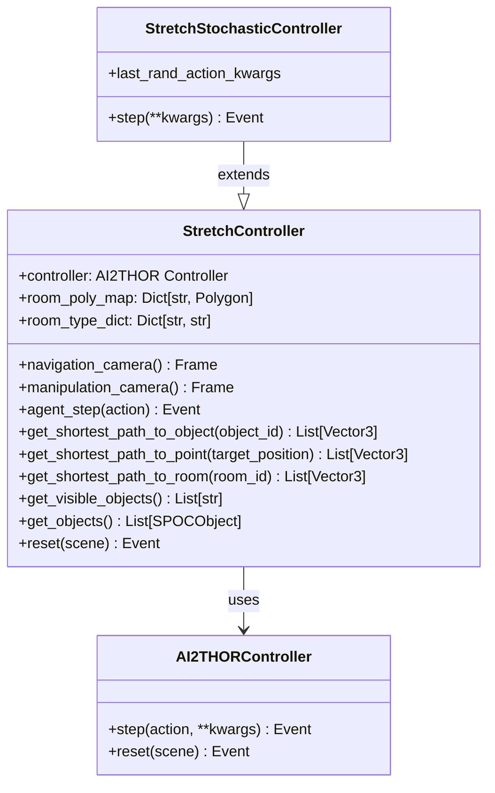
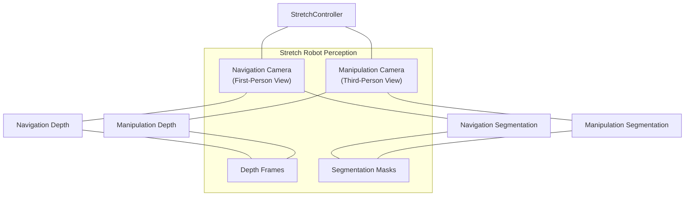
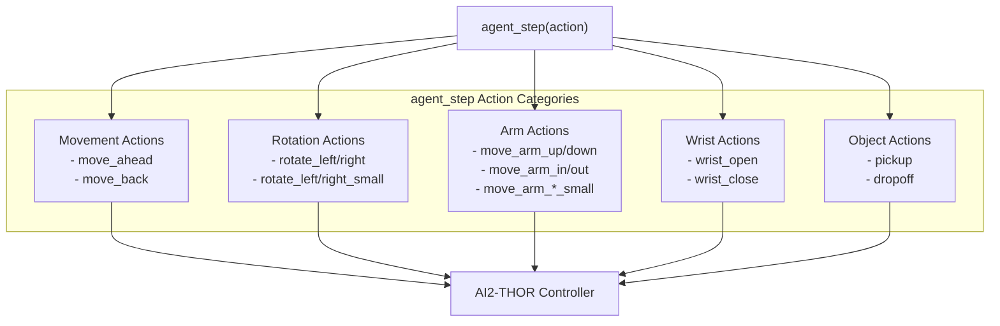
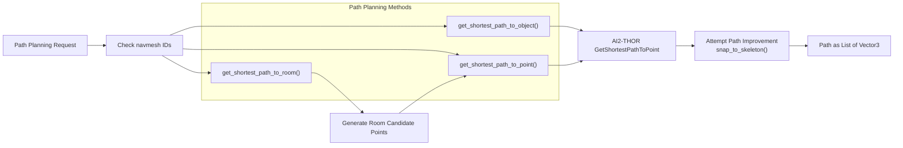

<!-- source: DeepWiki mcp.deepwiki.com · repo allenai/spoc-robot-training · page 6.1 Stretch Controller · fetched 2026-10-26 -->

# Stretch Controller

<details>
<summary>Relevant source files</summary>

The following files were used as context for generating this wiki page:

- [environment/stretch_controller.py](environment/stretch_controller.py)

</details>


The Stretch Controller is a core component of the SPOC (Simulation for Navigation and Manipulation) system that provides an interface for controlling the Stretch robot within the AI2-THOR simulation environment. It handles robot movement, perception, object interaction, and path planning. This documentation covers the implementation details and functionality of the `StretchController` class.

For information about the action space available to the robot, see [Action Space](#6.2).

## Overview

The Stretch Controller serves as a bridge between high-level robot control commands and the AI2-THOR simulation environment. It provides methods for:

1. Initializing and configuring the robot in a simulated environment
2. Accessing perception data from navigation and manipulation cameras
3. Controlling the robot's base movement and arm manipulation
4. Interacting with objects (picking up and dropping)
5. Path planning and navigation through the environment
6. Environment perception and scene understanding



Sources: [environment/stretch_controller.py:51-918]()

## Initialization and Configuration

The `StretchController` is initialized with AI2-THOR configuration parameters and can be set up with a specific scene. During initialization, it configures the camera field of view and establishes the controller connection to AI2-THOR.

```python
def __init__(self, initialize_controller=True, **kwargs):
    # Configuration setup
    if initialize_controller:
        self.controller = Controller(**kwargs)  # AI2-THOR controller
        # Additional initialization...
```

The `reset` method loads a new scene and calibrates the agent:

```python
def reset(self, scene):
    # Reset to new scene
    reset_event = self.controller.reset(scene=scene)
    self.calibrate_agent()
    # Additional scene setup...
```

The `calibrate_agent` method sets up the agent's initial posture and camera settings:

```python
def calibrate_agent(self):
    self.step(action="Teleport", horizon=0, standing=True)
    # Configure camera mounts and field of view
    # Set gripper openness
```

Sources: [environment/stretch_controller.py:51-67](), [environment/stretch_controller.py:251-302](), [environment/stretch_controller.py:227-249]()

## Camera Systems

The Stretch Controller provides access to two camera perspectives:



### Navigation Camera

Provides a first-person view from the robot's perspective:

```python
@property
def navigation_camera(self):
    frame = self.controller.last_event.frame
    cutoff = round(frame.shape[1] * 6 / 396)
    return frame[:, cutoff:-cutoff, :]
```

### Manipulation Camera

Provides a third-person view useful for object manipulation:

```python
@property
def manipulation_camera(self):
    frame = self.controller.last_event.third_party_camera_frames[0]
    cutoff = round(frame.shape[1] * 6 / 396)
    return frame[:, cutoff:-cutoff, :3]
```

Both cameras also provide:
- Depth frames: `navigation_depth_frame` and `manipulation_depth_frame`
- Segmentation masks: `navigation_camera_segmentation` and `manipulation_camera_segmentation`

Sources: [environment/stretch_controller.py:114-161]()

## Robot Movement and Control

The `agent_step` method serves as the main interface for controlling the robot. It supports various action types and translates them into the appropriate AI2-THOR commands.



Movement types include:

| Action Type | Description | Implementation Method |
|-------------|-------------|------------------------|
| Base Movement | Moving the robot forward/backward | `MoveAgent` |
| Base Rotation | Rotating the robot left/right | `RotateAgent` |
| Arm Movement | Moving the arm up/down/in/out | `MoveArm` |
| Wrist Rotation | Opening/closing the gripper | `RotateWristRelative` |
| Object Interaction | Picking up or dropping objects | `PickupObject`/`ReleaseObject` |

The controller also tracks the state of the robot before and after each action to verify that actions were successful.

Sources: [environment/stretch_controller.py:505-650]()

## Object Interaction

The controller provides methods to interact with objects in the environment:

### Object Detection

```python
# Get objects visible to the robot
def get_visible_objects(self, which_camera="nav", maximum_distance=2, filter_object_ids=None)

# Get objects in the robot's hand sphere (within reach)
def get_objects_in_hand_sphere(self)

# Check if an object is visible enough for interaction
def is_object_visible_enough_for_interaction(self, object_id, manipulation_camera=True)
```

### Object Manipulation

```python
# Get objects currently held by the robot
def get_held_objects(self)

# Calculate distance from arm to an object
def dist_from_arm_sphere_center_to_obj(self, object_id)
```

Sources: [environment/stretch_controller.py:86-112](), [environment/stretch_controller.py:304-362]()

## Environment Perception

The controller provides methods to perceive and understand the environment:

```python
# Get all objects in the scene
def get_objects(self) -> List[SPOCObject]

# Get a specific object by ID
def get_object(self, object_id, include_receptacle_info=False)

# Get objects of a specific type
def get_objects_of_synset_list(self, target_object_synsets, include_hyponyms, all_objs=None)

# Get object position
def get_object_position(self, object_id)
```

The controller also tracks room information:
- `room_poly_map`: Dictionary mapping room IDs to polygon representations
- `room_type_dict`: Dictionary mapping room IDs to room types

Sources: [environment/stretch_controller.py:364-469](), [environment/stretch_controller.py:890-896]()

## Path Planning

A significant portion of the controller's functionality is dedicated to path planning and navigation:



### Key Path Planning Methods

| Method | Purpose | Description |
|--------|---------|-------------|
| `get_shortest_path_to_object` | Navigate to an object | Finds a path from current position to a specified object |
| `get_shortest_path_to_point` | Navigate to a point | Finds a path from current position to a specified point |
| `get_shortest_path_to_room` | Navigate to a room | Finds a path from current position to a specified room |
| `get_closest_object_from_ids` | Find closest object | Identifies which of several objects is closest |
| `find_closest_room_of_list` | Find closest room | Identifies which of several rooms is closest |

Sources: [environment/stretch_controller.py:676-916]()

## Stochastic Controller

A specialized subclass, `StretchStochasticController`, extends the main controller to add randomness to robot movements:

```python
class StretchStochasticController(StretchController):
    def __init__(self, **kwargs):
        super().__init__(**kwargs)
        self.last_rand_action_kwargs = None

    def step(self, **kwargs):
        # Add randomness to movement and rotation
        if "action" in kwargs and kwargs["action"] in ["MoveAhead", "RotateAgent"]:
            rand = np.random.normal(0, 1, 1)[0]
            # Apply random adjustment to movement/rotation
            # ...
        return super(StretchStochasticController, self).step(**kwargs)
```

The stochastic controller is useful for robustness testing and training models that can handle real-world uncertainty.

Sources: [environment/stretch_controller.py:919-934]()

## Usage Example

Below is a simplified example of how the Stretch Controller might be used:

```python
# Initialize the controller
controller = StretchController(
    renderDepthImage=True,
    renderInstanceSegmentation=True,
    # Other AI2-THOR initialization parameters
)

# Reset to a specific scene
controller.reset(scene_json)

# Move the robot
controller.agent_step(THORActions.move_ahead)
controller.agent_step(THORActions.rotate_right)

# Move the arm
controller.agent_step(THORActions.move_arm_out)
controller.agent_step(THORActions.move_arm_up)

# Interact with an object
visible_objects = controller.get_visible_objects()
if visible_objects:
    object_id = visible_objects[0]
    if controller.is_object_visible_enough_for_interaction(object_id):
        controller.agent_step(THORActions.pickup)

# Navigate to a specific object
target_object_id = "Apple|1|2"
path = controller.get_shortest_path_to_object(target_object_id)
if path:
    # Navigate along the path
    # ...
```

Sources: [environment/stretch_controller.py:51-918]()

---

