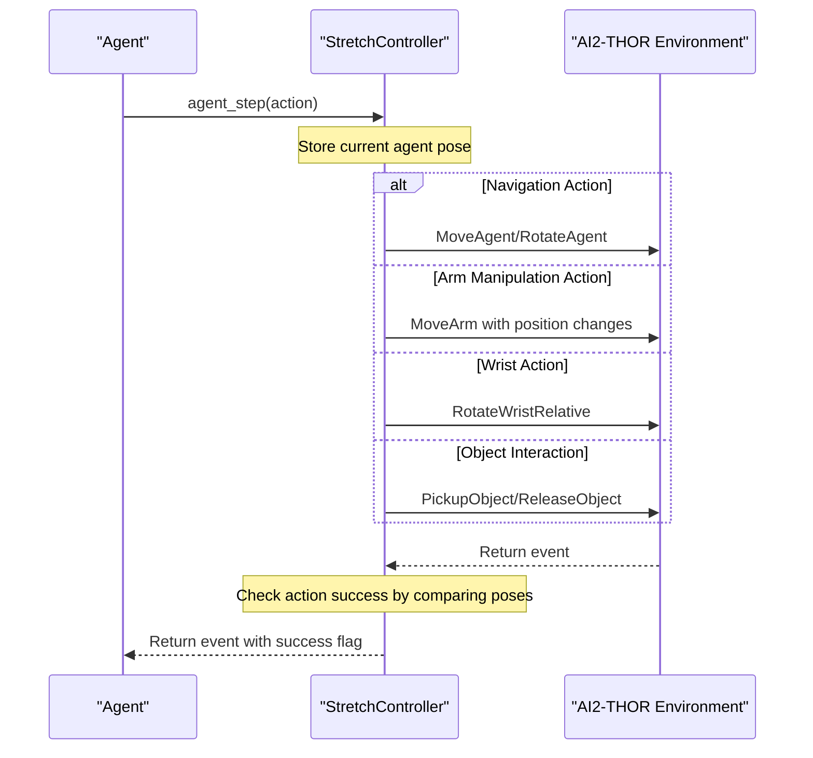
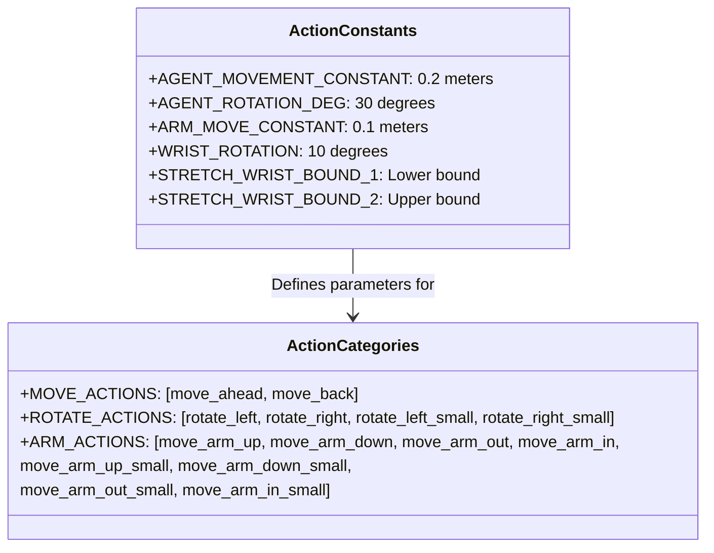

<!-- source: DeepWiki mcp.deepwiki.com · repo allenai/spoc-robot-training · page 6.2 Action Space · fetched 2026-10-26 -->

# Action Space

<details>
<summary>Relevant source files</summary>

The following files were used as context for generating this wiki page:

- [README.md](README.md)
- [environment/stretch_controller.py](environment/stretch_controller.py)
- [how_to_use_data.ipynb](how_to_use_data.ipynb)

</details>


## Purpose and Scope

This document provides a comprehensive overview of the action space available to the robot in the SPOC (Simulation for Navigation and Manipulation) system. It details the discrete actions that the robot can execute, how these actions are implemented, and their effects on the environment. For information about the Stretch Controller that executes these actions, see [Stretch Controller](#6.1).

## Discrete Action Space Overview

The SPOC system implements a discrete action space with commands for navigation, arm manipulation, wrist rotation, and object interaction. These actions are mapped to specific movements and rotations in the simulated environment.

```mermaid
flowchart TD
    subgraph "Action Categories"
        NAV["Navigation Actions"]
        ARM["Arm Manipulation"]
        WRIST["Wrist Actions"]
        OBJ["Object Interaction"]
        TASK["Task Completion"]
    end

    subgraph "Navigation Actions"
        MOVE_AHEAD["move_ahead (m)"]
        MOVE_BACK["move_back (b)"]
        ROT_LEFT["rotate_left (l)"]
        ROT_RIGHT["rotate_right (r)"]
        ROT_LEFT_S["rotate_left_small (ls)"]
        ROT_RIGHT_S["rotate_right_small (rs)"]
    end

    subgraph "Arm Manipulation"
        ARM_UP["move_arm_up (yp)"]
        ARM_DOWN["move_arm_down (ym)"]
        ARM_OUT["move_arm_out (zp)"]
        ARM_IN["move_arm_in (zm)"]
        ARM_UP_S["move_arm_up_small (yps)"]
        ARM_DOWN_S["move_arm_down_small (yms)"]
        ARM_OUT_S["move_arm_out_small (zps)"]
        ARM_IN_S["move_arm_in_small (zms)"]
    end

    subgraph "Wrist Actions"
        WRIST_OPEN["wrist_open (wp)"]
        WRIST_CLOSE["wrist_close (wm)"]
    end

    subgraph "Object Interaction"
        PICKUP["pickup (p)"]
        DROPOFF["dropoff (d)"]
    end

    subgraph "Task Completion"
        END["end (end)"]
        SUB_DONE["sub_done (sub_done)"]
    end

    NAV --> MOVE_AHEAD
    NAV --> MOVE_BACK
    NAV --> ROT_LEFT
    NAV --> ROT_RIGHT
    NAV --> ROT_LEFT_S
    NAV --> ROT_RIGHT_S
    
    ARM --> ARM_UP
    ARM --> ARM_DOWN
    ARM --> ARM_OUT
    ARM --> ARM_IN
    ARM --> ARM_UP_S
    ARM --> ARM_DOWN_S
    ARM --> ARM_OUT_S
    ARM --> ARM_IN_S
    
    WRIST --> WRIST_OPEN
    WRIST --> WRIST_CLOSE
    
    OBJ --> PICKUP
    OBJ --> DROPOFF
    
    TASK --> END
    TASK --> SUB_DONE
```



Sources: [README.md:79-102]()

## Detailed Action Specifications

The following table provides details for each discrete action in the system:

| Action Category | Action Name | Short Code | Description | Implementation |
|----------------|------------|-----------|-------------|----------------|
| **Navigation** | move_ahead | m | Move the agent's base forward by 0.2 meters | MoveAgent with ahead=AGENT_MOVEMENT_CONSTANT |
| **Navigation** | move_back | b | Move the agent's base backward by 0.2 meters | MoveAgent with ahead=-AGENT_MOVEMENT_CONSTANT |
| **Navigation** | rotate_left | l | Rotate the agent's base left by 30° | RotateAgent with degrees=-AGENT_ROTATION_DEG |
| **Navigation** | rotate_right | r | Rotate the agent's base right by 30° | RotateAgent with degrees=AGENT_ROTATION_DEG |
| **Navigation** | rotate_left_small | ls | Rotate the agent's base left by 6° | RotateAgent with degrees=-AGENT_ROTATION_DEG/5 |
| **Navigation** | rotate_right_small | rs | Rotate the agent's base right by 6° | RotateAgent with degrees=AGENT_ROTATION_DEG/5 |
| **Arm Manipulation** | move_arm_up | yp | Move the arm up by 0.1 meters | MoveArm with y+=ARM_MOVE_CONSTANT |
| **Arm Manipulation** | move_arm_down | ym | Move the arm down by 0.1 meters | MoveArm with y-=ARM_MOVE_CONSTANT |
| **Arm Manipulation** | move_arm_out | zp | Extend the arm outward by 0.1 meters | MoveArm with z+=ARM_MOVE_CONSTANT |
| **Arm Manipulation** | move_arm_in | zm | Retract the arm inward by 0.1 meters | MoveArm with z-=ARM_MOVE_CONSTANT |
| **Arm Manipulation** | move_arm_up_small | yps | Move the arm up by 0.02 meters | MoveArm with y+=ARM_MOVE_CONSTANT/5 |
| **Arm Manipulation** | move_arm_down_small | yms | Move the arm down by 0.02 meters | MoveArm with y-=ARM_MOVE_CONSTANT/5 |
| **Arm Manipulation** | move_arm_out_small | zps | Extend the arm outward by 0.02 meters | MoveArm with z+=ARM_MOVE_CONSTANT/5 |
| **Arm Manipulation** | move_arm_in_small | zms | Retract the arm inward by 0.02 meters | MoveArm with z-=ARM_MOVE_CONSTANT/5 |
| **Wrist Actions** | wrist_open | wp | Rotate the wrist counterclockwise by 10° | RotateWristRelative with yaw=-WRIST_ROTATION |
| **Wrist Actions** | wrist_close | wm | Rotate the wrist clockwise by 10° | RotateWristRelative with yaw=WRIST_ROTATION |
| **Object Interaction** | pickup | p | Initiate a grasp action to pick up an object | PickupObject |
| **Object Interaction** | dropoff | d | Execute a release action to drop an object | ReleaseObject followed by AdvancePhysicsStep |
| **Task Completion** | end | end | Signal the end of a task | Logical marker, no physical effect |
| **Task Completion** | sub_done | sub_done | Mark a sub-task as complete | Logical marker, no physical effect |

Sources: [README.md:79-102](), [environment/stretch_controller.py:505-650]()

## Action Implementation in the Codebase

The action space is implemented in the `StretchController` class, primarily in the `agent_step` method. This method translates the high-level action commands into specific AI2-THOR environment commands.



Sources: [environment/stretch_controller.py:505-650]()

## Action Execution Details

When an action is executed, the `agent_step` method follows these steps:

1. Capture the agent's full pose before the action
2. Convert the high-level action to the appropriate AI2-THOR command
3. Execute the command in the AI2-THOR environment
4. Capture the agent's full pose after the action
5. Verify the action success by checking if the position/rotation changed sufficiently
6. Return the event with the updated success flag

For arm manipulation actions, the controller modifies the relative position of the arm in the agent's coordinate frame. The action has specific constraints for the movement distance, defined by constants like `ARM_MOVE_CONSTANT` and `AGENT_ROTATION_DEG`.

Wrist actions rotate the wrist joint within specific bounds (`STRETCH_WRIST_BOUND_1` and `STRETCH_WRIST_BOUND_2`), ensuring the wrist stays within its operational range.

For object interaction, the `dropoff` action includes an additional step to advance the physics simulation to allow the dropped object to settle.

Sources: [environment/stretch_controller.py:505-650]()

## Action Space Constants and Parameters

The movement and rotation parameters for the actions are defined by several constants:



Sources: [environment/stretch_controller.py:16-27](), [environment/stretch_controller.py:518-523](), [environment/stretch_controller.py:536-545]()

## Action Space Integration with the Training Pipeline

The action space is used in the training pipeline, where models learn to predict the appropriate actions for various tasks. The actions are encoded as discrete values, with each action having a unique identifier.

```mermaid
flowchart TD
    subgraph "Model Training Pipeline"
        INPUT["Input Sensors\n- Navigation Camera\n- Manipulation Camera\n- Object Bounding Boxes\n- Last Action Taken"]
        MODEL["Policy Model"]
        ACTION_PRED["Action Prediction"]
        ENV["Environment Step\n(AI2-THOR)"]
        REWARD["Reward Calculation"]
    end
    
    subgraph "Action Space Integration"
        ACTION_ENCODER["Action Encoding"]
        ACTION_DECODER["Action Decoding"]
        STRETCH_CONTROLLER["StretchController.agent_step()"]
    end
    
    INPUT --> MODEL
    MODEL --> ACTION_PRED
    ACTION_PRED --> ACTION_DECODER
    ACTION_DECODER --> STRETCH_CONTROLLER
    STRETCH_CONTROLLER --> ENV
    ENV --> REWARD
    REWARD --> MODEL
    
    ACTION_ENCODER --> INPUT: Encodes last action
```

Sources: [environment/stretch_controller.py:505-650](), [README.md:79-102]()

## Validation of Action Success

The `StretchController` includes mechanisms to validate whether actions were successful:

1. For navigation actions (`MOVE_ACTIONS`), success is determined by a position change of at least 0.01 meters
2. For rotation actions (`ROTATE_ACTIONS`), success requires a rotation change of at least 2 degrees
3. For arm actions (`ARM_ACTIONS`), success is validated by an arm movement of at least 0.001 meters
4. For wrist actions, success is determined by a wrist rotation change of at least 0.001 radians

This validation ensures that actions have actually had an effect on the agent's state, accounting for potential collisions or constraints in the environment.

Sources: [environment/stretch_controller.py:610-649]()

## Stochastic Controller Variant

The SPOC system also includes a `StretchStochasticController` class that introduces randomness to navigation actions. This variant adds Gaussian noise to movement and rotation actions, which can help with robustness during training.

When using the stochastic controller:
- Movement commands have random noise with σ=0.01 added to the distance
- Rotation commands have random noise with σ=0.5 added to the angle

This stochasticity helps the agent learn policies that are more robust to minor variations in movement execution.

Sources: [environment/stretch_controller.py:919-934]()

---

