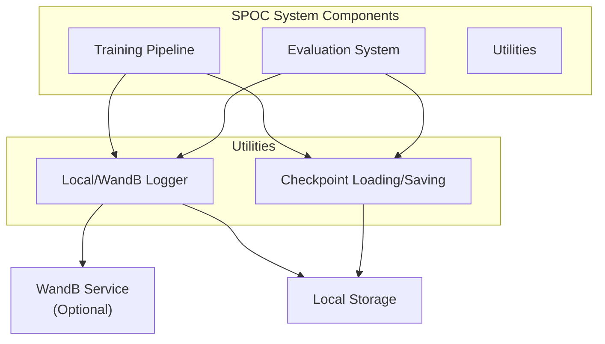
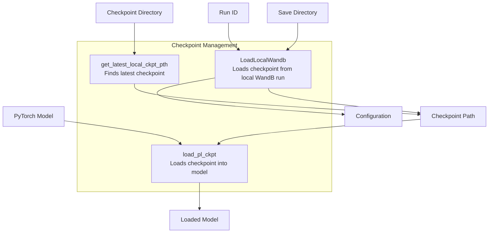
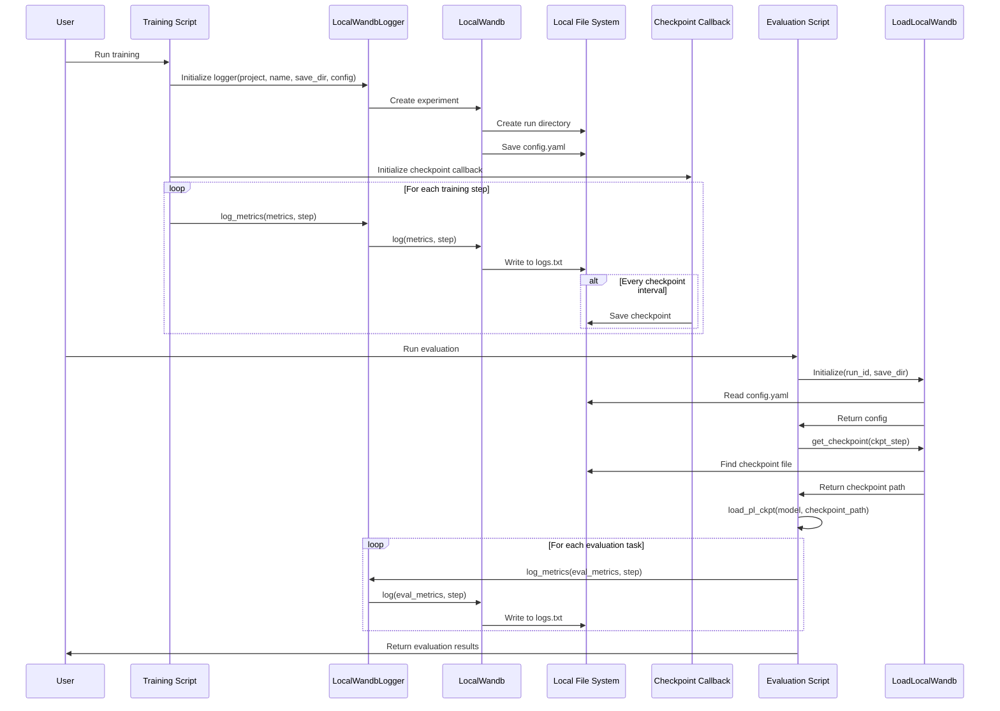

<!-- source: DeepWiki mcp.deepwiki.com · repo allenai/spoc-robot-training · page 7 Utilities · fetched 2026-10-26 -->

# Utilities

<details>
<summary>Relevant source files</summary>

The following files were used as context for generating this wiki page:

- [online_evaluation/local_logging_utils.py](online_evaluation/local_logging_utils.py)
- [training/offline/train_utils.py](training/offline/train_utils.py)

</details>


This page provides an overview of the utility systems used throughout the SPOC-Robot-Training codebase. These utilities provide essential functionality for experiment tracking, logging, and checkpoint management that support both the training and evaluation systems.

For information about specific subsystems, see:
- [Logging Utilities](#7.1)
- [Checkpoint Management](#7.2)

## Overview

The Utilities component consists of two primary subsystems:

1. **Logging Utilities**: Provides flexible logging capabilities that support both Weights & Biases (WandB) for online tracking and a local alternative for offline use.
2. **Checkpoint Management**: Handles saving, loading, and managing model checkpoints during training and evaluation.

These utilities are designed to be modular and interoperable with the rest of the SPOC system, serving as essential infrastructure for both training and evaluation workflows.



Sources: [online_evaluation/local_logging_utils.py](https://github.com/allenai/spoc-robot-training/blob/main/online_evaluation/local_logging_utils.py), [training/offline/train_utils.py](https://github.com/allenai/spoc-robot-training/blob/main/training/offline/train_utils.py)

## Logging Utilities

The logging utilities provide a consistent interface for experiment tracking, regardless of whether you're using Weights & Biases (WandB) or a local logging solution. This flexibility allows users to choose the most appropriate logging method for their environment without changing their code.

### Architecture

```mermaid
classDiagram
    class "LocalWandbLogger" {
        +project: str
        +entity: str
        +name: str
        +save_dir: str
        +config: dict
        +log_model: bool
        +experiment: LocalWandb
        +log_metrics(metrics, step)
        +version: str
    }
    
    class "LocalWandb" {
        +project: str
        +entity: str
        +name: str
        +save_dir: str
        +config: dict
        +run_id: str
        +log_config(config)
        +log(dict_to_log, step)
        +log_artifact(artifact, aliases)
        +Table(columns)
        +Video(video_path)
        +Image(image_path)
    }
    
    class "LocalTable" {
        +columns: list
        +rows: list
        +add_data(*data)
        +get_dataframe()
    }
    
    class "LoadLocalWandb" {
        +run_id: str
        +save_dir: str
        +config: dict
        +get_checkpoint(ckpt_step)
        +load_config()
    }
    
    class "pl.loggers.WandbLogger" {
        +log_metrics(metrics, step)
        +experiment: wandb.Run
    }
    
    "LocalWandbLogger" --|> "pl.loggers.WandbLogger": extends
    "LocalWandbLogger" --> "LocalWandb": creates
    "LocalWandb" --> "LocalTable": uses
    "LoadLocalWandb" --> "LocalWandb": loads
```

Sources: [online_evaluation/local_logging_utils.py:16-222](https://github.com/allenai/spoc-robot-training/blob/main/online_evaluation/local_logging_utils.py)

### Key Components

#### LocalWandbLogger

`LocalWandbLogger` is a PyTorch Lightning logger that extends the standard WandB logger but provides the option to log data locally instead of to the WandB servers. This is particularly useful for offline environments or when you want to avoid the network overhead of WandB.

```python
logger = LocalWandbLogger(
    project="spoc-project",
    entity="my-entity",
    name="experiment-name",
    save_dir="./logs",
    config=config_dict,
    log_model=True
)
```

Sources: [online_evaluation/local_logging_utils.py:20-67](https://github.com/allenai/spoc-robot-training/blob/main/online_evaluation/local_logging_utils.py)

#### LocalWandb

`LocalWandb` is the core class that mimics the WandB interface but saves data locally. It provides methods for logging metrics, artifacts, tables, videos, and images.

```python
local_wandb = LocalWandb(
    project="spoc-project",
    entity="my-entity",
    name="experiment-name",
    save_dir="./logs",
    config=config_dict
)

# Log metrics
local_wandb.log({"loss": 0.5, "accuracy": 0.9}, step=100)

# Log a table
table = LocalWandb.Table(["column1", "column2"])
table.add_data("value1", "value2")
local_wandb.log({"my_table": table})
```

Sources: [online_evaluation/local_logging_utils.py:98-189](https://github.com/allenai/spoc-robot-training/blob/main/online_evaluation/local_logging_utils.py)

#### LoadLocalWandb

`LoadLocalWandb` provides functionality to load data from previously saved local WandB runs, including configurations and checkpoints.

```python
loader = LoadLocalWandb(run_id="abcd1234", save_dir="./logs")
config = loader.config  # Load the configuration
checkpoint_path = loader.get_checkpoint(ckpt_step=1000)  # Get a specific checkpoint
```

Sources: [online_evaluation/local_logging_utils.py:69-95](https://github.com/allenai/spoc-robot-training/blob/main/online_evaluation/local_logging_utils.py)

#### LocalTable

`LocalTable` is a utility class for creating and displaying tables locally, similar to WandB's Table class. It provides a simple way to organize and display tabular data.

```python
table = LocalTable(["column1", "column2"])
table.add_data("value1", "value2")
table.add_data("value3", "value4")
print(table)  # Displays a pretty-formatted table
```

Sources: [online_evaluation/local_logging_utils.py:192-215](https://github.com/allenai/spoc-robot-training/blob/main/online_evaluation/local_logging_utils.py)

## Checkpoint Management

The checkpoint management utilities provide functionality for loading, saving, and managing model checkpoints during training and evaluation.

### Architecture



Sources: [training/offline/train_utils.py:6-60](https://github.com/allenai/spoc-robot-training/blob/main/training/offline/train_utils.py), [online_evaluation/local_logging_utils.py:69-95](https://github.com/allenai/spoc-robot-training/blob/main/online_evaluation/local_logging_utils.py)

### Key Functions

#### load_pl_ckpt

`load_pl_ckpt` loads a PyTorch Lightning checkpoint into a model, with options for handling mismatches between the checkpoint and model architectures. This function is particularly useful when loading pretrained models or resuming training from a checkpoint.

```python
load_pl_ckpt(
    model,               # The model to load the checkpoint into
    ckpt_pth,            # Path to the checkpoint file
    ckpt_prefix="model.", # Prefix for the model parameters in the checkpoint
    verbose=False        # Whether to print detailed information about parameter matching
)
```

The function provides detailed logging of which parameters were loaded, which parameters exist in the model but not in the checkpoint, and which parameters exist in the checkpoint but not in the model.

Sources: [training/offline/train_utils.py:6-48](https://github.com/allenai/spoc-robot-training/blob/main/training/offline/train_utils.py)

#### get_latest_local_ckpt_pth

`get_latest_local_ckpt_pth` finds the latest checkpoint in a directory based on the step count in the filename. This is useful for resuming training from the latest checkpoint or evaluating the most recent model.

```python
latest_checkpoint_path = get_latest_local_ckpt_pth(ckpt_dir)
```

The function sorts the checkpoint files by the step count and returns the path to the latest one. If no checkpoints exist, it returns `None`.

Sources: [training/offline/train_utils.py:51-60](https://github.com/allenai/spoc-robot-training/blob/main/training/offline/train_utils.py)

## Usage Workflow

The following sequence diagram illustrates how the utilities are used in a typical training and evaluation workflow:



Sources: [online_evaluation/local_logging_utils.py](https://github.com/allenai/spoc-robot-training/blob/main/online_evaluation/local_logging_utils.py), [training/offline/train_utils.py](https://github.com/allenai/spoc-robot-training/blob/main/training/offline/train_utils.py)

## Integration with SPOC System

The utilities are designed to integrate seamlessly with the rest of the SPOC system, particularly the training and evaluation components. The following table summarizes the key integration points:

| Component | Utility Used | Purpose |
|-----------|--------------|---------|
| Offline Training | `LocalWandbLogger` | Log training metrics and visualizations |
| Offline Training | `load_pl_ckpt` | Resume training from checkpoints |
| Offline Training | `get_latest_local_ckpt_pth` | Find the latest checkpoint |
| Online Evaluation | `LocalWandbLogger` | Log evaluation metrics and results |
| Online Evaluation | `load_pl_ckpt` | Load trained models for evaluation |
| Online Evaluation | `LoadLocalWandb` | Load configurations from previous runs |

Sources: [online_evaluation/local_logging_utils.py](https://github.com/allenai/spoc-robot-training/blob/main/online_evaluation/local_logging_utils.py), [training/offline/train_utils.py](https://github.com/allenai/spoc-robot-training/blob/main/training/offline/train_utils.py)

---

