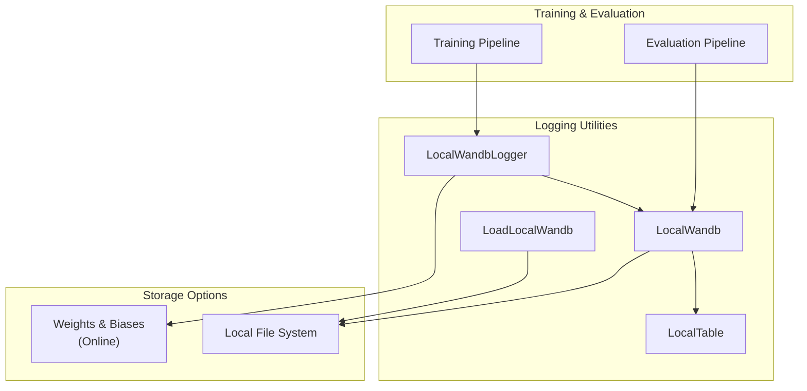
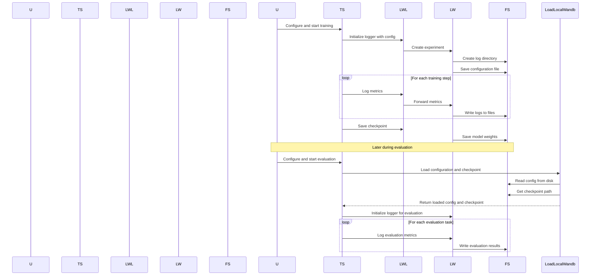

<!-- source: DeepWiki mcp.deepwiki.com · repo allenai/spoc-robot-training · page 7.1 Logging Utilities · fetched 2026-10-26 -->

# Logging Utilities

<details>
<summary>Relevant source files</summary>

The following files were used as context for generating this wiki page:

- [TRAINING_README.md](TRAINING_README.md)
- [online_evaluation/local_logging_utils.py](online_evaluation/local_logging_utils.py)

</details>


## Purpose and Scope

This document describes the logging utilities available in the SPOC robot training system. These utilities provide mechanisms for tracking metrics, storing experimental configurations, and saving model artifacts during both training and evaluation. The logging system supports both online logging through Weights & Biases (wandb) and local file-based logging through a custom implementation.

For information about checkpoint management specifically, see [Checkpoint Management](#7.2).

## Logging System Architecture

The SPOC system provides a flexible logging architecture that allows developers to choose between logging to Weights & Biases (wandb) for online tracking or a local file system for offline use. The system is designed to be compatible with PyTorch Lightning's logging interfaces while providing additional capabilities.



**Diagram: Logging System Architecture**

Sources: [online_evaluation/local_logging_utils.py:1-223](), [TRAINING_README.md:41-58]()

## Key Components

### LocalWandbLogger

`LocalWandbLogger` extends PyTorch Lightning's WandbLogger to provide a seamless way to switch between wandb and local logging. It initializes with standard wandb parameters, but if wandb logging is disabled, it redirects all logs to a local directory.

```mermaid
classDiagram
    class LoggerInfo {
        +project: str
        +entity: str
        +name: str
        +save_dir: str
        +config: dict
        +log_model: bool
    }
    
    class "LocalWandbLogger" {
        +logger_info: LoggerInfo
        +_save_dir: str
        +_run_id: str
        +_experiment: LocalWandb or WandbRun
        +experiment(): LocalWandb or WandbRun
        +log_metrics(metrics, step): void
        +version: str
    }
    
    class "pl.loggers.wandb.WandbLogger" {
    }
    
    "LocalWandbLogger" --|> "pl.loggers.wandb.WandbLogger"
    "LocalWandbLogger" o-- "LoggerInfo"
```

**Diagram: LocalWandbLogger Class Structure**

Sources: [online_evaluation/local_logging_utils.py:16-67]()

### LocalWandb

The `LocalWandb` class implements a local file-based alternative to wandb's online logging functionality. It provides methods for logging metrics, configurations, tables, and artifacts to a local directory.

```mermaid
classDiagram
    class "LocalWandb" {
        +project: str
        +entity: str
        +name: str
        +save_dir: str
        +config: dict
        +run_id: str
        +full_dir: str
        +log_config(config): void
        +write_logs(dict_to_log, step): void
        +log(dict_to_log, step): void
        +log_artifact(artifact, aliases): void
        +Table(columns): LocalTable
        +Video(video_path): str
        +Image(image_path): str
    }
    
    class "LocalTable" {
        +columns: list
        +rows: list
        +add_data(*data): void
        +get_dataframe(): str
        +get_local_table_from_wandb_table(wandb_table): LocalTable
    }
    
    "LocalWandb" --> "LocalTable": creates
```

**Diagram: LocalWandb and LocalTable Classes**

Sources: [online_evaluation/local_logging_utils.py:98-189](), [online_evaluation/local_logging_utils.py:192-216]()

### LoadLocalWandb

The `LoadLocalWandb` class is used for loading configuration and checkpoint files that were saved by a previous run using `LocalWandb`. It's particularly useful during evaluation when you need to load a trained model.

Sources: [online_evaluation/local_logging_utils.py:69-95]()

## Configuration and Usage

### Configuring Logging for Training

During training, you can configure the logging system using command-line arguments:

For local logging:
```bash
--wandb_logging False --output_dir /path/to/save/logs
```

For wandb logging:
```bash
--wandb_logging True --wandb_entity_name WANDB_ENTITY_NAME --wandb_project_NAME WANDB_PROJECT_NAME
```

You can also set the local directory where wandb will save files before uploading:
```bash
export WANDB_DIR=/local/path/to/save/files
```

Sources: [TRAINING_README.md:41-58]()

### Configuring Logging for Evaluation

For evaluation, similar options are available:

For local logging:
```bash
--wandb_logging False --training_run_id TRAINING_ID --ckptStep STEP_NUMBER --local_checkpoint_dir /path/to/local/checkpoints/
```

For wandb logging:
```bash
--wandb_logging True --wandb_entity_name WANDB_ENTITY_NAME --wandb_project_name WANDB_PROJECT_NAME --training_run_id TRAINING_ID
```

Sources: [TRAINING_README.md:64-86]()

## Logging Flow During Training and Evaluation



**Diagram: Logging Flow During Training and Evaluation**

Sources: [online_evaluation/local_logging_utils.py:1-223](), [TRAINING_README.md:41-86]()

## Data Types and Logging Methods

The logging system supports various types of data:

### Metrics
Numerical values, strings, and dictionaries can be logged using the `log_metrics()` or `log()` methods.

### Tables
Tabular data can be logged using the `LocalTable` class, which provides a local alternative to wandb's Table.

```python
table = LocalWandb.Table(columns=["Column1", "Column2"])
table.add_data("Value1", "Value2")
```

### Media
Images and videos can be logged using the `LocalWandb.Image()` and `LocalWandb.Video()` methods, which store the file paths.

### Configuration
Model and experiment configurations are logged using `log_config()`, which stores them as YAML files.

Sources: [online_evaluation/local_logging_utils.py:172-189](), [online_evaluation/local_logging_utils.py:130-132]()

## Local Directory Structure

When using local logging, files are organized in the following structure:

```
/path/to/save/logs/
└── RUN_ID/
    ├── config.yaml      # Experiment configuration
    ├── logs.txt         # Logged metrics and messages
    ├── checkpoint_train_steps={step}.ckpt  # Model checkpoints
    └── checkpoint_final.ckpt              # Final model checkpoint
```

Sources: [online_evaluation/local_logging_utils.py:125-127](), [online_evaluation/local_logging_utils.py:130-153](), [online_evaluation/local_logging_utils.py:75-83]()

## Best Practices

1. **Consistent Logging**: Use the same logging configuration throughout a project to maintain consistency.

2. **Meaningful Run IDs**: If not using auto-generated IDs, choose descriptive run IDs that reflect the experiment's purpose.

3. **Log Essential Metrics**: Log only metrics that are necessary for evaluation and analysis to avoid clutter.

4. **Local Backup**: Even when using wandb, set the `WANDB_DIR` environment variable to keep local backups of experiment data.

5. **Checkpoint Integration**: Configure checkpoints to be saved at regular intervals alongside logged metrics for coherent model versioning.

Sources: [TRAINING_README.md:41-58]()

---

