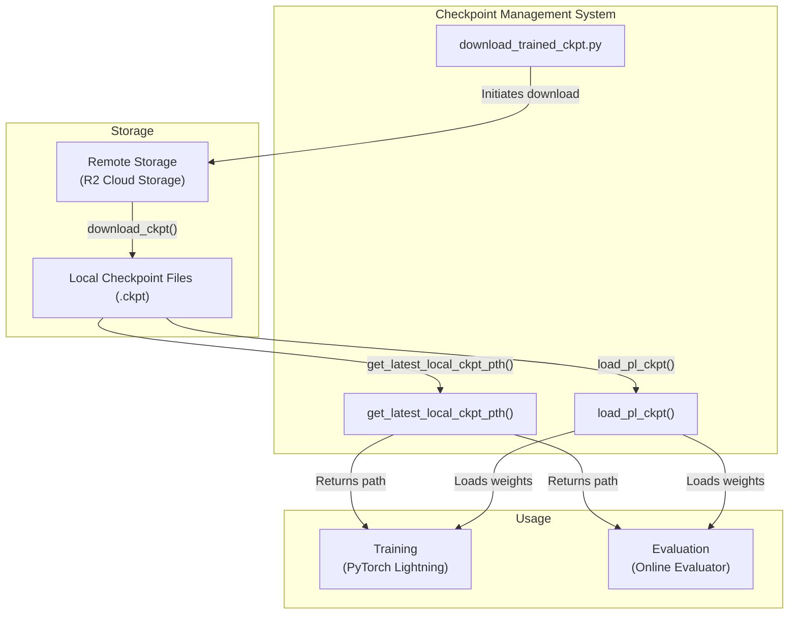
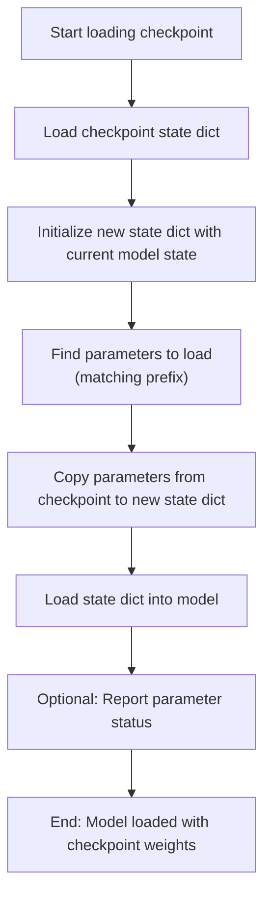
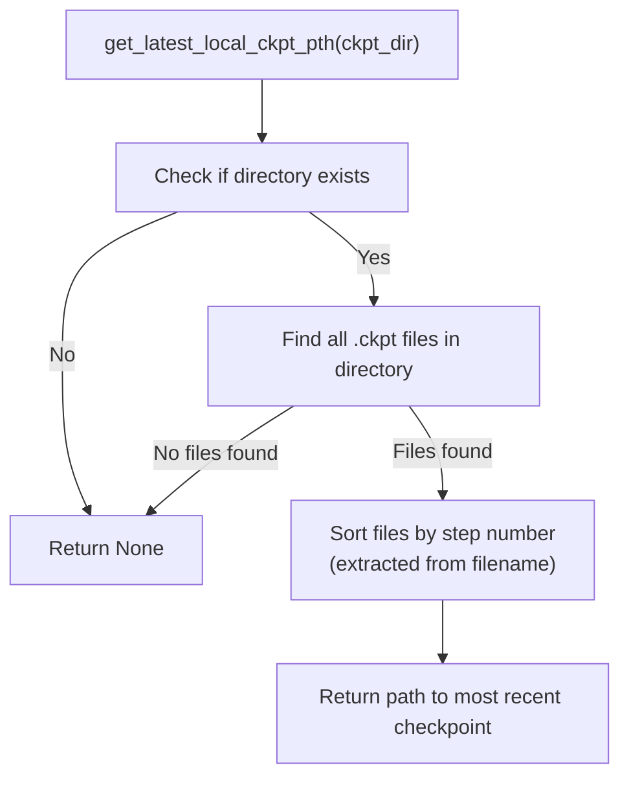
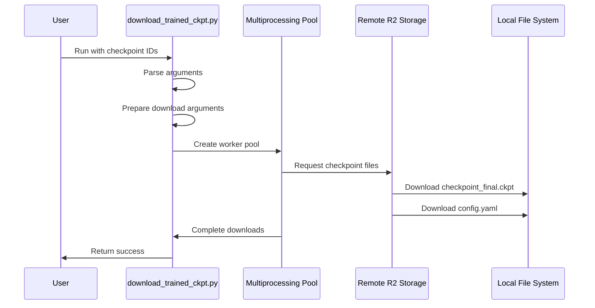
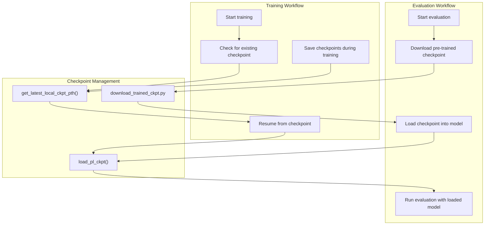

<!-- source: DeepWiki mcp.deepwiki.com · repo allenai/spoc-robot-training · page 7.2 Checkpoint Management · fetched 2026-10-26 -->

# Checkpoint Management

<details>
<summary>Relevant source files</summary>

The following files were used as context for generating this wiki page:

- [scripts/download_trained_ckpt.py](scripts/download_trained_ckpt.py)
- [training/offline/train_utils.py](training/offline/train_utils.py)

</details>


This document describes the checkpoint management system for the SPOC-Robot-Training codebase. The system provides utilities for loading, finding, and downloading model checkpoints, which is essential for both training continuation and evaluation of trained models. For information about logging systems that track training metrics, see [Logging Utilities](#7.1).

## Overview

The checkpoint management system consists of utilities for three main tasks:

1. Loading checkpoints into models for continued training or evaluation
2. Finding local checkpoints on disk to resume training
3. Downloading pre-trained checkpoints from remote storage



Sources: [training/offline/train_utils.py:1-61](), [scripts/download_trained_ckpt.py:1-74]()

## Loading Checkpoints

The `load_pl_ckpt()` function provides a flexible way to load PyTorch Lightning checkpoints into model objects. It handles parameter mapping, reports on parameter matching, and manages cases where checkpoint parameters might not perfectly match the model's architecture.



### Key Features

- **Prefix Handling**: Supports customizable state dictionary key prefixes for flexible loading
- **Verbose Reporting**: Can report parameters that were:
  - Found and loaded from the checkpoint
  - Present in the model but not in the checkpoint
  - Present in the checkpoint but not in the model
- **Selective Loading**: Only transfers parameters that exist in both the model and checkpoint

### Usage Example

```python
# Load a checkpoint into a model
load_pl_ckpt(
    model=my_model,
    ckpt_pth="path/to/checkpoint.ckpt",
    ckpt_prefix="model.",  # Default prefix in PyTorch Lightning
    verbose=True  # To see detailed parameter matching information
)
```

Sources: [training/offline/train_utils.py:6-48]()

## Finding Latest Checkpoints

When resuming training or selecting the most recent checkpoint for evaluation, the `get_latest_local_ckpt_pth()` function automatically identifies the most recent checkpoint in a directory.



### Sorting Logic

The function sorts checkpoint files based on the step number embedded in the filename format `epoch=X.ckpt` or similar, ensuring the most recent checkpoint (with the highest step number) is returned.

### Usage Example

```python
# Get the latest checkpoint from a directory
latest_ckpt = get_latest_local_ckpt_pth("/path/to/checkpoints/")
if latest_ckpt is not None:
    print(f"Found latest checkpoint: {latest_ckpt}")
    # Now you can load this checkpoint
    load_pl_ckpt(model, latest_ckpt)
```

Sources: [training/offline/train_utils.py:51-60]()

## Downloading Pre-trained Checkpoints

The `download_trained_ckpt.py` script facilitates downloading pre-trained model checkpoints from remote storage. This is particularly useful for evaluation or for initializing training with pre-trained weights.



### Available Checkpoints

The script maintains a list of pre-defined checkpoint IDs that can be downloaded:

| Checkpoint ID | Description |
|---------------|-------------|
| DINOv2-ViTs-3-CHORES-S | DINOv2 ViT-small model trained on CHORES dataset |
| SigLIP-ViTb-3-CHORES-L | SigLIP ViT-base model trained on large CHORES dataset |
| SigLIP-ViTb-3-CHORES-S | SigLIP ViT-base model trained on small CHORES dataset |
| SigLIP-ViTb-3-CHORESNav-L | SigLIP Navigation model trained on large dataset |
| SigLIP-ViTb-3-CHORESNav-S | SigLIP Navigation model trained on small dataset |
| SigLIP-ViTb-3-double-det-CHORES-L | SigLIP model with double detection on large dataset |
| SigLIP-ViTb-3-double-det-CHORES-S | SigLIP model with double detection on small dataset |

### Usage

The script can be run from the command line with the following options:

```bash
python scripts/download_trained_ckpt.py --save_dir /path/to/save --ckpt_ids SigLIP-ViTb-3-CHORES-S --num 2
```

Options:
- `--save_dir`: Directory to save the checkpoints (required)
- `--ckpt_ids`: List of checkpoint IDs to download (optional, downloads all if not specified)
- `--num` or `-n`: Number of parallel downloads (default: 1)

### Downloaded Files

For each checkpoint, the script downloads:
1. `checkpoint_final.ckpt`: The model weights file
2. `config.yaml`: Configuration file containing model and training parameters

Sources: [scripts/download_trained_ckpt.py:1-74]()

## Integration with Training and Evaluation

The checkpoint management system integrates with both the training and evaluation workflows in the SPOC-Robot-Training system.



Sources: [training/offline/train_utils.py:1-61](), [scripts/download_trained_ckpt.py:1-74]()

## Best Practices

When working with checkpoints in the SPOC-Robot-Training system, consider the following best practices:

1. **Regular Checkpointing**: Configure PyTorch Lightning to save checkpoints at regular intervals during training

2. **Version Control**: Keep track of which checkpoint versions correspond to which experiment configurations

3. **Checkpoint Selection**: When downloading pre-trained checkpoints, select the appropriate model based on your task requirements (navigation vs. manipulation)

4. **Parameter Verification**: Use the verbose option in `load_pl_ckpt()` when loading checkpoints into custom or modified models to ensure parameter compatibility

5. **Consistent Naming**: Maintain consistent checkpoint naming conventions to enable automatic latest checkpoint detection

Sources: [training/offline/train_utils.py:1-61](), [scripts/download_trained_ckpt.py:1-74]()

---

