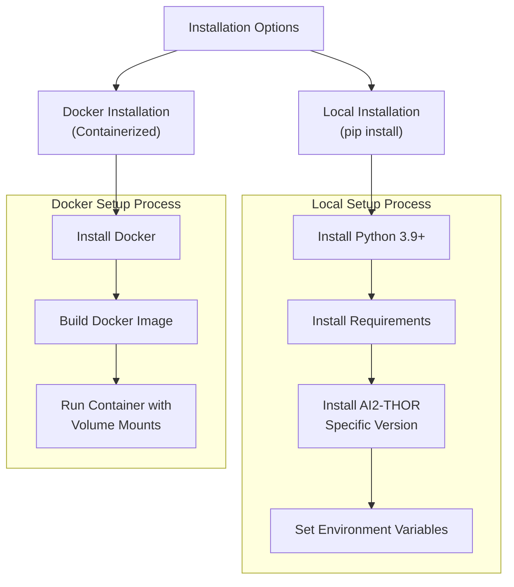
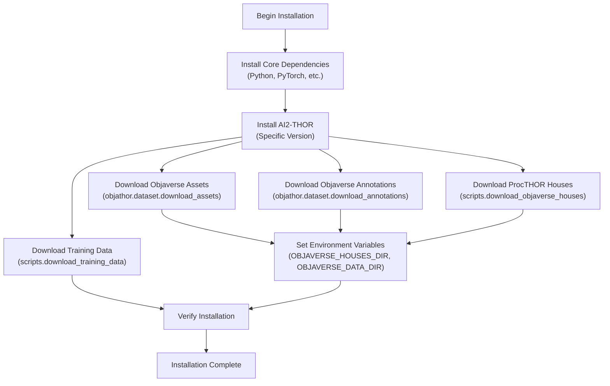

<!-- source: DeepWiki mcp.deepwiki.com · repo allenai/spoc-robot-training · page 8 Setup and Installation · fetched 2026-10-26 -->

# Setup and Installation

<details>
<summary>Relevant source files</summary>

The following files were used as context for generating this wiki page:

- [README.md](README.md)
- [docker/requirements.txt](docker/requirements.txt)
- [how_to_use_data.ipynb](how_to_use_data.ipynb)
- [spoc-robot-training/__init__.py](spoc-robot-training/__init__.py)

</details>


## Purpose and Scope

This document provides comprehensive instructions for setting up and installing the SPOC (Simulation for Navigation and Manipulation) system. It covers both local installation and Docker-based setup, along with the configuration of necessary environment variables and downloading required datasets for training and evaluation.

For information about running training after installation, see [Training Pipeline](#3).
For information about running evaluations after installation, see [Evaluation System](#4).

## Installation Methods Overview

### System Requirements

- Python 3.9 or higher (as indicated by the repository badge)
- CUDA-compatible GPU (recommended for training and efficient inference)
- Sufficient disk space for datasets and model checkpoints

### Installation Options

SPOC supports two installation methods: direct local installation or using Docker containers.

Installation Methods Diagram


Sources: [README.md:10-21]()

## Local Installation

Follow these steps to install SPOC directly on your system:

1. Ensure Python 3.9+ is installed on your system
2. Clone the repository:
   ```bash
   git clone https://github.com/allenai/spoc-robot-training.git
   cd spoc-robot-training
   ```

3. Install the required Python packages:
   ```bash
   pip install -r requirements.txt
   ```

4. Install the specific version of AI2-THOR:
   ```bash
   pip install --extra-index-url https://ai2thor-pypi.allenai.org ai2thor==0+5d0ab8ab8760eb584c5ae659c2b2b951cab23246
   ```

Sources: [README.md:12-17]()

## Docker Installation

Using Docker provides a more consistent environment across different systems:

1. Ensure Docker is installed on your system
2. Navigate to the Docker directory in the repository:
   ```bash
   cd docker
   ```

3. Follow the instructions in the Docker README to build and run the container

Sources: [README.md:19-21]()

## Dependency Architecture

The SPOC system relies on several key dependencies that are installed during the setup process, as defined in the requirements files:

Dependencies Diagram
```mermaid
classDiagram
    class "Core Dependencies" {
        +Python 3.9+
        +PyTorch 2.0.1
        +torchvision
        +AI2-THOR (specific version)
    }
    
    class "Machine Learning Stack" {
        +Lightning
        +xformers
        +allenact 0.5.4
        +CLIP
        +transformers
    }
    
    class "Utility Libraries" {
        +wandb
        +opencv-python
        +h5py
        +objathor
        +numpy
        +matplotlib
    }
    
    class "Data Processing Tools" {
        +trimesh
        +objaverse
        +compress_pickle
        +compress_json
        +h5py
    }
    
    "Core Dependencies" --> "Machine Learning Stack": enables
    "Core Dependencies" --> "Utility Libraries": supports
    "Core Dependencies" --> "Data Processing Tools": powers
```

Sources: [docker/requirements.txt:1-82]()

## Downloading Required Data

After installation, you'll need to download several datasets to train and evaluate models.

### Data Components Relationship

Data Flow Diagram
```mermaid
flowchart TD
    subgraph "Data Components"
        ObjAssets["Objaverse Assets\nscripts.download_assets"]
        ObjAnnotations["Objaverse Annotations\nscripts.download_annotations"]
        ProcHouses["ProcTHOR Houses\nscripts.download_objaverse_houses"]
        TrainData["Training Data\nscripts.download_training_data"]
    end
    
    subgraph "Environment Configuration"
        EnvVars["Environment Variables\nOBJAVERSE_HOUSES_DIR\nOBJAVERSE_DATA_DIR"]
    end
    
    TrainingProcess["Training Process\ntrain_pl.py"]
    EvalProcess["Evaluation Process\nonline_evaluator.py"]
    
    ObjAssets --> EnvVars
    ObjAnnotations --> EnvVars
    ProcHouses --> EnvVars
    
    EnvVars --> EvalProcess
    TrainData --> TrainingProcess
    
    EvalProcess --> ObjAssets: uses
    EvalProcess --> ObjAnnotations: uses
    EvalProcess --> ProcHouses: uses
```

Sources: [README.md:108-164]()

### Objaverse Assets and Annotations

To download the optimized Objaverse assets and annotations:

```bash
python -m objathor.dataset.download_annotations --version 2023_07_28 --path /path/to/objaverse_assets
python -m objathor.dataset.download_assets --version 2023_07_28 --path /path/to/objaverse_assets
```

This will create the following directory structure:
```
/path/to/objaverse_assets
    2023_07_28
        annotations.json.gz                              # The annotations for each object
        assets
            000074a334c541878360457c672b6c2e             # asset id
                000074a334c541878360457c672b6c2e.pkl.gz
                albedo.jpg
                emission.jpg
                normal.jpg
                thor_metadata.json
            ... #  39663 more asset directories
```

Sources: [README.md:125-144]()

### ProcTHOR-Objaverse Houses

To download the ProcTHOR-Objaverse houses:

```bash
python -m scripts.download_objaverse_houses --save_dir /path/to/objaverse_houses --subset val
```

You can replace `val` with `train` to download the training set of houses. This will save the houses as `/path/to/objaverse_houses/val.jsonl.gz`.

Sources: [README.md:146-151]()

### Training Data

To download the training data:

```bash
python -m scripts.download_training_data --save_dir /your/local/save/dir --types fifteen
```

You can replace `fifteen` with `all` to download all object types training data. By default, you will download data for all 10 task types (ObjectNav, Pickup, Fetch, etc); if you'd only like to download data for a subset of task types, use the `--task_types` flag.

Sources: [README.md:25-33]()

#### Dataset Structure

Once downloaded, the training data will have the following directory structure:

```
/your/local/save/dir/<fifteen OR all>_type
    <TASK_TYPE>
        house_id_to_sub_house_id_train.json # Mapping needed for train data loading
        house_id_to_sub_house_id_val.json   # Mapping needed for val data loading
        train
            <HOUSEID>
                hdf5_sensors.hdf5 -- containing all the sensors that are not videos
                    <EPISODE_NUMBER>
                        <SENSOR_NAME>
                raw_navigation_camera__<EPISODE_NUMBER>.mp4
                raw_manipulation_camera__<EPISODE_NUMBER>.mp4
        val
            # Same structure as train
```

The dataset includes various sensors data stored in HDF5 format and camera recordings as MP4 files.

Sources: [README.md:35-52]()

## Setting Up Environment Variables

For the SPOC system to function correctly, particularly during evaluation, you'll need to set specific environment variables:

```bash
# Path to the directory containing the ProcTHOR-Objaverse houses
export OBJAVERSE_HOUSES_DIR=/path/to/objaverse_houses

# Path to the directory containing the Objaverse assets and annotations
export OBJAVERSE_DATA_DIR=/path/to/objaverse_assets
```

These environment variables should be set whenever you run evaluation scripts. For persistent configuration, add these lines to your `.bashrc` or `.bash_profile` file.

Sources: [README.md:154-160]()

## Sensor Data Overview

The training data contains several sensors, with the following definitions:

| Sensor Name | Definition |
|-------------|------------|
| `an_object_is_in_hand` | Indicates whether an object is currently being held in hand |
| `house_index` | Indicates the index of the house in the dataset |
| `hypothetical_task_success` | Indicates whether the task will be successful if the agent would have issued done at this step |
| `last_action_is_random` | Indicates if the most recent action taken was chosen randomly |
| `last_action_str` | A string representation of the last action performed |
| `last_action_success` | Indicates whether the last action performed was successful |
| `last_agent_location` | Indicates agent's location in the world coordinate frame |
| `manip_accurate_object_bbox` | Bounding box for target object in manipulation camera (first calculation method) |
| `manip_task_relevant_object_bbox` | Bounding box for target object in manipulation camera (second calculation method) |
| `minimum_l2_target_distance` | The minimum Euclidean (L2) distance to the target object or location |
| `minimum_visible_target_alignment` | Minimum degree to turn to center object in navigation camera frame (if visible) |
| `nav_accurate_object_bbox` | Bounding box for target object in navigation camera (first calculation method) |
| `nav_task_relevant_object_bbox` | Bounding box for target object in navigation camera (second calculation method) |
| `relative_arm_location_metadata` | Arm proprioceptive, relative location of arm in agent's coordinate frame |
| `room_current_seen` | Indicates whether this room has been seen before or not |
| `rooms_seen` | Count of rooms that have been visited by the agent |
| `templated_task_spec` | Dictionary of task information, used to generate natural language task description |
| `visible_target_4m_count` | Count of targets visible within a 4-meter radius or distance |

Sources: [README.md:54-78]()

## Action Space

The SPOC system uses the following discrete action space:

| Action Name | Key | Description |
|-------------|-----|-------------|
| **move_ahead** | `m` | Move the agent's base forward by 0.2 meters |
| **move_back** | `b` | Move the agent's base backward by 0.2 meters |
| **rotate_left** | `l` | Rotate the agent's base left by 30° |
| **rotate_right** | `r` | Rotate the agent's base right by 30° |
| **rotate_left_small** | `ls` | Rotate the agent's base left by 6° |
| **rotate_right_small** | `rs` | Rotate the agent's base right by 6° |
| **move_arm_up** | `yp` | Move the arm up by 0.1 meters |
| **move_arm_down** | `ym` | Move the arm down by 0.1 meters |
| **move_arm_out** | `zp` | Extend the arm outward by 0.1 meters |
| **move_arm_in** | `zm` | Retract the arm inward by 0.1 meters |
| **move_arm_up_small** | `yps` | Move the arm up by 0.02 meters |
| **move_arm_down_small** | `yms` | Move the arm down by 0.02 meters |
| **move_arm_out_small** | `zps` | Extend the arm outward by 0.02 meters |
| **move_arm_in_small** | `zms` | Retract the arm inward by 0.02 meters |
| **wrist_open** | `wp` | Rotate the wrist counterclockwise by 10° |
| **wrist_close** | `wm` | Rotate the wrist clockwise by 10° |
| **end** | `end` | Signal the end of a task |
| **sub_done** | `sub_done` | Mark a sub-task as complete |
| **pickup** | `p` | Initiate a grasp action to pick up an object |
| **dropoff** | `d` | Execute a release action to drop an object |

Sources: [README.md:79-102]()

## Installation Verification

After completing the installation, you can verify your setup by:

1. Ensuring all required packages are installed:
   ```bash
   pip list | grep -E 'torch|ai2thor|objathor|allenact'
   ```

2. Checking that environment variables are properly set:
   ```bash
   echo $OBJAVERSE_HOUSES_DIR
   echo $OBJAVERSE_DATA_DIR
   ```

3. Running a basic test (if available)

## Troubleshooting

### Common Issues

- **AI2-THOR Version Errors**: Ensure you've installed the exact version specified in the README
- **Environment Variable Issues**: Verify that the environment variables are correctly set
- **CUDA Compatibility Problems**: Check that your PyTorch installation is compatible with your CUDA version
- **Disk Space Issues**: Downloading all assets, houses, and training data requires significant disk space

### Installation Process Flowchart

Complete Installation Flowchart


Sources: [README.md:10-102]()