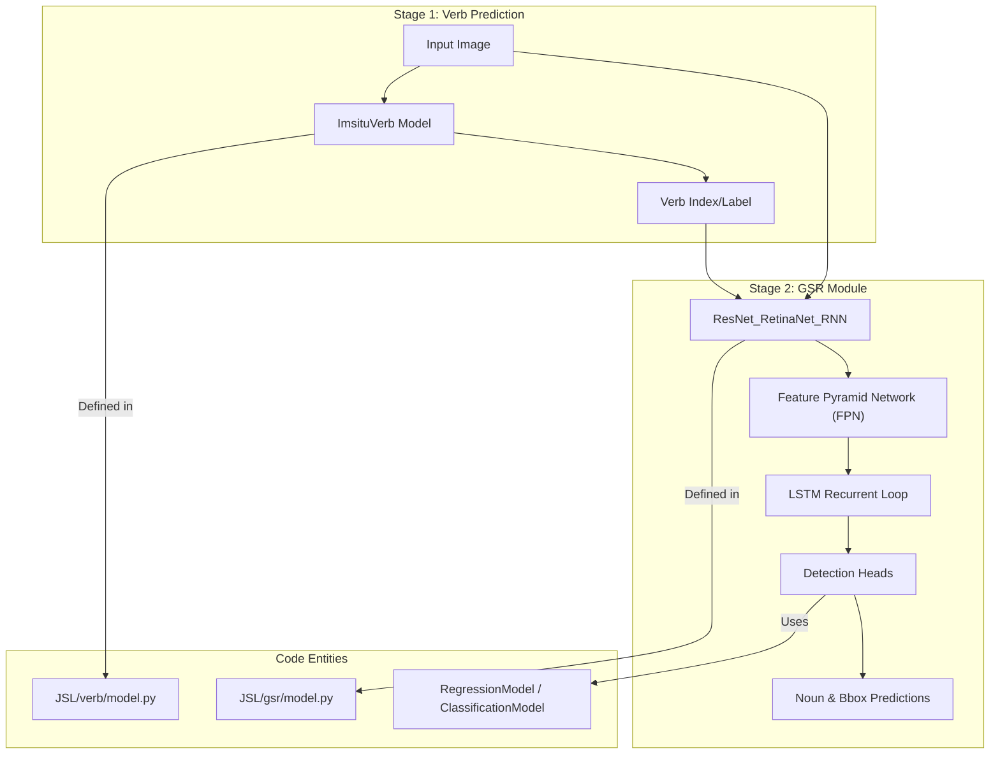
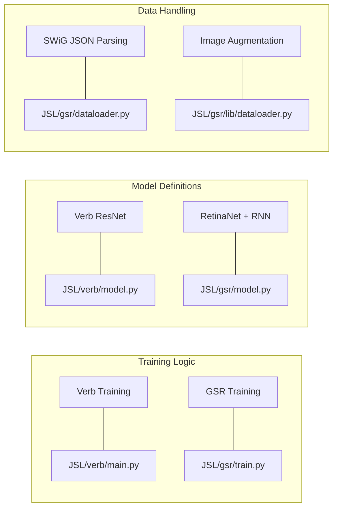

<!-- source: DeepWiki mcp.deepwiki.com · repo allenai/swig · page 1 Overview · fetched 2026-10-26 -->

# Overview

Relevant source files

The following files were used as context for generating this wiki page:

- [LICENSE](LICENSE)
- [README.md](README.md)
- [images/banner.png](images/banner.png)

The **SWiG/JSL** repository provides the implementation for the **Joint Situation Localizer (JSL)**, a model designed for the **Grounded Situation Recognition (GSR)** task. GSR extends activity recognition by not only identifying the primary action (verb) in an image but also identifying and localizing all entities (nouns) that fulfill semantic roles associated with that action.

## Grounded Situation Recognition (GSR)

GSR is a structured vision-language task where the system must predict a "situation" represented by a verb and a corresponding semantic frame. 

*   **Verb**: One of 504 visually groundable actions (e.g., "kneading", "hitchhiking"). [README.md:36-39]()
*   **Frame**: A set of 1 to 6 semantic roles (e.g., "Agent", "Item", "Place") defined by the verb's ontology. [README.md:41-44]()
*   **Groundings**: Bounding box coordinates `[x1, y1, x2, y2]` for each entity filling a role. If an entity is not visible or occluded, it is marked as not grounded. [README.md:51-53]()

The system utilizes the **SWiG (Situations With Groundings)** dataset, which augments the imSitu dataset with object bounding boxes. [README.md:3-6]()

## System Architecture

The JSL system is implemented as a two-stage pipeline. The first stage classifies the verb, and the second stage predicts the nouns and their locations based on that verb.

### High-Level Component Interaction

The following diagram illustrates how the system components interact, mapping high-level tasks to specific code entities.

**JSL Execution Flow**

Sources: [README.md:124-126](), [JSL/inference.py:113-115]()

## Key Components

### 1. Verb Classifier
The verb classifier uses a ResNet-50 backbone to predict the most likely action occurring in the image. This stage is decoupled from the grounding stage to allow for flexible updates to either model.
*   **Primary Class**: `ImsituVerb`
*   **For details, see [Verb Classifier](#2.1)**

### 2. GSR Module (RetinaNet-RNN)
The core of JSL is a modified RetinaNet architecture that uses an RNN (LSTM) to sequentially predict nouns and bounding boxes for each role in the verb's frame. It utilizes a Feature Pyramid Network (FPN) for multi-scale object detection.
*   **Primary Class**: `ResNet_RetinaNet_RNN`
*   **For details, see [JSL Model Architecture](#2)**

### 3. Data Pipeline
The system processes the SWiG JSON annotations into structured tensors. It handles the mapping between WordNet synsets (nouns) and the visual roles defined in `imsitu_space.json`.
*   **Key Classes**: `CSVDataset`, `imSituDatasetGood`, `Resizer`, `Collater`
*   **For details, see [Data Pipeline](#4)**

### 4. Inference and Evaluation
The inference engine runs the two stages sequentially and outputs a `results.json` file. Evaluation is performed using the `BboxEval` utility, which calculates accuracy for verbs, nouns (values), and bounding box overlaps (IoU).
*   **For details, see [Inference Pipeline](#5) and [Evaluation and Metrics](#6)**

## Codebase Navigation

The repository is organized into functional subdirectories:

| Directory | Description |
| :--- | :--- |
| `JSL/verb/` | Code for training and defining the Stage 1 verb classifier. [README.md:128-131]() |
| `JSL/gsr/` | Code for the Stage 2 RetinaNet-RNN model and training loop. [README.md:134-135]() |
| `global_utils/` | Shared utilities for bounding box transformations, ResNet blocks, and experiment logging. [README.md:134]() |
| `SWiG_jsons/` | Contains `train.json`, `test.json`, `dev.json`, and the `imsitu_space.json` ontology. [README.md:99]() |

### Code Entity Mapping
The following diagram bridges the conceptual tasks to the specific file structure and classes.

**Component to File Mapping**

Sources: [README.md:128-136]()

## Wiki Navigation

*   **[Getting Started](#1.1)**: Instructions for environment setup, downloading the SWiG dataset, and running your first inference.
*   **[Task and Dataset: SWiG](#1.2)**: Deep dive into the Grounded Situation Recognition task and the format of the SWiG annotations.
*   **[JSL Model Architecture](#2)**: Detailed technical breakdown of the verb classifier and the recurrent RetinaNet-RNN.
*   **[Training Pipeline](#3)**: Explanation of the training loops, optimizers, and the multi-component loss functions.
*   **[Data Pipeline](#4)**: How images and JSON metadata are transformed into model-ready batches.
*   **[Inference Pipeline](#5)**: Walkthrough of the end-to-end prediction process and feature extraction.
*   **[Evaluation and Metrics](#6)**: How the model is benchmarked against the SWiG dataset.

Sources: [README.md:1-126]()

---

