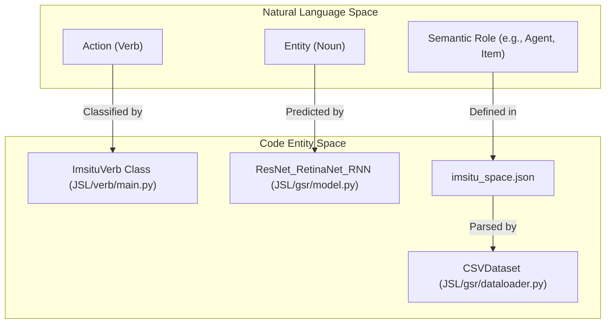
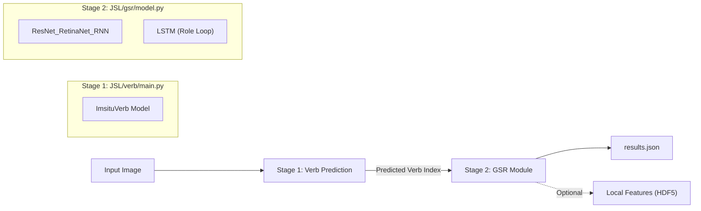

<!-- source: DeepWiki mcp.deepwiki.com · repo allenai/swig · page 1.1 Getting Started · fetched 2026-10-26 -->

# Getting Started

<details>
<summary>Relevant source files</summary>

The following files were used as context for generating this wiki page:

- [.gitignore](.gitignore)
- [README.md](README.md)
- [all_ims.txt](all_ims.txt)
- [requirements.txt](requirements.txt)

</details>


The Situation With Groundings (SWiG) codebase provides a comprehensive framework for solving the **Grounded Situation Recognition (GSR)** task. This task involves identifying a primary action (verb) in an image, recognizing the semantic entities (nouns) involved in roles specific to that action, and localizing those entities with bounding boxes [README.md:1-6]().

The core of the system is the **Joint Situation Localizer (JSL)**, a two-stage model architecture that separates verb classification from noun and grounding prediction [README.md:123-126]().

## Environment Setup

The project requires Python 3 and several scientific computing libraries.

1.  **Clone the Repository**:
    ```bash
    git clone git@github.com:allenai/swig.git
    cd swig
    ```
    [README.md:19-20]()

2.  **Environment Configuration**:
    It is recommended to use a virtual environment to manage dependencies such as `torch` (v1.4.0), `torchvision` (v0.5.0), and `tensorboardX` [README.md:21-24](), [requirements.txt:18-20]().
    ```bash
    python3 -m venv my_venv
    source my_venv/bin/activate
    pip install -r requirements.txt
    ```

## Directory Layout

The repository is organized into specific modules for the two-stage pipeline and shared utilities.

| Directory | Purpose |
| :--- | :--- |
| `SWiG_jsons/` | Contains the dataset annotations (`train.json`, `dev.json`, `test.json`) and the `imsitu_space.json` ontology [README.md:99-102](). |
| `JSL/` | The root directory for the Joint Situation Localizer code. |
| `JSL/verb/` | Logic for Stage 1: Verb classification, including the `ImsituVerb` model and its training loop [README.md:128-131](). |
| `JSL/gsr/` | Logic for Stage 2: Noun prediction and bounding box localization using a RetinaNet-RNN architecture [README.md:134-137](). |
| `global_utils/` | Shared utilities for bounding box transformations (`BBoxTransform`), ResNet building blocks, and learning rate schedulers [README.md:134-135](). |

## System Architecture and Data Flow

The JSL model processes images through a sequential pipeline. The output of the Verb Classifier determines the semantic frame (roles) that the GSR module must then ground.

### Data Entity Mapping: Natural Language to Code
This diagram maps the conceptual GSR task components to their specific implementations in the codebase.


**Sources:** [README.md:34-48](), [README.md:73-85](), [README.md:128-137]()

### End-to-End Inference Flow
The inference process flows from an image input to a structured `results.json` output.


**Sources:** [README.md:104-120](), [README.md:123-126]()

## Running the Pipeline

### 1. Dataset Preparation
Download the images and place them in the project structure. The annotations are provided in `SWiG_jsons/` [README.md:29-30]().
*   **Images**: [images_512.zip](https://swig-data-weights.s3.us-east-2.amazonaws.com/images_512.zip)
*   **Weights**: [weights.zip](https://swig-data-weights.s3.us-east-2.amazonaws.com/weights.zip)

### 2. Inference
To run the full JSL pipeline on custom images, use `inference.py`. You must provide paths to both the verb weights and the GSR weights [README.md:106-113]().

```bash
python ./JSL/inference.py \
    --verb-path ./path/to/verb/weights \
    --jsl-path ./path/to/detection/weights \
    --image-file ./path/to/images.txt \
    --batch-size 8
```
The `--store-features` flag can be used to export local ResNet features for each grounded object to an HDF5 file [README.md:116-117]().

### 3. Training
Training is decoupled into two phases:

#### Phase A: Verb Classifier
Trains the `ImsituVerb` model (ResNet-50 backbone) to predict one of 504 visually groundable verbs [README.md:37-39](), [README.md:128-131]().
```bash
python ./JSL/verb/main.py
```

#### Phase B: GSR Module
Trains the `ResNet_RetinaNet_RNN` to predict nouns and bounding boxes. This requires specifying the SWiG annotation files and a class list [README.md:134-137]().
```bash
python ./JSL/gsr/train.py \
    --train-file ./SWiG_jsons/train.json \
    --val-file ./SWiG_jsons/dev.json \
    --class-file ./train_classes.csv
```

**Sources:** [README.md:104-137](), [requirements.txt:1-20]()

---

