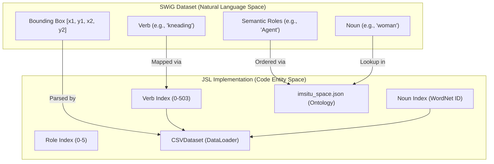
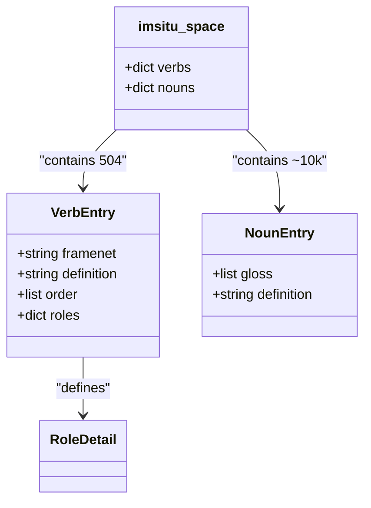

<!-- source: DeepWiki mcp.deepwiki.com · repo allenai/swig · page 1.2 Task and Dataset: SWiG · fetched 2026-10-26 -->

# Task and Dataset: SWiG

<details>
<summary>Relevant source files</summary>

The following files were used as context for generating this wiki page:

- [README.md](README.md)
- [SWiG_jsons/dev.json](SWiG_jsons/dev.json)
- [SWiG_jsons/imsitu_space.json](SWiG_jsons/imsitu_space.json)
- [SWiG_jsons/test.json](SWiG_jsons/test.json)
- [SWiG_jsons/train.json](SWiG_jsons/train.json)

</details>


This page provides a technical deep dive into the **Situation With Groundings (SWiG)** dataset and the **Grounded Situation Recognition (GSR)** task. It covers the semantic ontology defined in `imsitu_space.json`, the structure of the JSON annotations, and how these entities are represented within the codebase.

## Grounded Situation Recognition (GSR)

The GSR task extends traditional image classification and object detection by requiring a model to identify a primary activity (Verb), the entities involved in that activity (Semantic Roles), and their locations in the image (Grounding).

### Task Components
1.  **Verb Prediction**: Identifying one of 504 visually groundable verbs [README.md:36-39]().
2.  **Semantic Role Labeling**: Filling a "frame" of 1 to 6 roles (e.g., Agent, Item, Place) with specific nouns [README.md:41-44]().
3.  **Grounding**: Providing bounding box coordinates `[x1, y1, x2, y2]` for each noun in the frame [README.md:51-53]().

### Data Flow: From Dataset to Model
The following diagram illustrates how the natural language concepts in the SWiG dataset are mapped to code entities and data structures used by the `JSL` model.

**Natural Language to Code Entity Mapping**

**Sources:** [README.md:34-71](), [SWiG_jsons/imsitu_space.json:1-10]()

---

## SWiG Dataset Structure

The dataset is distributed as three primary JSON files: `train.json`, `dev.json`, and `test.json` [README.md:55-59]().

### Annotation Format
Each image entry in the JSON contains the following fields:
*   `verb`: The action depicted.
*   `height` / `width`: Original image dimensions.
*   `bb`: A dictionary mapping role names to a single set of grounding coordinates. `[-1, -1, -1, -1]` indicates no grounding (e.g., for abstract roles like "place" or occluded objects) [README.md:56-57]().
*   `frames`: A list of 3 dictionaries (representing 3 different annotators). Each dictionary maps roles to WordNet noun IDs [README.md:48-49]().

**Example Entry:**
```json
"hitchhiking_238.jpg": {
    "verb": "hitchhiking", 
    "height": 683, 
    "width": 512, 
    "bb": {"place": [-1, -1, -1, -1], "agent": [195, 282, 380, 554]}, 
    "frames": [{"place": "n03519981", "agent": "n10287213"}, ...]
}
```
**Sources:** [README.md:62-71](), [SWiG_jsons/dev.json:1-5]()

---

## The imsitu_space.json Ontology

The `imsitu_space.json` file serves as the global registry for the GSR task. It contains two primary indices: `verbs` and `nouns` [README.md:73-85]().

### 1. Verbs Index
For every verb, the ontology defines:
*   **Order**: A fixed list determining the sequence of roles. This is critical for the `RetinaNet-RNN` model, which predicts roles in this specific order [README.md:84-92]().
*   **Roles**: Definitions and FrameNet mappings for each role associated with the verb.
*   **Abstract**: A sentence template (e.g., "the AGENT drinks a LIQUID...").

### 2. Nouns Index
Maps WordNet IDs (e.g., `n10787470`) to:
*   **Gloss**: English synonyms (e.g., `["woman", "adult female"]`).
*   **Def**: A dictionary definition [README.md:77-81]().

**Ontology Relationship Diagram**

**Sources:** [README.md:73-98](), [SWiG_jsons/imsitu_space.json:1-20]()

---

## Implementation Details

### Bounding Box Representation
In the raw JSON, coordinates are absolute pixels. During data loading in `CSVDataset`, these are often normalized or shifted based on image resizing [README.md:115-117](). A value of `-1` in the `bb` dictionary is used to mask loss calculations for roles that are not visually grounded.

### Verb-Role Constraints
The `order` field in `imsitu_space.json` is the source of truth for the `GSR` model's recurrent loop. Because different verbs have different numbers of roles (1 to 6), the model uses this order to align its LSTM hidden states with the correct semantic meaning [README.md:41-44](), [SWiG_jsons/imsitu_space.json:92]().

| Verb | Roles (Ordered) |
| :--- | :--- |
| `drinking` | `agent`, `liquid`, `container`, `place` |
| `hitchhiking`| `agent`, `place` |
| `raining` | `place` |

**Sources:** [README.md:88-98](), [SWiG_jsons/imsitu_space.json:1-15]()

---

