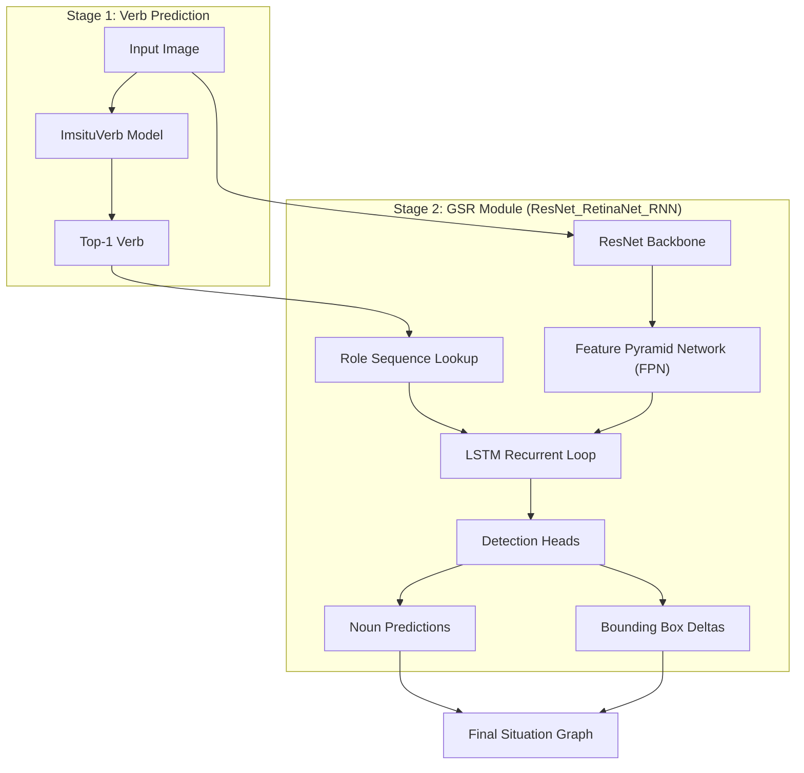
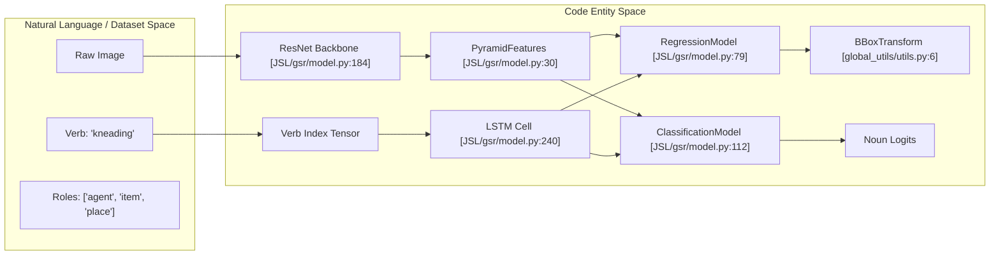

<!-- source: DeepWiki mcp.deepwiki.com · repo allenai/swig · page 2 JSL Model Architecture · fetched 2026-10-26 -->

# JSL Model Architecture

Relevant source files

The following files were used as context for generating this wiki page:

- [JSL/gsr/model.py](JSL/gsr/model.py)
- [README.md](README.md)

The Joint Situation Localizer (JSL) is a two-stage neural architecture designed to solve the Grounded Situation Recognition (GSR) task [README.md:4-6](). GSR requires a model to identify a primary action (verb), the entities involved in that action (nouns/roles), and the spatial location of those entities in the image (bounding boxes) [README.md:34-53]().

The JSL decomposes this task into two distinct modules:
1.  **Verb Classifier**: Predicts the most likely verb for a given image.
2.  **GSR Model**: A recurrent detection network that predicts nouns and bounding boxes for each role associated with the predicted verb.

### System Overview

The JSL architecture bridges the gap between image pixels and the semantic frame defined in the SWiG ontology. It utilizes a shared ResNet backbone strategy, though the two stages are trained independently to allow for modularity and flexibility [README.md:124-126]().

**Sources:** [README.md:34-53](), [JSL/gsr/model.py:184-210](), [JSL/verb/model.py:12-40]()

---

### Verb Classifier (Stage 1)

The first stage of the JSL pipeline is the **Verb Classifier**. This component is responsible for identifying the action occurring in the image from a set of 504 visually groundable verbs [README.md:37-39](). 

The model, implemented as `ImsituVerb`, typically uses a ResNet-50 backbone to extract global image features, followed by a linear layer that maps these features to the verb vocabulary [JSL/verb/model.py:12-40](). The predicted verb determines the "frame" (the specific set of roles like *Agent*, *Place*, or *Item*) that the second stage must then populate [README.md:41-47]().

For details on the verb model and its training, see **[Verb Classifier (#2.1)]()**.

**Sources:** [JSL/verb/model.py:12-40](), [README.md:36-40]()

---

### GSR Model: ResNet-RetinaNet-RNN (Stage 2)

The core of the JSL is the `ResNet_RetinaNet_RNN` class [JSL/gsr/model.py:184](). This module takes the image and the predicted verb as input to produce the final grounded frame.

#### Architectural Components:
*   **Feature Extraction**: Uses a ResNet backbone (e.g., ResNet-50 or ResNet-101) to generate multi-scale feature maps [JSL/gsr/model.py:184-210]().
*   **Pyramid Features**: A `PyramidFeatures` module implements a Feature Pyramid Network (FPN), generating levels P3 through P7 to handle objects of varying sizes [JSL/gsr/model.py:30-75]().
*   **Recurrent Processing**: An LSTM-based recurrent loop iterates through the roles required by the verb's frame (1 to 6 roles) [JSL/gsr/model.py:240-255](). At each step, it predicts the noun and the bounding box for a specific role.
*   **Detection Heads**: The model employs `RegressionModel` for anchor deltas [JSL/gsr/model.py:79-110]() and `ClassificationModel` for noun classification and a `bbox_exists` logit [JSL/gsr/model.py:112-160]().

For a deep dive into the recurrent detection logic, see **[GSR Model: ResNet-RetinaNet-RNN (#2.2)]()**.

**Sources:** [JSL/gsr/model.py:30-75](), [JSL/gsr/model.py:79-160](), [JSL/gsr/model.py:184-255]()

---

### Anchor Generation

To localize entities, the GSR model relies on a dense set of predefined bounding boxes called anchors. The `Anchors` module generates these across all levels of the Feature Pyramid [JSL/gsr/model.py:7]().

The anchors are defined by specific ratios and scales to ensure coverage of various object shapes. These anchors are then shifted across the image grid according to the stride of each pyramid level [global_utils/anchors.py](). The `RegressionModel` learns to predict offsets (deltas) from these anchors to the actual ground truth objects.

For details on the mathematical generation of anchors, see **[Anchor Generation (#2.3)]()**.

**Sources:** [JSL/gsr/model.py:7](), [JSL/gsr/model.py:108-109]()

---

### Data Flow: From Pixels to Code Entities

The following diagram illustrates how raw image data is transformed into the internal code representations used by the JSL architecture.

**Sources:** [JSL/gsr/model.py:30-160](), [JSL/gsr/model.py:184-255](), [global_utils/utils.py:6]()

---

