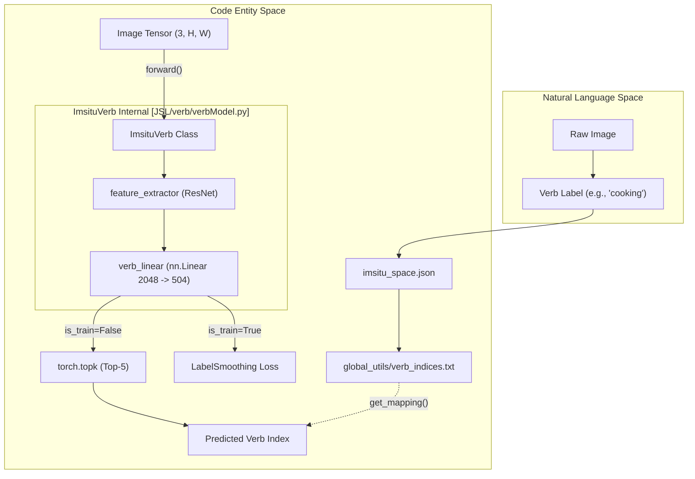
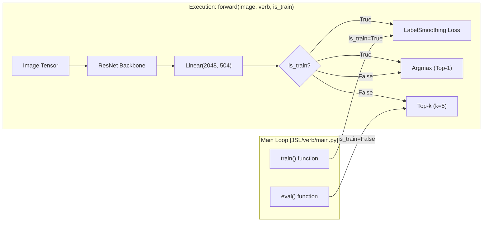

<!-- source: DeepWiki mcp.deepwiki.com · repo allenai/swig · page 2.1 Verb Classifier · fetched 2026-10-26 -->

# Verb Classifier

Relevant source files

The following files were used as context for generating this wiki page:

- [JSL/verb/main.py](JSL/verb/main.py)
- [JSL/verb/resnet50.py](JSL/verb/resnet50.py)
- [JSL/verb/verbModel.py](JSL/verb/verbModel.py)
- [global_utils/verb_indices.txt](global_utils/verb_indices.txt)

The **Verb Classifier** is the first stage of the Joint Situation Localizer (JSL) pipeline. Its primary objective is to predict the main action (verb) occurring in an image from a fixed vocabulary of 504 verbs defined in the SWiG dataset. This prediction serves as a conditioning signal for the subsequent Grounded Situation Recognition (GSR) module, which identifies roles and localizes entities based on the predicted verb's frame.

## Architectural Overview

The verb classification sub-system is encapsulated in the `ImsituVerb` class [JSL/verb/verbModel.py:33-41](). It utilizes a ResNet-50 backbone to extract global image features, followed by a linear layer that maps these features to the verb space.

### Data Flow: Image to Verb Prediction

The following diagram illustrates the transformation of input image data into a verb index through the code entities of the `verb` sub-package.

**Diagram: Verb Classification Data Flow**

**Sources:** [JSL/verb/verbModel.py:33-53](), [JSL/verb/main.py:37-38](), [JSL/verb/main.py:129-139]()

---

## Model Components

### ResNet-50 Backbone
The `ImsituVerb` model uses a customized ResNet-50 architecture defined in `JSL/verb/resnet50.py`. 
- **Pre-trained Weights:** The model initializes its backbone using weights from the official PyTorch ResNet-50 model [JSL/verb/verbModel.py:38-39]().
- **Adaptive Pooling:** The standard fully connected layer of ResNet is replaced with an `AdaptiveAvgPool2d` layer that produces a 2048-dimensional feature vector regardless of input resolution [JSL/verb/resnet50.py:103-105]().
- **Layer Freezing Logic:** During training, different stages of the ResNet backbone are detached (frozen) based on the `epoch_num` to stabilize early training phases [JSL/verb/resnet50.py:152-168]().

### Verb Linear Layer
The final classification head is a simple linear transformation:
- **Input:** 2048 (ResNet-50 output features).
- **Output:** 504 (Total number of verbs in the SWiG ontology).
- **Location:** [JSL/verb/verbModel.py:40]()

### Label Smoothing Loss
To improve generalization and prevent the model from becoming over-confident, the system implements a `LabelSmoothing` module [JSL/verb/verbModel.py:11-30]().
- **Formula:** It combines Negative Log Likelihood (NLL) loss with a distribution-based smoothing factor.
- **Confidence:** Set to 0.8 (smoothing factor of 0.2) [JSL/verb/verbModel.py:41]().
- **Implementation:** Uses `log_softmax` and `gather` to calculate the loss against the target index [JSL/verb/verbModel.py:25-29]().

---

## Verb Vocabulary and Mapping

The system relies on a static mapping between verb strings and integer indices. This mapping is loaded from a text file during initialization.

| Component | Description | File Reference |
| :--- | :--- | :--- |
| **Vocabulary File** | A list of 504 verbs (e.g., educating, putting, cooking). | [global_utils/verb_indices.txt:1-504]() |
| **Mapping Function** | `get_mapping()` reads the file and returns `verb_to_idx` and `idx_to_verb`. | [JSL/verb/main.py:129-139]() |
| **Index Usage** | Predicted indices are converted back to strings for `top_5_verbs.json` output. | [JSL/verb/main.py:116-121]() |

---

## Training and Evaluation Logic

The `ImsituVerb` model's `forward` method behaves differently depending on the `is_train` flag [JSL/verb/verbModel.py:44-52]().

**Diagram: Model Execution Modes**

**Sources:** [JSL/verb/verbModel.py:44-52](), [JSL/verb/main.py:74-100](), [JSL/verb/main.py:102-126]()

### Key Functions
- **`train(model, data_loader, ...)`**: Executes the training pass, calculates the mean loss, and logs accuracy to TensorBoard via `writer.add_scalar` [JSL/verb/main.py:74-100]().
- **`eval(model, data_loader, ...)`**: Runs inference on the validation set, calculates Top-1 accuracy, and exports the Top-5 predicted verbs for every image into a JSON file named `top_5_verbs.json` [JSL/verb/main.py:102-126]().
- **Checkpointing**: The `save_checkpoint` utility serializes the `state_dict` of both the model and the optimizer to `.pth.tar` files [JSL/verb/main.py:190-194]().

**Sources:**
- `JSL/verb/verbModel.py`
- `JSL/verb/resnet50.py`
- `JSL/verb/main.py`
- `global_utils/verb_indices.txt`

---

