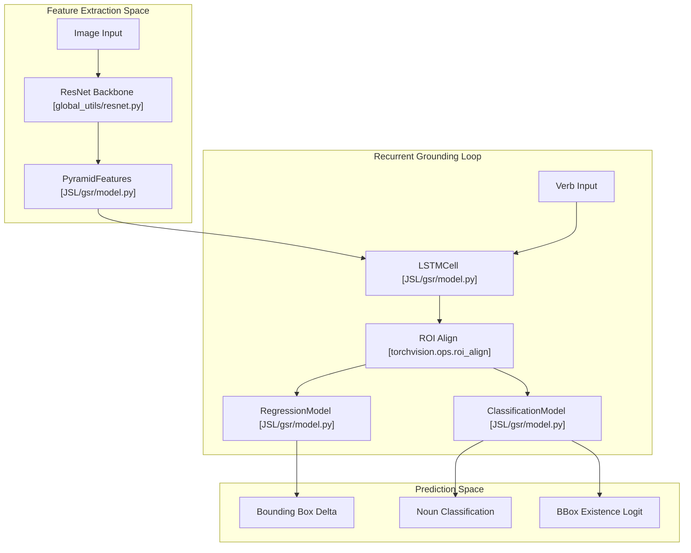
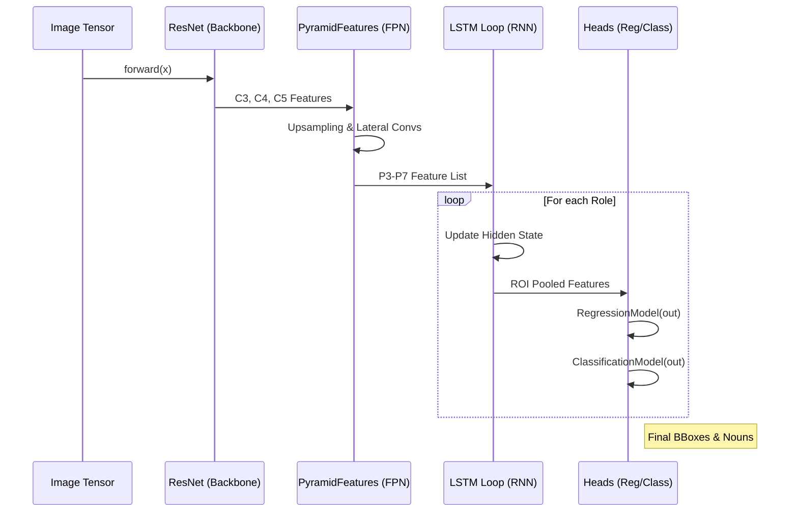

<!-- source: DeepWiki mcp.deepwiki.com · repo allenai/swig · page 2.2 GSR Model: ResNet-RetinaNet-RNN · fetched 2026-10-26 -->

# GSR Model: ResNet-RetinaNet-RNN

Relevant source files

The following files were used as context for generating this wiki page:

- [JSL/gsr/model.py](JSL/gsr/model.py)
- [global_utils/resnet.py](global_utils/resnet.py)
- [global_utils/utils.py](global_utils/utils.py)

The Grounded Situation Recognition (GSR) module is a multi-stage neural network designed to predict the semantic structure of an image based on a given verb. It implements the `ResNet_RetinaNet_RNN` class, which combines a ResNet backbone, a Feature Pyramid Network (FPN), a recurrent LSTM loop for role-based reasoning, and specialized detection heads for bounding box regression and noun classification [JSL/gsr/model.py:184-188]().

## Architecture Overview

The model follows a two-stage approach within the GSR module:
1.  **Feature Extraction**: A ResNet backbone and FPN generate multi-scale feature maps.
2.  **Recurrent Grounding**: An LSTM iterates through the semantic roles associated with a verb, using ROI Align to extract local features for bounding box and noun prediction at each step.

### System Mapping: Data Flow and Code Entities

The following diagram maps the conceptual components of the GSR model to their specific implementations in the codebase.

**Diagram: GSR Architecture to Code Entity Mapping**

**Sources:** [JSL/gsr/model.py:30-160](), [JSL/gsr/model.py:184-210](), [global_utils/resnet.py:87-102]()

---

## Component Details

### 1. Feature Pyramid Network (FPN)
The `PyramidFeatures` class implements the FPN architecture to handle scale variance. It takes feature maps from the ResNet backbone (C3, C4, C5) and produces five pyramid levels (P3 to P7) [JSL/gsr/model.py:30-55]().

*   **P3, P4, P5**: Generated via lateral connections (1x1 conv) and top-down upsampling [JSL/gsr/model.py:57-69]().
*   **P6**: Obtained via a 3x3 stride-2 convolution on C5 [JSL/gsr/model.py:70]().
*   **P7**: Computed by applying ReLU and a 3x3 stride-2 convolution on P6 [JSL/gsr/model.py:72-73]().

**Sources:** [JSL/gsr/model.py:30-75]()

### 2. Recurrent LSTM Loop
The model uses a recurrent structure to predict values for each role defined by the verb. 
*   **Initialization**: The LSTM hidden state is initialized using the verb embedding and global image features.
*   **Iteration**: For each role, the LSTM receives the previous hidden state and the current role's embedding.
*   **Role-Specific Prediction**: The output of the LSTM is used to attend to the FPN features and perform ROI Align to localize the specific entity filling that role.

**Sources:** [JSL/gsr/model.py:184-210]()

### 3. Detection and Classification Heads
The model employs two specialized heads that process the features extracted from the pyramid levels.

#### RegressionModel
Predicts the bounding box deltas $(dx, dy, dw, dh)$ relative to the anchors. It consists of four 3x3 convolutional layers followed by an output layer that generates `num_anchors * 4` channels [JSL/gsr/model.py:79-91](). The output is reshaped to $(Batch, Anchors, 4)$ [JSL/gsr/model.py:109]().

#### ClassificationModel
Handles two distinct tasks:
1.  **Noun Classification**: Predicts the noun category for the role across `num_classes` [JSL/gsr/model.py:153-159]().
2.  **BBox Existence**: A binary logit branch that determines if a bounding box should exist for the current role, implemented via `AdaptiveMaxPool2d` and a linear layer [JSL/gsr/model.py:148-149]().

**Sources:** [JSL/gsr/model.py:79-110](), [JSL/gsr/model.py:112-160]()

---

## Data Flow: From Image to Situation

The following diagram illustrates the transformation of data through the GSR model's internal classes.

**Diagram: Internal Data Flow**

**Sources:** [JSL/gsr/model.py:55-75](), [JSL/gsr/model.py:94-109](), [JSL/gsr/model.py:136-160](), [global_utils/resnet.py:140-159]()

---

## Supporting Utilities

### BBoxTransform and ClipBoxes
The `BBoxTransform` class decodes the regression deltas produced by the `RegressionModel` into actual pixel coordinates using anchor means and standard deviations [global_utils/utils.py:80-117](). The `ClipBoxes` utility ensures that the predicted coordinates remain within the image boundaries [global_utils/utils.py:120-135]().

### Label Smoothing
To improve generalization during noun prediction, the `LabelSmoothing` module implements NLL loss with a smoothing factor, redistributing probability mass from the ground truth to other classes [JSL/gsr/model.py:162-181]().

**Sources:** [global_utils/utils.py:80-135](), [JSL/gsr/model.py:162-181]()

---

