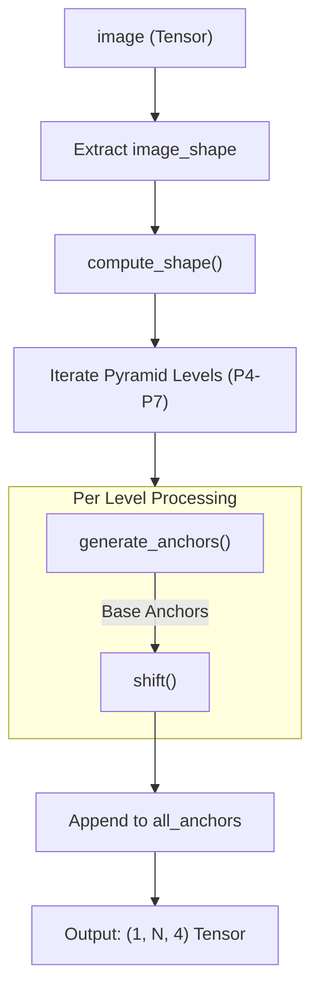
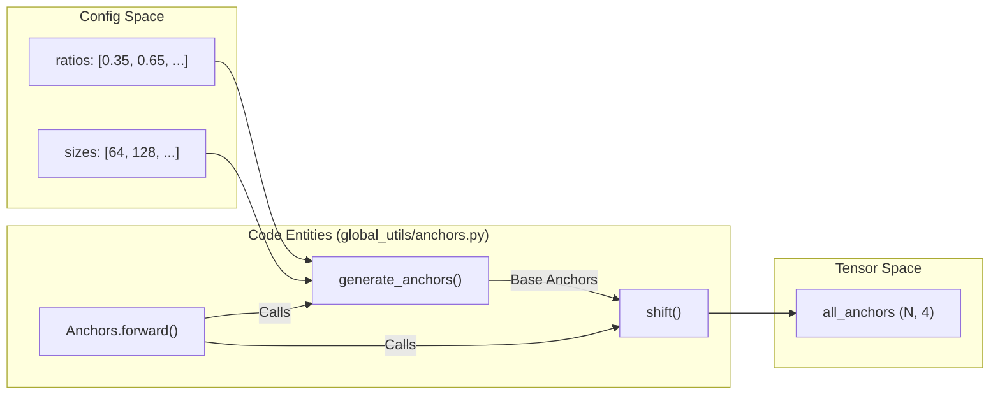

<!-- source: DeepWiki mcp.deepwiki.com · repo allenai/swig · page 2.3 Anchor Generation · fetched 2026-10-26 -->

# Anchor Generation

Relevant source files

The following files were used as context for generating this wiki page:

- [global_utils/anchors.py](global_utils/anchors.py)

The JSL model utilizes a set of predefined reference boxes, known as anchors, to predict bounding boxes for roles in Grounded Situation Recognition. These anchors are generated across multiple scales and aspect ratios, distributed over different levels of the Feature Pyramid Network (FPN) to handle objects of varying sizes.

## The Anchors Module

The `Anchors` class is a `nn.Module` responsible for generating the full set of anchor boxes for a given input image size. It computes the geometry of anchors for every spatial location across the specified pyramid levels [global_utils/anchors.py:7-21]().

### Configuration Parameters
The default configuration is tailored for the JSL architecture:
*   **Pyramid Levels**: `[4, 5, 6, 7]`. These correspond to the feature maps produced by the FPN [global_utils/anchors.py:12]().
*   **Strides**: `[16, 32, 64, 128]`. Calculated as $2^{\text{level}}$, representing the downsampling factor relative to the input image [global_utils/anchors.py:14]().
*   **Sizes**: `[64, 128, 256, 512]`. Calculated as $2^{\text{level} + 2}$, defining the base scale of the anchors at each level [global_utils/anchors.py:16]().
*   **Ratios**: `[0.35, 0.65, 0.95, 1.38, 2.3]`. A set of five aspect ratios ($W/H$) to cover various role shapes [global_utils/anchors.py:18]().
*   **Scales**: `[2 ** 0]`. By default, only a single scale multiplier is used per level [global_utils/anchors.py:20]().

### Anchor Generation Flow
The following diagram illustrates how the `Anchors` module translates image dimensions into a tensor of candidate boxes.

**Anchor Generation Logic**

Sources: [global_utils/anchors.py:22-42](), [global_utils/anchors.py:79-88]()

## Core Functions

### generate_anchors
The `generate_anchors` function creates a set of base anchor windows at the origin $(0, 0)$ for a single spatial location. It enumerates all combinations of aspect ratios and scales [global_utils/anchors.py:44-56]().

1.  **Scaling**: It tiles the `base_size` by the `scales` [global_utils/anchors.py:64]().
2.  **Ratio Adjustment**: It calculates the width and height such that the area remains consistent with the scale while satisfying the `ratios` [global_utils/anchors.py:67-71]().
3.  **Coordinate Transformation**: It converts the anchors from center-based format $(x_{center}, y_{center}, w, h)$ to corner-based format $(x_1, y_1, x_2, y_2)$ [global_utils/anchors.py:73-75]().

### shift
The `shift` function replicates the base anchors across the entire feature map grid for a specific pyramid level [global_utils/anchors.py:113]().

*   It generates a meshgrid of $x$ and $y$ coordinates based on the feature map `shape` and the level's `stride` [global_utils/anchors.py:114-117]().
*   The center of each cell is offset by $0.5 \times \text{stride}$ to ensure anchors are centered within the receptive field of the feature pixel [global_utils/anchors.py:114-115]().
*   The base anchors are broadcasted and added to these shifts, resulting in a flattened array of $(K \times A, 4)$ anchors, where $K$ is the number of grid cells and $A$ is the number of anchors per cell [global_utils/anchors.py:128-131]().

**Data Flow: From Configuration to Tensor**

Sources: [global_utils/anchors.py:35-38](), [global_utils/anchors.py:44-77](), [global_utils/anchors.py:113-133]()

## Summary of Anchor Geometry

The total number of anchors $N$ is the sum of anchors across all levels. For each level $i$ with feature map dimensions $H_i \times W_i$:
$$N_i = H_i \times W_i \times (\text{len}(\text{ratios}) \times \text{len}(\text{scales}))$$

| Level | Stride | Base Size | Ratios | Scales |
| :--- | :--- | :--- | :--- | :--- |
| P4 | 16 | 64 | 5 | 1 |
| P5 | 32 | 128 | 5 | 1 |
| P6 | 64 | 256 | 5 | 1 |
| P7 | 128 | 512 | 5 | 1 |

Sources: [global_utils/anchors.py:11-21]()

---

