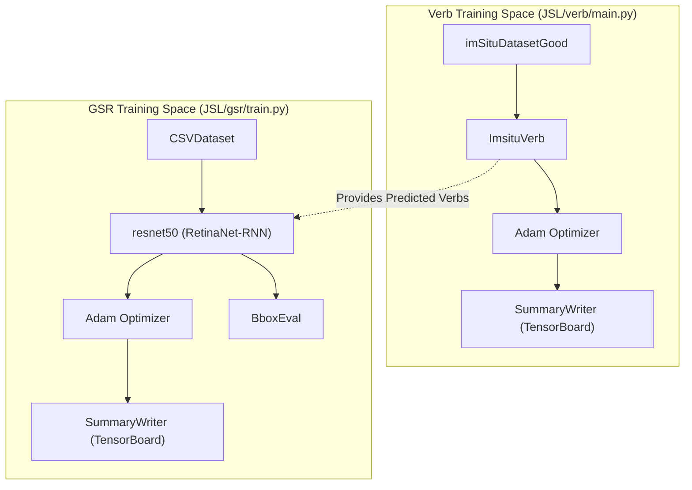
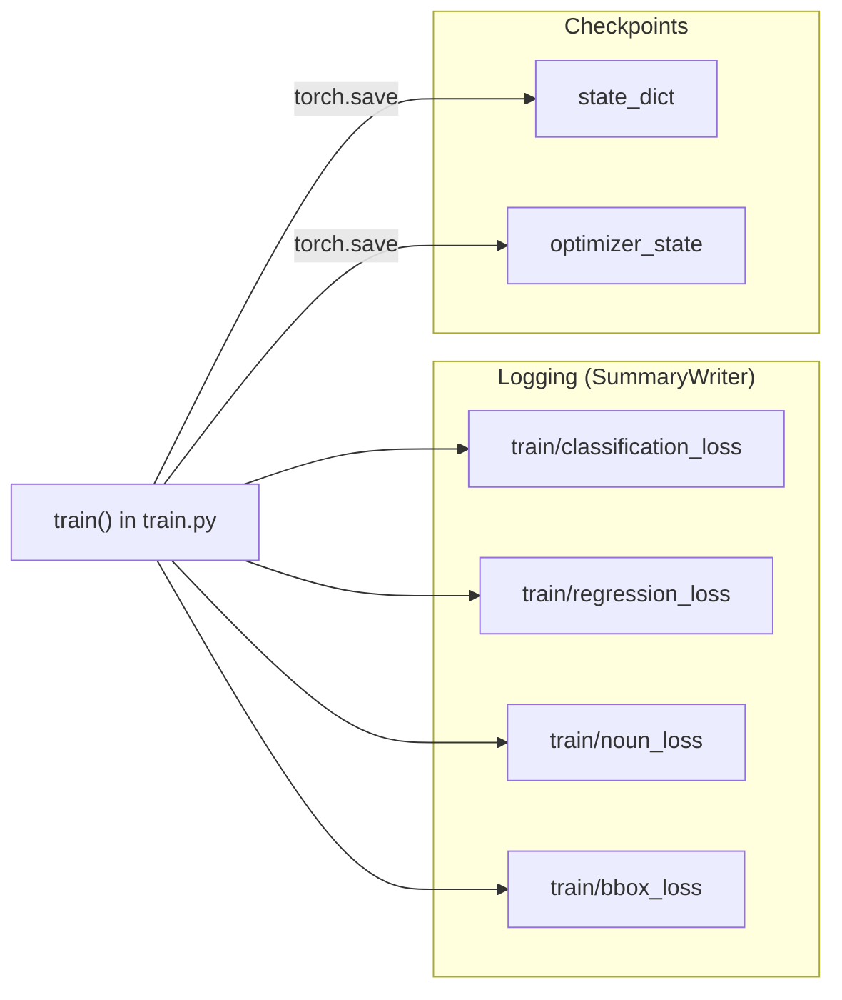

<!-- source: DeepWiki mcp.deepwiki.com · repo allenai/swig · page 3 Training Pipeline · fetched 2026-10-26 -->

# Training Pipeline

Relevant source files

The following files were used as context for generating this wiki page:

- [JSL/gsr/train.py](JSL/gsr/train.py)
- [JSL/verb/main.py](JSL/verb/main.py)

The training pipeline for the Joint Situation Localizer (JSL) is divided into two distinct stages: the training of the **Verb Classifier** and the training of the **GSR Module** (ResNet-RetinaNet-RNN). Both stages utilize `torch.optim.Adam` for optimization and leverage `tensorboardX` for logging metrics and visualizing loss convergence.

### System Training Overview

The training process involves distinct data loading strategies and optimization schedules for each model component. While the Verb Classifier focuses on identifying the primary action in an image, the GSR Module is trained to localize objects and assign semantic roles based on the predicted (or ground-truth) verb.

Training Flow and Code Entities:

**Sources:** [JSL/verb/main.py:24-71](), [JSL/gsr/train.py:22-67]()

---

### Verb Classifier Training (#3.1)

The verb classification stage uses `JSL/verb/main.py` as the entry point. It trains the `ImsituVerb` model, which is based on a ResNet backbone.

*   **Data Loading**: Uses `imSituDatasetGood` [JSL/verb/main.py:43]() to load SWiG annotations.
*   **Optimization**: Employs the Adam optimizer with a learning rate that decreases by a factor of 5 at epoch 18 [JSL/verb/main.py:59-67]().
*   **Evaluation**: During the evaluation phase, the pipeline generates a `top_5_verbs.json` file containing the highest-probability verb predictions for the validation set [JSL/verb/main.py:108-121]().

For more details, see [Verb Classifier Training](#3.1).

**Sources:** [JSL/verb/main.py:52-71](), [JSL/verb/main.py:102-127]()

---

### GSR Module Training (#3.2)

The GSR module training in `JSL/gsr/train.py` is more complex, involving a recurrent architecture and multiple loss components.

*   **Phased Training**: The pipeline supports specific schedules for freezing components. The `deatch_resnet` flag (controlled by `--detach-epoch`) determines when to stop updating the ResNet backbone [JSL/gsr/train.py:80]().
*   **Ground-Truth Injection**: To stabilize early training, the model can use ground-truth nouns instead of predictions via the `use_gt_nouns` flag [JSL/gsr/train.py:81-96]().
*   **Learning Rate Schedule**: The learning rate is decreased by a factor of 10 at milestones defined by `--lr-decrease` and `--second-lr-decrease` [JSL/gsr/train.py:83-91]().

For more details, see [GSR Module Training](#3.2).

**Sources:** [JSL/gsr/train.py:69-142](), [JSL/gsr/train.py:30-35]()

---

### Loss Functions (#3.3)

The JSL system utilizes a composite loss function to optimize for both localization and semantic recognition.

| Loss Component | Purpose | Code Entity |
| :--- | :--- | :--- |
| **Class Loss** | Object classification (Focal Loss) | `class_loss` |
| **Reg Loss** | Bounding box delta regression | `reg_loss` |
| **Bbox Loss** | Bounding box existence/visibility | `bbox_loss` |
| **Noun Loss** | Semantic role noun classification | `all_noun_loss` |

The total loss is calculated as the sum of these components: `loss = class_loss + reg_loss + bbox_loss + all_noun_loss` [JSL/gsr/train.py:135]().

For more details, see [Loss Functions](#3.3).

**Sources:** [JSL/gsr/train.py:107-112](), [JSL/gsr/train.py:135-141]()

---

### Training Utilities and Logging

Both training scripts share similar logging and checkpointing logic to ensure reproducibility and monitoring.

Model State and Logging:

*   **Checkpointing**: Models are saved using `torch.save`, storing both the `state_dict` of the model and the `optimizer` state to allow for resuming training [JSL/gsr/train.py:64](), [JSL/verb/main.py:190-194]().
*   **Gradient Clipping**: The GSR training loop implements gradient norm clipping to prevent exploding gradients during the RNN unrolling [JSL/gsr/train.py:140]().

**Sources:** [JSL/gsr/train.py:120-127](), [JSL/gsr/train.py:140](), [JSL/verb/main.py:70-71]()

---

