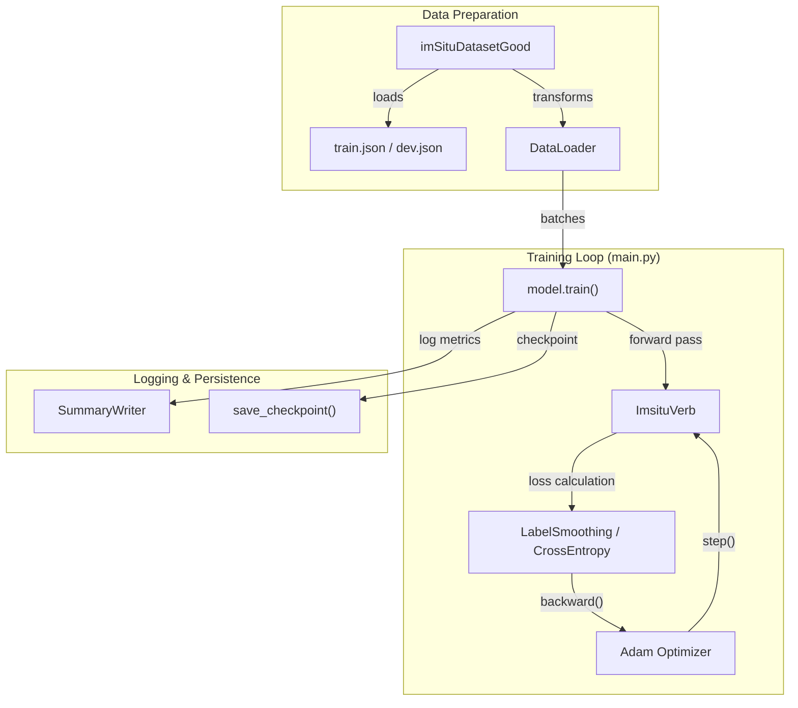
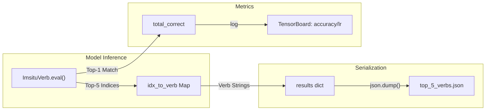

<!-- source: DeepWiki mcp.deepwiki.com · repo allenai/swig · page 3.1 Verb Classifier Training · fetched 2026-10-26 -->

# Verb Classifier Training

Relevant source files

The following files were used as context for generating this wiki page:

- [JSL/verb/imsituDatasetGood.py](JSL/verb/imsituDatasetGood.py)
- [JSL/verb/main.py](JSL/verb/main.py)

The Verb Classifier Training pipeline is responsible for optimizing the `ImsituVerb` model to predict the primary action (verb) depicted in an image. This stage serves as the first half of the Joint Situation Localizer (JSL) architecture, providing the necessary verb context for subsequent role and noun prediction.

## Training Infrastructure Overview

The training process is orchestrated by `JSL/verb/main.py`. It integrates data loading via `imSituDatasetGood`, model initialization, an Adam optimizer, and a specific learning rate decay schedule. Progress is tracked using TensorBoard for loss and accuracy metrics, and model weights are serialized as checkpoints.

### Code Entity Space to Training Space
The following diagram illustrates how specific code components interact during the training loop.

**Verb Training System Architecture**

Sources: [JSL/verb/main.py:24-72](), [JSL/verb/imsituDatasetGood.py:14-35]()

## Data Loading and Preprocessing

The `imSituDatasetGood` class handles the ingestion of SWiG JSON annotations. It maps verb strings to numerical indices using a vocabulary file (`verb_indices.txt`) and prepares a role-presence target vector.

*   **Target Vector**: A tensor of size 1788 representing the presence of specific verb-role pairs [JSL/verb/imsituDatasetGood.py:53-60]().
*   **Image Transforms**:
    *   **Train**: Includes `RandomResizedCrop` (256x256), `ColorJitter`, `RandomGrayscale`, and `RandomHorizontalFlip` [JSL/verb/imsituDatasetGood.py:69-76]().
    *   **Validation**: Uses `Resize` and `CenterCrop` to 256x256 [JSL/verb/imsituDatasetGood.py:85-90]().
*   **Normalization**: Both pipelines use standard ImageNet mean `[0.485, 0.456, 0.406]` and standard deviation `[0.229, 0.224, 0.225]` [JSL/verb/imsituDatasetGood.py:67-68](), [JSL/verb/imsituDatasetGood.py:83-84]().

Sources: [JSL/verb/imsituDatasetGood.py:45-64](), [JSL/verb/imsituDatasetGood.py:65-91]()

## Optimization and Learning Schedule

The training loop utilizes the **Adam optimizer** with an initial learning rate of `0.0001` [JSL/verb/main.py:20](), [JSL/verb/main.py:59](). 

### Learning Rate Decay
The schedule implements a step-down decay based on epochs:
*   If the epoch is a multiple of 18 (and between 0 and 25), the learning rate is divided by 5.0 [JSL/verb/main.py:64-67]().

### Training Step Logic
For every batch in the `DataLoader`:
1.  **Forward Pass**: The model receives the image and ground truth verb [JSL/verb/main.py:85]().
2.  **Loss**: The mean loss is calculated from the model output [JSL/verb/main.py:88]().
3.  **Backpropagation**: `loss.backward()` computes gradients, followed by `optimizer.step()` [JSL/verb/main.py:96-97]().
4.  **Logging**: Every 100 iterations, the average loss is logged to TensorBoard via `SummaryWriter` [JSL/verb/main.py:90-94]().

Sources: [JSL/verb/main.py:58-71](), [JSL/verb/main.py:74-100]()

## Evaluation and Checkpointing

Evaluation occurs at the end of every epoch using the `eval` function [JSL/verb/main.py:69]().

### Top-5 Verb Evaluation
During evaluation, the model generates the top 5 predicted verbs for each image in the validation set. These are mapped back to strings using `idx_to_verb` and stored in `top_5_verbs.json` [JSL/verb/main.py:108-121](). This file is critical for downstream GSR tasks that may require multiple verb hypotheses.

### Checkpointing
The `save_checkpoint` utility serializes the model's `state_dict` and the optimizer's state [JSL/verb/main.py:190-194](). Checkpoints are saved in a directory named after the experiment title (generated from command-line arguments) [JSL/verb/main.py:30-35]().

**Data Flow: Evaluation to JSON**

Sources: [JSL/verb/main.py:102-127](), [JSL/verb/main.py:190-194]()

## Execution and Utilities

Training is initiated by calling `main.py`. The system automatically generates experiment titles using `cmd_to_title`, which incorporates the provided arguments and the current timestamp [JSL/verb/main.py:29](), [JSL/verb/main.py:179-183]().

| Argument | Default | Description |
| :--- | :--- | :--- |
| `--title` | None | Custom name for the run; auto-generated if omitted |
| `--batch-size` | 256 | Number of images per training batch |
| `--workers` | 16 | Number of subprocesses for data loading |
| `--lr` | 0.0001 | Initial learning rate for Adam |

Sources: [JSL/verb/main.py:16-21](), [JSL/verb/main.py:142-188]()

---

