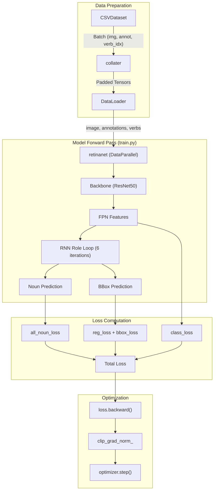
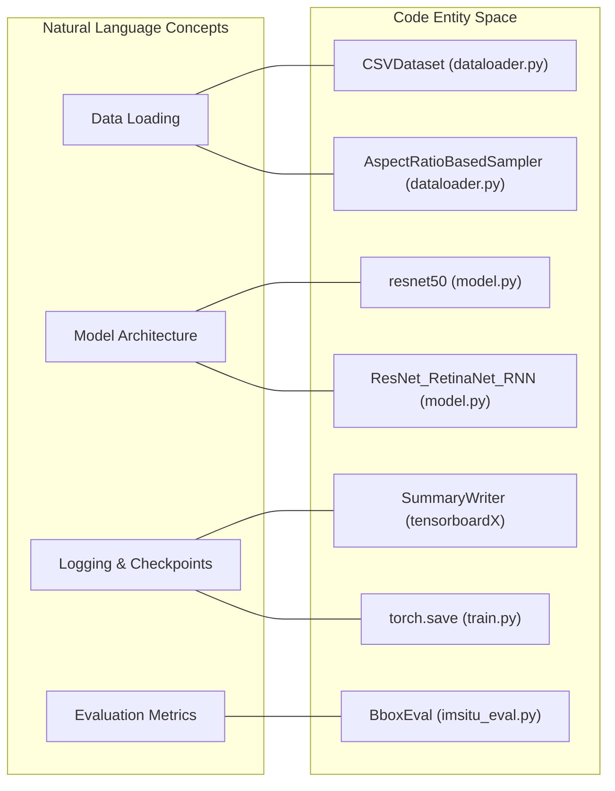

<!-- source: DeepWiki mcp.deepwiki.com · repo allenai/swig · page 3.2 GSR Module Training · fetched 2026-10-26 -->

# GSR Module Training

Relevant source files

The following files were used as context for generating this wiki page:

- [JSL/gsr/dataloader.py](JSL/gsr/dataloader.py)
- [JSL/gsr/train.py](JSL/gsr/train.py)

The training pipeline for the Grounded Situation Recognition (GSR) module handles the optimization of the RetinaNet-RNN architecture. This process involves a composite loss function that simultaneously optimizes for verb-role bounding box localization, noun classification for each role, and bounding box existence. The pipeline features specific training phases, including backbone freezing and ground-truth noun injection to stabilize the recurrent state.

## Training Loop Implementation

The training loop is implemented in `JSL/gsr/train.py` within the `train()` function. It manages the forward pass, loss accumulation, gradient clipping, and weight updates for the `ResNet_RetinaNet_RNN` model.

### Composite Loss Calculation
The model returns four distinct loss components which are aggregated for the backward pass:
1.  **Classification Loss**: Focal loss for anchor-based object classification.
2.  **Regression Loss**: Smooth L1 loss for bounding box coordinate deltas.
3.  **BBox Existence Loss**: Binary cross-entropy or focal loss determining if a role should have a box.
4.  **Noun Loss**: Label smoothing cross-entropy for predicting the noun category for each of the 6 potential roles.

The total loss is calculated as the mean sum of these components:
`loss = class_loss.mean() + reg_loss.mean() + bbox_loss.mean() + all_noun_loss.mean()` [JSL/gsr/train.py:135-135]().

### Training Phases and Detachment
The pipeline utilizes specific flags to control the flow of gradients and data:
*   **Backbone Detachment**: Controlled by `--detach-epoch`. If the current epoch is less than this value, the ResNet backbone is detached to prevent early gradients from destabilizing pretrained weights [JSL/gsr/train.py:31-31](), [JSL/gsr/train.py:80-80]().
*   **GT Noun Injection**: Controlled by `--gt-noun-epoch`. During early training, ground-truth nouns are injected into the RNN to help the model learn the relationship between nouns and spatial locations before it has learned to predict nouns accurately [JSL/gsr/train.py:32-32](), [JSL/gsr/train.py:81-81]().

### Optimization Details
*   **Optimizer**: Adam optimizer with a default learning rate of `0.0006` [JSL/gsr/train.py:37-37](), [JSL/gsr/train.py:58-58]().
*   **Gradient Clipping**: Gradients are clipped to a maximum norm of 1 using `inf` norm to prevent exploding gradients in the RNN [JSL/gsr/train.py:140-140]().
*   **Learning Rate Schedule**: The learning rate is decreased by a factor of 10 at two milestones: `--lr-decrease` (default 10) and `--second-lr-decrease` (default 20) [JSL/gsr/train.py:34-35](), [JSL/gsr/train.py:83-91]().

Sources: [JSL/gsr/train.py:22-143]()

## Data Flow: Training Step

The following diagram illustrates the flow of data from the `CSVDataset` through the model during a single training iteration.

**GSR Training Data Flow**

Sources: [JSL/gsr/train.py:98-141](), [JSL/gsr/dataloader.py:115-134]()

## Key Training Functions

| Function | File | Description |
| :--- | :--- | :--- |
| `main` | `JSL/gsr/train.py` | Initializes datasets, model, optimizer, and manages the epoch loop. |
| `train` | `JSL/gsr/train.py` | Executes the training iteration, loss logging, and parameter updates. |
| `evaluate` | `JSL/gsr/train.py` | Runs validation using `BboxEval` and logs metrics to TensorBoard. |
| `init_data` | `JSL/gsr/train.py` | Sets up `CSVDataset` with `Augmenter` for training and `Normalizer` for both. |
| `CSVDataset.__getitem__` | `JSL/gsr/dataloader.py` | Loads image, annotations, and verb index for a specific index. |

Sources: [JSL/gsr/train.py:22-143](), [JSL/gsr/dataloader.py:115-134]()

## System Entity Mapping

This diagram maps high-level training concepts to the specific classes and files that implement them in the codebase.

**Training Entity Mapping**

Sources: [JSL/gsr/train.py:10-15](), [JSL/gsr/dataloader.py:26-26](), [JSL/gsr/train.py:56-56](), [JSL/gsr/train.py:64-64]()

## Checkpointing and Logging

The pipeline uses `tensorboardX.SummaryWriter` to log training progress and `torch.save` for model persistence.

*   **TensorBoard Metrics**: Every `--iteration` (default 100), the loop logs:
    *   `train/classification_loss` [JSL/gsr/train.py:120-121]()
    *   `train/regression_loss` [JSL/gsr/train.py:122-123]()
    *   `train/bbox_loss` [JSL/gsr/train.py:124-125]()
    *   `train/noun_loss` [JSL/gsr/train.py:126-127]()
*   **Checkpoints**: At the end of every epoch, the model state and optimizer state are saved to the `checkpoints` directory within the log folder:
    `retinanet_{epoch_num}.pth` [JSL/gsr/train.py:64-64]().

Sources: [JSL/gsr/train.py:62-66](), [JSL/gsr/train.py:114-133]()

---

