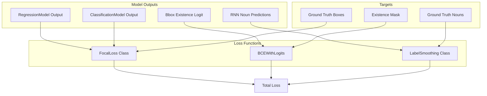

<!-- source: DeepWiki mcp.deepwiki.com · repo allenai/swig · page 3.3 Loss Functions · fetched 2026-10-26 -->

# Loss Functions

<details>
<summary>Relevant source files</summary>

The following files were used as context for generating this wiki page:

- [JSL/gsr/model.py](JSL/gsr/model.py)
- [global_utils/losses.py](global_utils/losses.py)

</details>


The training of the Joint Situation Localizer (JSL) involves a composite loss strategy to handle simultaneous verb classification, noun prediction, and bounding box localization. The system utilizes Focal Loss for object detection tasks, Label Smoothing for noun classification, and a binary existence loss to determine if a role requires a bounding box.

### Overview of Loss Components

The total loss is a combination of four distinct signals:
1.  **Classification Loss**: Focal Loss for anchor-based object classification.
2.  **Regression Loss**: Smooth L1 loss for bounding box coordinate refinement.
3.  **Bbox Existence Loss**: Binary Cross Entropy for predicting if a role is groundable.
4.  **Noun Loss**: Cross Entropy with Label Smoothing for role-filler (noun) prediction.

### Focal Loss and Detection
The `FocalLoss` class in `global_utils/losses.py` handles three critical aspects of the GSR module: classification of anchors, regression of box deltas, and the binary prediction of whether a role has an associated bounding box.

#### Anchor Matching and IoU
The loss calculation begins by computing the Intersection over Union (IoU) between all generated anchors and the ground truth annotations using the `calc_iou` function [global_utils/losses.py:10-24]().
*   **Positive Anchors**: Anchors with $IoU \ge 0.5$ are assigned as positive samples [global_utils/losses.py:84-85]().
*   **Negative Anchors**: Anchors with $IoU < 0.4$ are treated as background [global_utils/losses.py:83]().
*   **Ignored Anchors**: Anchors with $0.4 \le IoU < 0.5$ are excluded from the loss calculation [global_utils/losses.py:106]().

#### Classification Loss
To address class imbalance between foreground and background anchors, the model implements Focal Loss [global_utils/losses.py:26-168](). It uses an $\alpha$ of 0.25 and $\gamma$ of 2.0 to down-weight easy examples and focus on hard negatives [global_utils/losses.py:38-39]().

#### Regression Loss
For positive anchors, the model calculates a Smooth L1 loss (Huber loss) between predicted deltas and ground truth targets [global_utils/losses.py:153-160](). The targets are normalized by standard deviations of `[0.1, 0.1, 0.2, 0.2]` for $[dx, dy, dw, dh]$ [global_utils/losses.py:141-149]().

#### Bbox Existence Loss
A specific signal is used to train the `ClassificationModel` to predict if a role contains a bounding box (`bbox_exists`). This is implemented as a Binary Cross Entropy loss with logits, comparing the predicted `bbox_exists` scalar against the ground truth mask [global_utils/losses.py:56-57]().

**Sources:**
* `global_utils/losses.py:10-168`
* `JSL/gsr/model.py:112-160`

---

### Noun Classification with Label Smoothing

The `LabelSmoothing` module implements a modified Negative Log Likelihood loss to prevent the model from becoming over-confident in its noun predictions, which aids in generalization across the large SWiG vocabulary.

| Parameter | Role | Implementation |
| :--- | :--- | :--- |
| `confidence` | Weight for the target class | $1.0 - \text{smoothing}$ [JSL/gsr/model.py:172]() |
| `smoothing` | Weight for the uniform distribution | $\text{smoothing} / \text{num\_classes}$ [JSL/gsr/model.py:173-181]() |

The loss is calculated by taking the `log_softmax` of the predictions and combining the NLL of the target with the mean of all log probabilities [JSL/gsr/model.py:176-180]().

**Sources:**
* `JSL/gsr/model.py:162-182`

---

### Data Flow: From Model Output to Loss

The following diagram illustrates how the outputs from the `ResNet_RetinaNet_RNN` architecture are routed to the respective loss functions during training.

**GSR Loss Data Flow**

**Sources:**
* `JSL/gsr/model.py:79-110` (RegressionModel)
* `JSL/gsr/model.py:112-160` (ClassificationModel)
* `global_utils/losses.py:32-44` (FocalLoss forward)

---

### Implementation Details: Code Entity Mapping

The relationship between the natural language concepts of "Loss" and the specific code entities in the `global_utils` and `JSL` modules is mapped below.

**Loss Entity Mapping**
```mermaid
classDiagram
    class FocalLoss {
        +forward(classifications, regressions, anchors, bbox_exist_prediction, annotations)
        -calc_iou(a, b)
    }
    class LabelSmoothing {
        +forward(x, target)
        -confidence: float
        -smoothing: float
    }
    class RegressionModel {
        +forward(x)
        -output: Conv2d
    }
    class ClassificationModel {
        +forward(x)
        -features_linear: Linear
        -output_retina: Conv2d
    }

    FocalLoss ..> RegressionModel : "Evaluates Output"
    FocalLoss ..> ClassificationModel : "Evaluates Output"
    LabelSmoothing ..> "RNN Predictions" : "Evaluates Nouns"
```

**Key Implementation Logic:**
*   **Coordinate Transformation**: Inside `FocalLoss`, anchors are converted to center coordinates $(ctr\_x, ctr\_y)$ and widths/heights to compute regression targets [global_utils/losses.py:48-51]().
*   **Target Normalization**: Regression targets are scaled by a factor of 10 for offsets and 5 for log-scale dimensions (via the `0.1, 0.2` divisors) to balance the gradient magnitude relative to classification [global_utils/losses.py:149]().
*   **Logit Clamping**: Classification probabilities are clamped to `[1e-4, 1.0 - 1e-4]` to ensure numerical stability during log calculations [global_utils/losses.py:54]().

**Sources:**
* `global_utils/losses.py:9-168`
* `JSL/gsr/model.py:79-182`

---

