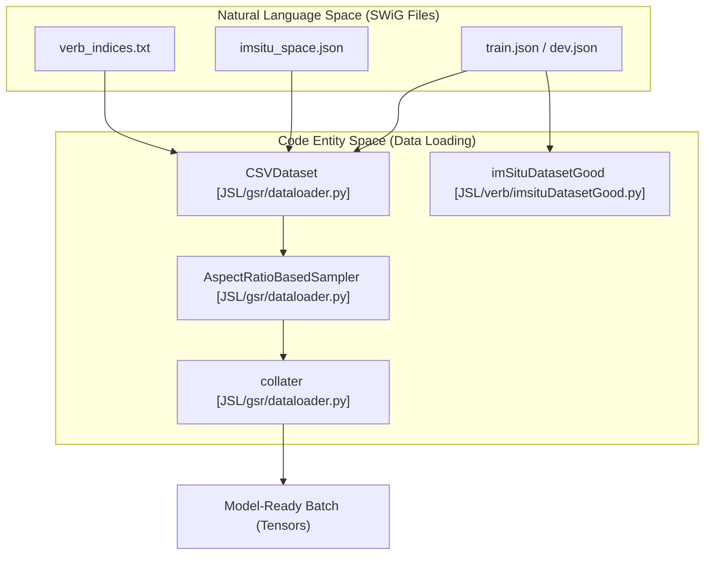
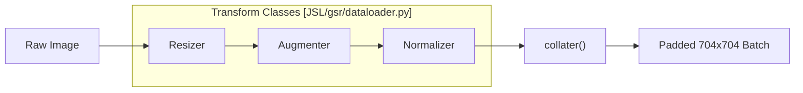

<!-- source: DeepWiki mcp.deepwiki.com · repo allenai/swig · page 4 Data Pipeline · fetched 2026-10-26 -->

# Data Pipeline

Relevant source files

The following files were used as context for generating this wiki page:

- [JSL/gsr/dataloader.py](JSL/gsr/dataloader.py)
- [JSL/verb/imsituDatasetGood.py](JSL/verb/imsituDatasetGood.py)

The SWiG data pipeline manages the flow of images and semantic annotations from raw JSON files into structured tensors suitable for training and inference. The pipeline is split into two primary paths: one for the **Verb Classifier** and one for the **Joint Situation Localizer (GSR Module)**. 

The pipeline handles complex SWiG data structures, including multi-annotator noun labels (up to 3 per role), variable role counts per verb, and bounding box coordinates.

### Data Flow Architecture

The following diagram illustrates how raw SWiG files are processed by specific dataset classes and transforms before being batched by the `DataLoader`.

**System Entity Mapping: Raw Data to Code Objects**

**Sources:** [JSL/gsr/dataloader.py:26-44](), [JSL/verb/imsituDatasetGood.py:14-35]()

---

### GSR Data Loader (CSVDataset)

The `CSVDataset` class is the core component for the Grounded Situation Recognition (GSR) task. It parses the SWiG JSON format and converts it into a standardized 7-column annotation tensor. 

Key responsibilities include:
*   **Verb-Role Ordering**: Aligning roles based on the specific verb's predefined order to ensure consistent LSTM input sequences [JSL/gsr/dataloader.py:181-184]().
*   **Annotation Formatting**: Each role is represented by a row containing `[x1, y1, x2, y2, class1, class2, class3]`, where the classes represent the three independent annotator labels from SWiG [JSL/gsr/dataloader.py:162-170]().
*   **Special Token Handling**: Mapping missing or out-of-vocabulary nouns to `blank`, `oov`, or `Pad` tokens [JSL/gsr/dataloader.py:190-211]().

For details, see [GSR Data Loader (CSVDataset)](#4.1).

**Sources:** [JSL/gsr/dataloader.py:26-213]()

---

### Image Transforms and Collation

To support efficient batching of images with different aspect ratios, the pipeline employs a custom transformation and collation strategy.

**Transformation Pipeline (Code-to-Logic)**

The `collater` function ensures that all images in a batch are padded to a uniform size (typically 704x704) while maintaining the correct spatial relationship for bounding boxes [JSL/gsr/dataloader.py:755-780](). It also tracks "shift" values—the amount of padding added—which is critical for reversing transformations during inference.

For details, see [Image Transforms and Collation](#4.2).

**Sources:** [JSL/gsr/dataloader.py:539-645](), [JSL/gsr/dataloader.py:755-810]()

---

### Verb Dataset (imSituDatasetGood)

The `imSituDatasetGood` class is dedicated to Stage 1: Verb Classification. Unlike the GSR loader, it focuses on the global image context and the presence of specific roles.

*   **Target Vector**: It constructs a 1788-dimensional binary vector representing the roles present for a given verb in an image [JSL/verb/imsituDatasetGood.py:53-60]().
*   **Transforms**: It uses standard ResNet-style augmentations, including `RandomResizedCrop` and `ColorJitter` during training [JSL/verb/imsituDatasetGood.py:65-77]().
*   **Inference Mode**: In inference mode, it simplifies the pipeline to load only the image and its filename, bypassing annotation parsing [JSL/verb/imsituDatasetGood.py:109-111]().

For details, see [Verb Dataset (imSituDatasetGood)](#4.3).

**Sources:** [JSL/verb/imsituDatasetGood.py:14-116]()

---

### Data Format Summary

| Component | Input Format | Output Format | Key File |
| :--- | :--- | :--- | :--- |
| **GSR Loader** | SWiG JSON | `[6, 7]` Tensor (BBox + 3 Nouns) | [JSL/gsr/dataloader.py]() |
| **Verb Loader** | SWiG JSON | `[1788]` Role Presence Vector | [JSL/verb/imsituDatasetGood.py]() |
| **Collater** | List of Tensors | `[Batch, 3, 704, 704]` Padded Tensor | [JSL/gsr/dataloader.py]() |

**Sources:** [JSL/gsr/dataloader.py:152-172](), [JSL/verb/imsituDatasetGood.py:53-62](), [JSL/gsr/dataloader.py:785-805]()

---

