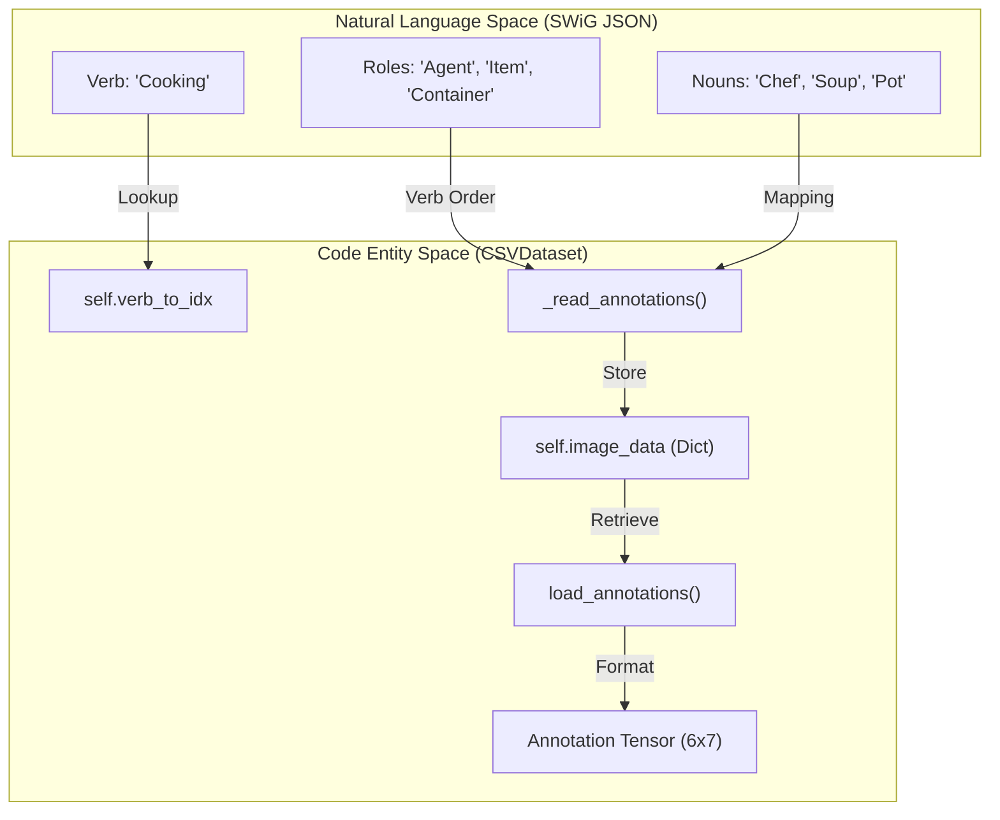
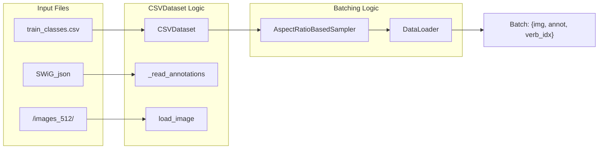

<!-- source: DeepWiki mcp.deepwiki.com · repo allenai/swig · page 4.1 GSR Data Loader (CSVDataset) · fetched 2026-10-26 -->

# GSR Data Loader (CSVDataset)

Relevant source files

The following files were used as context for generating this wiki page:

- [JSL/gsr/dataloader.py](JSL/gsr/dataloader.py)
- [global_utils/train_classes.csv](global_utils/train_classes.csv)

The `CSVDataset` class is the primary data ingestion component for Grounded Situation Recognition (GSR) in the SWiG repository. It is responsible for parsing the SWiG JSON annotations, mapping verbs to their specific role orders, and formatting ground-truth data into a structured 7-column tensor format compatible with the RetinaNet-RNN architecture.

## Overview of CSVDataset

The `CSVDataset` class, defined in `JSL/gsr/dataloader.py`, inherits from `torch.utils.data.Dataset` [JSL/gsr/dataloader.py:26-29](). It handles two primary modes: standard training/validation (where ground truth is loaded from JSON) and inference (where dummy annotations are created for prediction) [JSL/gsr/dataloader.py:49-63]().

### Data Flow and Initialization
During initialization, the dataset performs several key setup steps:
1.  **Class Mapping**: Loads the noun category list from a CSV file (e.g., `train_classes.csv`), establishing a mapping between WordNet IDs and integer indices [JSL/gsr/dataloader.py:46-47]().
2.  **Verb Ontology**: Loads verb indices from `global_utils/verb_indices.txt` to map verb strings to their numerical identifiers [JSL/gsr/dataloader.py:65-74]().
3.  **Annotation Parsing**: In non-inference mode, it reads the SWiG JSON file and organizes data by image filename [JSL/gsr/dataloader.py:54-57]().

**Sources:** [JSL/gsr/dataloader.py:26-80](), [global_utils/train_classes.csv:1-427]()

---

## Annotation Parsing and Formatting

The core logic for transforming raw SWiG JSON into model-ready tensors resides in `_read_annotations` and `load_annotations`.

### The 7-Column Tensor Format
For every image, the dataset produces an annotation tensor of shape `(6, 7)`. Each of the 6 rows represents a semantic role (e.g., Agent, Tool, Place), and the 7 columns are defined as follows:

| Column Index | Content | Description |
| :--- | :--- | :--- |
| 0 | `x1` | Top-left x-coordinate |
| 1 | `y1` | Top-left y-coordinate |
| 2 | `x2` | Bottom-right x-coordinate |
| 3 | `y2` | Bottom-right y-coordinate |
| 4 | `class1` | Noun index from the first annotator |
| 5 | `class2` | Noun index from the second annotator |
| 6 | `class3` | Noun index from the third annotator |

**Sources:** [JSL/gsr/dataloader.py:152-172](), [JSL/gsr/dataloader.py:186-203]()

### Verb-Role Ordering
SWiG verbs have varying numbers of semantic roles. To maintain a consistent tensor shape for batching, `CSVDataset` uses a fixed ordering and padding strategy:
1.  **Role Order**: The dataset retrieves the specific role sequence for a verb from `verb_info` [JSL/gsr/dataloader.py:181]().
2.  **OOV and Blank Handling**: If an annotation is empty, it is labeled as `blank`. If a noun is not in the class list, it is labeled as `oov` (Out Of Vocabulary) [JSL/gsr/dataloader.py:190-201]().
3.  **Padding**: If a verb has fewer than 6 roles, the remaining rows are filled with `Pad` labels and coordinates set to `-1` [JSL/gsr/dataloader.py:205-213]().

### Natural Language to Code Entity Mapping
The following diagram illustrates how the abstract concepts of the SWiG dataset are mapped to specific code structures within `CSVDataset`.

**Annotation Transformation Flow**

**Sources:** [JSL/gsr/dataloader.py:56-74](), [JSL/gsr/dataloader.py:149-172](), [JSL/gsr/dataloader.py:175-213]()

---

## Image Preprocessing and Transforms

The `load_image` method handles image loading and initial color augmentation [JSL/gsr/dataloader.py:136-147]().

1.  **Loading**: Uses `PIL.Image` to open files and converts them to RGB [JSL/gsr/dataloader.py:138-139]().
2.  **Augmentation**: During training, a `color_change` pipeline applies `ColorJitter` (hue, saturation, brightness) and `RandomGrayscale` [JSL/gsr/dataloader.py:44](), [JSL/gsr/dataloader.py:142]().
3.  **Normalization**: Pixel values are scaled to the `[0, 1]` range [JSL/gsr/dataloader.py:147]().

**Sources:** [JSL/gsr/dataloader.py:44-45](), [JSL/gsr/dataloader.py:136-147]()

---

## Sampling and Batching

To optimize training efficiency, the system uses specialized sampling to handle images of different aspect ratios.

### AspectRatioBasedSampler
The `AspectRatioBasedSampler` ensures that images in a batch have similar aspect ratios, minimizing the amount of padding required during collation.

1.  **Grouping**: It calculates the aspect ratio for every image in the dataset [JSL/gsr/dataloader.py:228-232]().
2.  **Binning**: Images are divided into two groups: those with `width/height < 1` (tall) and `width/height >= 1` (wide) [JSL/gsr/dataloader.py:234-240]().
3.  **Shuffling**: Each bin is shuffled independently, and batches are drawn from the bins to ensure aspect ratio consistency within the batch [JSL/gsr/dataloader.py:245-260]().

### System Architecture: Data Loading Pipeline
The following diagram shows the relationship between the `CSVDataset`, the sampler, and the final output used by the `GSR` model.

**GSR Data Loading Architecture**

**Sources:** [JSL/gsr/dataloader.py:26-57](), [JSL/gsr/dataloader.py:218-262]()

---

## Summary of Key Functions

| Function | Purpose |
| :--- | :--- |
| `load_classes` | Parses the CSV mapping of noun strings to integer IDs [JSL/gsr/dataloader.py:82-94](). |
| `_read_annotations` | Iterates through the SWiG JSON to build a lookup dictionary of coordinates and nouns, applying verb-specific role ordering [JSL/gsr/dataloader.py:175-213](). |
| `load_annotations` | Converts the dictionary data for a specific image into a `(6, 7)` NumPy array [JSL/gsr/dataloader.py:149-172](). |
| `__getitem__` | Orchestrates image loading, annotation retrieval, and application of transforms for a single index [JSL/gsr/dataloader.py:115-134](). |
| `make_dummy_annot` | Generates a zeroed-out annotation tensor for inference mode [JSL/gsr/dataloader.py:97-107](). |

**Sources:** [JSL/gsr/dataloader.py:26-213]()

---

