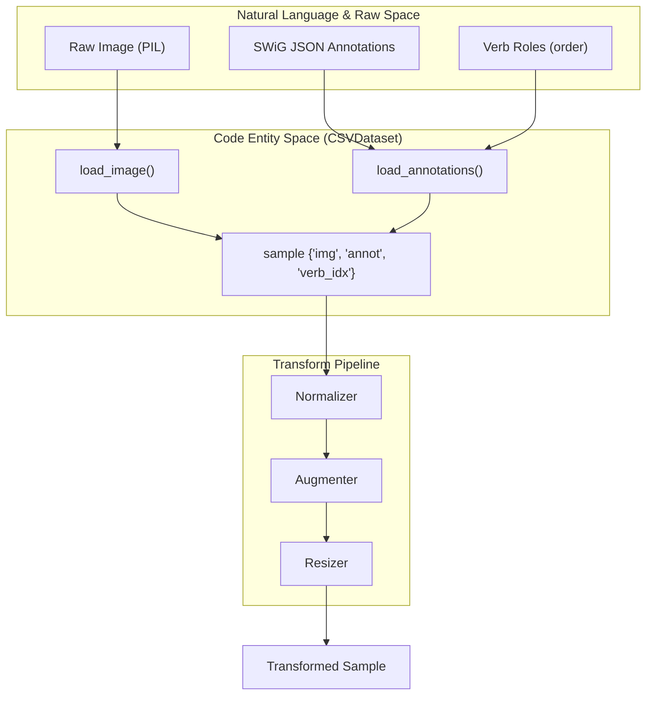
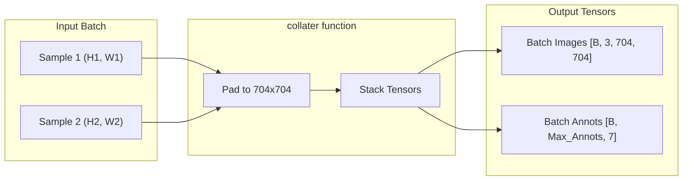

<!-- source: DeepWiki mcp.deepwiki.com · repo allenai/swig · page 4.2 Image Transforms and Collation · fetched 2026-10-26 -->

# Image Transforms and Collation

Relevant source files

The following files were used as context for generating this wiki page:

- [JSL/gsr/dataloader.py](JSL/gsr/dataloader.py)

This page details the data transformation pipeline and batch collation logic used in the Grounded Situation Recognition (GSR) task. The pipeline is responsible for preparing raw images and annotations into a standardized format (704×704 pixels) while tracking spatial shifts and scales necessary for coordinate reconstruction during inference.

## Transform Pipeline Overview

The data pipeline utilizes a sequence of deterministic and stochastic transforms to process images and their corresponding annotation tensors. The primary goal is to standardize input dimensions for the Feature Pyramid Network (FPN) while maintaining the integrity of bounding box coordinates and noun labels.

### Core Transform Classes

The system defines three primary transform classes in `JSL/gsr/dataloader.py`:

1.  **`Resizer`**: Handles the geometric scaling of images and bounding boxes. It resizes the image such that the smaller side is 600 pixels, maintaining the aspect ratio, while ensuring the larger side does not exceed 1000 pixels [JSL/gsr/dataloader.py:236-281]().
2.  **`Augmenter`**: Implements horizontal flipping for data augmentation during training. When an image is flipped, the `x` coordinates of the bounding boxes are mirrored accordingly [JSL/gsr/dataloader.py:284-307]().
3.  **`Normalizer`**: Standardizes the image pixel values using the ImageNet mean (`[0.485, 0.456, 0.406]`) and standard deviation (`[0.229, 0.224, 0.225]`) [JSL/gsr/dataloader.py:218-233]().

### Data Flow and Entity Mapping

The following diagram illustrates how raw data entities are transformed into the internal representations used by the `CSVDataset`.

**Diagram: Data Entity Transformation Flow**

**Sources:** [JSL/gsr/dataloader.py:115-134](), [JSL/gsr/dataloader.py:218-281]()

---

## The Resizer and Coordinate Tracking

The `Resizer` class is critical for ensuring that the model receives inputs of a consistent scale. It calculates a `scale` factor based on the input image dimensions [JSL/gsr/dataloader.py:246-261]().

Key behaviors of `Resizer`:
*   **Scale Calculation**: It determines the scale required to set the smallest side to 600 pixels.
*   **Annotation Scaling**: All bounding box coordinates (`x1, y1, x2, y2`) in the annotation tensor are multiplied by this `scale` [JSL/gsr/dataloader.py:274-277]().
*   **Metadata**: The `scale` value is stored in the sample dictionary, which is essential for the inference pipeline to map predicted boxes back to the original image resolution.

**Sources:** [JSL/gsr/dataloader.py:236-281]()

---

## Batch Collation and Padding

Because images in a batch may have different aspect ratios after resizing, the `collater` function is used to pad them into a uniform tensor size.

### Image Padding
The `collater` function identifies the maximum height and width in a batch and pads all images to these dimensions using zeros [JSL/gsr/dataloader.py:314-332](). In the JSL implementation, images are specifically padded to a fixed size of **704×704** pixels to satisfy the requirements of the FPN and stride constraints [JSL/gsr/dataloader.py:330-332]().

### Annotation Tensor Collation
The annotation tensors (shaped `[6, 7]`) are stacked into a batch. If an image has fewer than the maximum number of annotations found in the batch, the `collater` pads the annotation tensor with `-1` values to indicate "no-object" or "padding" [JSL/gsr/dataloader.py:334-347]().

**Diagram: Collation and Padding Logic**

**Sources:** [JSL/gsr/dataloader.py:310-352]()

---

## Summary of Annotation Format

The annotation tensor, after passing through the transforms and `collater`, maintains a 7-column structure for each of the 6 roles associated with a verb:

| Column Index | Data Description | Source / Handling |
| :--- | :--- | :--- |
| 0 - 3 | `x1, y1, x2, y2` | Scaled by `Resizer`, flipped by `Augmenter` |
| 4 | `class1` (Noun 1) | Encoded via `name_to_label` |
| 5 | `class2` (Noun 2) | Encoded via `name_to_label` |
| 6 | `class3` (Noun 3) | Encoded via `name_to_label` |

If a role is not present for a specific verb, the coordinates are set to `-1` and the classes are set to the `Pad` index during the `_read_annotations` phase [JSL/gsr/dataloader.py:205-212]().

**Sources:** [JSL/gsr/dataloader.py:159-172](), [JSL/gsr/dataloader.py:205-212]()

---

