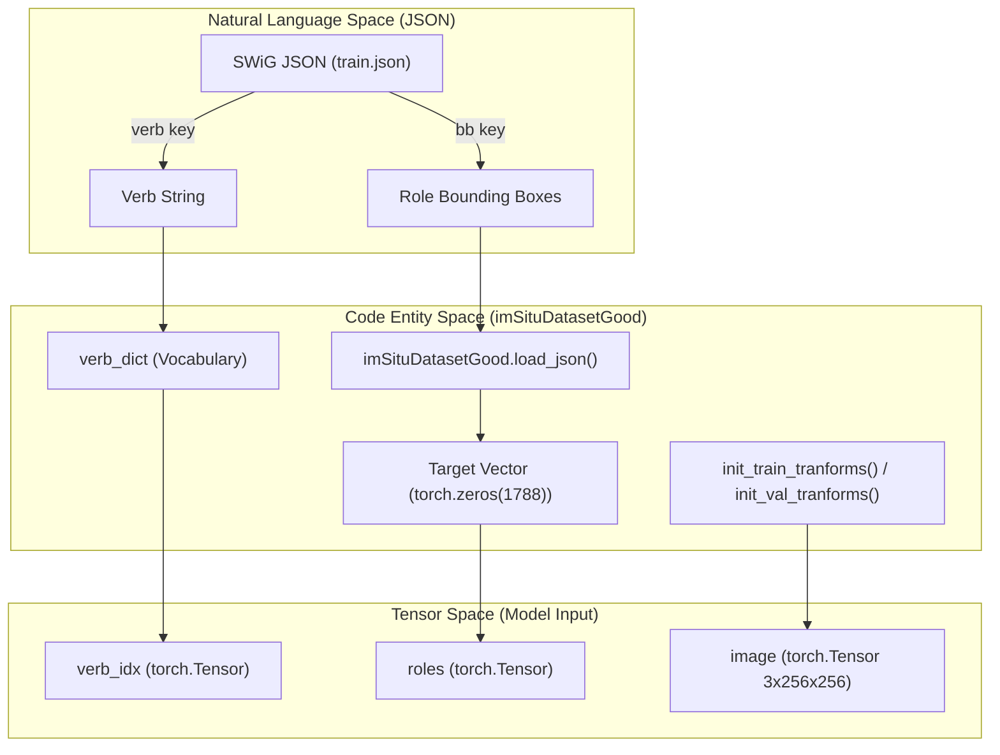
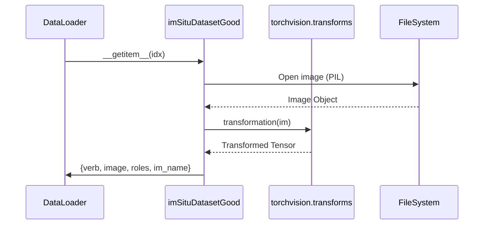

<!-- source: DeepWiki mcp.deepwiki.com · repo allenai/swig · page 4.3 Verb Dataset (imSituDatasetGood) · fetched 2026-10-26 -->

# Verb Dataset (imSituDatasetGood)

Relevant source files

The following files were used as context for generating this wiki page:

- [JSL/verb/imsituDatasetGood.py](JSL/verb/imsituDatasetGood.py)
- [SWiG_jsons/train.json](SWiG_jsons/train.json)

The `imSituDatasetGood` class is the primary data loading utility for the Stage 1 Verb Classifier. It handles the parsing of SWiG JSON annotations, image preprocessing via standard computer vision transforms, and the generation of target vectors that represent the presence of semantic roles.

## Overview and Data Flow

The dataset operates in two distinct modes: standard training/validation and inference. In training mode, it maps images to their corresponding ground-truth verb indices and a role-presence vector. In inference mode, it simply loads images from a list for batch processing.

### Code Entity to Data Space Mapping

The following diagram illustrates how the `imSituDatasetGood` class bridges the gap between raw JSON annotations and the tensors required by the `ImsituVerb` model.

**Data Transformation Pipeline**

Sources: [JSL/verb/imsituDatasetGood.py:45-63](), [JSL/verb/imsituDatasetGood.py:65-91]()

---

## Implementation Details

### Initialization and Mode Handling
The constructor `__init__` determines the behavior of the dataset based on the `is_train` and `inference` flags.
- **Training/Validation**: Loads annotations from a JSON file and initializes either augmentation transforms (train) or resizing/cropping transforms (val) [JSL/verb/imsituDatasetGood.py:25-29]().
- **Inference**: Loads a simple list of image paths and defaults to validation transforms [JSL/verb/imsituDatasetGood.py:30-33]().

### Target Vector Generation (Role Presence)
A unique feature of this dataset is the creation of a role-presence vector.
1. It initializes a zero-vector of size 1788 [JSL/verb/imsituDatasetGood.py:53]().
2. For each role associated with a verb in the annotation, it generates a unique key: `verb + '_' + role` [JSL/verb/imsituDatasetGood.py:56-57]().
3. If the bounding box for that role is valid (not `[-1, -1, -1, -1]`), the corresponding index in the target vector is set to 1 [JSL/verb/imsituDatasetGood.py:58-59]().

### Image Transforms
The dataset uses `torchvision.transforms` to prepare images for the ResNet backbone.

| Transform Type | Operations | Purpose |
| :--- | :--- | :--- |
| **Train** | `RandomResizedCrop(256)`, `ColorJitter`, `RandomGrayscale`, `RandomHorizontalFlip`, `Normalize` | Prevents overfitting and improves model robustness [JSL/verb/imsituDatasetGood.py:69-76](). |
| **Validation** | `Resize(256)`, `CenterCrop(256)`, `Normalize` | Ensures consistent input dimensions for evaluation [JSL/verb/imsituDatasetGood.py:85-90](). |

Sources: [JSL/verb/imsituDatasetGood.py:14-34](), [JSL/verb/imsituDatasetGood.py:45-63](), [JSL/verb/imsituDatasetGood.py:65-91]()

---

## Key Functions

### `load_json(self)`
This function parses the SWiG JSON file. It populates `self.training_data` with dictionaries containing:
- `verb`: The integer index of the verb from `verb_dict` [JSL/verb/imsituDatasetGood.py:61-62]().
- `image_features`: The filename (minus extension) [JSL/verb/imsituDatasetGood.py:62]().
- `frame_length`: The number of roles associated with the verb [JSL/verb/imsituDatasetGood.py:52]().
- `roles`: The 1788-dimensional multi-hot role presence vector [JSL/verb/imsituDatasetGood.py:62]().

### `__getitem__(self, idx)`
Handles the retrieval of a single data point.
- **Inference Mode**: Returns only the transformed image tensor and the image name [JSL/verb/imsituDatasetGood.py:109-111]().
- **Standard Mode**: Loads the image from `./images_512/`, applies transforms via `get_im_tensor`, and returns a dictionary including the `verb` index, `image` tensor, and `roles` vector [JSL/verb/imsituDatasetGood.py:113-115]().

**Entity Interaction Diagram**

Sources: [JSL/verb/imsituDatasetGood.py:45-63](), [JSL/verb/imsituDatasetGood.py:106-115](), [JSL/verb/imsituDatasetGood.py:94-98]()

---

## Data Structure: Target roles Vector
The `roles` vector is a sparse representation used to track which semantic roles are actually grounded in the image for a specific verb. This is derived from the `bb` (bounding box) field in the SWiG JSON [SWiG_jsons/train.json:1-10]().

| Field | Value in JSON | Logic in imSituDatasetGood |
| :--- | :--- | :--- |
| **Verb** | `"glaring"` | `verb_dict["glaring"]` -> index [JSL/verb/imsituDatasetGood.py:61]() |
| **Role** | `"agent"` | Key: `"glaring_agent"` [JSL/verb/imsituDatasetGood.py:56-57]() |
| **BBox** | `[19, 33, 457, 1093]` | `bb[role][0] != -1` -> Target[idx] = 1 [JSL/verb/imsituDatasetGood.py:58-59]() |
| **Missing Role** | `[-1, -1, -1, -1]` | `bb[role][0] == -1` -> Target[idx] = 0 [JSL/verb/imsituDatasetGood.py:58-59]() |

Sources: [JSL/verb/imsituDatasetGood.py:49-60](), [SWiG_jsons/train.json:1-10]()

---

