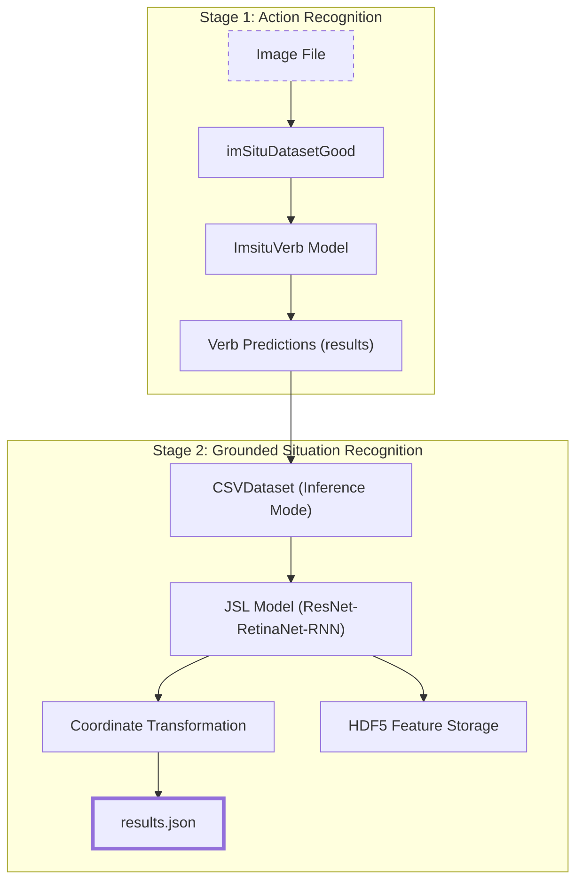
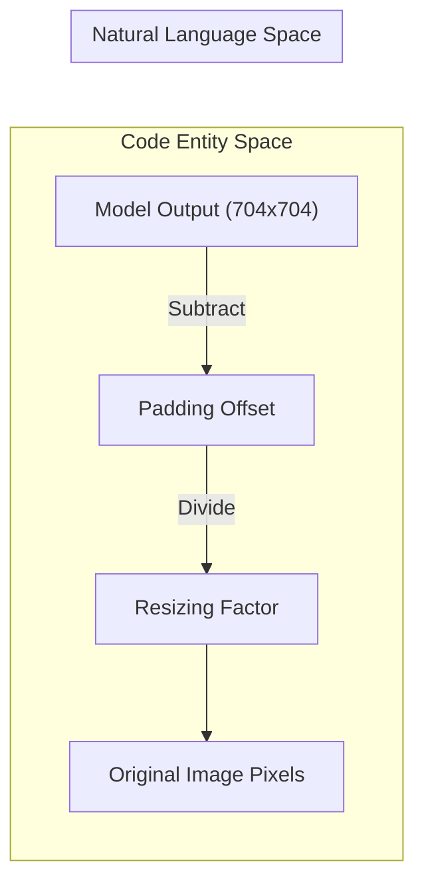

<!-- source: DeepWiki mcp.deepwiki.com · repo allenai/swig · page 5 Inference Pipeline · fetched 2026-10-26 -->

# Inference Pipeline

Relevant source files

The following files were used as context for generating this wiki page:

- [JSL/gsr/dataloader.py](JSL/gsr/dataloader.py)
- [JSL/inference.py](JSL/inference.py)
- [JSL/verb/verbModel.py](JSL/verb/verbModel.py)

The inference pipeline for the Joint Situation Localizer (JSL) is a two-stage process that transforms a raw image into a structured situation representation. It first identifies the primary action (verb) and then predicts the associated semantic roles, their corresponding entities (nouns), and their locations (bounding boxes).

## End-to-End Execution Flow

The entry point for inference is `JSL/inference.py` [JSL/inference.py:17-83](). The pipeline operates sequentially, using the output of the first stage to condition the execution of the second stage.

### System Architecture Overview

Sources: [JSL/inference.py:17-83](), [JSL/inference.py:149-166]()

## Stage 1: Verb Prediction

The first stage utilizes the `ImsituVerb` model [JSL/verb/verbModel.py:33-53]() to predict the most likely verb for each input image. 

1.  **Data Loading**: The `imSituDatasetGood` class is initialized in `inference` mode [JSL/inference.py:55]().
2.  **Model Execution**: The `eval` function [JSL/inference.py:149-166]() iterates through the images, passing them through the `ImsituVerb` backbone to generate verb indices.
3.  **Handoff**: These predicted indices are stored in a dictionary and passed to the `CSVDataset` for Stage 2 [JSL/inference.py:70-71]().

For details, see [Stage 1: Verb Prediction](#5.1).

Sources: [JSL/inference.py:53-61](), [JSL/inference.py:149-166](), [JSL/verb/verbModel.py:33-53]()

## Stage 2: Noun and Bounding Box Prediction

The second stage uses the `jsl_model` (a ResNet-RetinaNet-RNN architecture) to perform Grounded Situation Recognition (GSR) conditioned on the predicted verb.

1.  **Conditioning**: The `CSVDataset` uses the `inference_verbs` from Stage 1 to determine which semantic roles (from `imsitu_space.json`) need to be filled [JSL/gsr/dataloader.py:118-121]().
2.  **Recurrent Localization**: The model predicts noun categories and bounding box coordinates for each role in the verb's frame [JSL/inference.py:105-107]().
3.  **Coordinate Recovery**: Predicted bounding boxes are transformed back from the model's internal 704x704 coordinate space to the original image dimensions using `shift_1`, `shift_0`, and `scale` [JSL/inference.py:130-136]().

For details, see [Stage 2: Noun and Bounding Box Prediction](#5.2).

Sources: [JSL/inference.py:85-141](), [JSL/gsr/dataloader.py:118-124](), [JSL/gsr/dataloader.py:175-203]()

## Feature Extraction and Output

The pipeline concludes by serializing the structured data and, optionally, saving intermediate tensor representations.

### Output Formats

| Format | Content | File Path |
| :--- | :--- | :--- |
| **JSON** | Verb, noun list, and bounding box coordinates (x1, y1, x2, y2) per image. | `results.json` |
| **HDF5** | Local features extracted from the ROI Align layer for each predicted role. | `local_features/{image_id}.hdf5` |

### Coordinate Reverse-Transformation Logic

Because images are padded and resized during preprocessing in `Resizer` and `collater`, the inference script must reverse these operations to provide accurate coordinates relative to the original image:

Sources: [JSL/inference.py:130-143](), [JSL/inference.py:115-124]()

### Local Feature Extraction
If the `--store-features` flag is provided [JSL/inference.py:31](), the pipeline saves the `local_features` tensor [JSL/inference.py:105](). These features represent the visual encoding of specific semantic roles after ROI pooling, which are saved per-role within an HDF5 file [JSL/inference.py:115-124]().

Sources: [JSL/inference.py:31](), [JSL/inference.py:104-105](), [JSL/inference.py:115-124](), [JSL/inference.py:139-141]()

---

