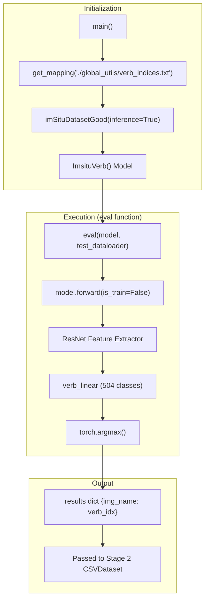
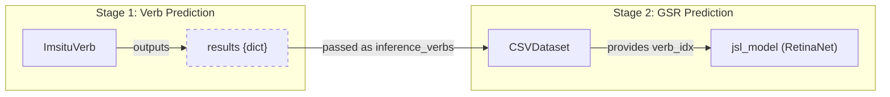

<!-- source: DeepWiki mcp.deepwiki.com · repo allenai/swig · page 5.1 Stage 1: Verb Prediction · fetched 2026-10-26 -->

# Stage 1: Verb Prediction

Relevant source files

The following files were used as context for generating this wiki page:

- [JSL/inference.py](JSL/inference.py)
- [JSL/verb/verbModel.py](JSL/verb/verbModel.py)

The Joint Situation Localizer (JSL) architecture operates in two distinct stages. Stage 1 is responsible for **Verb Prediction**, where the model identifies the primary action (verb) depicted in an image. This predicted verb index is critical because it defines the semantic "frame" (roles and expected nouns) that the Stage 2 GSR model will subsequently populate.

## Overview and Purpose

During inference, Stage 1 acts as a classifier that maps an input image to one of the 504 verb categories defined in the SWiG dataset. The output of this stage is a mapping of image filenames to predicted verb indices, which is then injected into the Stage 2 data loader to guide role-based grounding.

### Key Components
*   **`ImsituVerb`**: The primary model class responsible for verb classification [JSL/verb/verbModel.py:33-43]().
*   **`imSituDatasetGood`**: The dataset handler used to load images specifically for verb prediction [JSL/inference.py:55-56]().
*   **`eval()`**: The inference loop function that executes the verb model and collects results [JSL/inference.py:149-166]().

## System Architecture and Data Flow

The verb prediction pipeline transitions from the "Natural Language Space" (verb strings like "cooking") to the "Code Entity Space" (integer indices) via a mapping file.

### Stage 1 Inference Flow
The diagram below illustrates how the `inference.py` script orchestrates the verb prediction stage.

**Figure 1: Stage 1 Inference Execution**

Sources: [JSL/inference.py:50-61](), [JSL/verb/verbModel.py:44-52]()

## Implementation Details

### The ImsituVerb Model
The `ImsituVerb` class utilizes a ResNet-50 backbone to extract global image features. The 2048-dimensional feature vector from the final pooling layer is passed through a linear layer to produce logits for 504 verb classes.

| Component | Entity | Description |
| :--- | :--- | :--- |
| **Backbone** | `self.feature_extractor` | A `ResNet` instance initialized with pretrained weights [JSL/verb/verbModel.py:37-39](). |
| **Classifier** | `self.verb_linear` | `nn.Linear(2048, 504)` mapping features to verb space [JSL/verb/verbModel.py:40](). |
| **Loss (Training)** | `LabelSmoothing(0.2)` | Used during training to improve generalization [JSL/verb/verbModel.py:41](). |

### Inference Logic (`eval` function)
The `eval` function in `inference.py` runs the model in evaluation mode. It iterates through the `test_dataloader` and stores the predicted verb index for every image.

*   **Model Call**: The model is called with `is_train=False`, which triggers the return of both the top-1 prediction and the top-5 predictions [JSL/verb/verbModel.py:52]().
*   **Result Storage**: Only the top-1 prediction (`verb[i]`) is stored in the `results` dictionary, keyed by the image filename [JSL/inference.py:162-163]().

Sources: [JSL/inference.py:149-166](), [JSL/verb/verbModel.py:44-53]()

## Transition to Stage 2

The hand-off between Stage 1 and Stage 2 is facilitated by the `results` dictionary. This dictionary is passed directly into the constructor of the `CSVDataset` for Stage 2.

**Figure 2: Data Hand-off between Stage 1 and Stage 2**

In `inference.py`, the `results` from `eval()` are provided to the `CSVDataset` via the `inference_verbs` parameter [JSL/inference.py:70-71](). This ensures that when the GSR model processes an image, it uses the verb predicted in Stage 1 to look up the correct semantic roles (e.g., agent, tool, container) from the `imsitu_space.json` ontology [JSL/inference.py:63-66]().

Sources: [JSL/inference.py:61-71]()

---

