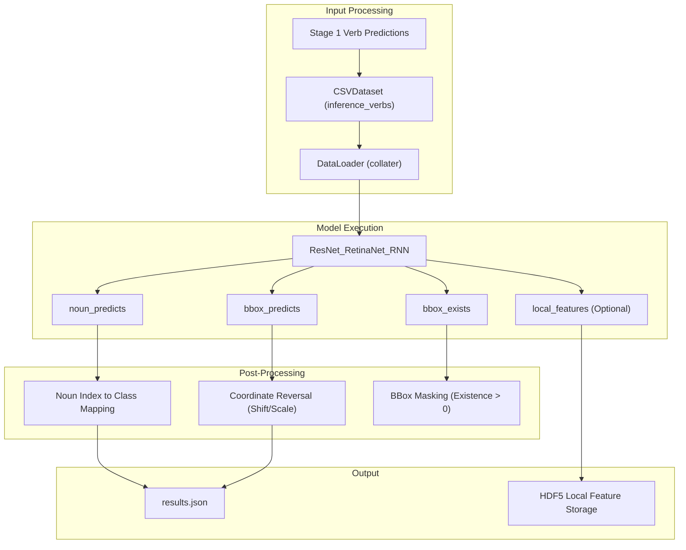
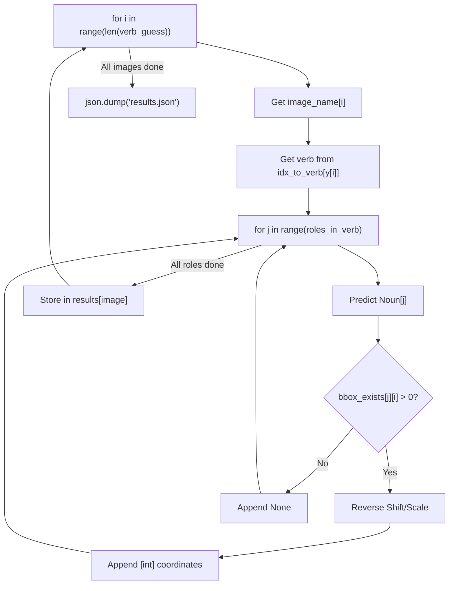

<!-- source: DeepWiki mcp.deepwiki.com · repo allenai/swig · page 5.2 Stage 2: Noun and Bounding Box Prediction · fetched 2026-10-26 -->

# Stage 2: Noun and Bounding Box Prediction

<details>
<summary>Relevant source files</summary>

The following files were used as context for generating this wiki page:

- [JSL/gsr/model.py](JSL/gsr/model.py)
- [JSL/inference.py](JSL/inference.py)

</details>


Stage 2 of the Joint Situation Localizer (JSL) inference pipeline is responsible for predicting the nouns (semantic roles) and their corresponding spatial bounding boxes for a given image and verb. This stage consumes the verb predictions from Stage 1 and utilizes a ResNet-RetinaNet-RNN architecture to generate grounded situation representations.

## Overview and Initialization

The Stage 2 process is orchestrated by the `evaluate` function in `JSL/inference.py`. It initializes a `CSVDataset` which maps verbs to their expected semantic roles based on the SWiG ontology.

### Key Components
- **Model Architecture**: A `ResNet_RetinaNet_RNN` model [JSL/gsr/model.py:184-186]() which combines a ResNet backbone, a Feature Pyramid Network (FPN), and an LSTM to predict a sequence of nouns and boxes.
- **Data Loading**: `CSVDataset` [JSL/inference.py:70-71]() handles the alignment of images with the verbs predicted in Stage 1.
- **Coordinate Handling**: The system tracks `shift_0`, `shift_1`, and `scale` to reverse image transformations applied during preprocessing.

### Inference Data Flow
The following diagram illustrates the flow from Stage 1 output to the final Stage 2 serialization.

**Stage 2 Inference Data Flow**

Sources: [JSL/inference.py:55-82](), [JSL/gsr/model.py:184-250]()

## Coordinate Shift and Scale Reversal

Images are resized and padded during the `Resizer` transform to fit a 704x704 input size. To produce bounding boxes relative to the original image dimensions, Stage 2 applies a reversal process:

1.  **Shift Reversal**: The `shift_1` (horizontal) and `shift_0` (vertical) values are subtracted from the predicted coordinates [JSL/inference.py:130-133]().
2.  **Scale Reversal**: The coordinates are divided by the original `scale` factor [JSL/inference.py:134]().
3.  **Clamping**: Coordinates are clamped to ensure they do not fall below zero [JSL/inference.py:130-133]().

| Variable | Description | Source |
| :--- | :--- | :--- |
| `shift_0` | Vertical padding/offset applied during resizing | [JSL/inference.py:101]() |
| `shift_1` | Horizontal padding/offset applied during resizing | [JSL/inference.py:100]() |
| `scale` | Scaling factor used to reach target resolution | [JSL/inference.py:134]() |

Sources: [JSL/inference.py:97-101](), [JSL/inference.py:129-136]()

## Noun Prediction and BBox Masking

The model predicts a noun for every role defined by the verb's frame. However, not all roles require a bounding box (e.g., abstract concepts or roles not present in the image).

-   **Noun Mapping**: Predicted noun indices are converted back to strings using `dataset_train.idx_to_class`. If a "blank" class is predicted, it is stored as an empty string [JSL/inference.py:125-128]().
-   **Existence Masking**: The `bbox_exists` logit determines if a box should be included. If `bbox_exists[j][i] > 0`, the box is processed; otherwise, it is set to `None` in the final output [JSL/inference.py:129-138]().

Sources: [JSL/inference.py:119-141](), [JSL/gsr/model.py:148-150]()

## Local Feature Storage (HDF5)

If the `--store-features` flag is provided [JSL/inference.py:31](), the system extracts intermediate representations from the GSR module.

-   **Extraction**: The model is called with `return_local_features=True` [JSL/inference.py:105]().
-   **Storage**: For each image, an HDF5 file is created in the `local_features/` directory [JSL/inference.py:117]().
-   **Structure**: Features for each semantic role are stored as separate datasets within the HDF5 file, indexed by the role's position in the verb's frame [JSL/inference.py:121-123]().

Sources: [JSL/inference.py:45-47](), [JSL/inference.py:115-124](), [JSL/inference.py:139-140]()

## Serialization: results.json

The final output of the inference pipeline is a `results.json` file. This file contains a dictionary where keys are image filenames and values are the grounded situation objects.

**Structure of results.json**
```json
{
    "image_name.jpg": {
        "verb": "cooking",
        "nouns": ["chef", "pan", "stove"],
        "boxes": [[10, 20, 100, 200], [50, 60, 80, 90], null]
    }
}
```

The `boxes` array contains `[xmin, ymin, xmax, ymax]` coordinates or `null` if the role is not grounded [JSL/inference.py:141-143]().

**System Logic Diagram: Serialization Loop**

Sources: [JSL/inference.py:109-144]()

---

