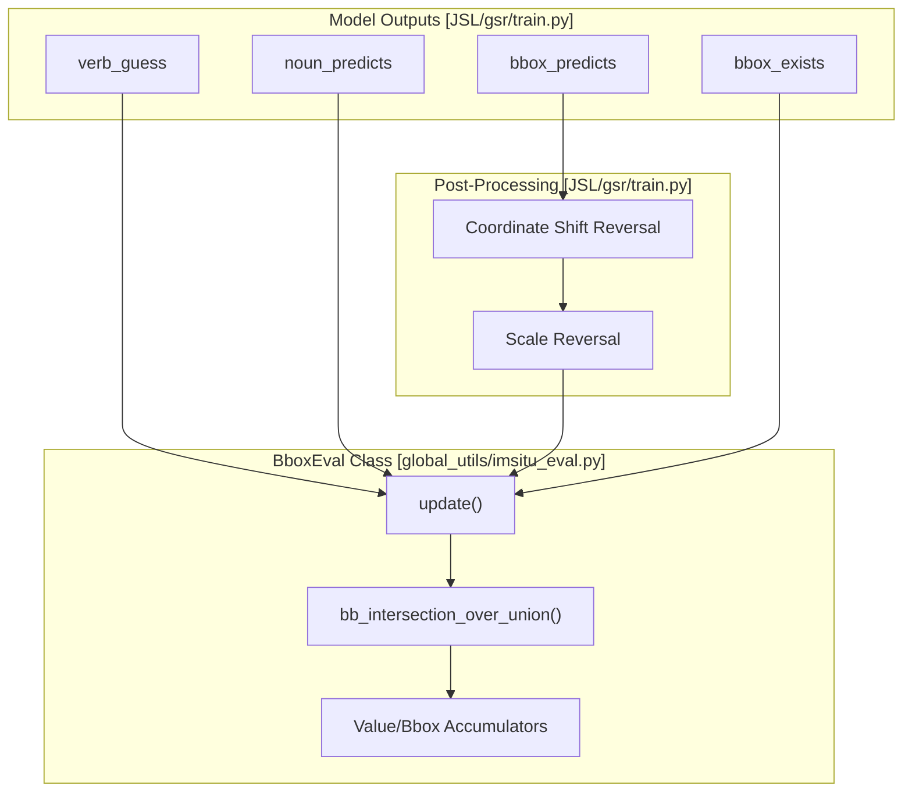

<!-- source: DeepWiki mcp.deepwiki.com · repo allenai/swig · page 6 Evaluation and Metrics · fetched 2026-10-26 -->

# Evaluation and Metrics

Relevant source files

The following files were used as context for generating this wiki page:

- [JSL/gsr/train.py](JSL/gsr/train.py)
- [global_utils/imsitu_eval.py](global_utils/imsitu_eval.py)

The SWiG (Situations with Grounding) benchmark requires evaluating models on three distinct but interconnected levels: identifying the action (**Verb**), identifying the participants (**Noun/Value**), and localizing those participants (**Bounding Box**). Performance is measured using a set of hierarchical metrics that track how many components of a "situation" are correctly predicted.

The primary engine for these calculations is the `BboxEval` class [global_utils/imsitu_eval.py:7](), which accumulates results across the dataset to produce aggregate accuracy scores.

### Metric Hierarchy

The evaluation suite produces several key metrics, categorized by whether they require noun accuracy ("Value") and whether they require spatial grounding ("Bbox").

| Metric | Description | Code Reference |
| :--- | :--- | :--- |
| **Verb** | Top-1 accuracy of the predicted verb. | [global_utils/imsitu_eval.py:23-24]() |
| **Value** | Mean per-verb accuracy of individual role-noun assignments. | [global_utils/imsitu_eval.py:36-42]() |
| **Value-All** | Accuracy of the entire situation (all nouns in all roles must be correct). | [global_utils/imsitu_eval.py:27-33]() |
| **Value-Bbox** | Individual role-noun accuracy, requiring an IoU > 0.5 for the bounding box. | [global_utils/imsitu_eval.py:54-60]() |
| **Value-All-Bbox** | The strictest metric; all nouns and all bounding boxes must be correct. | [global_utils/imsitu_eval.py:45-51]() |

For details on the specific accumulation logic and the 0.5 IoU threshold implementation, see **[BboxEval: Metric Computation](#6.1)**.

### Evaluation Flow

The evaluation process is integrated into the training loop via the `evaluate` function in `JSL/gsr/train.py` [JSL/gsr/train.py:144](). During this phase, the model is set to `eval()` mode, and the `BboxEval` object is updated iteratively for each batch in the validation dataloader.

#### Data Flow for Metric Calculation

The following diagram illustrates how raw model outputs are transformed and passed to the `BboxEval` utility to update global counters.

**Evaluation Data Flow Diagram**

**Sources:** [JSL/gsr/train.py:144-181](), [global_utils/imsitu_eval.py:63-98]()

### Integration with Training

Evaluation typically occurs at the end of every epoch [JSL/gsr/train.py:66](). A critical feature of the SWiG evaluation is the `use_gt_verb` flag [JSL/gsr/train.py:162](). When evaluating the GSR module's ability to predict nouns and boxes, researchers often provide the Ground Truth (GT) verb to isolate the grounding performance from the verb classifier's errors.

The results are logged to TensorBoard using the `SummaryWriter` [JSL/gsr/train.py:41](), allowing for real-time tracking of the gap between `Value` (noun-only) and `Value-Bbox` (noun + localization) performance.

For details on how coordinates are reversed and how the `evaluate` function handles the training-to-evaluation transition, see **[Evaluation During Training](#6.2)**.

### Logic for Grounding Success

A prediction for a specific role is considered "Grounded" if:
1. The predicted **Noun** matches one of the acceptable synonyms in the ground truth for that role [global_utils/imsitu_eval.py:85]().
2. The **Intersection over Union (IoU)** between the predicted box and the ground truth box is greater than **0.5** [global_utils/imsitu_eval.py:116]().
3. If the role is marked as not having a box (e.g., "abstract" roles), both the prediction and ground truth must be `None` [global_utils/imsitu_eval.py:103]().

**Sources:**
- [JSL/gsr/train.py:62-67]() (Epoch-based evaluation)
- [JSL/gsr/train.py:144-181]() (Evaluation logic)
- [global_utils/imsitu_eval.py:7-21]() (Class definition and state)
- [global_utils/imsitu_eval.py:102-119]() (IoU Logic)

---

