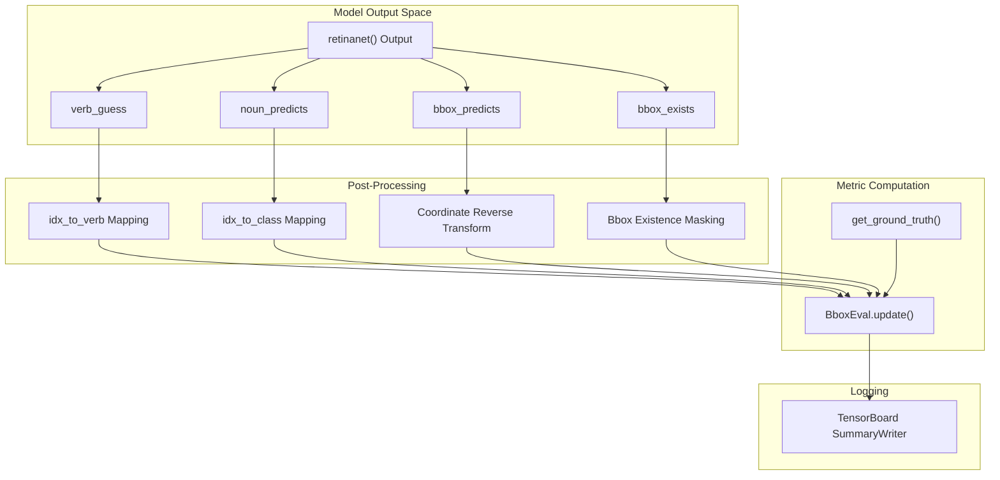
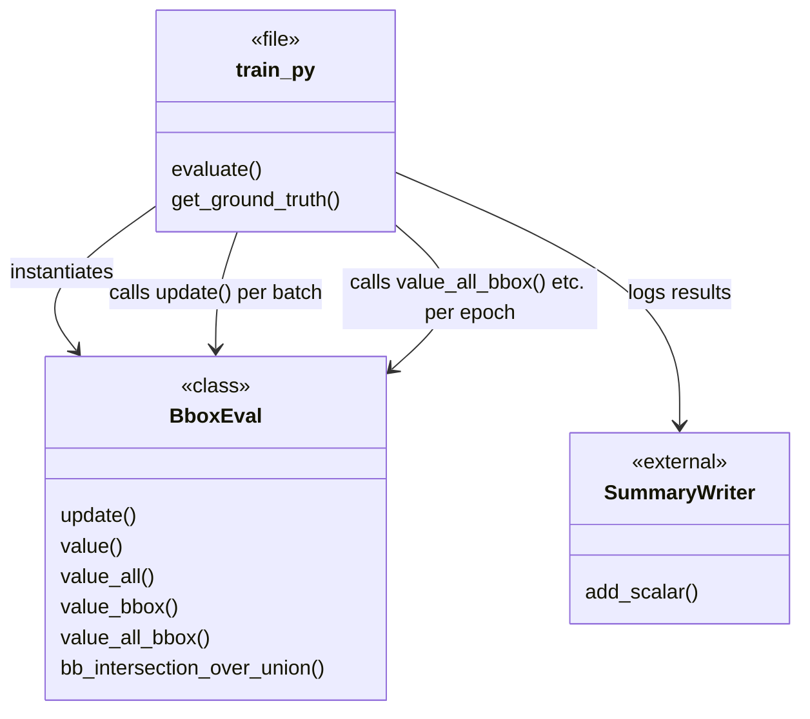

<!-- source: DeepWiki mcp.deepwiki.com · repo allenai/swig · page 6.2 Evaluation During Training · fetched 2026-10-26 -->

# Evaluation During Training

Relevant source files

The following files were used as context for generating this wiki page:

- [JSL/gsr/train.py](JSL/gsr/train.py)
- [global_utils/imsitu_eval.py](global_utils/imsitu_eval.py)

Evaluation during training is performed by the `evaluate()` function within the training loop. This process monitors model performance on the validation set after each epoch, calculating specialized Grounded Situation Recognition (GSR) metrics using the `BboxEval` class and logging them to TensorBoard.

## Evaluation Workflow

The evaluation pipeline bridges the model's raw tensor outputs (indices and bounding box deltas) to semantic labels and image-space coordinates for metric computation.

### System Data Flow: Tensors to Metrics
The following diagram illustrates how the `evaluate` function transforms model outputs into evaluation metrics.

**Evaluation Logic Flow**

**Sources:** [JSL/gsr/train.py:144-181](), [JSL/gsr/train.py:182-200](), [global_utils/imsitu_eval.py:63-98]()

## Key Components

### The `evaluate()` Function
The `evaluate()` function is called at the end of every epoch in `main` [JSL/gsr/train.py:66](). It switches the model to evaluation mode using `retinanet.eval()` [JSL/gsr/train.py:147]() and disables gradient calculation with `torch.no_grad()` [JSL/gsr/train.py:161]().

Key parameters and their roles:
*   **`use_gt_verb=True`**: During training evaluation, the GSR module is typically provided with the ground-truth verb to isolate the performance of noun prediction and localization from verb classification errors [JSL/gsr/train.py:162]().
*   **Coordinate Transformation**: Predicted bounding boxes are adjusted to account for the image padding (`shift_0`, `shift_1`) and scaling performed during data loading [JSL/gsr/train.py:174-178]().

**Sources:** [JSL/gsr/train.py:144-181]()

### BboxEval Metric Computation
The `BboxEval` class accumulates results across the validation set to calculate GSR-specific metrics.

| Metric | Code Method | Description |
| :--- | :--- | :--- |
| **Value** | `value()` | Accuracy of noun predictions across all roles [global_utils/imsitu_eval.py:36-42](). |
| **Value-All** | `value_all()` | Percentage of images where every noun in the situation is correct [global_utils/imsitu_eval.py:27-33](). |
| **Value-Bbox** | `value_bbox()` | Accuracy of noun predictions where the predicted box also has IoU > 0.5 with ground truth [global_utils/imsitu_eval.py:54-60](). |
| **Value-All-Bbox** | `value_all_bbox()` | Percentage of images where every noun and every bounding box is correct [global_utils/imsitu_eval.py:45-51](). |

The `update()` method performs the core comparison between predictions and ground truth for a single image, iterating through the roles defined in the verb's `order` [global_utils/imsitu_eval.py:63-98]().

**Sources:** [global_utils/imsitu_eval.py:7-60](), [global_utils/imsitu_eval.py:63-98]()

## Metric Logging and Integration

The metrics computed by `BboxEval` are retrieved and logged to TensorBoard using the `SummaryWriter`. This allows for real-time tracking of the model's grounding capabilities.

### Implementation Mapping
The following diagram maps the evaluation logic to the specific code entities in `train.py` and `imsitu_eval.py`.

**Code Entity Association**

**Sources:** [JSL/gsr/train.py:144-145](), [JSL/gsr/train.py:182-200](), [global_utils/imsitu_eval.py:7-21]()

### TensorBoard Metrics
After iterating through the entire validation dataloader, the following scalars are logged:
*   `val/value_all`
*   `val/value`
*   `val/value_all_bbox`
*   `val/value_bbox`

These metrics are essential for determining if the model is learning to associate the correct semantic nouns with the correct spatial regions (Grounded Situation Recognition).

**Sources:** [JSL/gsr/train.py:192-196](), [global_utils/imsitu_eval.py:27-60]()

---

