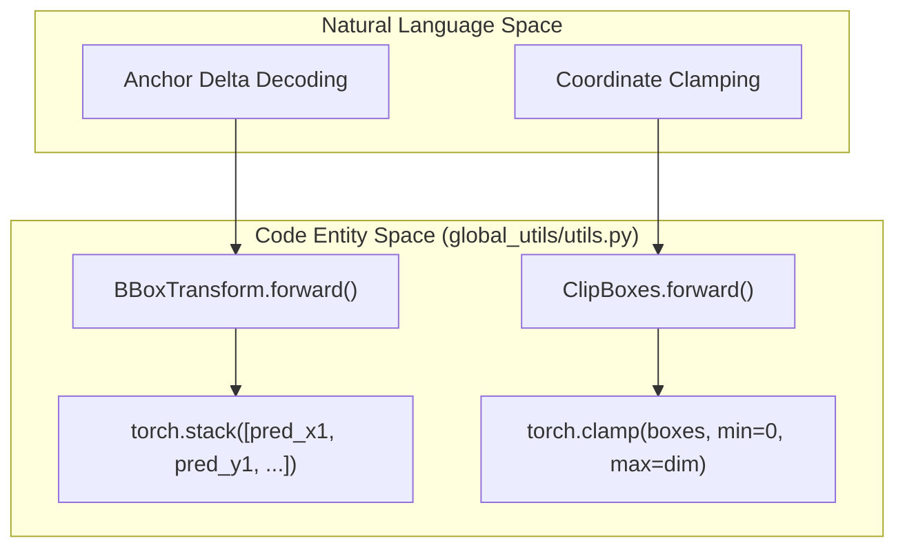
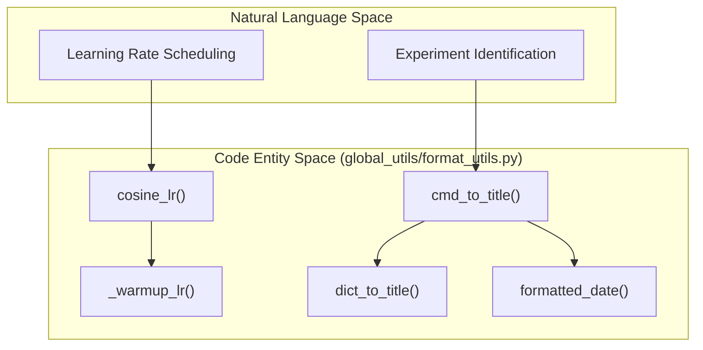

<!-- source: DeepWiki mcp.deepwiki.com · repo allenai/swig · page 7 Global Utilities · fetched 2026-10-26 -->

# Global Utilities

Relevant source files

The following files were used as context for generating this wiki page:

- [global_utils/format_utils.py](global_utils/format_utils.py)
- [global_utils/resnet.py](global_utils/resnet.py)
- [global_utils/utils.py](global_utils/utils.py)

The `global_utils` directory contains shared modules and helper functions utilized by both the Verb Classifier and the GSR (Joint Situation Localizer) components. These utilities standardize common operations such as neural network building blocks, bounding box transformations, and experiment management.

## Overview of Utility Areas

The utilities are broadly categorized into architectural components and operational helpers:

1.  **Architectural Utilities**: Standardized ResNet blocks (`BasicBlock`, `Bottleneck`) and coordinate transformation layers (`BBoxTransform`, `ClipBoxes`) that ensure consistency across different model stages.
2.  **Operational Utilities**: Helpers for managing the training lifecycle, including learning rate scheduling, command-line argument parsing, and automated experiment naming.

### Bounding Box and Architectural Utilities
The codebase relies on shared logic for handling spatial data and backbone architectures. The `BBoxTransform` class [global_utils/utils.py:80-118]() is responsible for decoding anchor deltas into absolute image coordinates using standardized mean and standard deviation values. Complementing this, `ClipBoxes` [global_utils/utils.py:120-136]() ensures that predicted coordinates remain within the valid image boundaries.

For model backbones, the repository provides generic implementations of ResNet components. These include `BasicBlock` [global_utils/resnet.py:17-46]() and `Bottleneck` [global_utils/resnet.py:49-84](), which are used to construct the feature extraction layers for situation recognition.

For details on coordinate handling and ResNet blocks, see **[Bounding Box Utilities](#7.1)**.

### Format and Experiment Utilities
To maintain reproducibility and organized logging, the `format_utils.py` module provides tools to translate training commands into human-readable experiment titles. Functions like `cmd_to_title` [global_utils/format_utils.py:66-70]() automatically append timestamps and parameter settings to run names.

Additionally, this module contains the learning rate logic, specifically the `cosine_lr` scheduler [global_utils/format_utils.py:9-22]() which implements a linear warmup followed by a cosine decay, a common practice for stabilizing deep learning training.

For details on LR scheduling and experiment naming, see **[Format and Experiment Utilities](#7.2)**.

---

## Code-to-System Mapping

The following diagrams illustrate how these utility classes and functions bridge the gap between high-level system requirements (like "Training Stability" or "Spatial Accuracy") and the specific code entities that implement them.

### Diagram 1: Spatial Processing Utilities
This diagram shows how raw model outputs (deltas) are processed by utility entities to produce final, valid bounding boxes.

**Sources:** [global_utils/utils.py:80-136]()

### Diagram 2: Experiment Management Utilities
This diagram maps the requirement of "Automated Logging" to the formatting functions that generate unique experiment identifiers.

**Sources:** [global_utils/format_utils.py:9-75]()

---

## Utility Module Summary

| Module | Key Entities | Purpose |
| :--- | :--- | :--- |
| `utils.py` | `BBoxTransform`, `ClipBoxes` | Bounding box delta decoding and boundary enforcement. [global_utils/utils.py:1-136]() |
| `resnet.py` | `ResNet`, `Bottleneck`, `BasicBlock` | Shared ResNet backbone implementation for feature extraction. [global_utils/resnet.py:1-160]() |
| `format_utils.py` | `cosine_lr`, `cmd_to_title` | Training hyperparameter management and logging utilities. [global_utils/format_utils.py:1-75]() |

**Sources:** [global_utils/utils.py:1-136](), [global_utils/resnet.py:1-160](), [global_utils/format_utils.py:1-75]()

---

