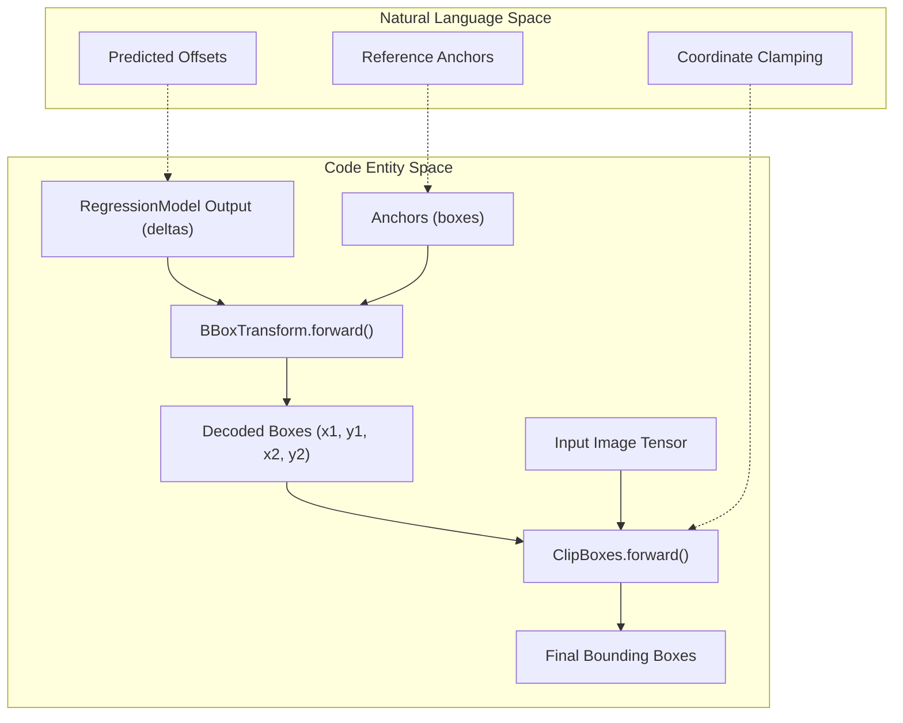
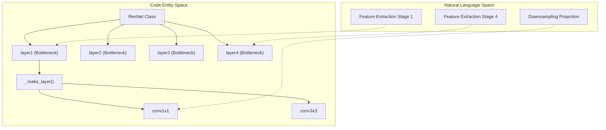

<!-- source: DeepWiki mcp.deepwiki.com · repo allenai/swig · page 7.1 Bounding Box Utilities · fetched 2026-10-26 -->

# Bounding Box Utilities

Relevant source files

The following files were used as context for generating this wiki page:

- [global_utils/resnet.py](global_utils/resnet.py)
- [global_utils/utils.py](global_utils/utils.py)

This section details the foundational utilities used for bounding box manipulation and the core ResNet architectural blocks. These components are shared across the Verb Classifier and the Grounded Situation Recognition (GSR) models to ensure consistent spatial transformations and feature extraction.

## Bounding Box Transformations

The system utilizes specialized modules to transform raw model outputs (deltas) into pixel-space coordinates and to ensure these coordinates remain within image boundaries.

### BBoxTransform
The `BBoxTransform` class is responsible for decoding bounding box regression deltas relative to anchor boxes. It converts the network's predicted offsets into absolute coordinates $(x1, y1, x2, y2)$.

**Implementation Details:**
- **Anchor Center Calculation**: It first computes the widths, heights, and center coordinates ($ctr\_x$, $ctr\_y$) of the input anchors [global_utils/utils.py:95-98]().
- **Delta Normalization**: Predicted deltas are denormalized using a predefined mean and standard deviation (default: $\mu=0$, $\sigma=[0.1, 0.1, 0.2, 0.2]$) [global_utils/utils.py:85-91]().
- **Coordinate Decoding**: 
    - The predicted center shifts by $dx \times width$ and $dy \times height$ [global_utils/utils.py:105-106]().
    - The predicted width and height are scaled using the exponential of the deltas: $\exp(dw) \times width$ [global_utils/utils.py:107-108]().
- **Final Output**: The center-width-height representation is converted back to corner coordinates $(x1, y1, x2, y2)$ [global_utils/utils.py:110-115]().

### ClipBoxes
The `ClipBoxes` class ensures that predicted bounding boxes do not exceed the physical dimensions of the input image [global_utils/utils.py:120](). It uses `torch.clamp` to restrict $x$ coordinates between $0$ and the image width, and $y$ coordinates between $0$ and the image height [global_utils/utils.py:129-133]().

### Data Flow: Anchor to Prediction
The following diagram illustrates how raw model outputs are transformed into valid image-space bounding boxes.

**Bounding Box Decoding Pipeline**

Sources: [global_utils/utils.py:80-136]()

---

## ResNet Building Blocks

The repository provides standard ResNet components in `global_utils/resnet.py` and `global_utils/utils.py`. These blocks are used to construct the backbones for both the verb classification and the GSR modules.

### BasicBlock
Used primarily in shallower ResNet variants (e.g., ResNet-18, ResNet-34), the `BasicBlock` consists of two $3 \times 3$ convolutions with a residual skip connection [global_utils/resnet.py:17-46]().

### Bottleneck
Used in deeper architectures like ResNet-50 and ResNet-101, the `Bottleneck` block optimizes computation using a $1 \times 1 \rightarrow 3 \times 3 \rightarrow 1 \times 1$ convolution sequence [global_utils/resnet.py:49-84](). 
- The first $1 \times 1$ reduces dimensionality [global_utils/resnet.py:54]().
- The $3 \times 3$ performs spatial convolution [global_utils/resnet.py:56]().
- The final $1 \times 1$ restores (expands) dimensionality [global_utils/resnet.py:58]().

### Block Comparison Table

| Feature | BasicBlock | Bottleneck |
| :--- | :--- | :--- |
| **Expansion Factor** | 1 [global_utils/resnet.py:18]() | 4 [global_utils/resnet.py:50]() |
| **Layers** | 2 x Conv 3x3 [global_utils/resnet.py:22-25]() | Conv 1x1, 3x3, 1x1 [global_utils/resnet.py:54-58]() |
| **Usage** | Shallow Networks | Deep Networks (ResNet-50+) |
| **Downsampling** | Optional stride in first conv [global_utils/resnet.py:22]() | Optional stride in 3x3 conv [global_utils/resnet.py:56]() |

### ResNet Class Structure
The `ResNet` class implements the standard four-stage architecture [global_utils/resnet.py:87]().
- **Initial Layers**: A $7 \times 7$ convolution followed by MaxPool [global_utils/resnet.py:94-98]().
- **Layer Stages**: Four stages (`layer1` to `layer4`) composed of multiple blocks [global_utils/resnet.py:99-102]().
- **Global Pooling**: Uses `AdaptiveAvgPool2d` to produce a fixed-size feature vector [global_utils/resnet.py:103, 155]().

**ResNet Entity Mapping**

Sources: [global_utils/resnet.py:6-159](), [global_utils/utils.py:5-78]()

## Summary of Global Functions

| Function | File | Description |
| :--- | :--- | :--- |
| `conv3x3` | `global_utils/resnet.py:6-9` | Standard 3x3 convolution with padding=1 and no bias. |
| `conv1x1` | `global_utils/resnet.py:12-14` | Standard 1x1 convolution for dimensionality reduction/expansion. |
| `_make_layer` | `global_utils/resnet.py:124-138` | Helper to instantiate sequences of `BasicBlock` or `Bottleneck`. |

Sources: [global_utils/resnet.py:1-160](), [global_utils/utils.py:1-136]()

---

