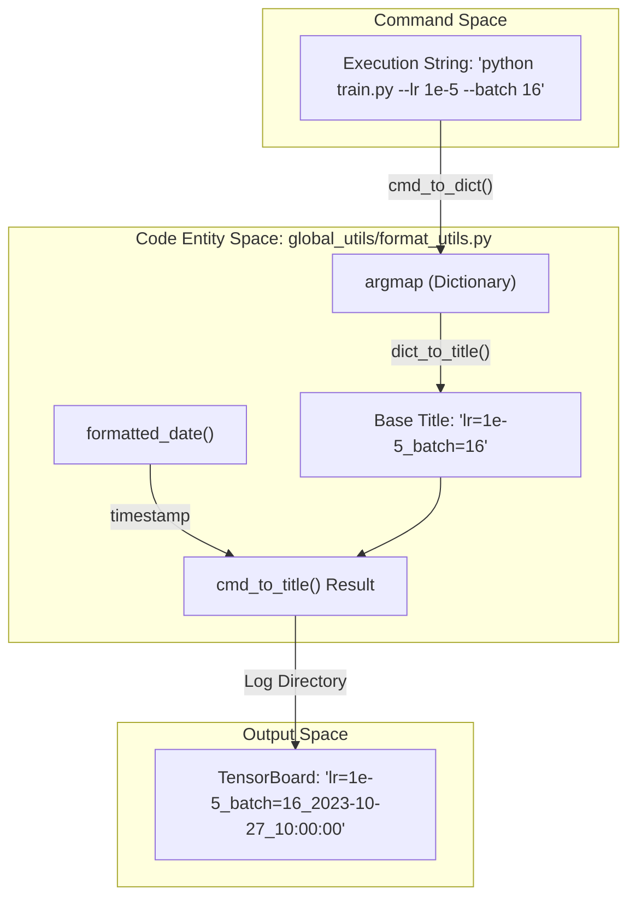
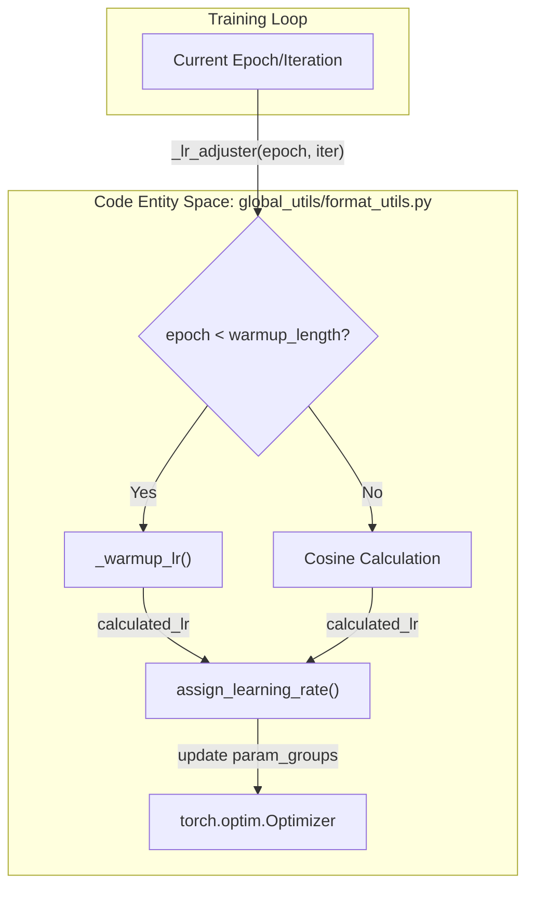

<!-- source: DeepWiki mcp.deepwiki.com · repo allenai/swig · page 7.2 Format and Experiment Utilities · fetched 2026-10-26 -->

# Format and Experiment Utilities

Relevant source files

The following files were used as context for generating this wiki page:

- [global_utils/format_utils.py](global_utils/format_utils.py)

The `global_utils/format_utils.py` module provides a suite of helper functions designed to standardize experiment tracking and learning rate management across the SWiG codebase. These utilities facilitate the automatic generation of descriptive run names based on command-line arguments and implement learning rate schedules such as Cosine Annealing with linear warmup.

## Experiment Naming and Command Parsing

To ensure reproducibility and organized logging in TensorBoard, the codebase uses a set of functions to transform command-line execution strings into structured dictionaries and human-readable titles.

### Implementation Details
The utility parses the command string used to launch a script (typically `train.py`) and extracts key-value pairs representing the hyperparameters.

*   **`cmd_to_dict(cmd, list_format=False)`**: This function takes a raw command string or a list of arguments and converts them into an `argmap` dictionary [global_utils/format_utils.py:27-54](). It identifies keys by the leading `-` character and maps them to their subsequent values [global_utils/format_utils.py:43-47]().
*   **`dict_to_title(argmap)`**: Converts the dictionary into a string of `key=value` pairs joined by underscores [global_utils/format_utils.py:57-63](). It explicitly excludes filesystem paths (e.g., `--train-file`, `--role-file`) to keep the title concise [global_utils/format_utils.py:62-63]().
*   **`cmd_to_title(cmd, list_format=False)`**: The primary entry point for generating experiment IDs. It combines the output of `dict_to_title` with a timestamp from `formatted_date()` to ensure every run has a unique identifier [global_utils/format_utils.py:66-69]().
*   **`formatted_date()`**: Returns a string representation of the current system time in `YYYY-MM-DD_HH:MM:SS` format [global_utils/format_utils.py:72-75]().

### Diagram: Command to Experiment Identity
The following diagram illustrates how raw execution commands are transformed into the "Natural Language Space" of experiment titles used for directory naming and logging.

**Experiment Title Generation Flow**

**Sources:** [global_utils/format_utils.py:27-75]()

---

## Learning Rate Scheduling

The module provides utilities for dynamically adjusting the learning rate (LR) during training, which is critical for the convergence of both the Verb Classifier and the GSR Module.

### Learning Rate Assignment
The `assign_learning_rate` function is a low-level helper that directly modifies the `param_groups` of a PyTorch optimizer [global_utils/format_utils.py:4-7](). This allows for manual LR overrides or integration into custom scheduling loops.

### Cosine Annealing with Warmup
The `cosine_lr` function implements a sophisticated scheduling strategy that combines an initial linear warmup phase with a cosine decay phase [global_utils/format_utils.py:9-22]().

1.  **Warmup Phase**: For the first `args.warmup_length` epochs, the LR increases linearly from 0 to the base learning rate defined in `args.lr` [global_utils/format_utils.py:24-25]().
2.  **Cosine Decay Phase**: After the warmup, the LR follows a cosine curve, gradually decreasing toward zero as the current epoch approaches the total `args.epochs` [global_utils/format_utils.py:14-16]().

### Diagram: LR Scheduler Logic
This diagram maps the mathematical logic of the scheduler to the internal function calls within `format_utils.py`.

**LR Scheduler Data Flow**

### Scheduling Logic Summary
| Feature | Function | Description |
| :--- | :--- | :--- |
| **Manual Update** | `assign_learning_rate` | Iterates through `optimizer.param_groups` and sets `lr` to `new_lr`. |
| **Linear Warmup** | `_warmup_lr` | Calculates `base_lr * (epoch + 1) / warmup_length`. |
| **Cosine Decay** | `cosine_lr` | Returns a closure `_lr_adjuster` that calculates LR based on `0.5 * (1 + cos(pi * e / es))`. |

**Sources:** [global_utils/format_utils.py:4-25]()

---

## Utility Function Reference

### Timestamping
The `formatted_date` function provides a standardized string format used across the repository for checkpoint naming and logging [global_utils/format_utils.py:72-75]().

### Dictionary Filtering
In `dict_to_title`, specific keys are filtered out to prevent experiment titles from becoming excessively long or containing environment-specific absolute paths [global_utils/format_utils.py:62-63]().

| Filtered Key | Reason |
| :--- | :--- |
| `train-file` | Path to training JSON; varies by environment. |
| `val-file` | Path to validation JSON; varies by environment. |
| `classes-file` | Path to ontology; usually static. |
| `role-file` | Path to role definitions; usually static. |
| `cmd` | The full raw command string. |

**Sources:** [global_utils/format_utils.py:57-75]()

---

