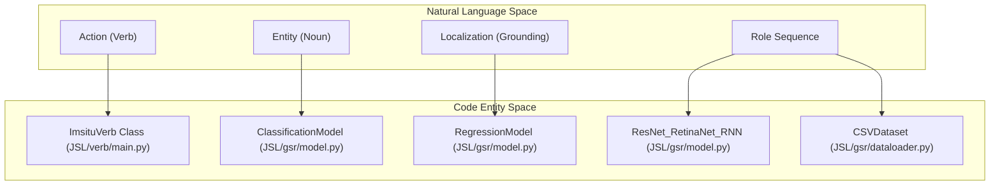
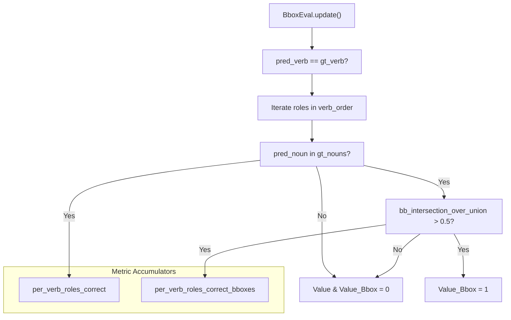

<!-- source: DeepWiki mcp.deepwiki.com · repo allenai/swig · page 8 Glossary · fetched 2026-10-26 -->

# Glossary

Relevant source files

The following files were used as context for generating this wiki page:

- [JSL/gsr/dataloader.py](JSL/gsr/dataloader.py)
- [JSL/gsr/model.py](JSL/gsr/model.py)
- [README.md](README.md)
- [SWiG_jsons/imsitu_space.json](SWiG_jsons/imsitu_space.json)
- [global_utils/imsitu_eval.py](global_utils/imsitu_eval.py)
- [global_utils/losses.py](global_utils/losses.py)
- [global_utils/train_classes.csv](global_utils/train_classes.csv)
- [global_utils/verb_indices.txt](global_utils/verb_indices.txt)

This glossary defines technical terms, dataset concepts, and architectural components specific to the SWiG (Situations With Groundings) codebase and the Joint Situation Localizer (JSL) model. It serves as a reference for engineers to map conceptual terminology to specific code entities and implementation details.

## 1. Task and Dataset Concepts

### Grounded Situation Recognition (GSR)
The primary task performed by the system, which extends Situation Recognition by requiring the model to not only identify the action (verb) and entities (nouns) but also to localize those entities with bounding boxes [README.md:4-6]().

### Verb
One of 504 visually groundable actions defined in the dataset [README.md:36-39](). In the code, verbs are mapped to indices using `verb_indices.txt` [JSL/gsr/dataloader.py:67-73]().

### Frame
A semantic structure associated with a verb, consisting of 1 to 6 semantic roles [README.md:41-44](). Each verb has a pre-defined set of roles (e.g., "kneading" has "Agent", "Item", and "Place") [README.md:42-44]().

### Role (Semantic Role)
A specific slot in a verb's frame. Roles are ordered according to the `order` key in `imsitu_space.json` [SWiG_jsons/imsitu_space.json:85-92]().

### Noun (Value)
The entity filling a semantic role. The SWiG dataset provides three noun annotations per role from different annotators [README.md:48-49](). Nouns are represented by WordNet IDs (e.g., `n10287213`) [global_utils/train_classes.csv:2]().

### Grounding
The spatial localization of a noun in an image, represented by coordinates `[x1, y1, x2, y2]` [README.md:51-53](). If a noun is not visible or grounded, coordinates are set to `[-1, -1, -1, -1]` [README.md:56-57]().

---

## 2. Architectural Components

### JSL (Joint Situation Localizer)
The unified model architecture designed to solve GSR. It is composed of a Verb Classifier and a GSR Module (RetinaNet-RNN) [README.md:4-6]().

### RetinaNet-RNN
The core GSR architecture implemented in `ResNet_RetinaNet_RNN` [JSL/gsr/model.py:184-188](). It combines a ResNet backbone with a Feature Pyramid Network (FPN) and an LSTM to sequentially predict nouns and bounding boxes for each role in a verb's frame.

### Feature Pyramid Network (FPN)
Implemented as `PyramidFeatures`, this component extracts multi-scale features (P3 through P7) from the ResNet backbone [JSL/gsr/model.py:30-75]().

### Anchor
Reference boxes of various scales and ratios used for object detection. The `Anchors` class generates these across different FPN levels [JSL/gsr/model.py:7]().

### Natural Language to Code Mapping
The following diagram maps high-level GSR concepts to the specific classes and files that implement them.

**Concept to Code Entity Map**

*Sources: [JSL/gsr/model.py:79-161](), [JSL/gsr/dataloader.py:26-57]()*

---

## 3. Data Pipeline Terminology

### Annotation Tensor (7-column format)
The internal representation of role data within the `CSVDataset`. Each role is represented by a row: `[x1, y1, x2, y2, class1, class2, class3]` [JSL/gsr/dataloader.py:159-172]().

### OOV (Out of Vocabulary)
A special label used for nouns present in the annotations but missing from the training class list [JSL/gsr/dataloader.py:197-201]().

### Blank / Pad
*   **Blank**: Used when a role exists for a verb but is not present in the specific image [JSL/gsr/dataloader.py:190-195]().
*   **Pad**: Used to fill the annotation tensor to a fixed size of 6 roles for batching purposes [JSL/gsr/dataloader.py:208-212]().

---

## 4. Training and Evaluation Terms

### Focal Loss
A specialized loss function used to handle class imbalance in the detection heads. It computes classification, regression, and bbox existence losses [global_utils/losses.py:26-44]().

### Label Smoothing
A regularization technique implemented in the `LabelSmoothing` class to prevent the model from becoming overconfident in noun predictions [JSL/gsr/model.py:162-181]().

### BboxEval
 The evaluation engine that computes GSR metrics, including `value`, `value_all`, and their grounded counterparts `value_bbox` and `value_all_bbox` [global_utils/imsitu_eval.py:7-60]().

**Evaluation Logic Flow**

*Sources: [global_utils/imsitu_eval.py:63-119]()*

---

## 5. Technical Implementation Glossary

| Term | Implementation / Reference | Description |
| :--- | :--- | :--- |
| **BBoxTransform** | `global_utils/utils.py` | Decodes anchor deltas into final pixel coordinates [JSL/gsr/model.py:6](). |
| **ClipBoxes** | `global_utils/utils.py` | Clamps bounding box coordinates to the image boundaries [JSL/gsr/model.py:6](). |
| **ROI Align** | `torchvision.ops.roi_align` | Extracts local features from the FPN for noun classification [JSL/gsr/model.py:13](). |
| **imsitu_space.json** | `SWiG_jsons/imsitu_space.json` | The global ontology containing verb definitions, role orders, and noun glosses [README.md:73-98](). |
| **bbox_exists** | `ClassificationModel` | A binary logit predicting if a role should have a grounding box in the current image [JSL/gsr/model.py:148-159](). |

*Sources: [JSL/gsr/model.py:6-159](), [README.md:73-98]()*