# Page: Overview

# Overview

<details>
<summary>Relevant source files</summary>

The following files were used as context for generating this wiki page:

- [LICENSE](LICENSE)
- [README.md](README.md)
- [images/banner.png](images/banner.png)

</details>


The **SWiG/JSL** repository provides the implementation for the **Joint Situation Localizer (JSL)**, a model designed for the **Grounded Situation Recognition (GSR)** task. GSR extends activity recognition by not only identifying the primary action (verb) in an image but also identifying and localizing all entities (nouns) that fulfill semantic roles associated with that action.

## Grounded Situation Recognition (GSR)

GSR is a structured vision-language task where the system must predict a "situation" represented by a verb and a corresponding semantic frame. 

*   **Verb**: One of 504 visually groundable actions (e.g., "kneading", "hitchhiking"). [README.md:36-39]()
*   **Frame**: A set of 1 to 6 semantic roles (e.g., "Agent", "Item", "Place") defined by the verb's ontology. [README.md:41-44]()
*   **Groundings**: Bounding box coordinates `[x1, y1, x2, y2]` for each entity filling a role. If an entity is not visible or occluded, it is marked as not grounded. [README.md:51-53]()

The system utilizes the **SWiG (Situations With Groundings)** dataset, which augments the imSitu dataset with object bounding boxes. [README.md:3-6]()

## System Architecture

The JSL system is implemented as a two-stage pipeline. The first stage classifies the verb, and the second stage predicts the nouns and their locations based on that verb.

### High-Level Component Interaction

The following diagram illustrates how the system components interact, mapping high-level tasks to specific code entities.

**JSL Execution Flow**
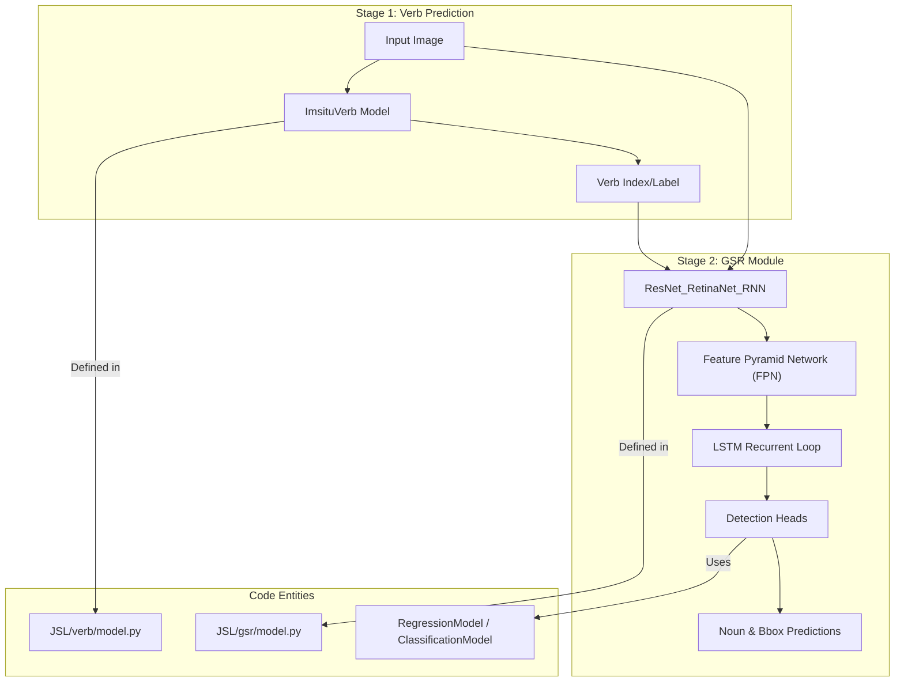
Sources: [README.md:124-126](), [JSL/inference.py:113-115]()

## Key Components

### 1. Verb Classifier
The verb classifier uses a ResNet-50 backbone to predict the most likely action occurring in the image. This stage is decoupled from the grounding stage to allow for flexible updates to either model.
*   **Primary Class**: `ImsituVerb`
*   **For details, see [Verb Classifier](#2.1)**

### 2. GSR Module (RetinaNet-RNN)
The core of JSL is a modified RetinaNet architecture that uses an RNN (LSTM) to sequentially predict nouns and bounding boxes for each role in the verb's frame. It utilizes a Feature Pyramid Network (FPN) for multi-scale object detection.
*   **Primary Class**: `ResNet_RetinaNet_RNN`
*   **For details, see [JSL Model Architecture](#2)**

### 3. Data Pipeline
The system processes the SWiG JSON annotations into structured tensors. It handles the mapping between WordNet synsets (nouns) and the visual roles defined in `imsitu_space.json`.
*   **Key Classes**: `CSVDataset`, `imSituDatasetGood`, `Resizer`, `Collater`
*   **For details, see [Data Pipeline](#4)**

### 4. Inference and Evaluation
The inference engine runs the two stages sequentially and outputs a `results.json` file. Evaluation is performed using the `BboxEval` utility, which calculates accuracy for verbs, nouns (values), and bounding box overlaps (IoU).
*   **For details, see [Inference Pipeline](#5) and [Evaluation and Metrics](#6)**

## Codebase Navigation

The repository is organized into functional subdirectories:

| Directory | Description |
| :--- | :--- |
| `JSL/verb/` | Code for training and defining the Stage 1 verb classifier. [README.md:128-131]() |
| `JSL/gsr/` | Code for the Stage 2 RetinaNet-RNN model and training loop. [README.md:134-135]() |
| `global_utils/` | Shared utilities for bounding box transformations, ResNet blocks, and experiment logging. [README.md:134]() |
| `SWiG_jsons/` | Contains `train.json`, `test.json`, `dev.json`, and the `imsitu_space.json` ontology. [README.md:99]() |

### Code Entity Mapping
The following diagram bridges the conceptual tasks to the specific file structure and classes.

**Component to File Mapping**
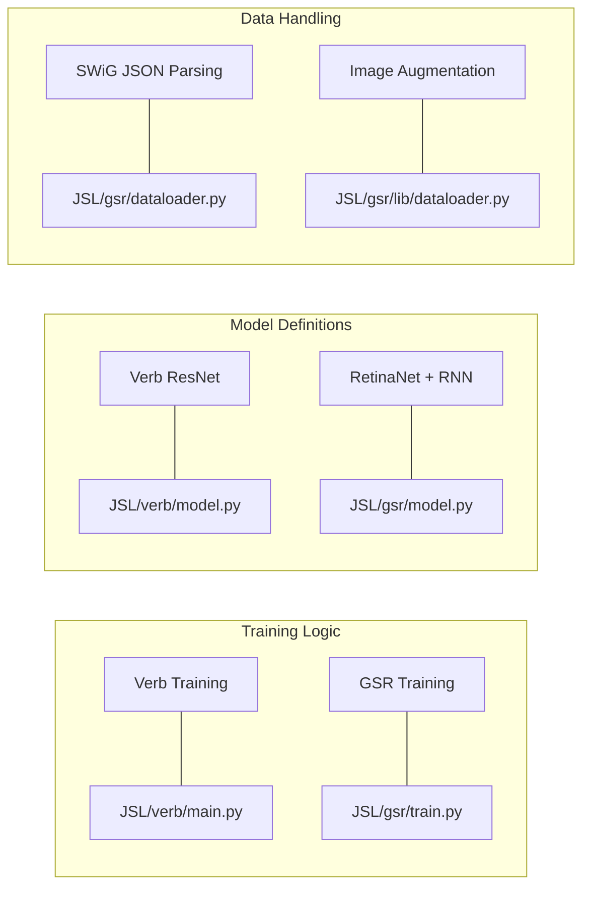
Sources: [README.md:128-136]()

## Wiki Navigation

*   **[Getting Started](#1.1)**: Instructions for environment setup, downloading the SWiG dataset, and running your first inference.
*   **[Task and Dataset: SWiG](#1.2)**: Deep dive into the Grounded Situation Recognition task and the format of the SWiG annotations.
*   **[JSL Model Architecture](#2)**: Detailed technical breakdown of the verb classifier and the recurrent RetinaNet-RNN.
*   **[Training Pipeline](#3)**: Explanation of the training loops, optimizers, and the multi-component loss functions.
*   **[Data Pipeline](#4)**: How images and JSON metadata are transformed into model-ready batches.
*   **[Inference Pipeline](#5)**: Walkthrough of the end-to-end prediction process and feature extraction.
*   **[Evaluation and Metrics](#6)**: How the model is benchmarked against the SWiG dataset.

Sources: [README.md:1-126]()

---

# Page: Getting Started

# Getting Started

<details>
<summary>Relevant source files</summary>

The following files were used as context for generating this wiki page:

- [.gitignore](.gitignore)
- [README.md](README.md)
- [all_ims.txt](all_ims.txt)
- [requirements.txt](requirements.txt)

</details>


The Situation With Groundings (SWiG) codebase provides a comprehensive framework for solving the **Grounded Situation Recognition (GSR)** task. This task involves identifying a primary action (verb) in an image, recognizing the semantic entities (nouns) involved in roles specific to that action, and localizing those entities with bounding boxes [README.md:1-6]().

The core of the system is the **Joint Situation Localizer (JSL)**, a two-stage model architecture that separates verb classification from noun and grounding prediction [README.md:123-126]().

## Environment Setup

The project requires Python 3 and several scientific computing libraries.

1.  **Clone the Repository**:
    ```bash
    git clone git@github.com:allenai/swig.git
    cd swig
    ```
    [README.md:19-20]()

2.  **Environment Configuration**:
    It is recommended to use a virtual environment to manage dependencies such as `torch` (v1.4.0), `torchvision` (v0.5.0), and `tensorboardX` [README.md:21-24](), [requirements.txt:18-20]().
    ```bash
    python3 -m venv my_venv
    source my_venv/bin/activate
    pip install -r requirements.txt
    ```

## Directory Layout

The repository is organized into specific modules for the two-stage pipeline and shared utilities.

| Directory | Purpose |
| :--- | :--- |
| `SWiG_jsons/` | Contains the dataset annotations (`train.json`, `dev.json`, `test.json`) and the `imsitu_space.json` ontology [README.md:99-102](). |
| `JSL/` | The root directory for the Joint Situation Localizer code. |
| `JSL/verb/` | Logic for Stage 1: Verb classification, including the `ImsituVerb` model and its training loop [README.md:128-131](). |
| `JSL/gsr/` | Logic for Stage 2: Noun prediction and bounding box localization using a RetinaNet-RNN architecture [README.md:134-137](). |
| `global_utils/` | Shared utilities for bounding box transformations (`BBoxTransform`), ResNet building blocks, and learning rate schedulers [README.md:134-135](). |

## System Architecture and Data Flow

The JSL model processes images through a sequential pipeline. The output of the Verb Classifier determines the semantic frame (roles) that the GSR module must then ground.

### Data Entity Mapping: Natural Language to Code
This diagram maps the conceptual GSR task components to their specific implementations in the codebase.

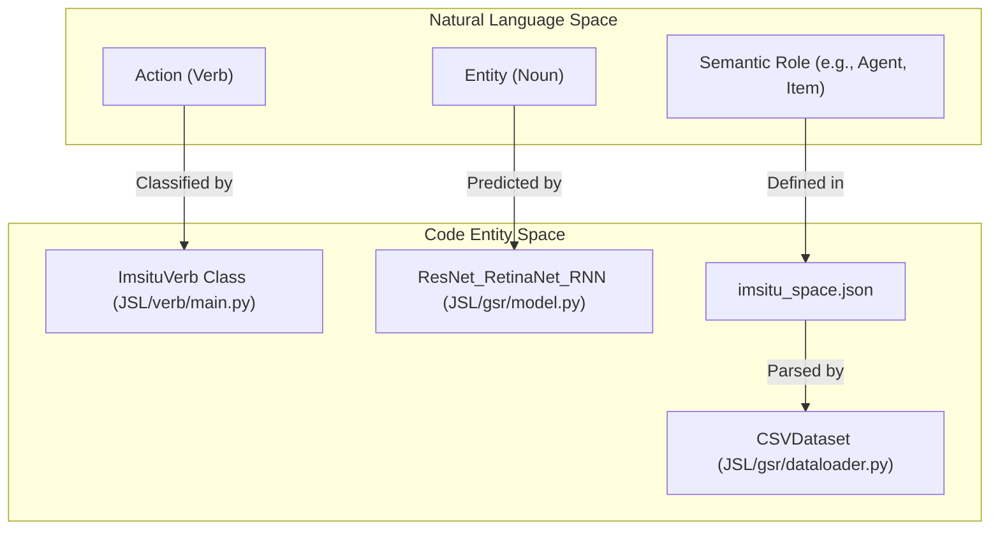
**Sources:** [README.md:34-48](), [README.md:73-85](), [README.md:128-137]()

### End-to-End Inference Flow
The inference process flows from an image input to a structured `results.json` output.

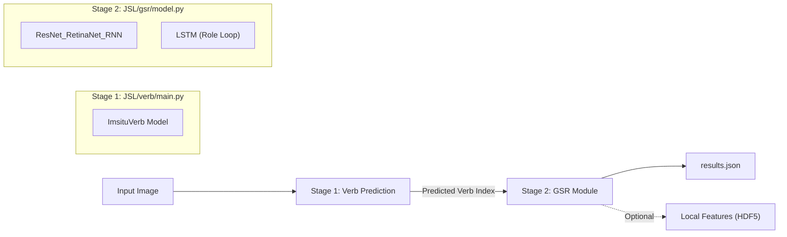
**Sources:** [README.md:104-120](), [README.md:123-126]()

## Running the Pipeline

### 1. Dataset Preparation
Download the images and place them in the project structure. The annotations are provided in `SWiG_jsons/` [README.md:29-30]().
*   **Images**: [images_512.zip](https://swig-data-weights.s3.us-east-2.amazonaws.com/images_512.zip)
*   **Weights**: [weights.zip](https://swig-data-weights.s3.us-east-2.amazonaws.com/weights.zip)

### 2. Inference
To run the full JSL pipeline on custom images, use `inference.py`. You must provide paths to both the verb weights and the GSR weights [README.md:106-113]().

```bash
python ./JSL/inference.py \
    --verb-path ./path/to/verb/weights \
    --jsl-path ./path/to/detection/weights \
    --image-file ./path/to/images.txt \
    --batch-size 8
```
The `--store-features` flag can be used to export local ResNet features for each grounded object to an HDF5 file [README.md:116-117]().

### 3. Training
Training is decoupled into two phases:

#### Phase A: Verb Classifier
Trains the `ImsituVerb` model (ResNet-50 backbone) to predict one of 504 visually groundable verbs [README.md:37-39](), [README.md:128-131]().
```bash
python ./JSL/verb/main.py
```

#### Phase B: GSR Module
Trains the `ResNet_RetinaNet_RNN` to predict nouns and bounding boxes. This requires specifying the SWiG annotation files and a class list [README.md:134-137]().
```bash
python ./JSL/gsr/train.py \
    --train-file ./SWiG_jsons/train.json \
    --val-file ./SWiG_jsons/dev.json \
    --class-file ./train_classes.csv
```

**Sources:** [README.md:104-137](), [requirements.txt:1-20]()

---

# Page: Task and Dataset: SWiG

# Task and Dataset: SWiG

<details>
<summary>Relevant source files</summary>

The following files were used as context for generating this wiki page:

- [README.md](README.md)
- [SWiG_jsons/dev.json](SWiG_jsons/dev.json)
- [SWiG_jsons/imsitu_space.json](SWiG_jsons/imsitu_space.json)
- [SWiG_jsons/test.json](SWiG_jsons/test.json)
- [SWiG_jsons/train.json](SWiG_jsons/train.json)

</details>


This page provides a technical deep dive into the **Situation With Groundings (SWiG)** dataset and the **Grounded Situation Recognition (GSR)** task. It covers the semantic ontology defined in `imsitu_space.json`, the structure of the JSON annotations, and how these entities are represented within the codebase.

## Grounded Situation Recognition (GSR)

The GSR task extends traditional image classification and object detection by requiring a model to identify a primary activity (Verb), the entities involved in that activity (Semantic Roles), and their locations in the image (Grounding).

### Task Components
1.  **Verb Prediction**: Identifying one of 504 visually groundable verbs [README.md:36-39]().
2.  **Semantic Role Labeling**: Filling a "frame" of 1 to 6 roles (e.g., Agent, Item, Place) with specific nouns [README.md:41-44]().
3.  **Grounding**: Providing bounding box coordinates `[x1, y1, x2, y2]` for each noun in the frame [README.md:51-53]().

### Data Flow: From Dataset to Model
The following diagram illustrates how the natural language concepts in the SWiG dataset are mapped to code entities and data structures used by the `JSL` model.

**Natural Language to Code Entity Mapping**
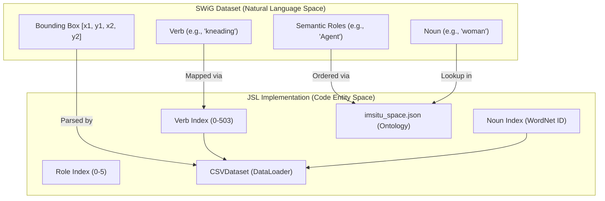
**Sources:** [README.md:34-71](), [SWiG_jsons/imsitu_space.json:1-10]()

---

## SWiG Dataset Structure

The dataset is distributed as three primary JSON files: `train.json`, `dev.json`, and `test.json` [README.md:55-59]().

### Annotation Format
Each image entry in the JSON contains the following fields:
*   `verb`: The action depicted.
*   `height` / `width`: Original image dimensions.
*   `bb`: A dictionary mapping role names to a single set of grounding coordinates. `[-1, -1, -1, -1]` indicates no grounding (e.g., for abstract roles like "place" or occluded objects) [README.md:56-57]().
*   `frames`: A list of 3 dictionaries (representing 3 different annotators). Each dictionary maps roles to WordNet noun IDs [README.md:48-49]().

**Example Entry:**
```json
"hitchhiking_238.jpg": {
    "verb": "hitchhiking", 
    "height": 683, 
    "width": 512, 
    "bb": {"place": [-1, -1, -1, -1], "agent": [195, 282, 380, 554]}, 
    "frames": [{"place": "n03519981", "agent": "n10287213"}, ...]
}
```
**Sources:** [README.md:62-71](), [SWiG_jsons/dev.json:1-5]()

---

## The imsitu_space.json Ontology

The `imsitu_space.json` file serves as the global registry for the GSR task. It contains two primary indices: `verbs` and `nouns` [README.md:73-85]().

### 1. Verbs Index
For every verb, the ontology defines:
*   **Order**: A fixed list determining the sequence of roles. This is critical for the `RetinaNet-RNN` model, which predicts roles in this specific order [README.md:84-92]().
*   **Roles**: Definitions and FrameNet mappings for each role associated with the verb.
*   **Abstract**: A sentence template (e.g., "the AGENT drinks a LIQUID...").

### 2. Nouns Index
Maps WordNet IDs (e.g., `n10787470`) to:
*   **Gloss**: English synonyms (e.g., `["woman", "adult female"]`).
*   **Def**: A dictionary definition [README.md:77-81]().

**Ontology Relationship Diagram**
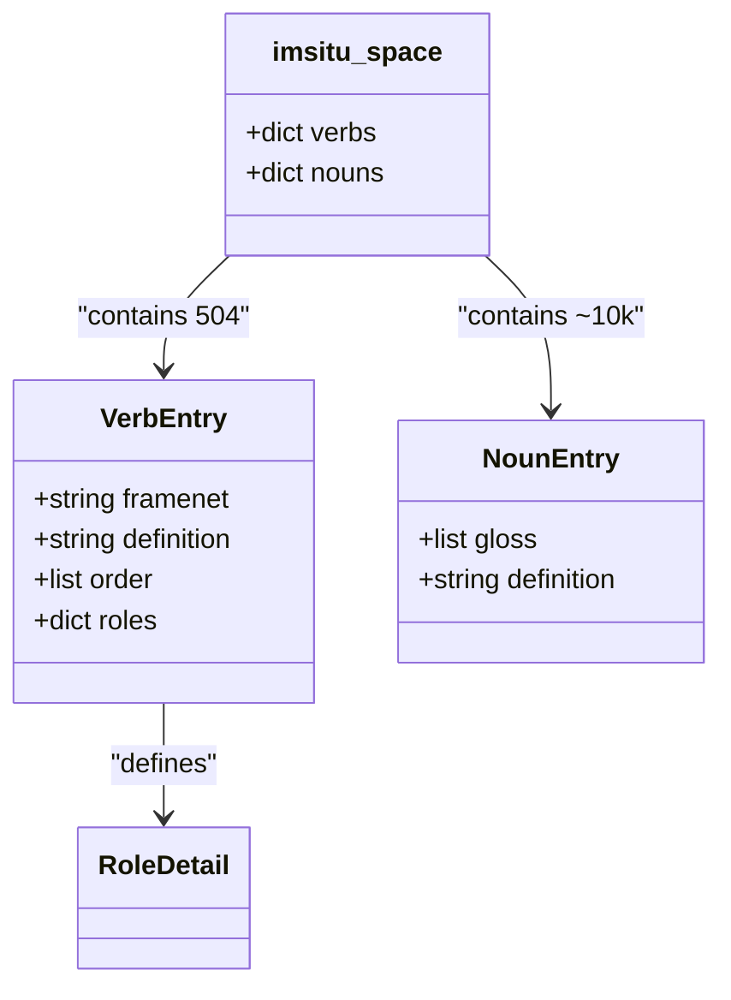
**Sources:** [README.md:73-98](), [SWiG_jsons/imsitu_space.json:1-20]()

---

## Implementation Details

### Bounding Box Representation
In the raw JSON, coordinates are absolute pixels. During data loading in `CSVDataset`, these are often normalized or shifted based on image resizing [README.md:115-117](). A value of `-1` in the `bb` dictionary is used to mask loss calculations for roles that are not visually grounded.

### Verb-Role Constraints
The `order` field in `imsitu_space.json` is the source of truth for the `GSR` model's recurrent loop. Because different verbs have different numbers of roles (1 to 6), the model uses this order to align its LSTM hidden states with the correct semantic meaning [README.md:41-44](), [SWiG_jsons/imsitu_space.json:92]().

| Verb | Roles (Ordered) |
| :--- | :--- |
| `drinking` | `agent`, `liquid`, `container`, `place` |
| `hitchhiking`| `agent`, `place` |
| `raining` | `place` |

**Sources:** [README.md:88-98](), [SWiG_jsons/imsitu_space.json:1-15]()

---

# Page: JSL Model Architecture

# JSL Model Architecture

<details>
<summary>Relevant source files</summary>

The following files were used as context for generating this wiki page:

- [JSL/gsr/model.py](JSL/gsr/model.py)
- [README.md](README.md)

</details>


The Joint Situation Localizer (JSL) is a two-stage neural architecture designed to solve the Grounded Situation Recognition (GSR) task [README.md:4-6](). GSR requires a model to identify a primary action (verb), the entities involved in that action (nouns/roles), and the spatial location of those entities in the image (bounding boxes) [README.md:34-53]().

The JSL decomposes this task into two distinct modules:
1.  **Verb Classifier**: Predicts the most likely verb for a given image.
2.  **GSR Model**: A recurrent detection network that predicts nouns and bounding boxes for each role associated with the predicted verb.

### System Overview

The JSL architecture bridges the gap between image pixels and the semantic frame defined in the SWiG ontology. It utilizes a shared ResNet backbone strategy, though the two stages are trained independently to allow for modularity and flexibility [README.md:124-126]().

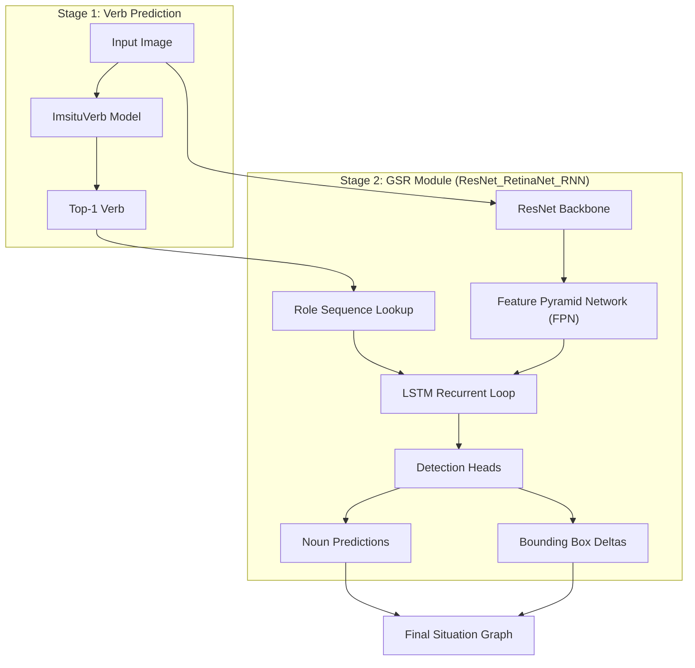
**Sources:** [README.md:34-53](), [JSL/gsr/model.py:184-210](), [JSL/verb/model.py:12-40]()

---

### Verb Classifier (Stage 1)

The first stage of the JSL pipeline is the **Verb Classifier**. This component is responsible for identifying the action occurring in the image from a set of 504 visually groundable verbs [README.md:37-39](). 

The model, implemented as `ImsituVerb`, typically uses a ResNet-50 backbone to extract global image features, followed by a linear layer that maps these features to the verb vocabulary [JSL/verb/model.py:12-40](). The predicted verb determines the "frame" (the specific set of roles like *Agent*, *Place*, or *Item*) that the second stage must then populate [README.md:41-47]().

For details on the verb model and its training, see **[Verb Classifier (#2.1)]()**.

**Sources:** [JSL/verb/model.py:12-40](), [README.md:36-40]()

---

### GSR Model: ResNet-RetinaNet-RNN (Stage 2)

The core of the JSL is the `ResNet_RetinaNet_RNN` class [JSL/gsr/model.py:184](). This module takes the image and the predicted verb as input to produce the final grounded frame.

#### Architectural Components:
*   **Feature Extraction**: Uses a ResNet backbone (e.g., ResNet-50 or ResNet-101) to generate multi-scale feature maps [JSL/gsr/model.py:184-210]().
*   **Pyramid Features**: A `PyramidFeatures` module implements a Feature Pyramid Network (FPN), generating levels P3 through P7 to handle objects of varying sizes [JSL/gsr/model.py:30-75]().
*   **Recurrent Processing**: An LSTM-based recurrent loop iterates through the roles required by the verb's frame (1 to 6 roles) [JSL/gsr/model.py:240-255](). At each step, it predicts the noun and the bounding box for a specific role.
*   **Detection Heads**: The model employs `RegressionModel` for anchor deltas [JSL/gsr/model.py:79-110]() and `ClassificationModel` for noun classification and a `bbox_exists` logit [JSL/gsr/model.py:112-160]().

For a deep dive into the recurrent detection logic, see **[GSR Model: ResNet-RetinaNet-RNN (#2.2)]()**.

**Sources:** [JSL/gsr/model.py:30-75](), [JSL/gsr/model.py:79-160](), [JSL/gsr/model.py:184-255]()

---

### Anchor Generation

To localize entities, the GSR model relies on a dense set of predefined bounding boxes called anchors. The `Anchors` module generates these across all levels of the Feature Pyramid [JSL/gsr/model.py:7]().

The anchors are defined by specific ratios and scales to ensure coverage of various object shapes. These anchors are then shifted across the image grid according to the stride of each pyramid level [global_utils/anchors.py](). The `RegressionModel` learns to predict offsets (deltas) from these anchors to the actual ground truth objects.

For details on the mathematical generation of anchors, see **[Anchor Generation (#2.3)]()**.

**Sources:** [JSL/gsr/model.py:7](), [JSL/gsr/model.py:108-109]()

---

### Data Flow: From Pixels to Code Entities

The following diagram illustrates how raw image data is transformed into the internal code representations used by the JSL architecture.

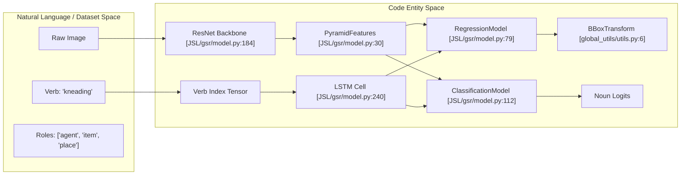

**Sources:** [JSL/gsr/model.py:30-160](), [JSL/gsr/model.py:184-255](), [global_utils/utils.py:6]()

---

# Page: Verb Classifier

# Verb Classifier

<details>
<summary>Relevant source files</summary>

The following files were used as context for generating this wiki page:

- [JSL/verb/main.py](JSL/verb/main.py)
- [JSL/verb/resnet50.py](JSL/verb/resnet50.py)
- [JSL/verb/verbModel.py](JSL/verb/verbModel.py)
- [global_utils/verb_indices.txt](global_utils/verb_indices.txt)

</details>


The **Verb Classifier** is the first stage of the Joint Situation Localizer (JSL) pipeline. Its primary objective is to predict the main action (verb) occurring in an image from a fixed vocabulary of 504 verbs defined in the SWiG dataset. This prediction serves as a conditioning signal for the subsequent Grounded Situation Recognition (GSR) module, which identifies roles and localizes entities based on the predicted verb's frame.

## Architectural Overview

The verb classification sub-system is encapsulated in the `ImsituVerb` class [JSL/verb/verbModel.py:33-41](). It utilizes a ResNet-50 backbone to extract global image features, followed by a linear layer that maps these features to the verb space.

### Data Flow: Image to Verb Prediction

The following diagram illustrates the transformation of input image data into a verb index through the code entities of the `verb` sub-package.

**Diagram: Verb Classification Data Flow**
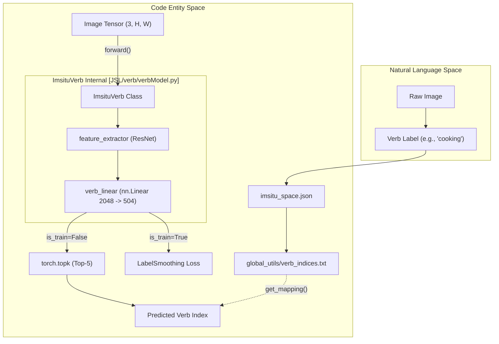
**Sources:** [JSL/verb/verbModel.py:33-53](), [JSL/verb/main.py:37-38](), [JSL/verb/main.py:129-139]()

---

## Model Components

### ResNet-50 Backbone
The `ImsituVerb` model uses a customized ResNet-50 architecture defined in `JSL/verb/resnet50.py`. 
- **Pre-trained Weights:** The model initializes its backbone using weights from the official PyTorch ResNet-50 model [JSL/verb/verbModel.py:38-39]().
- **Adaptive Pooling:** The standard fully connected layer of ResNet is replaced with an `AdaptiveAvgPool2d` layer that produces a 2048-dimensional feature vector regardless of input resolution [JSL/verb/resnet50.py:103-105]().
- **Layer Freezing Logic:** During training, different stages of the ResNet backbone are detached (frozen) based on the `epoch_num` to stabilize early training phases [JSL/verb/resnet50.py:152-168]().

### Verb Linear Layer
The final classification head is a simple linear transformation:
- **Input:** 2048 (ResNet-50 output features).
- **Output:** 504 (Total number of verbs in the SWiG ontology).
- **Location:** [JSL/verb/verbModel.py:40]()

### Label Smoothing Loss
To improve generalization and prevent the model from becoming over-confident, the system implements a `LabelSmoothing` module [JSL/verb/verbModel.py:11-30]().
- **Formula:** It combines Negative Log Likelihood (NLL) loss with a distribution-based smoothing factor.
- **Confidence:** Set to 0.8 (smoothing factor of 0.2) [JSL/verb/verbModel.py:41]().
- **Implementation:** Uses `log_softmax` and `gather` to calculate the loss against the target index [JSL/verb/verbModel.py:25-29]().

---

## Verb Vocabulary and Mapping

The system relies on a static mapping between verb strings and integer indices. This mapping is loaded from a text file during initialization.

| Component | Description | File Reference |
| :--- | :--- | :--- |
| **Vocabulary File** | A list of 504 verbs (e.g., educating, putting, cooking). | [global_utils/verb_indices.txt:1-504]() |
| **Mapping Function** | `get_mapping()` reads the file and returns `verb_to_idx` and `idx_to_verb`. | [JSL/verb/main.py:129-139]() |
| **Index Usage** | Predicted indices are converted back to strings for `top_5_verbs.json` output. | [JSL/verb/main.py:116-121]() |

---

## Training and Evaluation Logic

The `ImsituVerb` model's `forward` method behaves differently depending on the `is_train` flag [JSL/verb/verbModel.py:44-52]().

**Diagram: Model Execution Modes**
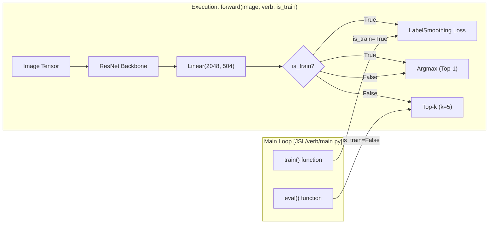
**Sources:** [JSL/verb/verbModel.py:44-52](), [JSL/verb/main.py:74-100](), [JSL/verb/main.py:102-126]()

### Key Functions
- **`train(model, data_loader, ...)`**: Executes the training pass, calculates the mean loss, and logs accuracy to TensorBoard via `writer.add_scalar` [JSL/verb/main.py:74-100]().
- **`eval(model, data_loader, ...)`**: Runs inference on the validation set, calculates Top-1 accuracy, and exports the Top-5 predicted verbs for every image into a JSON file named `top_5_verbs.json` [JSL/verb/main.py:102-126]().
- **Checkpointing**: The `save_checkpoint` utility serializes the `state_dict` of both the model and the optimizer to `.pth.tar` files [JSL/verb/main.py:190-194]().

**Sources:**
- `JSL/verb/verbModel.py`
- `JSL/verb/resnet50.py`
- `JSL/verb/main.py`
- `global_utils/verb_indices.txt`

---

# Page: GSR Model: ResNet-RetinaNet-RNN

# GSR Model: ResNet-RetinaNet-RNN

<details>
<summary>Relevant source files</summary>

The following files were used as context for generating this wiki page:

- [JSL/gsr/model.py](JSL/gsr/model.py)
- [global_utils/resnet.py](global_utils/resnet.py)
- [global_utils/utils.py](global_utils/utils.py)

</details>


The Grounded Situation Recognition (GSR) module is a multi-stage neural network designed to predict the semantic structure of an image based on a given verb. It implements the `ResNet_RetinaNet_RNN` class, which combines a ResNet backbone, a Feature Pyramid Network (FPN), a recurrent LSTM loop for role-based reasoning, and specialized detection heads for bounding box regression and noun classification [JSL/gsr/model.py:184-188]().

## Architecture Overview

The model follows a two-stage approach within the GSR module:
1.  **Feature Extraction**: A ResNet backbone and FPN generate multi-scale feature maps.
2.  **Recurrent Grounding**: An LSTM iterates through the semantic roles associated with a verb, using ROI Align to extract local features for bounding box and noun prediction at each step.

### System Mapping: Data Flow and Code Entities

The following diagram maps the conceptual components of the GSR model to their specific implementations in the codebase.

**Diagram: GSR Architecture to Code Entity Mapping**
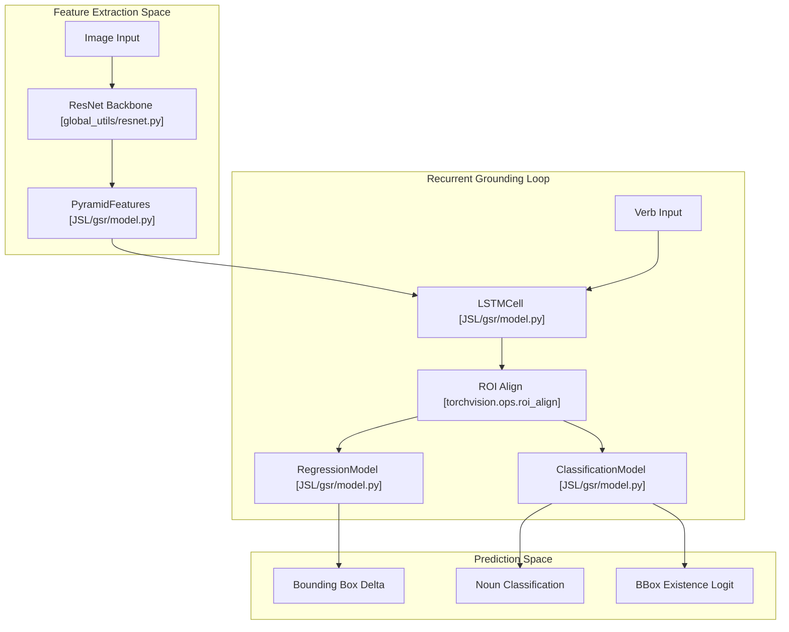
**Sources:** [JSL/gsr/model.py:30-160](), [JSL/gsr/model.py:184-210](), [global_utils/resnet.py:87-102]()

---

## Component Details

### 1. Feature Pyramid Network (FPN)
The `PyramidFeatures` class implements the FPN architecture to handle scale variance. It takes feature maps from the ResNet backbone (C3, C4, C5) and produces five pyramid levels (P3 to P7) [JSL/gsr/model.py:30-55]().

*   **P3, P4, P5**: Generated via lateral connections (1x1 conv) and top-down upsampling [JSL/gsr/model.py:57-69]().
*   **P6**: Obtained via a 3x3 stride-2 convolution on C5 [JSL/gsr/model.py:70]().
*   **P7**: Computed by applying ReLU and a 3x3 stride-2 convolution on P6 [JSL/gsr/model.py:72-73]().

**Sources:** [JSL/gsr/model.py:30-75]()

### 2. Recurrent LSTM Loop
The model uses a recurrent structure to predict values for each role defined by the verb. 
*   **Initialization**: The LSTM hidden state is initialized using the verb embedding and global image features.
*   **Iteration**: For each role, the LSTM receives the previous hidden state and the current role's embedding.
*   **Role-Specific Prediction**: The output of the LSTM is used to attend to the FPN features and perform ROI Align to localize the specific entity filling that role.

**Sources:** [JSL/gsr/model.py:184-210]()

### 3. Detection and Classification Heads
The model employs two specialized heads that process the features extracted from the pyramid levels.

#### RegressionModel
Predicts the bounding box deltas $(dx, dy, dw, dh)$ relative to the anchors. It consists of four 3x3 convolutional layers followed by an output layer that generates `num_anchors * 4` channels [JSL/gsr/model.py:79-91](). The output is reshaped to $(Batch, Anchors, 4)$ [JSL/gsr/model.py:109]().

#### ClassificationModel
Handles two distinct tasks:
1.  **Noun Classification**: Predicts the noun category for the role across `num_classes` [JSL/gsr/model.py:153-159]().
2.  **BBox Existence**: A binary logit branch that determines if a bounding box should exist for the current role, implemented via `AdaptiveMaxPool2d` and a linear layer [JSL/gsr/model.py:148-149]().

**Sources:** [JSL/gsr/model.py:79-110](), [JSL/gsr/model.py:112-160]()

---

## Data Flow: From Image to Situation

The following diagram illustrates the transformation of data through the GSR model's internal classes.

**Diagram: Internal Data Flow**
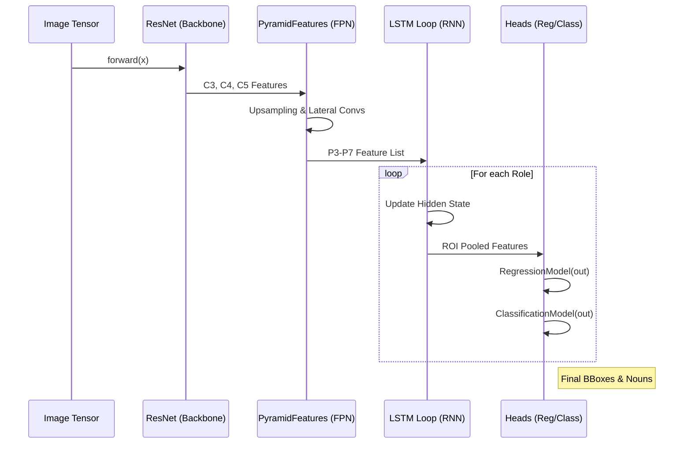
**Sources:** [JSL/gsr/model.py:55-75](), [JSL/gsr/model.py:94-109](), [JSL/gsr/model.py:136-160](), [global_utils/resnet.py:140-159]()

---

## Supporting Utilities

### BBoxTransform and ClipBoxes
The `BBoxTransform` class decodes the regression deltas produced by the `RegressionModel` into actual pixel coordinates using anchor means and standard deviations [global_utils/utils.py:80-117](). The `ClipBoxes` utility ensures that the predicted coordinates remain within the image boundaries [global_utils/utils.py:120-135]().

### Label Smoothing
To improve generalization during noun prediction, the `LabelSmoothing` module implements NLL loss with a smoothing factor, redistributing probability mass from the ground truth to other classes [JSL/gsr/model.py:162-181]().

**Sources:** [global_utils/utils.py:80-135](), [JSL/gsr/model.py:162-181]()

---

# Page: Anchor Generation

# Anchor Generation

<details>
<summary>Relevant source files</summary>

The following files were used as context for generating this wiki page:

- [global_utils/anchors.py](global_utils/anchors.py)

</details>


The JSL model utilizes a set of predefined reference boxes, known as anchors, to predict bounding boxes for roles in Grounded Situation Recognition. These anchors are generated across multiple scales and aspect ratios, distributed over different levels of the Feature Pyramid Network (FPN) to handle objects of varying sizes.

## The Anchors Module

The `Anchors` class is a `nn.Module` responsible for generating the full set of anchor boxes for a given input image size. It computes the geometry of anchors for every spatial location across the specified pyramid levels [global_utils/anchors.py:7-21]().

### Configuration Parameters
The default configuration is tailored for the JSL architecture:
*   **Pyramid Levels**: `[4, 5, 6, 7]`. These correspond to the feature maps produced by the FPN [global_utils/anchors.py:12]().
*   **Strides**: `[16, 32, 64, 128]`. Calculated as $2^{\text{level}}$, representing the downsampling factor relative to the input image [global_utils/anchors.py:14]().
*   **Sizes**: `[64, 128, 256, 512]`. Calculated as $2^{\text{level} + 2}$, defining the base scale of the anchors at each level [global_utils/anchors.py:16]().
*   **Ratios**: `[0.35, 0.65, 0.95, 1.38, 2.3]`. A set of five aspect ratios ($W/H$) to cover various role shapes [global_utils/anchors.py:18]().
*   **Scales**: `[2 ** 0]`. By default, only a single scale multiplier is used per level [global_utils/anchors.py:20]().

### Anchor Generation Flow
The following diagram illustrates how the `Anchors` module translates image dimensions into a tensor of candidate boxes.

**Anchor Generation Logic**
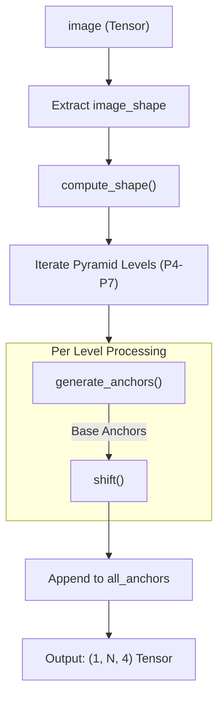
Sources: [global_utils/anchors.py:22-42](), [global_utils/anchors.py:79-88]()

## Core Functions

### generate_anchors
The `generate_anchors` function creates a set of base anchor windows at the origin $(0, 0)$ for a single spatial location. It enumerates all combinations of aspect ratios and scales [global_utils/anchors.py:44-56]().

1.  **Scaling**: It tiles the `base_size` by the `scales` [global_utils/anchors.py:64]().
2.  **Ratio Adjustment**: It calculates the width and height such that the area remains consistent with the scale while satisfying the `ratios` [global_utils/anchors.py:67-71]().
3.  **Coordinate Transformation**: It converts the anchors from center-based format $(x_{center}, y_{center}, w, h)$ to corner-based format $(x_1, y_1, x_2, y_2)$ [global_utils/anchors.py:73-75]().

### shift
The `shift` function replicates the base anchors across the entire feature map grid for a specific pyramid level [global_utils/anchors.py:113]().

*   It generates a meshgrid of $x$ and $y$ coordinates based on the feature map `shape` and the level's `stride` [global_utils/anchors.py:114-117]().
*   The center of each cell is offset by $0.5 \times \text{stride}$ to ensure anchors are centered within the receptive field of the feature pixel [global_utils/anchors.py:114-115]().
*   The base anchors are broadcasted and added to these shifts, resulting in a flattened array of $(K \times A, 4)$ anchors, where $K$ is the number of grid cells and $A$ is the number of anchors per cell [global_utils/anchors.py:128-131]().

**Data Flow: From Configuration to Tensor**
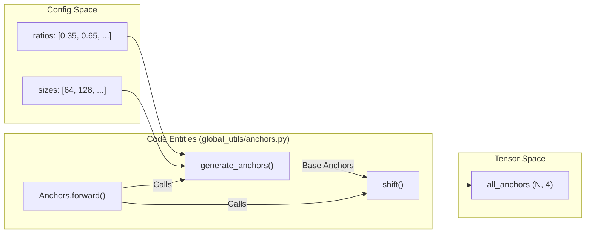
Sources: [global_utils/anchors.py:35-38](), [global_utils/anchors.py:44-77](), [global_utils/anchors.py:113-133]()

## Summary of Anchor Geometry

The total number of anchors $N$ is the sum of anchors across all levels. For each level $i$ with feature map dimensions $H_i \times W_i$:
$$N_i = H_i \times W_i \times (\text{len}(\text{ratios}) \times \text{len}(\text{scales}))$$

| Level | Stride | Base Size | Ratios | Scales |
| :--- | :--- | :--- | :--- | :--- |
| P4 | 16 | 64 | 5 | 1 |
| P5 | 32 | 128 | 5 | 1 |
| P6 | 64 | 256 | 5 | 1 |
| P7 | 128 | 512 | 5 | 1 |

Sources: [global_utils/anchors.py:11-21]()

---

# Page: Training Pipeline

# Training Pipeline

<details>
<summary>Relevant source files</summary>

The following files were used as context for generating this wiki page:

- [JSL/gsr/train.py](JSL/gsr/train.py)
- [JSL/verb/main.py](JSL/verb/main.py)

</details>


The training pipeline for the Joint Situation Localizer (JSL) is divided into two distinct stages: the training of the **Verb Classifier** and the training of the **GSR Module** (ResNet-RetinaNet-RNN). Both stages utilize `torch.optim.Adam` for optimization and leverage `tensorboardX` for logging metrics and visualizing loss convergence.

### System Training Overview

The training process involves distinct data loading strategies and optimization schedules for each model component. While the Verb Classifier focuses on identifying the primary action in an image, the GSR Module is trained to localize objects and assign semantic roles based on the predicted (or ground-truth) verb.

Training Flow and Code Entities:
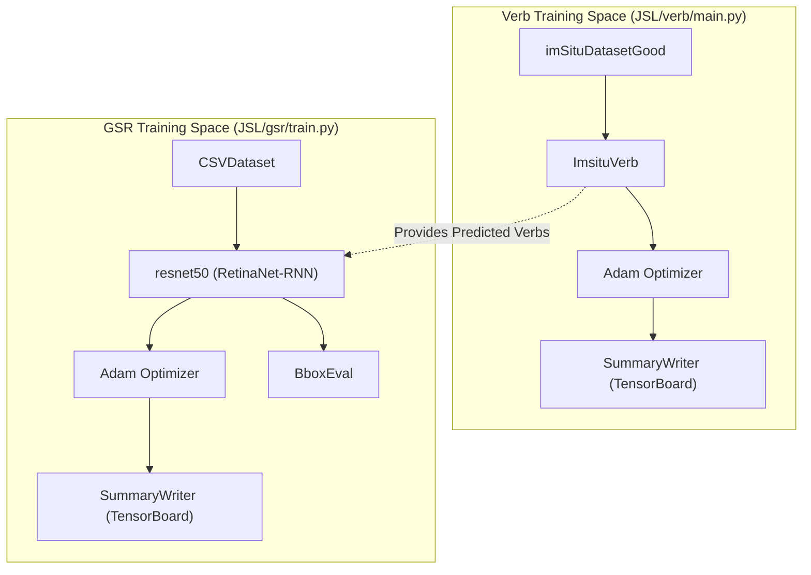
**Sources:** [JSL/verb/main.py:24-71](), [JSL/gsr/train.py:22-67]()

---

### Verb Classifier Training (#3.1)

The verb classification stage uses `JSL/verb/main.py` as the entry point. It trains the `ImsituVerb` model, which is based on a ResNet backbone.

*   **Data Loading**: Uses `imSituDatasetGood` [JSL/verb/main.py:43]() to load SWiG annotations.
*   **Optimization**: Employs the Adam optimizer with a learning rate that decreases by a factor of 5 at epoch 18 [JSL/verb/main.py:59-67]().
*   **Evaluation**: During the evaluation phase, the pipeline generates a `top_5_verbs.json` file containing the highest-probability verb predictions for the validation set [JSL/verb/main.py:108-121]().

For more details, see [Verb Classifier Training](#3.1).

**Sources:** [JSL/verb/main.py:52-71](), [JSL/verb/main.py:102-127]()

---

### GSR Module Training (#3.2)

The GSR module training in `JSL/gsr/train.py` is more complex, involving a recurrent architecture and multiple loss components.

*   **Phased Training**: The pipeline supports specific schedules for freezing components. The `deatch_resnet` flag (controlled by `--detach-epoch`) determines when to stop updating the ResNet backbone [JSL/gsr/train.py:80]().
*   **Ground-Truth Injection**: To stabilize early training, the model can use ground-truth nouns instead of predictions via the `use_gt_nouns` flag [JSL/gsr/train.py:81-96]().
*   **Learning Rate Schedule**: The learning rate is decreased by a factor of 10 at milestones defined by `--lr-decrease` and `--second-lr-decrease` [JSL/gsr/train.py:83-91]().

For more details, see [GSR Module Training](#3.2).

**Sources:** [JSL/gsr/train.py:69-142](), [JSL/gsr/train.py:30-35]()

---

### Loss Functions (#3.3)

The JSL system utilizes a composite loss function to optimize for both localization and semantic recognition.

| Loss Component | Purpose | Code Entity |
| :--- | :--- | :--- |
| **Class Loss** | Object classification (Focal Loss) | `class_loss` |
| **Reg Loss** | Bounding box delta regression | `reg_loss` |
| **Bbox Loss** | Bounding box existence/visibility | `bbox_loss` |
| **Noun Loss** | Semantic role noun classification | `all_noun_loss` |

The total loss is calculated as the sum of these components: `loss = class_loss + reg_loss + bbox_loss + all_noun_loss` [JSL/gsr/train.py:135]().

For more details, see [Loss Functions](#3.3).

**Sources:** [JSL/gsr/train.py:107-112](), [JSL/gsr/train.py:135-141]()

---

### Training Utilities and Logging

Both training scripts share similar logging and checkpointing logic to ensure reproducibility and monitoring.

Model State and Logging:
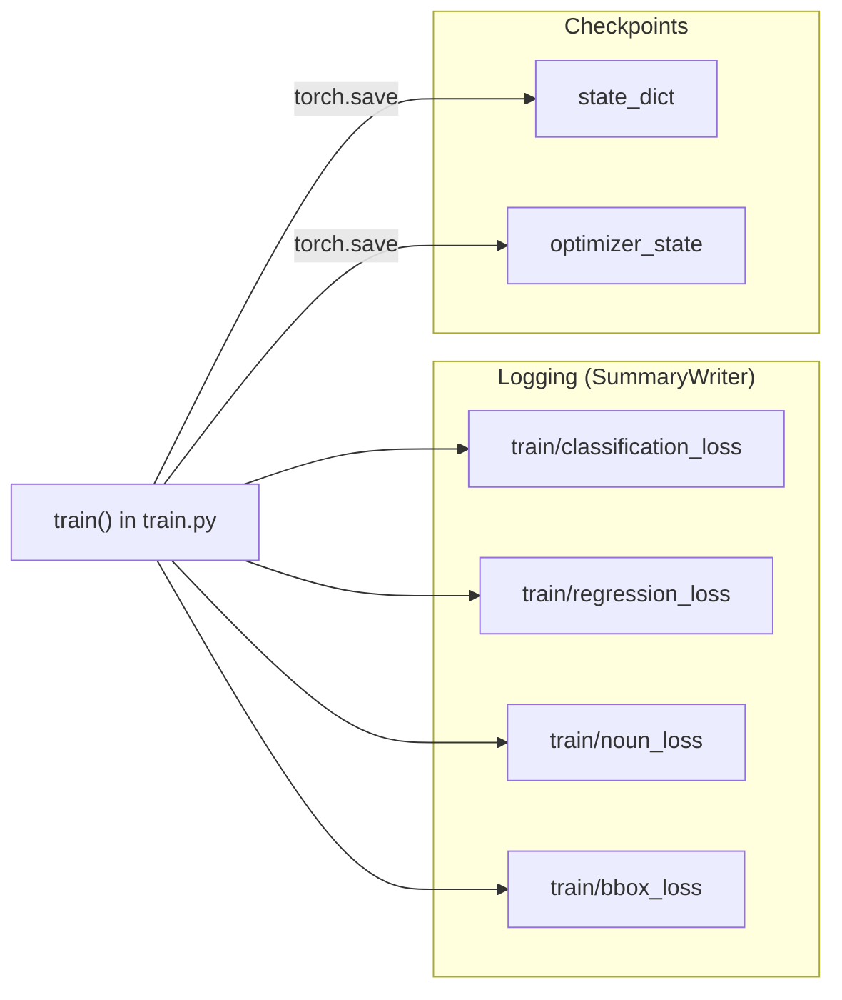

*   **Checkpointing**: Models are saved using `torch.save`, storing both the `state_dict` of the model and the `optimizer` state to allow for resuming training [JSL/gsr/train.py:64](), [JSL/verb/main.py:190-194]().
*   **Gradient Clipping**: The GSR training loop implements gradient norm clipping to prevent exploding gradients during the RNN unrolling [JSL/gsr/train.py:140]().

**Sources:** [JSL/gsr/train.py:120-127](), [JSL/gsr/train.py:140](), [JSL/verb/main.py:70-71]()

---

# Page: Verb Classifier Training

# Verb Classifier Training

<details>
<summary>Relevant source files</summary>

The following files were used as context for generating this wiki page:

- [JSL/verb/imsituDatasetGood.py](JSL/verb/imsituDatasetGood.py)
- [JSL/verb/main.py](JSL/verb/main.py)

</details>


The Verb Classifier Training pipeline is responsible for optimizing the `ImsituVerb` model to predict the primary action (verb) depicted in an image. This stage serves as the first half of the Joint Situation Localizer (JSL) architecture, providing the necessary verb context for subsequent role and noun prediction.

## Training Infrastructure Overview

The training process is orchestrated by `JSL/verb/main.py`. It integrates data loading via `imSituDatasetGood`, model initialization, an Adam optimizer, and a specific learning rate decay schedule. Progress is tracked using TensorBoard for loss and accuracy metrics, and model weights are serialized as checkpoints.

### Code Entity Space to Training Space
The following diagram illustrates how specific code components interact during the training loop.

**Verb Training System Architecture**
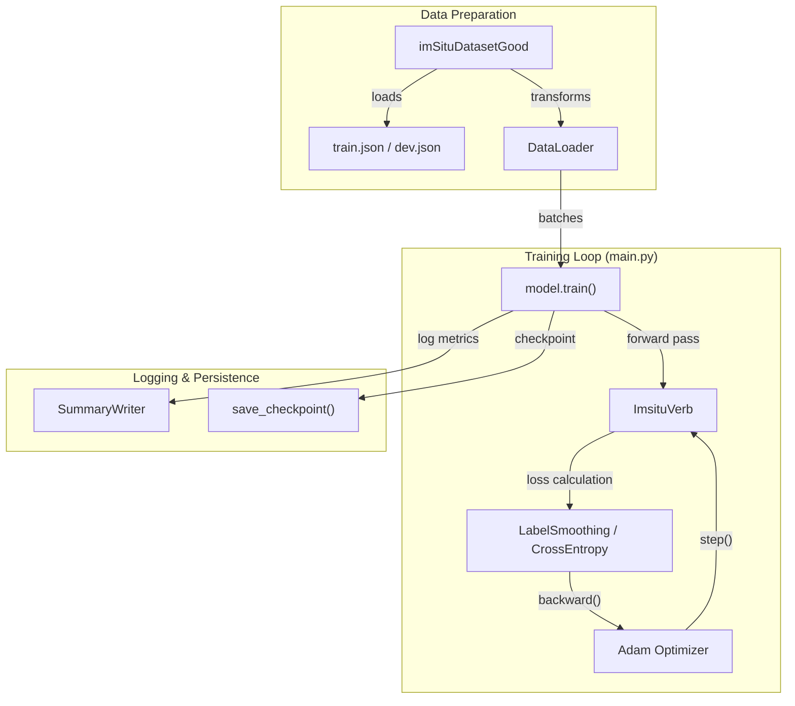
Sources: [JSL/verb/main.py:24-72](), [JSL/verb/imsituDatasetGood.py:14-35]()

## Data Loading and Preprocessing

The `imSituDatasetGood` class handles the ingestion of SWiG JSON annotations. It maps verb strings to numerical indices using a vocabulary file (`verb_indices.txt`) and prepares a role-presence target vector.

*   **Target Vector**: A tensor of size 1788 representing the presence of specific verb-role pairs [JSL/verb/imsituDatasetGood.py:53-60]().
*   **Image Transforms**:
    *   **Train**: Includes `RandomResizedCrop` (256x256), `ColorJitter`, `RandomGrayscale`, and `RandomHorizontalFlip` [JSL/verb/imsituDatasetGood.py:69-76]().
    *   **Validation**: Uses `Resize` and `CenterCrop` to 256x256 [JSL/verb/imsituDatasetGood.py:85-90]().
*   **Normalization**: Both pipelines use standard ImageNet mean `[0.485, 0.456, 0.406]` and standard deviation `[0.229, 0.224, 0.225]` [JSL/verb/imsituDatasetGood.py:67-68](), [JSL/verb/imsituDatasetGood.py:83-84]().

Sources: [JSL/verb/imsituDatasetGood.py:45-64](), [JSL/verb/imsituDatasetGood.py:65-91]()

## Optimization and Learning Schedule

The training loop utilizes the **Adam optimizer** with an initial learning rate of `0.0001` [JSL/verb/main.py:20](), [JSL/verb/main.py:59](). 

### Learning Rate Decay
The schedule implements a step-down decay based on epochs:
*   If the epoch is a multiple of 18 (and between 0 and 25), the learning rate is divided by 5.0 [JSL/verb/main.py:64-67]().

### Training Step Logic
For every batch in the `DataLoader`:
1.  **Forward Pass**: The model receives the image and ground truth verb [JSL/verb/main.py:85]().
2.  **Loss**: The mean loss is calculated from the model output [JSL/verb/main.py:88]().
3.  **Backpropagation**: `loss.backward()` computes gradients, followed by `optimizer.step()` [JSL/verb/main.py:96-97]().
4.  **Logging**: Every 100 iterations, the average loss is logged to TensorBoard via `SummaryWriter` [JSL/verb/main.py:90-94]().

Sources: [JSL/verb/main.py:58-71](), [JSL/verb/main.py:74-100]()

## Evaluation and Checkpointing

Evaluation occurs at the end of every epoch using the `eval` function [JSL/verb/main.py:69]().

### Top-5 Verb Evaluation
During evaluation, the model generates the top 5 predicted verbs for each image in the validation set. These are mapped back to strings using `idx_to_verb` and stored in `top_5_verbs.json` [JSL/verb/main.py:108-121](). This file is critical for downstream GSR tasks that may require multiple verb hypotheses.

### Checkpointing
The `save_checkpoint` utility serializes the model's `state_dict` and the optimizer's state [JSL/verb/main.py:190-194](). Checkpoints are saved in a directory named after the experiment title (generated from command-line arguments) [JSL/verb/main.py:30-35]().

**Data Flow: Evaluation to JSON**
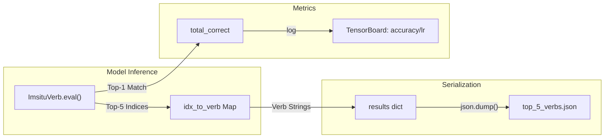
Sources: [JSL/verb/main.py:102-127](), [JSL/verb/main.py:190-194]()

## Execution and Utilities

Training is initiated by calling `main.py`. The system automatically generates experiment titles using `cmd_to_title`, which incorporates the provided arguments and the current timestamp [JSL/verb/main.py:29](), [JSL/verb/main.py:179-183]().

| Argument | Default | Description |
| :--- | :--- | :--- |
| `--title` | None | Custom name for the run; auto-generated if omitted |
| `--batch-size` | 256 | Number of images per training batch |
| `--workers` | 16 | Number of subprocesses for data loading |
| `--lr` | 0.0001 | Initial learning rate for Adam |

Sources: [JSL/verb/main.py:16-21](), [JSL/verb/main.py:142-188]()

---

# Page: GSR Module Training

# GSR Module Training

<details>
<summary>Relevant source files</summary>

The following files were used as context for generating this wiki page:

- [JSL/gsr/dataloader.py](JSL/gsr/dataloader.py)
- [JSL/gsr/train.py](JSL/gsr/train.py)

</details>


The training pipeline for the Grounded Situation Recognition (GSR) module handles the optimization of the RetinaNet-RNN architecture. This process involves a composite loss function that simultaneously optimizes for verb-role bounding box localization, noun classification for each role, and bounding box existence. The pipeline features specific training phases, including backbone freezing and ground-truth noun injection to stabilize the recurrent state.

## Training Loop Implementation

The training loop is implemented in `JSL/gsr/train.py` within the `train()` function. It manages the forward pass, loss accumulation, gradient clipping, and weight updates for the `ResNet_RetinaNet_RNN` model.

### Composite Loss Calculation
The model returns four distinct loss components which are aggregated for the backward pass:
1.  **Classification Loss**: Focal loss for anchor-based object classification.
2.  **Regression Loss**: Smooth L1 loss for bounding box coordinate deltas.
3.  **BBox Existence Loss**: Binary cross-entropy or focal loss determining if a role should have a box.
4.  **Noun Loss**: Label smoothing cross-entropy for predicting the noun category for each of the 6 potential roles.

The total loss is calculated as the mean sum of these components:
`loss = class_loss.mean() + reg_loss.mean() + bbox_loss.mean() + all_noun_loss.mean()` [JSL/gsr/train.py:135-135]().

### Training Phases and Detachment
The pipeline utilizes specific flags to control the flow of gradients and data:
*   **Backbone Detachment**: Controlled by `--detach-epoch`. If the current epoch is less than this value, the ResNet backbone is detached to prevent early gradients from destabilizing pretrained weights [JSL/gsr/train.py:31-31](), [JSL/gsr/train.py:80-80]().
*   **GT Noun Injection**: Controlled by `--gt-noun-epoch`. During early training, ground-truth nouns are injected into the RNN to help the model learn the relationship between nouns and spatial locations before it has learned to predict nouns accurately [JSL/gsr/train.py:32-32](), [JSL/gsr/train.py:81-81]().

### Optimization Details
*   **Optimizer**: Adam optimizer with a default learning rate of `0.0006` [JSL/gsr/train.py:37-37](), [JSL/gsr/train.py:58-58]().
*   **Gradient Clipping**: Gradients are clipped to a maximum norm of 1 using `inf` norm to prevent exploding gradients in the RNN [JSL/gsr/train.py:140-140]().
*   **Learning Rate Schedule**: The learning rate is decreased by a factor of 10 at two milestones: `--lr-decrease` (default 10) and `--second-lr-decrease` (default 20) [JSL/gsr/train.py:34-35](), [JSL/gsr/train.py:83-91]().

Sources: [JSL/gsr/train.py:22-143]()

## Data Flow: Training Step

The following diagram illustrates the flow of data from the `CSVDataset` through the model during a single training iteration.

**GSR Training Data Flow**
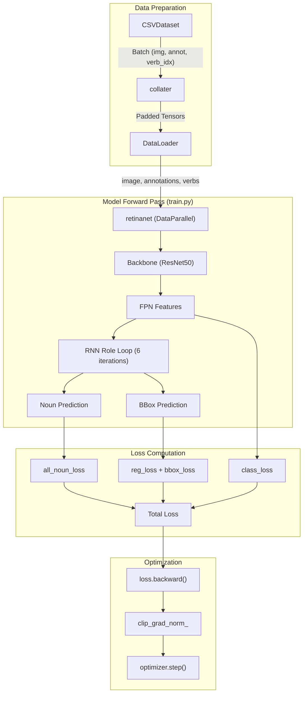
Sources: [JSL/gsr/train.py:98-141](), [JSL/gsr/dataloader.py:115-134]()

## Key Training Functions

| Function | File | Description |
| :--- | :--- | :--- |
| `main` | `JSL/gsr/train.py` | Initializes datasets, model, optimizer, and manages the epoch loop. |
| `train` | `JSL/gsr/train.py` | Executes the training iteration, loss logging, and parameter updates. |
| `evaluate` | `JSL/gsr/train.py` | Runs validation using `BboxEval` and logs metrics to TensorBoard. |
| `init_data` | `JSL/gsr/train.py` | Sets up `CSVDataset` with `Augmenter` for training and `Normalizer` for both. |
| `CSVDataset.__getitem__` | `JSL/gsr/dataloader.py` | Loads image, annotations, and verb index for a specific index. |

Sources: [JSL/gsr/train.py:22-143](), [JSL/gsr/dataloader.py:115-134]()

## System Entity Mapping

This diagram maps high-level training concepts to the specific classes and files that implement them in the codebase.

**Training Entity Mapping**
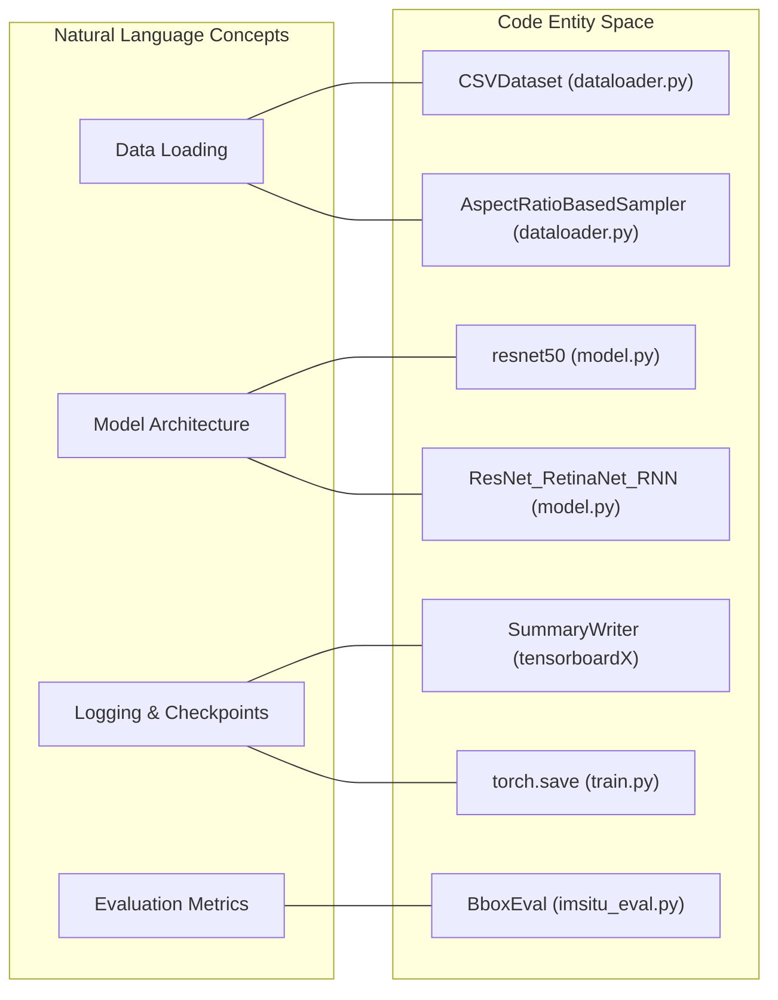
Sources: [JSL/gsr/train.py:10-15](), [JSL/gsr/dataloader.py:26-26](), [JSL/gsr/train.py:56-56](), [JSL/gsr/train.py:64-64]()

## Checkpointing and Logging

The pipeline uses `tensorboardX.SummaryWriter` to log training progress and `torch.save` for model persistence.

*   **TensorBoard Metrics**: Every `--iteration` (default 100), the loop logs:
    *   `train/classification_loss` [JSL/gsr/train.py:120-121]()
    *   `train/regression_loss` [JSL/gsr/train.py:122-123]()
    *   `train/bbox_loss` [JSL/gsr/train.py:124-125]()
    *   `train/noun_loss` [JSL/gsr/train.py:126-127]()
*   **Checkpoints**: At the end of every epoch, the model state and optimizer state are saved to the `checkpoints` directory within the log folder:
    `retinanet_{epoch_num}.pth` [JSL/gsr/train.py:64-64]().

Sources: [JSL/gsr/train.py:62-66](), [JSL/gsr/train.py:114-133]()

---

# Page: Loss Functions

# Loss Functions

<details>
<summary>Relevant source files</summary>

The following files were used as context for generating this wiki page:

- [JSL/gsr/model.py](JSL/gsr/model.py)
- [global_utils/losses.py](global_utils/losses.py)

</details>


The training of the Joint Situation Localizer (JSL) involves a composite loss strategy to handle simultaneous verb classification, noun prediction, and bounding box localization. The system utilizes Focal Loss for object detection tasks, Label Smoothing for noun classification, and a binary existence loss to determine if a role requires a bounding box.

### Overview of Loss Components

The total loss is a combination of four distinct signals:
1.  **Classification Loss**: Focal Loss for anchor-based object classification.
2.  **Regression Loss**: Smooth L1 loss for bounding box coordinate refinement.
3.  **Bbox Existence Loss**: Binary Cross Entropy for predicting if a role is groundable.
4.  **Noun Loss**: Cross Entropy with Label Smoothing for role-filler (noun) prediction.

### Focal Loss and Detection
The `FocalLoss` class in `global_utils/losses.py` handles three critical aspects of the GSR module: classification of anchors, regression of box deltas, and the binary prediction of whether a role has an associated bounding box.

#### Anchor Matching and IoU
The loss calculation begins by computing the Intersection over Union (IoU) between all generated anchors and the ground truth annotations using the `calc_iou` function [global_utils/losses.py:10-24]().
*   **Positive Anchors**: Anchors with $IoU \ge 0.5$ are assigned as positive samples [global_utils/losses.py:84-85]().
*   **Negative Anchors**: Anchors with $IoU < 0.4$ are treated as background [global_utils/losses.py:83]().
*   **Ignored Anchors**: Anchors with $0.4 \le IoU < 0.5$ are excluded from the loss calculation [global_utils/losses.py:106]().

#### Classification Loss
To address class imbalance between foreground and background anchors, the model implements Focal Loss [global_utils/losses.py:26-168](). It uses an $\alpha$ of 0.25 and $\gamma$ of 2.0 to down-weight easy examples and focus on hard negatives [global_utils/losses.py:38-39]().

#### Regression Loss
For positive anchors, the model calculates a Smooth L1 loss (Huber loss) between predicted deltas and ground truth targets [global_utils/losses.py:153-160](). The targets are normalized by standard deviations of `[0.1, 0.1, 0.2, 0.2]` for $[dx, dy, dw, dh]$ [global_utils/losses.py:141-149]().

#### Bbox Existence Loss
A specific signal is used to train the `ClassificationModel` to predict if a role contains a bounding box (`bbox_exists`). This is implemented as a Binary Cross Entropy loss with logits, comparing the predicted `bbox_exists` scalar against the ground truth mask [global_utils/losses.py:56-57]().

**Sources:**
* `global_utils/losses.py:10-168`
* `JSL/gsr/model.py:112-160`

---

### Noun Classification with Label Smoothing

The `LabelSmoothing` module implements a modified Negative Log Likelihood loss to prevent the model from becoming over-confident in its noun predictions, which aids in generalization across the large SWiG vocabulary.

| Parameter | Role | Implementation |
| :--- | :--- | :--- |
| `confidence` | Weight for the target class | $1.0 - \text{smoothing}$ [JSL/gsr/model.py:172]() |
| `smoothing` | Weight for the uniform distribution | $\text{smoothing} / \text{num\_classes}$ [JSL/gsr/model.py:173-181]() |

The loss is calculated by taking the `log_softmax` of the predictions and combining the NLL of the target with the mean of all log probabilities [JSL/gsr/model.py:176-180]().

**Sources:**
* `JSL/gsr/model.py:162-182`

---

### Data Flow: From Model Output to Loss

The following diagram illustrates how the outputs from the `ResNet_RetinaNet_RNN` architecture are routed to the respective loss functions during training.

**GSR Loss Data Flow**
```mermaid
graph TD
    subgraph "Model Outputs"
        REG["RegressionModel Output"]
        CLS["ClassificationModel Output"]
        BBE["Bbox Existence Logit"]
        NOUN["RNN Noun Predictions"]
    end

    subgraph "Loss Functions"
        FL["FocalLoss Class"]
        LS["LabelSmoothing Class"]
        BCE["BCEWithLogits"]
    end

    subgraph "Targets"
        GT_BBOX["Ground Truth Boxes"]
        GT_NOUN["Ground Truth Nouns"]
        GT_MASK["Existence Mask"]
    end

    REG --> FL
    CLS --> FL
    BBE --> BCE
    GT_BBOX --> FL
    GT_MASK --> BCE
    
    NOUN --> LS
    GT_NOUN --> LS

    FL --> TOTAL["Total Loss"]
    BCE --> TOTAL
    LS --> TOTAL
```
**Sources:**
* `JSL/gsr/model.py:79-110` (RegressionModel)
* `JSL/gsr/model.py:112-160` (ClassificationModel)
* `global_utils/losses.py:32-44` (FocalLoss forward)

---

### Implementation Details: Code Entity Mapping

The relationship between the natural language concepts of "Loss" and the specific code entities in the `global_utils` and `JSL` modules is mapped below.

**Loss Entity Mapping**
```mermaid
classDiagram
    class FocalLoss {
        +forward(classifications, regressions, anchors, bbox_exist_prediction, annotations)
        -calc_iou(a, b)
    }
    class LabelSmoothing {
        +forward(x, target)
        -confidence: float
        -smoothing: float
    }
    class RegressionModel {
        +forward(x)
        -output: Conv2d
    }
    class ClassificationModel {
        +forward(x)
        -features_linear: Linear
        -output_retina: Conv2d
    }

    FocalLoss ..> RegressionModel : "Evaluates Output"
    FocalLoss ..> ClassificationModel : "Evaluates Output"
    LabelSmoothing ..> "RNN Predictions" : "Evaluates Nouns"
```

**Key Implementation Logic:**
*   **Coordinate Transformation**: Inside `FocalLoss`, anchors are converted to center coordinates $(ctr\_x, ctr\_y)$ and widths/heights to compute regression targets [global_utils/losses.py:48-51]().
*   **Target Normalization**: Regression targets are scaled by a factor of 10 for offsets and 5 for log-scale dimensions (via the `0.1, 0.2` divisors) to balance the gradient magnitude relative to classification [global_utils/losses.py:149]().
*   **Logit Clamping**: Classification probabilities are clamped to `[1e-4, 1.0 - 1e-4]` to ensure numerical stability during log calculations [global_utils/losses.py:54]().

**Sources:**
* `global_utils/losses.py:9-168`
* `JSL/gsr/model.py:79-182`

---

# Page: Data Pipeline

# Data Pipeline

<details>
<summary>Relevant source files</summary>

The following files were used as context for generating this wiki page:

- [JSL/gsr/dataloader.py](JSL/gsr/dataloader.py)
- [JSL/verb/imsituDatasetGood.py](JSL/verb/imsituDatasetGood.py)

</details>


The SWiG data pipeline manages the flow of images and semantic annotations from raw JSON files into structured tensors suitable for training and inference. The pipeline is split into two primary paths: one for the **Verb Classifier** and one for the **Joint Situation Localizer (GSR Module)**. 

The pipeline handles complex SWiG data structures, including multi-annotator noun labels (up to 3 per role), variable role counts per verb, and bounding box coordinates.

### Data Flow Architecture

The following diagram illustrates how raw SWiG files are processed by specific dataset classes and transforms before being batched by the `DataLoader`.

**System Entity Mapping: Raw Data to Code Objects**
```mermaid
graph TD
    subgraph "Natural Language Space (SWiG Files)"
        A["train.json / dev.json"]
        B["imsitu_space.json"]
        C["verb_indices.txt"]
    end

    subgraph "Code Entity Space (Data Loading)"
        D["CSVDataset [JSL/gsr/dataloader.py]"]
        E["imSituDatasetGood [JSL/verb/imsituDatasetGood.py]"]
        F["AspectRatioBasedSampler [JSL/gsr/dataloader.py]"]
        G["collater [JSL/gsr/dataloader.py]"]
    end

    A --> D
    A --> E
    B --> D
    C --> D
    D --> F
    F --> G
    G --> H["Model-Ready Batch (Tensors)"]
```
**Sources:** [JSL/gsr/dataloader.py:26-44](), [JSL/verb/imsituDatasetGood.py:14-35]()

---

### GSR Data Loader (CSVDataset)

The `CSVDataset` class is the core component for the Grounded Situation Recognition (GSR) task. It parses the SWiG JSON format and converts it into a standardized 7-column annotation tensor. 

Key responsibilities include:
*   **Verb-Role Ordering**: Aligning roles based on the specific verb's predefined order to ensure consistent LSTM input sequences [JSL/gsr/dataloader.py:181-184]().
*   **Annotation Formatting**: Each role is represented by a row containing `[x1, y1, x2, y2, class1, class2, class3]`, where the classes represent the three independent annotator labels from SWiG [JSL/gsr/dataloader.py:162-170]().
*   **Special Token Handling**: Mapping missing or out-of-vocabulary nouns to `blank`, `oov`, or `Pad` tokens [JSL/gsr/dataloader.py:190-211]().

For details, see [GSR Data Loader (CSVDataset)](#4.1).

**Sources:** [JSL/gsr/dataloader.py:26-213]()

---

### Image Transforms and Collation

To support efficient batching of images with different aspect ratios, the pipeline employs a custom transformation and collation strategy.

**Transformation Pipeline (Code-to-Logic)**
```mermaid
graph LR
    subgraph "Transform Classes [JSL/gsr/dataloader.py]"
        T1["Resizer"]
        T2["Augmenter"]
        T3["Normalizer"]
    end

    Input["Raw Image"] --> T1
    T1 --> T2
    T2 --> T3
    T3 --> Coll["collater()"]
    Coll --> Output["Padded 704x704 Batch"]
```

The `collater` function ensures that all images in a batch are padded to a uniform size (typically 704x704) while maintaining the correct spatial relationship for bounding boxes [JSL/gsr/dataloader.py:755-780](). It also tracks "shift" values—the amount of padding added—which is critical for reversing transformations during inference.

For details, see [Image Transforms and Collation](#4.2).

**Sources:** [JSL/gsr/dataloader.py:539-645](), [JSL/gsr/dataloader.py:755-810]()

---

### Verb Dataset (imSituDatasetGood)

The `imSituDatasetGood` class is dedicated to Stage 1: Verb Classification. Unlike the GSR loader, it focuses on the global image context and the presence of specific roles.

*   **Target Vector**: It constructs a 1788-dimensional binary vector representing the roles present for a given verb in an image [JSL/verb/imsituDatasetGood.py:53-60]().
*   **Transforms**: It uses standard ResNet-style augmentations, including `RandomResizedCrop` and `ColorJitter` during training [JSL/verb/imsituDatasetGood.py:65-77]().
*   **Inference Mode**: In inference mode, it simplifies the pipeline to load only the image and its filename, bypassing annotation parsing [JSL/verb/imsituDatasetGood.py:109-111]().

For details, see [Verb Dataset (imSituDatasetGood)](#4.3).

**Sources:** [JSL/verb/imsituDatasetGood.py:14-116]()

---

### Data Format Summary

| Component | Input Format | Output Format | Key File |
| :--- | :--- | :--- | :--- |
| **GSR Loader** | SWiG JSON | `[6, 7]` Tensor (BBox + 3 Nouns) | [JSL/gsr/dataloader.py]() |
| **Verb Loader** | SWiG JSON | `[1788]` Role Presence Vector | [JSL/verb/imsituDatasetGood.py]() |
| **Collater** | List of Tensors | `[Batch, 3, 704, 704]` Padded Tensor | [JSL/gsr/dataloader.py]() |

**Sources:** [JSL/gsr/dataloader.py:152-172](), [JSL/verb/imsituDatasetGood.py:53-62](), [JSL/gsr/dataloader.py:785-805]()

---

# Page: GSR Data Loader (CSVDataset)

# GSR Data Loader (CSVDataset)

<details>
<summary>Relevant source files</summary>

The following files were used as context for generating this wiki page:

- [JSL/gsr/dataloader.py](JSL/gsr/dataloader.py)
- [global_utils/train_classes.csv](global_utils/train_classes.csv)

</details>


The `CSVDataset` class is the primary data ingestion component for Grounded Situation Recognition (GSR) in the SWiG repository. It is responsible for parsing the SWiG JSON annotations, mapping verbs to their specific role orders, and formatting ground-truth data into a structured 7-column tensor format compatible with the RetinaNet-RNN architecture.

## Overview of CSVDataset

The `CSVDataset` class, defined in `JSL/gsr/dataloader.py`, inherits from `torch.utils.data.Dataset` [JSL/gsr/dataloader.py:26-29](). It handles two primary modes: standard training/validation (where ground truth is loaded from JSON) and inference (where dummy annotations are created for prediction) [JSL/gsr/dataloader.py:49-63]().

### Data Flow and Initialization
During initialization, the dataset performs several key setup steps:
1.  **Class Mapping**: Loads the noun category list from a CSV file (e.g., `train_classes.csv`), establishing a mapping between WordNet IDs and integer indices [JSL/gsr/dataloader.py:46-47]().
2.  **Verb Ontology**: Loads verb indices from `global_utils/verb_indices.txt` to map verb strings to their numerical identifiers [JSL/gsr/dataloader.py:65-74]().
3.  **Annotation Parsing**: In non-inference mode, it reads the SWiG JSON file and organizes data by image filename [JSL/gsr/dataloader.py:54-57]().

**Sources:** [JSL/gsr/dataloader.py:26-80](), [global_utils/train_classes.csv:1-427]()

---

## Annotation Parsing and Formatting

The core logic for transforming raw SWiG JSON into model-ready tensors resides in `_read_annotations` and `load_annotations`.

### The 7-Column Tensor Format
For every image, the dataset produces an annotation tensor of shape `(6, 7)`. Each of the 6 rows represents a semantic role (e.g., Agent, Tool, Place), and the 7 columns are defined as follows:

| Column Index | Content | Description |
| :--- | :--- | :--- |
| 0 | `x1` | Top-left x-coordinate |
| 1 | `y1` | Top-left y-coordinate |
| 2 | `x2` | Bottom-right x-coordinate |
| 3 | `y2` | Bottom-right y-coordinate |
| 4 | `class1` | Noun index from the first annotator |
| 5 | `class2` | Noun index from the second annotator |
| 6 | `class3` | Noun index from the third annotator |

**Sources:** [JSL/gsr/dataloader.py:152-172](), [JSL/gsr/dataloader.py:186-203]()

### Verb-Role Ordering
SWiG verbs have varying numbers of semantic roles. To maintain a consistent tensor shape for batching, `CSVDataset` uses a fixed ordering and padding strategy:
1.  **Role Order**: The dataset retrieves the specific role sequence for a verb from `verb_info` [JSL/gsr/dataloader.py:181]().
2.  **OOV and Blank Handling**: If an annotation is empty, it is labeled as `blank`. If a noun is not in the class list, it is labeled as `oov` (Out Of Vocabulary) [JSL/gsr/dataloader.py:190-201]().
3.  **Padding**: If a verb has fewer than 6 roles, the remaining rows are filled with `Pad` labels and coordinates set to `-1` [JSL/gsr/dataloader.py:205-213]().

### Natural Language to Code Entity Mapping
The following diagram illustrates how the abstract concepts of the SWiG dataset are mapped to specific code structures within `CSVDataset`.

**Annotation Transformation Flow**
```mermaid
graph TD
    subgraph "Natural Language Space (SWiG JSON)"
        A["Verb: 'Cooking'"]
        B["Roles: 'Agent', 'Item', 'Container'"]
        C["Nouns: 'Chef', 'Soup', 'Pot'"]
    end

    subgraph "Code Entity Space (CSVDataset)"
        D["self.verb_to_idx"]
        E["self.image_data (Dict)"]
        F["_read_annotations()"]
        G["load_annotations()"]
        H["Annotation Tensor (6x7)"]
    end

    A -->|Lookup| D
    B -->|Verb Order| F
    C -->|Mapping| F
    F -->|Store| E
    E -->|Retrieve| G
    G -->|Format| H
```
**Sources:** [JSL/gsr/dataloader.py:56-74](), [JSL/gsr/dataloader.py:149-172](), [JSL/gsr/dataloader.py:175-213]()

---

## Image Preprocessing and Transforms

The `load_image` method handles image loading and initial color augmentation [JSL/gsr/dataloader.py:136-147]().

1.  **Loading**: Uses `PIL.Image` to open files and converts them to RGB [JSL/gsr/dataloader.py:138-139]().
2.  **Augmentation**: During training, a `color_change` pipeline applies `ColorJitter` (hue, saturation, brightness) and `RandomGrayscale` [JSL/gsr/dataloader.py:44](), [JSL/gsr/dataloader.py:142]().
3.  **Normalization**: Pixel values are scaled to the `[0, 1]` range [JSL/gsr/dataloader.py:147]().

**Sources:** [JSL/gsr/dataloader.py:44-45](), [JSL/gsr/dataloader.py:136-147]()

---

## Sampling and Batching

To optimize training efficiency, the system uses specialized sampling to handle images of different aspect ratios.

### AspectRatioBasedSampler
The `AspectRatioBasedSampler` ensures that images in a batch have similar aspect ratios, minimizing the amount of padding required during collation.

1.  **Grouping**: It calculates the aspect ratio for every image in the dataset [JSL/gsr/dataloader.py:228-232]().
2.  **Binning**: Images are divided into two groups: those with `width/height < 1` (tall) and `width/height >= 1` (wide) [JSL/gsr/dataloader.py:234-240]().
3.  **Shuffling**: Each bin is shuffled independently, and batches are drawn from the bins to ensure aspect ratio consistency within the batch [JSL/gsr/dataloader.py:245-260]().

### System Architecture: Data Loading Pipeline
The following diagram shows the relationship between the `CSVDataset`, the sampler, and the final output used by the `GSR` model.

**GSR Data Loading Architecture**
```mermaid
graph LR
    subgraph "Input Files"
        JSON["SWiG_json"]
        ImgDir["/images_512/"]
        ClassCSV["train_classes.csv"]
    end

    subgraph "CSVDataset Logic"
        CV["CSVDataset"]
        RA["_read_annotations"]
        LI["load_image"]
    end

    subgraph "Batching Logic"
        ARB["AspectRatioBasedSampler"]
        DL["DataLoader"]
    end

    JSON --> RA
    ClassCSV --> CV
    ImgDir --> LI
    CV --> ARB
    ARB --> DL
    DL --> Output["Batch: {img, annot, verb_idx}"]
```
**Sources:** [JSL/gsr/dataloader.py:26-57](), [JSL/gsr/dataloader.py:218-262]()

---

## Summary of Key Functions

| Function | Purpose |
| :--- | :--- |
| `load_classes` | Parses the CSV mapping of noun strings to integer IDs [JSL/gsr/dataloader.py:82-94](). |
| `_read_annotations` | Iterates through the SWiG JSON to build a lookup dictionary of coordinates and nouns, applying verb-specific role ordering [JSL/gsr/dataloader.py:175-213](). |
| `load_annotations` | Converts the dictionary data for a specific image into a `(6, 7)` NumPy array [JSL/gsr/dataloader.py:149-172](). |
| `__getitem__` | Orchestrates image loading, annotation retrieval, and application of transforms for a single index [JSL/gsr/dataloader.py:115-134](). |
| `make_dummy_annot` | Generates a zeroed-out annotation tensor for inference mode [JSL/gsr/dataloader.py:97-107](). |

**Sources:** [JSL/gsr/dataloader.py:26-213]()

---

# Page: Image Transforms and Collation

# Image Transforms and Collation

<details>
<summary>Relevant source files</summary>

The following files were used as context for generating this wiki page:

- [JSL/gsr/dataloader.py](JSL/gsr/dataloader.py)

</details>


This page details the data transformation pipeline and batch collation logic used in the Grounded Situation Recognition (GSR) task. The pipeline is responsible for preparing raw images and annotations into a standardized format (704×704 pixels) while tracking spatial shifts and scales necessary for coordinate reconstruction during inference.

## Transform Pipeline Overview

The data pipeline utilizes a sequence of deterministic and stochastic transforms to process images and their corresponding annotation tensors. The primary goal is to standardize input dimensions for the Feature Pyramid Network (FPN) while maintaining the integrity of bounding box coordinates and noun labels.

### Core Transform Classes

The system defines three primary transform classes in `JSL/gsr/dataloader.py`:

1.  **`Resizer`**: Handles the geometric scaling of images and bounding boxes. It resizes the image such that the smaller side is 600 pixels, maintaining the aspect ratio, while ensuring the larger side does not exceed 1000 pixels [JSL/gsr/dataloader.py:236-281]().
2.  **`Augmenter`**: Implements horizontal flipping for data augmentation during training. When an image is flipped, the `x` coordinates of the bounding boxes are mirrored accordingly [JSL/gsr/dataloader.py:284-307]().
3.  **`Normalizer`**: Standardizes the image pixel values using the ImageNet mean (`[0.485, 0.456, 0.406]`) and standard deviation (`[0.229, 0.224, 0.225]`) [JSL/gsr/dataloader.py:218-233]().

### Data Flow and Entity Mapping

The following diagram illustrates how raw data entities are transformed into the internal representations used by the `CSVDataset`.

**Diagram: Data Entity Transformation Flow**
```mermaid
graph TD
    subgraph "Natural Language & Raw Space"
        A["Raw Image (PIL)"]
        B["SWiG JSON Annotations"]
        C["Verb Roles (order)"]
    end

    subgraph "Code Entity Space (CSVDataset)"
        D["load_image()"]
        E["load_annotations()"]
        F["sample {'img', 'annot', 'verb_idx'}"]
    end

    subgraph "Transform Pipeline"
        G["Normalizer"]
        H["Augmenter"]
        I["Resizer"]
    end

    A --> D
    B --> E
    C --> E
    D --> F
    E --> F
    F --> G
    G --> H
    H --> I
    I --> J["Transformed Sample"]
```
**Sources:** [JSL/gsr/dataloader.py:115-134](), [JSL/gsr/dataloader.py:218-281]()

---

## The Resizer and Coordinate Tracking

The `Resizer` class is critical for ensuring that the model receives inputs of a consistent scale. It calculates a `scale` factor based on the input image dimensions [JSL/gsr/dataloader.py:246-261]().

Key behaviors of `Resizer`:
*   **Scale Calculation**: It determines the scale required to set the smallest side to 600 pixels.
*   **Annotation Scaling**: All bounding box coordinates (`x1, y1, x2, y2`) in the annotation tensor are multiplied by this `scale` [JSL/gsr/dataloader.py:274-277]().
*   **Metadata**: The `scale` value is stored in the sample dictionary, which is essential for the inference pipeline to map predicted boxes back to the original image resolution.

**Sources:** [JSL/gsr/dataloader.py:236-281]()

---

## Batch Collation and Padding

Because images in a batch may have different aspect ratios after resizing, the `collater` function is used to pad them into a uniform tensor size.

### Image Padding
The `collater` function identifies the maximum height and width in a batch and pads all images to these dimensions using zeros [JSL/gsr/dataloader.py:314-332](). In the JSL implementation, images are specifically padded to a fixed size of **704×704** pixels to satisfy the requirements of the FPN and stride constraints [JSL/gsr/dataloader.py:330-332]().

### Annotation Tensor Collation
The annotation tensors (shaped `[6, 7]`) are stacked into a batch. If an image has fewer than the maximum number of annotations found in the batch, the `collater` pads the annotation tensor with `-1` values to indicate "no-object" or "padding" [JSL/gsr/dataloader.py:334-347]().

**Diagram: Collation and Padding Logic**
```mermaid
graph LR
    subgraph "Input Batch"
        S1["Sample 1 (H1, W1)"]
        S2["Sample 2 (H2, W2)"]
    end

    subgraph "collater function"
        P["Pad to 704x704"]
        Stack["Stack Tensors"]
    end

    subgraph "Output Tensors"
        ImgT["Batch Images [B, 3, 704, 704]"]
        AnnotT["Batch Annots [B, Max_Annots, 7]"]
    end

    S1 --> P
    S2 --> P
    P --> Stack
    Stack --> ImgT
    Stack --> AnnotT
```
**Sources:** [JSL/gsr/dataloader.py:310-352]()

---

## Summary of Annotation Format

The annotation tensor, after passing through the transforms and `collater`, maintains a 7-column structure for each of the 6 roles associated with a verb:

| Column Index | Data Description | Source / Handling |
| :--- | :--- | :--- |
| 0 - 3 | `x1, y1, x2, y2` | Scaled by `Resizer`, flipped by `Augmenter` |
| 4 | `class1` (Noun 1) | Encoded via `name_to_label` |
| 5 | `class2` (Noun 2) | Encoded via `name_to_label` |
| 6 | `class3` (Noun 3) | Encoded via `name_to_label` |

If a role is not present for a specific verb, the coordinates are set to `-1` and the classes are set to the `Pad` index during the `_read_annotations` phase [JSL/gsr/dataloader.py:205-212]().

**Sources:** [JSL/gsr/dataloader.py:159-172](), [JSL/gsr/dataloader.py:205-212]()

---

# Page: Verb Dataset (imSituDatasetGood)

# Verb Dataset (imSituDatasetGood)

<details>
<summary>Relevant source files</summary>

The following files were used as context for generating this wiki page:

- [JSL/verb/imsituDatasetGood.py](JSL/verb/imsituDatasetGood.py)
- [SWiG_jsons/train.json](SWiG_jsons/train.json)

</details>


The `imSituDatasetGood` class is the primary data loading utility for the Stage 1 Verb Classifier. It handles the parsing of SWiG JSON annotations, image preprocessing via standard computer vision transforms, and the generation of target vectors that represent the presence of semantic roles.

## Overview and Data Flow

The dataset operates in two distinct modes: standard training/validation and inference. In training mode, it maps images to their corresponding ground-truth verb indices and a role-presence vector. In inference mode, it simply loads images from a list for batch processing.

### Code Entity to Data Space Mapping

The following diagram illustrates how the `imSituDatasetGood` class bridges the gap between raw JSON annotations and the tensors required by the `ImsituVerb` model.

**Data Transformation Pipeline**
```mermaid
graph TD
    subgraph "Natural Language Space (JSON)"
        A["SWiG JSON (train.json)"] -- "verb key" --> B["Verb String"]
        A -- "bb key" --> C["Role Bounding Boxes"]
    end

    subgraph "Code Entity Space (imSituDatasetGood)"
        D["imSituDatasetGood.load_json()"]
        E["verb_dict (Vocabulary)"]
        F["Target Vector (torch.zeros(1788))"]
        G["init_train_tranforms() / init_val_tranforms()"]
    end

    subgraph "Tensor Space (Model Input)"
        H["verb_idx (torch.Tensor)"]
        I["roles (torch.Tensor)"]
        J["image (torch.Tensor 3x256x256)"]
    end

    B --> E
    E --> H
    C --> D
    D --> F
    F --> I
    G --> J
```
Sources: [JSL/verb/imsituDatasetGood.py:45-63](), [JSL/verb/imsituDatasetGood.py:65-91]()

---

## Implementation Details

### Initialization and Mode Handling
The constructor `__init__` determines the behavior of the dataset based on the `is_train` and `inference` flags.
- **Training/Validation**: Loads annotations from a JSON file and initializes either augmentation transforms (train) or resizing/cropping transforms (val) [JSL/verb/imsituDatasetGood.py:25-29]().
- **Inference**: Loads a simple list of image paths and defaults to validation transforms [JSL/verb/imsituDatasetGood.py:30-33]().

### Target Vector Generation (Role Presence)
A unique feature of this dataset is the creation of a role-presence vector.
1. It initializes a zero-vector of size 1788 [JSL/verb/imsituDatasetGood.py:53]().
2. For each role associated with a verb in the annotation, it generates a unique key: `verb + '_' + role` [JSL/verb/imsituDatasetGood.py:56-57]().
3. If the bounding box for that role is valid (not `[-1, -1, -1, -1]`), the corresponding index in the target vector is set to 1 [JSL/verb/imsituDatasetGood.py:58-59]().

### Image Transforms
The dataset uses `torchvision.transforms` to prepare images for the ResNet backbone.

| Transform Type | Operations | Purpose |
| :--- | :--- | :--- |
| **Train** | `RandomResizedCrop(256)`, `ColorJitter`, `RandomGrayscale`, `RandomHorizontalFlip`, `Normalize` | Prevents overfitting and improves model robustness [JSL/verb/imsituDatasetGood.py:69-76](). |
| **Validation** | `Resize(256)`, `CenterCrop(256)`, `Normalize` | Ensures consistent input dimensions for evaluation [JSL/verb/imsituDatasetGood.py:85-90](). |

Sources: [JSL/verb/imsituDatasetGood.py:14-34](), [JSL/verb/imsituDatasetGood.py:45-63](), [JSL/verb/imsituDatasetGood.py:65-91]()

---

## Key Functions

### `load_json(self)`
This function parses the SWiG JSON file. It populates `self.training_data` with dictionaries containing:
- `verb`: The integer index of the verb from `verb_dict` [JSL/verb/imsituDatasetGood.py:61-62]().
- `image_features`: The filename (minus extension) [JSL/verb/imsituDatasetGood.py:62]().
- `frame_length`: The number of roles associated with the verb [JSL/verb/imsituDatasetGood.py:52]().
- `roles`: The 1788-dimensional multi-hot role presence vector [JSL/verb/imsituDatasetGood.py:62]().

### `__getitem__(self, idx)`
Handles the retrieval of a single data point.
- **Inference Mode**: Returns only the transformed image tensor and the image name [JSL/verb/imsituDatasetGood.py:109-111]().
- **Standard Mode**: Loads the image from `./images_512/`, applies transforms via `get_im_tensor`, and returns a dictionary including the `verb` index, `image` tensor, and `roles` vector [JSL/verb/imsituDatasetGood.py:113-115]().

**Entity Interaction Diagram**
```mermaid
sequenceDiagram
    participant D as DataLoader
    participant DS as imSituDatasetGood
    participant T as torchvision.transforms
    participant FS as FileSystem

    D->>DS: __getitem__(idx)
    DS->>FS: Open image (PIL)
    FS-->>DS: Image Object
    DS->>T: transformation(im)
    T-->>DS: Transformed Tensor
    DS->>D: {verb, image, roles, im_name}
```
Sources: [JSL/verb/imsituDatasetGood.py:45-63](), [JSL/verb/imsituDatasetGood.py:106-115](), [JSL/verb/imsituDatasetGood.py:94-98]()

---

## Data Structure: Target roles Vector
The `roles` vector is a sparse representation used to track which semantic roles are actually grounded in the image for a specific verb. This is derived from the `bb` (bounding box) field in the SWiG JSON [SWiG_jsons/train.json:1-10]().

| Field | Value in JSON | Logic in imSituDatasetGood |
| :--- | :--- | :--- |
| **Verb** | `"glaring"` | `verb_dict["glaring"]` -> index [JSL/verb/imsituDatasetGood.py:61]() |
| **Role** | `"agent"` | Key: `"glaring_agent"` [JSL/verb/imsituDatasetGood.py:56-57]() |
| **BBox** | `[19, 33, 457, 1093]` | `bb[role][0] != -1` -> Target[idx] = 1 [JSL/verb/imsituDatasetGood.py:58-59]() |
| **Missing Role** | `[-1, -1, -1, -1]` | `bb[role][0] == -1` -> Target[idx] = 0 [JSL/verb/imsituDatasetGood.py:58-59]() |

Sources: [JSL/verb/imsituDatasetGood.py:49-60](), [SWiG_jsons/train.json:1-10]()

---

# Page: Inference Pipeline

# Inference Pipeline

<details>
<summary>Relevant source files</summary>

The following files were used as context for generating this wiki page:

- [JSL/gsr/dataloader.py](JSL/gsr/dataloader.py)
- [JSL/inference.py](JSL/inference.py)
- [JSL/verb/verbModel.py](JSL/verb/verbModel.py)

</details>


The inference pipeline for the Joint Situation Localizer (JSL) is a two-stage process that transforms a raw image into a structured situation representation. It first identifies the primary action (verb) and then predicts the associated semantic roles, their corresponding entities (nouns), and their locations (bounding boxes).

## End-to-End Execution Flow

The entry point for inference is `JSL/inference.py` [JSL/inference.py:17-83](). The pipeline operates sequentially, using the output of the first stage to condition the execution of the second stage.

### System Architecture Overview

```mermaid
graph TD
    subgraph "Stage 1: Action Recognition"
        A["Image File"] --> B["imSituDatasetGood"]
        B --> C["ImsituVerb Model"]
        C --> D["Verb Predictions (results)"]
    end

    subgraph "Stage 2: Grounded Situation Recognition"
        D --> E["CSVDataset (Inference Mode)"]
        E --> F["JSL Model (ResNet-RetinaNet-RNN)"]
        F --> G["Coordinate Transformation"]
        G --> H["results.json"]
        F --> I["HDF5 Feature Storage"]
    end

    style A stroke-dasharray: 5 5
    style H stroke-width:4px
```
Sources: [JSL/inference.py:17-83](), [JSL/inference.py:149-166]()

## Stage 1: Verb Prediction

The first stage utilizes the `ImsituVerb` model [JSL/verb/verbModel.py:33-53]() to predict the most likely verb for each input image. 

1.  **Data Loading**: The `imSituDatasetGood` class is initialized in `inference` mode [JSL/inference.py:55]().
2.  **Model Execution**: The `eval` function [JSL/inference.py:149-166]() iterates through the images, passing them through the `ImsituVerb` backbone to generate verb indices.
3.  **Handoff**: These predicted indices are stored in a dictionary and passed to the `CSVDataset` for Stage 2 [JSL/inference.py:70-71]().

For details, see [Stage 1: Verb Prediction](#5.1).

Sources: [JSL/inference.py:53-61](), [JSL/inference.py:149-166](), [JSL/verb/verbModel.py:33-53]()

## Stage 2: Noun and Bounding Box Prediction

The second stage uses the `jsl_model` (a ResNet-RetinaNet-RNN architecture) to perform Grounded Situation Recognition (GSR) conditioned on the predicted verb.

1.  **Conditioning**: The `CSVDataset` uses the `inference_verbs` from Stage 1 to determine which semantic roles (from `imsitu_space.json`) need to be filled [JSL/gsr/dataloader.py:118-121]().
2.  **Recurrent Localization**: The model predicts noun categories and bounding box coordinates for each role in the verb's frame [JSL/inference.py:105-107]().
3.  **Coordinate Recovery**: Predicted bounding boxes are transformed back from the model's internal 704x704 coordinate space to the original image dimensions using `shift_1`, `shift_0`, and `scale` [JSL/inference.py:130-136]().

For details, see [Stage 2: Noun and Bounding Box Prediction](#5.2).

Sources: [JSL/inference.py:85-141](), [JSL/gsr/dataloader.py:118-124](), [JSL/gsr/dataloader.py:175-203]()

## Feature Extraction and Output

The pipeline concludes by serializing the structured data and, optionally, saving intermediate tensor representations.

### Output Formats

| Format | Content | File Path |
| :--- | :--- | :--- |
| **JSON** | Verb, noun list, and bounding box coordinates (x1, y1, x2, y2) per image. | `results.json` |
| **HDF5** | Local features extracted from the ROI Align layer for each predicted role. | `local_features/{image_id}.hdf5` |

### Coordinate Reverse-Transformation Logic

Because images are padded and resized during preprocessing in `Resizer` and `collater`, the inference script must reverse these operations to provide accurate coordinates relative to the original image:

```mermaid
graph LR
    subgraph "Code Entity Space"
        P["bbox_predicts"] -- "Subtract" --> S["shift_1 / shift_0"]
        S -- "Divide" --> SC["scale"]
        SC --> R["results.json"]
    end
    
    subgraph "Natural Language Space"
        P["Model Output (704x704)"]
        S["Padding Offset"]
        SC["Resizing Factor"]
        R["Original Image Pixels"]
    end
```
Sources: [JSL/inference.py:130-143](), [JSL/inference.py:115-124]()

### Local Feature Extraction
If the `--store-features` flag is provided [JSL/inference.py:31](), the pipeline saves the `local_features` tensor [JSL/inference.py:105](). These features represent the visual encoding of specific semantic roles after ROI pooling, which are saved per-role within an HDF5 file [JSL/inference.py:115-124]().

Sources: [JSL/inference.py:31](), [JSL/inference.py:104-105](), [JSL/inference.py:115-124](), [JSL/inference.py:139-141]()

---

# Page: Stage 1: Verb Prediction

# Stage 1: Verb Prediction

<details>
<summary>Relevant source files</summary>

The following files were used as context for generating this wiki page:

- [JSL/inference.py](JSL/inference.py)
- [JSL/verb/verbModel.py](JSL/verb/verbModel.py)

</details>


The Joint Situation Localizer (JSL) architecture operates in two distinct stages. Stage 1 is responsible for **Verb Prediction**, where the model identifies the primary action (verb) depicted in an image. This predicted verb index is critical because it defines the semantic "frame" (roles and expected nouns) that the Stage 2 GSR model will subsequently populate.

## Overview and Purpose

During inference, Stage 1 acts as a classifier that maps an input image to one of the 504 verb categories defined in the SWiG dataset. The output of this stage is a mapping of image filenames to predicted verb indices, which is then injected into the Stage 2 data loader to guide role-based grounding.

### Key Components
*   **`ImsituVerb`**: The primary model class responsible for verb classification [JSL/verb/verbModel.py:33-43]().
*   **`imSituDatasetGood`**: The dataset handler used to load images specifically for verb prediction [JSL/inference.py:55-56]().
*   **`eval()`**: The inference loop function that executes the verb model and collects results [JSL/inference.py:149-166]().

## System Architecture and Data Flow

The verb prediction pipeline transitions from the "Natural Language Space" (verb strings like "cooking") to the "Code Entity Space" (integer indices) via a mapping file.

### Stage 1 Inference Flow
The diagram below illustrates how the `inference.py` script orchestrates the verb prediction stage.

**Figure 1: Stage 1 Inference Execution**
```mermaid
graph TD
    subgraph "Initialization"
        A["main()"] --> B["get_mapping('./global_utils/verb_indices.txt')"]
        B --> C["imSituDatasetGood(inference=True)"]
        C --> D["ImsituVerb() Model"]
    end

    subgraph "Execution (eval function)"
        D --> E["eval(model, test_dataloader)"]
        E --> F["model.forward(is_train=False)"]
        F --> G["ResNet Feature Extractor"]
        G --> H["verb_linear (504 classes)"]
        H --> I["torch.argmax()"]
    end

    subgraph "Output"
        I --> J["results dict {img_name: verb_idx}"]
        J --> K["Passed to Stage 2 CSVDataset"]
    end
```
Sources: [JSL/inference.py:50-61](), [JSL/verb/verbModel.py:44-52]()

## Implementation Details

### The ImsituVerb Model
The `ImsituVerb` class utilizes a ResNet-50 backbone to extract global image features. The 2048-dimensional feature vector from the final pooling layer is passed through a linear layer to produce logits for 504 verb classes.

| Component | Entity | Description |
| :--- | :--- | :--- |
| **Backbone** | `self.feature_extractor` | A `ResNet` instance initialized with pretrained weights [JSL/verb/verbModel.py:37-39](). |
| **Classifier** | `self.verb_linear` | `nn.Linear(2048, 504)` mapping features to verb space [JSL/verb/verbModel.py:40](). |
| **Loss (Training)** | `LabelSmoothing(0.2)` | Used during training to improve generalization [JSL/verb/verbModel.py:41](). |

### Inference Logic (`eval` function)
The `eval` function in `inference.py` runs the model in evaluation mode. It iterates through the `test_dataloader` and stores the predicted verb index for every image.

*   **Model Call**: The model is called with `is_train=False`, which triggers the return of both the top-1 prediction and the top-5 predictions [JSL/verb/verbModel.py:52]().
*   **Result Storage**: Only the top-1 prediction (`verb[i]`) is stored in the `results` dictionary, keyed by the image filename [JSL/inference.py:162-163]().

Sources: [JSL/inference.py:149-166](), [JSL/verb/verbModel.py:44-53]()

## Transition to Stage 2

The hand-off between Stage 1 and Stage 2 is facilitated by the `results` dictionary. This dictionary is passed directly into the constructor of the `CSVDataset` for Stage 2.

**Figure 2: Data Hand-off between Stage 1 and Stage 2**
```mermaid
graph LR
    subgraph "Stage 1: Verb Prediction"
        M1["ImsituVerb"] -- "outputs" --> R["results {dict}"]
    end

    subgraph "Stage 2: GSR Prediction"
        R -- "passed as inference_verbs" --> D2["CSVDataset"]
        D2 -- "provides verb_idx" --> M2["jsl_model (RetinaNet)"]
    end

    style R stroke-dasharray: 5 5
```

In `inference.py`, the `results` from `eval()` are provided to the `CSVDataset` via the `inference_verbs` parameter [JSL/inference.py:70-71](). This ensures that when the GSR model processes an image, it uses the verb predicted in Stage 1 to look up the correct semantic roles (e.g., agent, tool, container) from the `imsitu_space.json` ontology [JSL/inference.py:63-66]().

Sources: [JSL/inference.py:61-71]()

---

# Page: Stage 2: Noun and Bounding Box Prediction

# Stage 2: Noun and Bounding Box Prediction

<details>
<summary>Relevant source files</summary>

The following files were used as context for generating this wiki page:

- [JSL/gsr/model.py](JSL/gsr/model.py)
- [JSL/inference.py](JSL/inference.py)

</details>


Stage 2 of the Joint Situation Localizer (JSL) inference pipeline is responsible for predicting the nouns (semantic roles) and their corresponding spatial bounding boxes for a given image and verb. This stage consumes the verb predictions from Stage 1 and utilizes a ResNet-RetinaNet-RNN architecture to generate grounded situation representations.

## Overview and Initialization

The Stage 2 process is orchestrated by the `evaluate` function in `JSL/inference.py`. It initializes a `CSVDataset` which maps verbs to their expected semantic roles based on the SWiG ontology.

### Key Components
- **Model Architecture**: A `ResNet_RetinaNet_RNN` model [JSL/gsr/model.py:184-186]() which combines a ResNet backbone, a Feature Pyramid Network (FPN), and an LSTM to predict a sequence of nouns and boxes.
- **Data Loading**: `CSVDataset` [JSL/inference.py:70-71]() handles the alignment of images with the verbs predicted in Stage 1.
- **Coordinate Handling**: The system tracks `shift_0`, `shift_1`, and `scale` to reverse image transformations applied during preprocessing.

### Inference Data Flow
The following diagram illustrates the flow from Stage 1 output to the final Stage 2 serialization.

**Stage 2 Inference Data Flow**
```mermaid
graph TD
    subgraph "Input Processing"
        V1["Stage 1 Verb Predictions"] --> CSV["CSVDataset (inference_verbs)"]
        CSV --> DL["DataLoader (collater)"]
    end

    subgraph "Model Execution"
        DL --> JSL["ResNet_RetinaNet_RNN"]
        JSL --> NG["noun_predicts"]
        JSL --> BP["bbox_predicts"]
        JSL --> BE["bbox_exists"]
        JSL --> LF["local_features (Optional)"]
    end

    subgraph "Post-Processing"
        NG --> RS["Noun Index to Class Mapping"]
        BP --> CR["Coordinate Reversal (Shift/Scale)"]
        BE --> MK["BBox Masking (Existence > 0)"]
    end

    subgraph "Output"
        RS --> RJ["results.json"]
        CR --> RJ
        LF --> H5["HDF5 Local Feature Storage"]
    end
```
Sources: [JSL/inference.py:55-82](), [JSL/gsr/model.py:184-250]()

## Coordinate Shift and Scale Reversal

Images are resized and padded during the `Resizer` transform to fit a 704x704 input size. To produce bounding boxes relative to the original image dimensions, Stage 2 applies a reversal process:

1.  **Shift Reversal**: The `shift_1` (horizontal) and `shift_0` (vertical) values are subtracted from the predicted coordinates [JSL/inference.py:130-133]().
2.  **Scale Reversal**: The coordinates are divided by the original `scale` factor [JSL/inference.py:134]().
3.  **Clamping**: Coordinates are clamped to ensure they do not fall below zero [JSL/inference.py:130-133]().

| Variable | Description | Source |
| :--- | :--- | :--- |
| `shift_0` | Vertical padding/offset applied during resizing | [JSL/inference.py:101]() |
| `shift_1` | Horizontal padding/offset applied during resizing | [JSL/inference.py:100]() |
| `scale` | Scaling factor used to reach target resolution | [JSL/inference.py:134]() |

Sources: [JSL/inference.py:97-101](), [JSL/inference.py:129-136]()

## Noun Prediction and BBox Masking

The model predicts a noun for every role defined by the verb's frame. However, not all roles require a bounding box (e.g., abstract concepts or roles not present in the image).

-   **Noun Mapping**: Predicted noun indices are converted back to strings using `dataset_train.idx_to_class`. If a "blank" class is predicted, it is stored as an empty string [JSL/inference.py:125-128]().
-   **Existence Masking**: The `bbox_exists` logit determines if a box should be included. If `bbox_exists[j][i] > 0`, the box is processed; otherwise, it is set to `None` in the final output [JSL/inference.py:129-138]().

Sources: [JSL/inference.py:119-141](), [JSL/gsr/model.py:148-150]()

## Local Feature Storage (HDF5)

If the `--store-features` flag is provided [JSL/inference.py:31](), the system extracts intermediate representations from the GSR module.

-   **Extraction**: The model is called with `return_local_features=True` [JSL/inference.py:105]().
-   **Storage**: For each image, an HDF5 file is created in the `local_features/` directory [JSL/inference.py:117]().
-   **Structure**: Features for each semantic role are stored as separate datasets within the HDF5 file, indexed by the role's position in the verb's frame [JSL/inference.py:121-123]().

Sources: [JSL/inference.py:45-47](), [JSL/inference.py:115-124](), [JSL/inference.py:139-140]()

## Serialization: results.json

The final output of the inference pipeline is a `results.json` file. This file contains a dictionary where keys are image filenames and values are the grounded situation objects.

**Structure of results.json**
```json
{
    "image_name.jpg": {
        "verb": "cooking",
        "nouns": ["chef", "pan", "stove"],
        "boxes": [[10, 20, 100, 200], [50, 60, 80, 90], null]
    }
}
```

The `boxes` array contains `[xmin, ymin, xmax, ymax]` coordinates or `null` if the role is not grounded [JSL/inference.py:141-143]().

**System Logic Diagram: Serialization Loop**
```mermaid
graph TD
    LOOP["for i in range(len(verb_guess))"] --> IMG["Get image_name[i]"]
    IMG --> VERB["Get verb from idx_to_verb[y[i]]"]
    VERB --> ROLE_LOOP["for j in range(roles_in_verb)"]
    ROLE_LOOP --> NOUN["Predict Noun[j]"]
    NOUN --> BBOX_CHECK{"bbox_exists[j][i] > 0?"}
    BBOX_CHECK -- Yes --> COORD["Reverse Shift/Scale"]
    COORD --> APPEND_B["Append [int] coordinates"]
    BBOX_CHECK -- No --> APPEND_N["Append None"]
    APPEND_B --> ROLE_LOOP
    APPEND_N --> ROLE_LOOP
    ROLE_LOOP -- "All roles done" --> SAVE["Store in results[image]"]
    SAVE --> LOOP
    LOOP -- "All images done" --> JSON["json.dump('results.json')"]
```
Sources: [JSL/inference.py:109-144]()

---

# Page: Evaluation and Metrics

# Evaluation and Metrics

<details>
<summary>Relevant source files</summary>

The following files were used as context for generating this wiki page:

- [JSL/gsr/train.py](JSL/gsr/train.py)
- [global_utils/imsitu_eval.py](global_utils/imsitu_eval.py)

</details>


The SWiG (Situations with Grounding) benchmark requires evaluating models on three distinct but interconnected levels: identifying the action (**Verb**), identifying the participants (**Noun/Value**), and localizing those participants (**Bounding Box**). Performance is measured using a set of hierarchical metrics that track how many components of a "situation" are correctly predicted.

The primary engine for these calculations is the `BboxEval` class [global_utils/imsitu_eval.py:7](), which accumulates results across the dataset to produce aggregate accuracy scores.

### Metric Hierarchy

The evaluation suite produces several key metrics, categorized by whether they require noun accuracy ("Value") and whether they require spatial grounding ("Bbox").

| Metric | Description | Code Reference |
| :--- | :--- | :--- |
| **Verb** | Top-1 accuracy of the predicted verb. | [global_utils/imsitu_eval.py:23-24]() |
| **Value** | Mean per-verb accuracy of individual role-noun assignments. | [global_utils/imsitu_eval.py:36-42]() |
| **Value-All** | Accuracy of the entire situation (all nouns in all roles must be correct). | [global_utils/imsitu_eval.py:27-33]() |
| **Value-Bbox** | Individual role-noun accuracy, requiring an IoU > 0.5 for the bounding box. | [global_utils/imsitu_eval.py:54-60]() |
| **Value-All-Bbox** | The strictest metric; all nouns and all bounding boxes must be correct. | [global_utils/imsitu_eval.py:45-51]() |

For details on the specific accumulation logic and the 0.5 IoU threshold implementation, see **[BboxEval: Metric Computation](#6.1)**.

### Evaluation Flow

The evaluation process is integrated into the training loop via the `evaluate` function in `JSL/gsr/train.py` [JSL/gsr/train.py:144](). During this phase, the model is set to `eval()` mode, and the `BboxEval` object is updated iteratively for each batch in the validation dataloader.

#### Data Flow for Metric Calculation

The following diagram illustrates how raw model outputs are transformed and passed to the `BboxEval` utility to update global counters.

**Evaluation Data Flow Diagram**
```mermaid
graph TD
    subgraph "Model Outputs [JSL/gsr/train.py]"
        V_PRED["verb_guess"]
        N_PRED["noun_predicts"]
        B_PRED["bbox_predicts"]
        B_EX["bbox_exists"]
    end

    subgraph "Post-Processing [JSL/gsr/train.py]"
        S_REV["Coordinate Shift Reversal"]
        SC_REV["Scale Reversal"]
    end

    subgraph "BboxEval Class [global_utils/imsitu_eval.py]"
        UP["update()"]
        IOU["bb_intersection_over_union()"]
        ACC["Value/Bbox Accumulators"]
    end

    V_PRED --> UP
    N_PRED --> UP
    B_PRED --> S_REV --> SC_REV --> UP
    B_EX --> UP
    UP --> IOU
    IOU --> ACC
```
**Sources:** [JSL/gsr/train.py:144-181](), [global_utils/imsitu_eval.py:63-98]()

### Integration with Training

Evaluation typically occurs at the end of every epoch [JSL/gsr/train.py:66](). A critical feature of the SWiG evaluation is the `use_gt_verb` flag [JSL/gsr/train.py:162](). When evaluating the GSR module's ability to predict nouns and boxes, researchers often provide the Ground Truth (GT) verb to isolate the grounding performance from the verb classifier's errors.

The results are logged to TensorBoard using the `SummaryWriter` [JSL/gsr/train.py:41](), allowing for real-time tracking of the gap between `Value` (noun-only) and `Value-Bbox` (noun + localization) performance.

For details on how coordinates are reversed and how the `evaluate` function handles the training-to-evaluation transition, see **[Evaluation During Training](#6.2)**.

### Logic for Grounding Success

A prediction for a specific role is considered "Grounded" if:
1. The predicted **Noun** matches one of the acceptable synonyms in the ground truth for that role [global_utils/imsitu_eval.py:85]().
2. The **Intersection over Union (IoU)** between the predicted box and the ground truth box is greater than **0.5** [global_utils/imsitu_eval.py:116]().
3. If the role is marked as not having a box (e.g., "abstract" roles), both the prediction and ground truth must be `None` [global_utils/imsitu_eval.py:103]().

**Sources:**
- [JSL/gsr/train.py:62-67]() (Epoch-based evaluation)
- [JSL/gsr/train.py:144-181]() (Evaluation logic)
- [global_utils/imsitu_eval.py:7-21]() (Class definition and state)
- [global_utils/imsitu_eval.py:102-119]() (IoU Logic)

---

# Page: BboxEval: Metric Computation

# BboxEval: Metric Computation

<details>
<summary>Relevant source files</summary>

The following files were used as context for generating this wiki page:

- [global_utils/imsitu_eval.py](global_utils/imsitu_eval.py)

</details>


The `BboxEval` class is the primary engine for calculating performance metrics in the Grounded Situation Recognition (GSR) task. It computes accuracies for verbs, nouns (values), and bounding box grounding by accumulating results across the dataset and aggregating them per-verb to ensure unbiased evaluation.

### Sources:
- [global_utils/imsitu_eval.py:7-21]()

---

## Core Metrics and Calculation Methods

The evaluation suite distinguishes between "Value" (noun prediction) and "Value-Bbox" (noun prediction + localization) across two granularities: per-role and per-situation (all roles correct).

| Metric | Method | Description |
| :--- | :--- | :--- |
| **Verb Accuracy** | `verb()` | The ratio of correctly predicted verbs to total instances. [global_utils/imsitu_eval.py:23-24]() |
| **Value** | `value()` | Mean per-verb accuracy of individual role noun predictions. [global_utils/imsitu_eval.py:36-42]() |
| **Value-All** | `value_all()` | Mean per-verb accuracy of situations where *all* roles in the frame are correctly predicted. [global_utils/imsitu_eval.py:27-33]() |
| **Value-Bbox** | `value_bbox()` | Mean per-verb accuracy of individual roles where the noun is correct AND the IoU $\ge$ 0.5. [global_utils/imsitu_eval.py:54-60]() |
| **Value-All-Bbox** | `value_all_bbox()` | Mean per-verb accuracy of situations where *every* role has a correct noun and a correct bounding box. [global_utils/imsitu_eval.py:45-51]() |

### Per-Verb Aggregation Logic
Unlike standard global averaging, `BboxEval` calculates the mean of per-verb accuracies. This prevents common verbs from dominating the final score. For each metric, the class iterates through `self.per_verb_occ` or `self.per_verb_roles` to compute a verb-specific ratio before averaging them [global_utils/imsitu_eval.py:30-33]().

### Sources:
- [global_utils/imsitu_eval.py:23-60]()

---

## Data Flow: The `update()` Method

The `update()` function is called for every image during the evaluation loop. It ingests the model's predictions and compares them against ground truth annotations.

### Implementation Detail
1.  **Role Iteration**: It retrieves the expected role order for the `gt_verb` using the `verb_order` dictionary [global_utils/imsitu_eval.py:64]().
2.  **Verb Tracking**: Increments global and per-verb occurrence counters [global_utils/imsitu_eval.py:66-68]().
3.  **Role Matching**: Iterates through each role in the situation:
    *   **Noun Match**: Checks if `pred_nouns[i]` exists within the `gt_nouns[i]` list (supporting multiple valid annotations) [global_utils/imsitu_eval.py:85]().
    *   **Bbox Match**: If the noun is correct, it calls `bb_intersection_over_union` to verify localization [global_utils/imsitu_eval.py:91]().
4.  **Situation Completion**: If any role in the situation fails the noun or bbox check, the `value_all` or `value_all_bbox` flags for that instance are set to `0.0` [global_utils/imsitu_eval.py:89-94]().

### Update Logic Flow
Title: "Update Logic Flow in BboxEval"
```mermaid
graph TD
    "InputData"["pred_verb, pred_nouns, pred_bboxes, gt_verb, gt_nouns, gt_bboxes"] --> "UpdateCounters"["Increment per_verb_occ & per_verb_roles"]
    "UpdateCounters" --> "LoopRoles"["For each Role in verb_order"]
    "LoopRoles" --> "CheckNoun"{"pred_nouns[i] in gt_nouns[i]?"}
    "CheckNoun" -- "Yes" --> "CheckIoU"{"bb_intersection_over_union >= 0.5?"}
    "CheckNoun" -- "No" --> "MarkFail"["value_all = 0.0"]
    "CheckIoU" -- "Yes" --> "RoleSuccess"["Increment per_verb_roles_correct_bboxes"]
    "CheckIoU" -- "No" --> "MarkBboxFail"["value_all_bbox = 0.0"]
    "MarkFail" --> "Finalize"["Update per_verb_all_correct counters"]
    "RoleSuccess" --> "Finalize"
    "MarkBboxFail" --> "Finalize"
```

### Sources:
- [global_utils/imsitu_eval.py:63-98]()

---

## Bounding Box Intersection over Union (IoU)

The `bb_intersection_over_union` method implements the geometric overlap calculation between a predicted box and a ground truth box.

### Implementation Details
*   **Coordinate Handling**: Takes boxes in `[x1, y1, x2, y2]` format.
*   **Area Calculation**: Uses the standard formula: $Area = (x2 - x1 + 1) \times (y2 - y1 + 1)$ [global_utils/imsitu_eval.py:112-114]().
*   **Threshold**: A hardcoded threshold of **0.5** is used to determine if a prediction is "correct" for the `bbox` metrics [global_utils/imsitu_eval.py:116-119]().
*   **Null Handling**: If both boxes are `None` (representing a role without an associated object in that specific frame), it returns `True` [global_utils/imsitu_eval.py:103-104]().

### Bbox Metric Logic
Title: "Grounded Situation Recognition Metric Logic"
```mermaid
graph LR
    subgraph "Code Entities"
        "BboxEval::update"
        "BboxEval::bb_intersection_over_union"
        "per_verb_roles_correct_bboxes"
    end

    subgraph "Natural Language Concepts"
        "Noun Prediction"
        "Object Grounding"
        "0.5 IoU Threshold"
    end

    "Noun Prediction" --> "BboxEval::update"
    "Object Grounding" --> "BboxEval::bb_intersection_over_union"
    "BboxEval::bb_intersection_over_union" -- "if > 0.5" --> "per_verb_roles_correct_bboxes"
    "BboxEval::update" -- "validates" --> "Noun Prediction"
```

### Sources:
- [global_utils/imsitu_eval.py:102-119]()

---

# Page: Evaluation During Training

# Evaluation During Training

<details>
<summary>Relevant source files</summary>

The following files were used as context for generating this wiki page:

- [JSL/gsr/train.py](JSL/gsr/train.py)
- [global_utils/imsitu_eval.py](global_utils/imsitu_eval.py)

</details>


Evaluation during training is performed by the `evaluate()` function within the training loop. This process monitors model performance on the validation set after each epoch, calculating specialized Grounded Situation Recognition (GSR) metrics using the `BboxEval` class and logging them to TensorBoard.

## Evaluation Workflow

The evaluation pipeline bridges the model's raw tensor outputs (indices and bounding box deltas) to semantic labels and image-space coordinates for metric computation.

### System Data Flow: Tensors to Metrics
The following diagram illustrates how the `evaluate` function transforms model outputs into evaluation metrics.

**Evaluation Logic Flow**
```mermaid
graph TD
    subgraph "Model Output Space"
        A["retinanet() Output"] --> B["verb_guess"]
        A --> C["noun_predicts"]
        A --> D["bbox_predicts"]
        A --> E["bbox_exists"]
    end

    subgraph "Post-Processing"
        B --> F["idx_to_verb Mapping"]
        C --> G["idx_to_class Mapping"]
        D --> H["Coordinate Reverse Transform"]
        E --> I["Bbox Existence Masking"]
    end

    subgraph "Metric Computation"
        F --> J["BboxEval.update()"]
        G --> J
        H --> J
        I --> J
        K["get_ground_truth()"] --> J
    end

    subgraph "Logging"
        J --> L["TensorBoard SummaryWriter"]
    end
```
**Sources:** [JSL/gsr/train.py:144-181](), [JSL/gsr/train.py:182-200](), [global_utils/imsitu_eval.py:63-98]()

## Key Components

### The `evaluate()` Function
The `evaluate()` function is called at the end of every epoch in `main` [JSL/gsr/train.py:66](). It switches the model to evaluation mode using `retinanet.eval()` [JSL/gsr/train.py:147]() and disables gradient calculation with `torch.no_grad()` [JSL/gsr/train.py:161]().

Key parameters and their roles:
*   **`use_gt_verb=True`**: During training evaluation, the GSR module is typically provided with the ground-truth verb to isolate the performance of noun prediction and localization from verb classification errors [JSL/gsr/train.py:162]().
*   **Coordinate Transformation**: Predicted bounding boxes are adjusted to account for the image padding (`shift_0`, `shift_1`) and scaling performed during data loading [JSL/gsr/train.py:174-178]().

**Sources:** [JSL/gsr/train.py:144-181]()

### BboxEval Metric Computation
The `BboxEval` class accumulates results across the validation set to calculate GSR-specific metrics.

| Metric | Code Method | Description |
| :--- | :--- | :--- |
| **Value** | `value()` | Accuracy of noun predictions across all roles [global_utils/imsitu_eval.py:36-42](). |
| **Value-All** | `value_all()` | Percentage of images where every noun in the situation is correct [global_utils/imsitu_eval.py:27-33](). |
| **Value-Bbox** | `value_bbox()` | Accuracy of noun predictions where the predicted box also has IoU > 0.5 with ground truth [global_utils/imsitu_eval.py:54-60](). |
| **Value-All-Bbox** | `value_all_bbox()` | Percentage of images where every noun and every bounding box is correct [global_utils/imsitu_eval.py:45-51](). |

The `update()` method performs the core comparison between predictions and ground truth for a single image, iterating through the roles defined in the verb's `order` [global_utils/imsitu_eval.py:63-98]().

**Sources:** [global_utils/imsitu_eval.py:7-60](), [global_utils/imsitu_eval.py:63-98]()

## Metric Logging and Integration

The metrics computed by `BboxEval` are retrieved and logged to TensorBoard using the `SummaryWriter`. This allows for real-time tracking of the model's grounding capabilities.

### Implementation Mapping
The following diagram maps the evaluation logic to the specific code entities in `train.py` and `imsitu_eval.py`.

**Code Entity Association**
```mermaid
classDiagram
    class train_py {
        <<file>>
        evaluate()
        get_ground_truth()
    }
    class BboxEval {
        <<class>>
        update()
        value()
        value_all()
        value_bbox()
        value_all_bbox()
        bb_intersection_over_union()
    }
    class SummaryWriter {
        <<external>>
        add_scalar()
    }

    train_py --> BboxEval : instantiates
    train_py --> BboxEval : calls update() per batch
    train_py --> BboxEval : calls value_all_bbox() etc. per epoch
    train_py --> SummaryWriter : logs results
```
**Sources:** [JSL/gsr/train.py:144-145](), [JSL/gsr/train.py:182-200](), [global_utils/imsitu_eval.py:7-21]()

### TensorBoard Metrics
After iterating through the entire validation dataloader, the following scalars are logged:
*   `val/value_all`
*   `val/value`
*   `val/value_all_bbox`
*   `val/value_bbox`

These metrics are essential for determining if the model is learning to associate the correct semantic nouns with the correct spatial regions (Grounded Situation Recognition).

**Sources:** [JSL/gsr/train.py:192-196](), [global_utils/imsitu_eval.py:27-60]()

---

# Page: Global Utilities

# Global Utilities

<details>
<summary>Relevant source files</summary>

The following files were used as context for generating this wiki page:

- [global_utils/format_utils.py](global_utils/format_utils.py)
- [global_utils/resnet.py](global_utils/resnet.py)
- [global_utils/utils.py](global_utils/utils.py)

</details>


The `global_utils` directory contains shared modules and helper functions utilized by both the Verb Classifier and the GSR (Joint Situation Localizer) components. These utilities standardize common operations such as neural network building blocks, bounding box transformations, and experiment management.

## Overview of Utility Areas

The utilities are broadly categorized into architectural components and operational helpers:

1.  **Architectural Utilities**: Standardized ResNet blocks (`BasicBlock`, `Bottleneck`) and coordinate transformation layers (`BBoxTransform`, `ClipBoxes`) that ensure consistency across different model stages.
2.  **Operational Utilities**: Helpers for managing the training lifecycle, including learning rate scheduling, command-line argument parsing, and automated experiment naming.

### Bounding Box and Architectural Utilities
The codebase relies on shared logic for handling spatial data and backbone architectures. The `BBoxTransform` class [global_utils/utils.py:80-118]() is responsible for decoding anchor deltas into absolute image coordinates using standardized mean and standard deviation values. Complementing this, `ClipBoxes` [global_utils/utils.py:120-136]() ensures that predicted coordinates remain within the valid image boundaries.

For model backbones, the repository provides generic implementations of ResNet components. These include `BasicBlock` [global_utils/resnet.py:17-46]() and `Bottleneck` [global_utils/resnet.py:49-84](), which are used to construct the feature extraction layers for situation recognition.

For details on coordinate handling and ResNet blocks, see **[Bounding Box Utilities](#7.1)**.

### Format and Experiment Utilities
To maintain reproducibility and organized logging, the `format_utils.py` module provides tools to translate training commands into human-readable experiment titles. Functions like `cmd_to_title` [global_utils/format_utils.py:66-70]() automatically append timestamps and parameter settings to run names.

Additionally, this module contains the learning rate logic, specifically the `cosine_lr` scheduler [global_utils/format_utils.py:9-22]() which implements a linear warmup followed by a cosine decay, a common practice for stabilizing deep learning training.

For details on LR scheduling and experiment naming, see **[Format and Experiment Utilities](#7.2)**.

---

## Code-to-System Mapping

The following diagrams illustrate how these utility classes and functions bridge the gap between high-level system requirements (like "Training Stability" or "Spatial Accuracy") and the specific code entities that implement them.

### Diagram 1: Spatial Processing Utilities
This diagram shows how raw model outputs (deltas) are processed by utility entities to produce final, valid bounding boxes.

```mermaid
graph TD
    subgraph "Natural Language Space"
        A["Anchor Delta Decoding"]
        B["Coordinate Clamping"]
    end

    subgraph "Code Entity Space (global_utils/utils.py)"
        A --> C["BBoxTransform.forward()"]
        B --> D["ClipBoxes.forward()"]
        C --> E["torch.stack([pred_x1, pred_y1, ...])"]
        D --> F["torch.clamp(boxes, min=0, max=dim)"]
    end
```
**Sources:** [global_utils/utils.py:80-136]()

### Diagram 2: Experiment Management Utilities
This diagram maps the requirement of "Automated Logging" to the formatting functions that generate unique experiment identifiers.

```mermaid
graph TD
    subgraph "Natural Language Space"
        G["Learning Rate Scheduling"]
        H["Experiment Identification"]
    end

    subgraph "Code Entity Space (global_utils/format_utils.py)"
        G --> I["cosine_lr()"]
        I --> J["_warmup_lr()"]
        H --> K["cmd_to_title()"]
        K --> L["dict_to_title()"]
        K --> M["formatted_date()"]
    end
```
**Sources:** [global_utils/format_utils.py:9-75]()

---

## Utility Module Summary

| Module | Key Entities | Purpose |
| :--- | :--- | :--- |
| `utils.py` | `BBoxTransform`, `ClipBoxes` | Bounding box delta decoding and boundary enforcement. [global_utils/utils.py:1-136]() |
| `resnet.py` | `ResNet`, `Bottleneck`, `BasicBlock` | Shared ResNet backbone implementation for feature extraction. [global_utils/resnet.py:1-160]() |
| `format_utils.py` | `cosine_lr`, `cmd_to_title` | Training hyperparameter management and logging utilities. [global_utils/format_utils.py:1-75]() |

**Sources:** [global_utils/utils.py:1-136](), [global_utils/resnet.py:1-160](), [global_utils/format_utils.py:1-75]()

---

# Page: Bounding Box Utilities

# Bounding Box Utilities

<details>
<summary>Relevant source files</summary>

The following files were used as context for generating this wiki page:

- [global_utils/resnet.py](global_utils/resnet.py)
- [global_utils/utils.py](global_utils/utils.py)

</details>


This section details the foundational utilities used for bounding box manipulation and the core ResNet architectural blocks. These components are shared across the Verb Classifier and the Grounded Situation Recognition (GSR) models to ensure consistent spatial transformations and feature extraction.

## Bounding Box Transformations

The system utilizes specialized modules to transform raw model outputs (deltas) into pixel-space coordinates and to ensure these coordinates remain within image boundaries.

### BBoxTransform
The `BBoxTransform` class is responsible for decoding bounding box regression deltas relative to anchor boxes. It converts the network's predicted offsets into absolute coordinates $(x1, y1, x2, y2)$.

**Implementation Details:**
- **Anchor Center Calculation**: It first computes the widths, heights, and center coordinates ($ctr\_x$, $ctr\_y$) of the input anchors [global_utils/utils.py:95-98]().
- **Delta Normalization**: Predicted deltas are denormalized using a predefined mean and standard deviation (default: $\mu=0$, $\sigma=[0.1, 0.1, 0.2, 0.2]$) [global_utils/utils.py:85-91]().
- **Coordinate Decoding**: 
    - The predicted center shifts by $dx \times width$ and $dy \times height$ [global_utils/utils.py:105-106]().
    - The predicted width and height are scaled using the exponential of the deltas: $\exp(dw) \times width$ [global_utils/utils.py:107-108]().
- **Final Output**: The center-width-height representation is converted back to corner coordinates $(x1, y1, x2, y2)$ [global_utils/utils.py:110-115]().

### ClipBoxes
The `ClipBoxes` class ensures that predicted bounding boxes do not exceed the physical dimensions of the input image [global_utils/utils.py:120](). It uses `torch.clamp` to restrict $x$ coordinates between $0$ and the image width, and $y$ coordinates between $0$ and the image height [global_utils/utils.py:129-133]().

### Data Flow: Anchor to Prediction
The following diagram illustrates how raw model outputs are transformed into valid image-space bounding boxes.

**Bounding Box Decoding Pipeline**
```mermaid
graph TD
    subgraph "Code Entity Space"
        A["RegressionModel Output (deltas)"] --> B["BBoxTransform.forward()"]
        C["Anchors (boxes)"] --> B
        B --> D["Decoded Boxes (x1, y1, x2, y2)"]
        D --> E["ClipBoxes.forward()"]
        F["Input Image Tensor"] --> E
        E --> G["Final Bounding Boxes"]
    end

    subgraph "Natural Language Space"
        direction LR
        H["Predicted Offsets"] -.-> A
        I["Reference Anchors"] -.-> C
        J["Coordinate Clamping"] -.-> E
    end
```
Sources: [global_utils/utils.py:80-136]()

---

## ResNet Building Blocks

The repository provides standard ResNet components in `global_utils/resnet.py` and `global_utils/utils.py`. These blocks are used to construct the backbones for both the verb classification and the GSR modules.

### BasicBlock
Used primarily in shallower ResNet variants (e.g., ResNet-18, ResNet-34), the `BasicBlock` consists of two $3 \times 3$ convolutions with a residual skip connection [global_utils/resnet.py:17-46]().

### Bottleneck
Used in deeper architectures like ResNet-50 and ResNet-101, the `Bottleneck` block optimizes computation using a $1 \times 1 \rightarrow 3 \times 3 \rightarrow 1 \times 1$ convolution sequence [global_utils/resnet.py:49-84](). 
- The first $1 \times 1$ reduces dimensionality [global_utils/resnet.py:54]().
- The $3 \times 3$ performs spatial convolution [global_utils/resnet.py:56]().
- The final $1 \times 1$ restores (expands) dimensionality [global_utils/resnet.py:58]().

### Block Comparison Table

| Feature | BasicBlock | Bottleneck |
| :--- | :--- | :--- |
| **Expansion Factor** | 1 [global_utils/resnet.py:18]() | 4 [global_utils/resnet.py:50]() |
| **Layers** | 2 x Conv 3x3 [global_utils/resnet.py:22-25]() | Conv 1x1, 3x3, 1x1 [global_utils/resnet.py:54-58]() |
| **Usage** | Shallow Networks | Deep Networks (ResNet-50+) |
| **Downsampling** | Optional stride in first conv [global_utils/resnet.py:22]() | Optional stride in 3x3 conv [global_utils/resnet.py:56]() |

### ResNet Class Structure
The `ResNet` class implements the standard four-stage architecture [global_utils/resnet.py:87]().
- **Initial Layers**: A $7 \times 7$ convolution followed by MaxPool [global_utils/resnet.py:94-98]().
- **Layer Stages**: Four stages (`layer1` to `layer4`) composed of multiple blocks [global_utils/resnet.py:99-102]().
- **Global Pooling**: Uses `AdaptiveAvgPool2d` to produce a fixed-size feature vector [global_utils/resnet.py:103, 155]().

**ResNet Entity Mapping**
```mermaid
graph TD
    subgraph "Code Entity Space"
        RN["ResNet Class"] --> L1["layer1 (Bottleneck)"]
        RN --> L2["layer2 (Bottleneck)"]
        RN --> L3["layer3 (Bottleneck)"]
        RN --> L4["layer4 (Bottleneck)"]
        L1 --> B1["_make_layer()"]
        B1 --> C1["conv1x1"]
        B1 --> C2["conv3x3"]
    end

    subgraph "Natural Language Space"
        direction LR
        F1["Feature Extraction Stage 1"] -.-> L1
        F2["Feature Extraction Stage 4"] -.-> L4
        DS["Downsampling Projection"] -.-> C1
    end
```
Sources: [global_utils/resnet.py:6-159](), [global_utils/utils.py:5-78]()

## Summary of Global Functions

| Function | File | Description |
| :--- | :--- | :--- |
| `conv3x3` | `global_utils/resnet.py:6-9` | Standard 3x3 convolution with padding=1 and no bias. |
| `conv1x1` | `global_utils/resnet.py:12-14` | Standard 1x1 convolution for dimensionality reduction/expansion. |
| `_make_layer` | `global_utils/resnet.py:124-138` | Helper to instantiate sequences of `BasicBlock` or `Bottleneck`. |

Sources: [global_utils/resnet.py:1-160](), [global_utils/utils.py:1-136]()

---

# Page: Format and Experiment Utilities

# Format and Experiment Utilities

<details>
<summary>Relevant source files</summary>

The following files were used as context for generating this wiki page:

- [global_utils/format_utils.py](global_utils/format_utils.py)

</details>


The `global_utils/format_utils.py` module provides a suite of helper functions designed to standardize experiment tracking and learning rate management across the SWiG codebase. These utilities facilitate the automatic generation of descriptive run names based on command-line arguments and implement learning rate schedules such as Cosine Annealing with linear warmup.

## Experiment Naming and Command Parsing

To ensure reproducibility and organized logging in TensorBoard, the codebase uses a set of functions to transform command-line execution strings into structured dictionaries and human-readable titles.

### Implementation Details
The utility parses the command string used to launch a script (typically `train.py`) and extracts key-value pairs representing the hyperparameters.

*   **`cmd_to_dict(cmd, list_format=False)`**: This function takes a raw command string or a list of arguments and converts them into an `argmap` dictionary [global_utils/format_utils.py:27-54](). It identifies keys by the leading `-` character and maps them to their subsequent values [global_utils/format_utils.py:43-47]().
*   **`dict_to_title(argmap)`**: Converts the dictionary into a string of `key=value` pairs joined by underscores [global_utils/format_utils.py:57-63](). It explicitly excludes filesystem paths (e.g., `--train-file`, `--role-file`) to keep the title concise [global_utils/format_utils.py:62-63]().
*   **`cmd_to_title(cmd, list_format=False)`**: The primary entry point for generating experiment IDs. It combines the output of `dict_to_title` with a timestamp from `formatted_date()` to ensure every run has a unique identifier [global_utils/format_utils.py:66-69]().
*   **`formatted_date()`**: Returns a string representation of the current system time in `YYYY-MM-DD_HH:MM:SS` format [global_utils/format_utils.py:72-75]().

### Diagram: Command to Experiment Identity
The following diagram illustrates how raw execution commands are transformed into the "Natural Language Space" of experiment titles used for directory naming and logging.

**Experiment Title Generation Flow**
```mermaid
graph TD
    subgraph "Command Space"
        CMD["Execution String: 'python train.py --lr 1e-5 --batch 16'"]
    end

    subgraph "Code Entity Space: global_utils/format_utils.py"
        CMD -->|"cmd_to_dict()"| ARGMAP["argmap (Dictionary)"]
        ARGMAP -->|"dict_to_title()"| TITLE_BASE["Base Title: 'lr=1e-5_batch=16'"]
        DATE["formatted_date()"] -->|"timestamp"| FINAL_TITLE["cmd_to_title() Result"]
        TITLE_BASE --> FINAL_TITLE
    end

    subgraph "Output Space"
        FINAL_TITLE -->|"Log Directory"| TB["TensorBoard: 'lr=1e-5_batch=16_2023-10-27_10:00:00'"]
    end
```
**Sources:** [global_utils/format_utils.py:27-75]()

---

## Learning Rate Scheduling

The module provides utilities for dynamically adjusting the learning rate (LR) during training, which is critical for the convergence of both the Verb Classifier and the GSR Module.

### Learning Rate Assignment
The `assign_learning_rate` function is a low-level helper that directly modifies the `param_groups` of a PyTorch optimizer [global_utils/format_utils.py:4-7](). This allows for manual LR overrides or integration into custom scheduling loops.

### Cosine Annealing with Warmup
The `cosine_lr` function implements a sophisticated scheduling strategy that combines an initial linear warmup phase with a cosine decay phase [global_utils/format_utils.py:9-22]().

1.  **Warmup Phase**: For the first `args.warmup_length` epochs, the LR increases linearly from 0 to the base learning rate defined in `args.lr` [global_utils/format_utils.py:24-25]().
2.  **Cosine Decay Phase**: After the warmup, the LR follows a cosine curve, gradually decreasing toward zero as the current epoch approaches the total `args.epochs` [global_utils/format_utils.py:14-16]().

### Diagram: LR Scheduler Logic
This diagram maps the mathematical logic of the scheduler to the internal function calls within `format_utils.py`.

**LR Scheduler Data Flow**
```mermaid
graph TD
    subgraph "Training Loop"
        ITER["Current Epoch/Iteration"]
    end

    subgraph "Code Entity Space: global_utils/format_utils.py"
        ITER -->|"_lr_adjuster(epoch, iter)"| COND{epoch < warmup_length?}
        COND -- "Yes" --> WARM["_warmup_lr()"]
        COND -- "No" --> COS["Cosine Calculation"]
        
        WARM -->|"calculated_lr"| ASSIGN["assign_learning_rate()"]
        COS -->|"calculated_lr"| ASSIGN
        
        ASSIGN -->|"update param_groups"| OPT["torch.optim.Optimizer"]
    end
```

### Scheduling Logic Summary
| Feature | Function | Description |
| :--- | :--- | :--- |
| **Manual Update** | `assign_learning_rate` | Iterates through `optimizer.param_groups` and sets `lr` to `new_lr`. |
| **Linear Warmup** | `_warmup_lr` | Calculates `base_lr * (epoch + 1) / warmup_length`. |
| **Cosine Decay** | `cosine_lr` | Returns a closure `_lr_adjuster` that calculates LR based on `0.5 * (1 + cos(pi * e / es))`. |

**Sources:** [global_utils/format_utils.py:4-25]()

---

## Utility Function Reference

### Timestamping
The `formatted_date` function provides a standardized string format used across the repository for checkpoint naming and logging [global_utils/format_utils.py:72-75]().

### Dictionary Filtering
In `dict_to_title`, specific keys are filtered out to prevent experiment titles from becoming excessively long or containing environment-specific absolute paths [global_utils/format_utils.py:62-63]().

| Filtered Key | Reason |
| :--- | :--- |
| `train-file` | Path to training JSON; varies by environment. |
| `val-file` | Path to validation JSON; varies by environment. |
| `classes-file` | Path to ontology; usually static. |
| `role-file` | Path to role definitions; usually static. |
| `cmd` | The full raw command string. |

**Sources:** [global_utils/format_utils.py:57-75]()

---

# Page: Glossary

# Glossary

<details>
<summary>Relevant source files</summary>

The following files were used as context for generating this wiki page:

- [JSL/gsr/dataloader.py](JSL/gsr/dataloader.py)
- [JSL/gsr/model.py](JSL/gsr/model.py)
- [README.md](README.md)
- [SWiG_jsons/imsitu_space.json](SWiG_jsons/imsitu_space.json)
- [global_utils/imsitu_eval.py](global_utils/imsitu_eval.py)
- [global_utils/losses.py](global_utils/losses.py)
- [global_utils/train_classes.csv](global_utils/train_classes.csv)
- [global_utils/verb_indices.txt](global_utils/verb_indices.txt)

</details>


This glossary defines technical terms, dataset concepts, and architectural components specific to the SWiG (Situations With Groundings) codebase and the Joint Situation Localizer (JSL) model. It serves as a reference for engineers to map conceptual terminology to specific code entities and implementation details.

## 1. Task and Dataset Concepts

### Grounded Situation Recognition (GSR)
The primary task performed by the system, which extends Situation Recognition by requiring the model to not only identify the action (verb) and entities (nouns) but also to localize those entities with bounding boxes [README.md:4-6]().

### Verb
One of 504 visually groundable actions defined in the dataset [README.md:36-39](). In the code, verbs are mapped to indices using `verb_indices.txt` [JSL/gsr/dataloader.py:67-73]().

### Frame
A semantic structure associated with a verb, consisting of 1 to 6 semantic roles [README.md:41-44](). Each verb has a pre-defined set of roles (e.g., "kneading" has "Agent", "Item", and "Place") [README.md:42-44]().

### Role (Semantic Role)
A specific slot in a verb's frame. Roles are ordered according to the `order` key in `imsitu_space.json` [SWiG_jsons/imsitu_space.json:85-92]().

### Noun (Value)
The entity filling a semantic role. The SWiG dataset provides three noun annotations per role from different annotators [README.md:48-49](). Nouns are represented by WordNet IDs (e.g., `n10287213`) [global_utils/train_classes.csv:2]().

### Grounding
The spatial localization of a noun in an image, represented by coordinates `[x1, y1, x2, y2]` [README.md:51-53](). If a noun is not visible or grounded, coordinates are set to `[-1, -1, -1, -1]` [README.md:56-57]().

---

## 2. Architectural Components

### JSL (Joint Situation Localizer)
The unified model architecture designed to solve GSR. It is composed of a Verb Classifier and a GSR Module (RetinaNet-RNN) [README.md:4-6]().

### RetinaNet-RNN
The core GSR architecture implemented in `ResNet_RetinaNet_RNN` [JSL/gsr/model.py:184-188](). It combines a ResNet backbone with a Feature Pyramid Network (FPN) and an LSTM to sequentially predict nouns and bounding boxes for each role in a verb's frame.

### Feature Pyramid Network (FPN)
Implemented as `PyramidFeatures`, this component extracts multi-scale features (P3 through P7) from the ResNet backbone [JSL/gsr/model.py:30-75]().

### Anchor
Reference boxes of various scales and ratios used for object detection. The `Anchors` class generates these across different FPN levels [JSL/gsr/model.py:7]().

### Natural Language to Code Mapping
The following diagram maps high-level GSR concepts to the specific classes and files that implement them.

**Concept to Code Entity Map**
```mermaid
graph TD
    subgraph "Natural Language Space"
        Action["Action (Verb)"]
        Entity["Entity (Noun)"]
        Localization["Localization (Grounding)"]
        Sequence["Role Sequence"]
    end

    subgraph "Code Entity Space"
        IVC["ImsituVerb Class (JSL/verb/main.py)"]
        RNN["ResNet_RetinaNet_RNN (JSL/gsr/model.py)"]
        CM["ClassificationModel (JSL/gsr/model.py)"]
        RM["RegressionModel (JSL/gsr/model.py)"]
        CSV["CSVDataset (JSL/gsr/dataloader.py)"]
    end

    Action --> IVC
    Entity --> CM
    Localization --> RM
    Sequence --> RNN
    Sequence --> CSV
```
*Sources: [JSL/gsr/model.py:79-161](), [JSL/gsr/dataloader.py:26-57]()*

---

## 3. Data Pipeline Terminology

### Annotation Tensor (7-column format)
The internal representation of role data within the `CSVDataset`. Each role is represented by a row: `[x1, y1, x2, y2, class1, class2, class3]` [JSL/gsr/dataloader.py:159-172]().

### OOV (Out of Vocabulary)
A special label used for nouns present in the annotations but missing from the training class list [JSL/gsr/dataloader.py:197-201]().

### Blank / Pad
*   **Blank**: Used when a role exists for a verb but is not present in the specific image [JSL/gsr/dataloader.py:190-195]().
*   **Pad**: Used to fill the annotation tensor to a fixed size of 6 roles for batching purposes [JSL/gsr/dataloader.py:208-212]().

---

## 4. Training and Evaluation Terms

### Focal Loss
A specialized loss function used to handle class imbalance in the detection heads. It computes classification, regression, and bbox existence losses [global_utils/losses.py:26-44]().

### Label Smoothing
A regularization technique implemented in the `LabelSmoothing` class to prevent the model from becoming overconfident in noun predictions [JSL/gsr/model.py:162-181]().

### BboxEval
 The evaluation engine that computes GSR metrics, including `value`, `value_all`, and their grounded counterparts `value_bbox` and `value_all_bbox` [global_utils/imsitu_eval.py:7-60]().

**Evaluation Logic Flow**
```mermaid
graph TD
    Start["BboxEval.update()"] --> VerbCheck["pred_verb == gt_verb?"]
    VerbCheck --> RoleLoop["Iterate roles in verb_order"]
    RoleLoop --> NounCheck["pred_noun in gt_nouns?"]
    NounCheck -- Yes --> IoUCheck["bb_intersection_over_union > 0.5?"]
    NounCheck -- No --> Fail["Value & Value_Bbox = 0"]
    IoUCheck -- Yes --> Success["Value_Bbox = 1"]
    IoUCheck -- No --> Fail
    
    subgraph "Metric Accumulators"
        per_verb_roles_correct["per_verb_roles_correct"]
        per_verb_roles_correct_bboxes["per_verb_roles_correct_bboxes"]
    end

    NounCheck -- Yes --> per_verb_roles_correct
    IoUCheck -- Yes --> per_verb_roles_correct_bboxes
```
*Sources: [global_utils/imsitu_eval.py:63-119]()*

---

## 5. Technical Implementation Glossary

| Term | Implementation / Reference | Description |
| :--- | :--- | :--- |
| **BBoxTransform** | `global_utils/utils.py` | Decodes anchor deltas into final pixel coordinates [JSL/gsr/model.py:6](). |
| **ClipBoxes** | `global_utils/utils.py` | Clamps bounding box coordinates to the image boundaries [JSL/gsr/model.py:6](). |
| **ROI Align** | `torchvision.ops.roi_align` | Extracts local features from the FPN for noun classification [JSL/gsr/model.py:13](). |
| **imsitu_space.json** | `SWiG_jsons/imsitu_space.json` | The global ontology containing verb definitions, role orders, and noun glosses [README.md:73-98](). |
| **bbox_exists** | `ClassificationModel` | A binary logit predicting if a role should have a grounding box in the current image [JSL/gsr/model.py:148-159](). |

*Sources: [JSL/gsr/model.py:6-159](), [README.md:73-98]()*