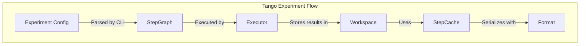
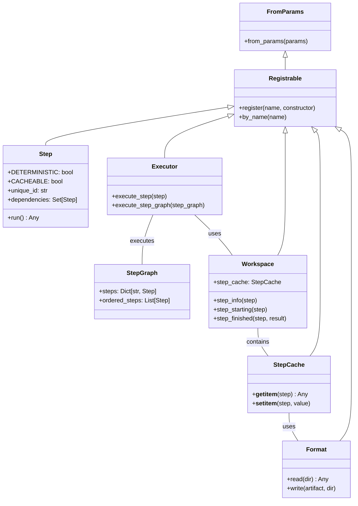
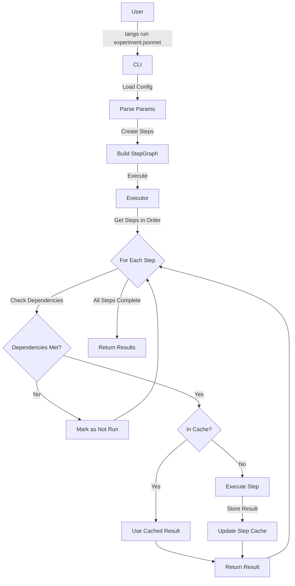
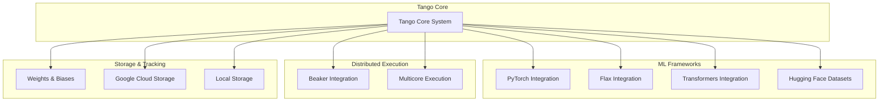
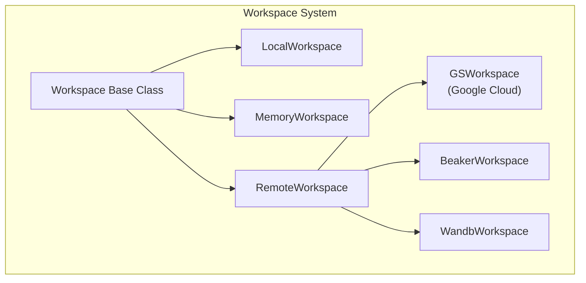

<!-- source: DeepWiki mcp.deepwiki.com · repo allenai/tango · page 1 Overview · fetched 2026-10-26 -->

# Overview

<details>
<summary>Relevant source files</summary>

The following files were used as context for generating this wiki page:

- [CHANGELOG.md](CHANGELOG.md)
- [README.md](README.md)
- [docs/source/conf.py](docs/source/conf.py)
- [docs/source/installation.md](docs/source/installation.md)
- [tango/version.py](tango/version.py)

</details>


AI2 Tango is a framework for organizing machine learning experiments into discrete, cacheable steps that can be reused throughout a research project's lifecycle. This document provides a high-level introduction to Tango's architecture, core components, and execution model.

For installation instructions, see [Installation](#1.2). For detailed information about the step system, see [Step System](#2).

## What is Tango?

Tango solves the problem of managing complex machine learning experiments by representing them as directed acyclic graphs (DAGs) of steps. Each step represents a discrete unit of computation (like data loading, preprocessing, model training, or evaluation) that can be cached based on its inputs, making experimentation more efficient and reproducible.



Sources: [README.md:7-9](), [README.md:243-246]()

## Key Features

- **Step-based computation**: Break down complex experiments into discrete, reusable steps
- **Intelligent caching**: Avoid redundant computation by caching step results based on inputs
- **Dependency management**: Automatically track and manage dependencies between steps
- **Multiple storage backends**: Store results locally or remotely (Google Cloud, Beaker, W&B)
- **ML framework integrations**: Work with popular frameworks like PyTorch, Flax, and Hugging Face

Sources: [README.md:97-102](), [CHANGELOG.md:62-72]()

## Core Architecture

Tango's architecture consists of six core components that work together to manage experiment workflows:



Sources: [README.md:237-251]()

### Core Components

| Component | Description | Primary Responsibility |
|-----------|-------------|------------------------|
| **Step** | Basic unit of computation | Encapsulates a discrete computation with defined inputs and outputs |
| **StepGraph** | Directed acyclic graph of steps | Manages dependencies between steps and their execution order |
| **Executor** | Executes steps in the graph | Runs steps in dependency order, handling parallelism and caching |
| **Workspace** | Manages storage of step results | Provides interfaces to different storage backends |
| **StepCache** | Caches step results | Stores and retrieves results based on step unique IDs |
| **Format** | Handles serialization | Converts step results to/from storable formats |

Sources: [CHANGELOG.md:377-384](), [CHANGELOG.md:395-402]()

## Execution Flow

The following diagram illustrates how Tango executes an experiment:



When executing steps, Tango follows these principles:
- Steps are executed in dependency order
- Before executing a step, Tango checks if its result is already in the cache
- Results are automatically cached for future reuse
- Dependencies are tracked automatically between steps

Sources: [CHANGELOG.md:41-43](), [README.md:76-102]()

## The Step System

The `Step` is the fundamental building block in Tango. Steps can be created two ways:

1. Using the `@step()` decorator on functions:

```python
@step()
def hello(name: str) -> str:
    message = f"Hello, {name}!"
    print(message)
    return message
```

2. Creating a class that inherits from `Step`:

```python
class MyStep(Step):
    DETERMINISTIC = True
    CACHEABLE = True
    
    def run(self, input_data):
        # Process input_data and return result
        return processed_data
```

Each step has a unique identifier based on:
1. The step's fully qualified name
2. The step's inputs
3. The step's `VERSION` class variable

This unique ID is used for caching purposes.

Sources: [README.md:53-60](), [README.md:243-251]()

## Integration Ecosystem

Tango integrates with popular ML frameworks and infrastructure tools:



Sources: [CHANGELOG.md:62-72](), [CHANGELOG.md:140-147](), [CHANGELOG.md:332-341]()

## Workspace System

The `Workspace` component manages the storage of step results and metadata. Tango provides several workspace implementations:



- **LocalWorkspace**: Stores results on the local filesystem
- **MemoryWorkspace**: Keeps results in memory (temporary)
- **GSWorkspace**: Stores results in Google Cloud Storage
- **BeakerWorkspace**: Integrates with Beaker for storage
- **WandbWorkspace**: Integrates with Weights & Biases

Sources: [CHANGELOG.md:579-583](), [CHANGELOG.md:62-72]()

## Getting Started

To create a simple Tango experiment:

1. Define a step:
```python
# hello.py
from tango import step

@step()
def hello(name: str) -> str:
    message = f"Hello, {name}!"
    print(message)
    return message
```

2. Create a configuration file:
```jsonnet
// hello.jsonnet
{
  steps: {
    hello: {
      type: "hello",
      name: "World",
    }
  }
}
```

3. Run the experiment:
```bash
tango run hello.jsonnet -w /tmp/workspace
```

Sources: [README.md:52-95]()

## Conclusion

AI2 Tango provides a structured way to manage machine learning experiments through discrete, cacheable steps. Its modular design and extensive integration ecosystem make it well-suited for research workflows, allowing researchers to focus on experimentation while Tango handles dependency management, caching, and execution.

Current version: 1.3.2

Sources: [version.py:1-8]()

---

