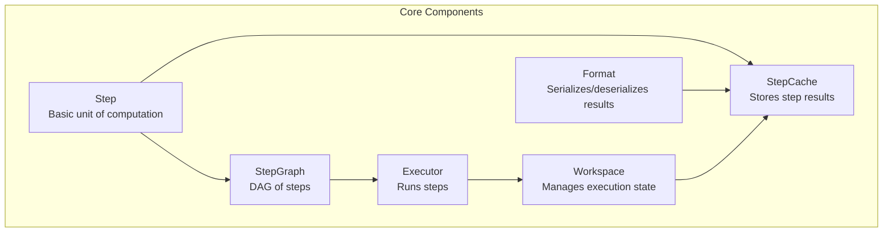
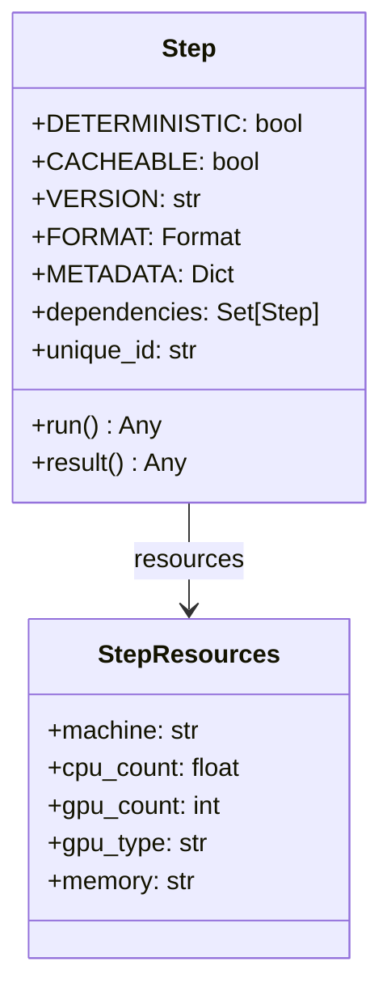
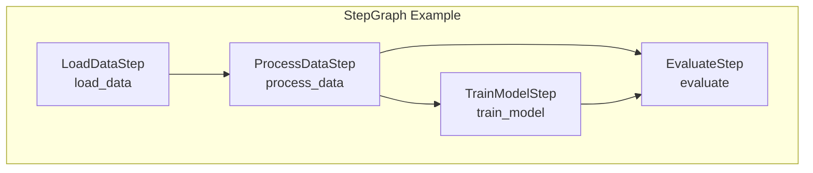
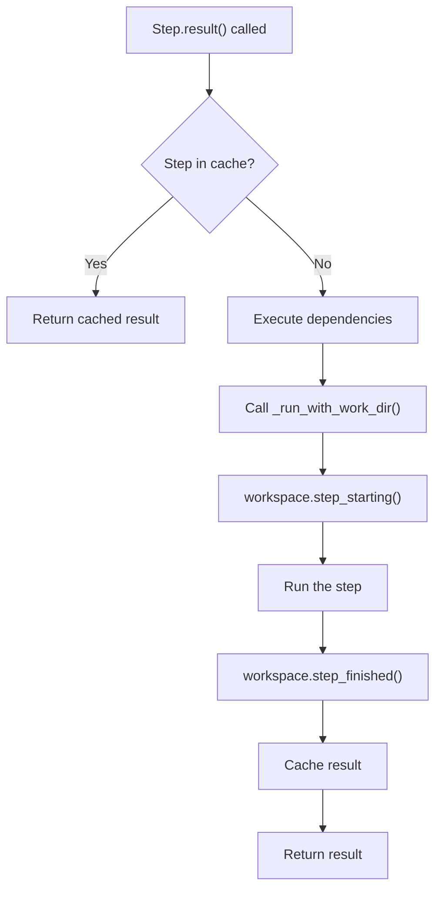
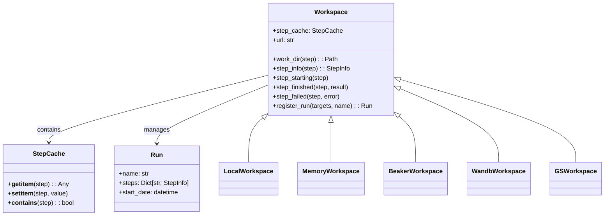
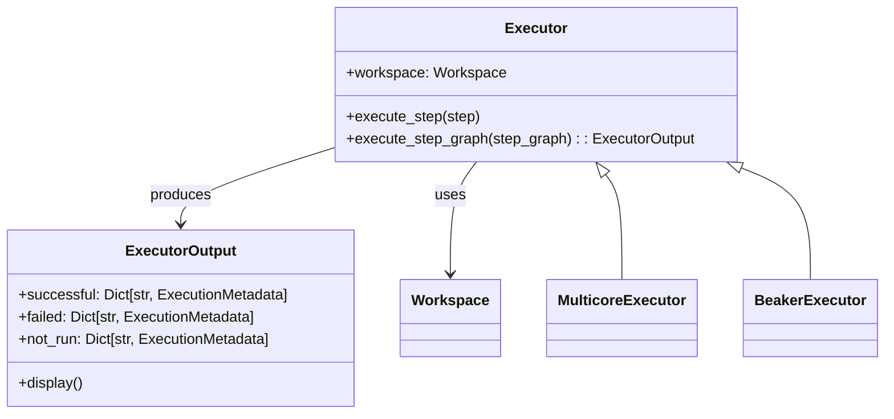
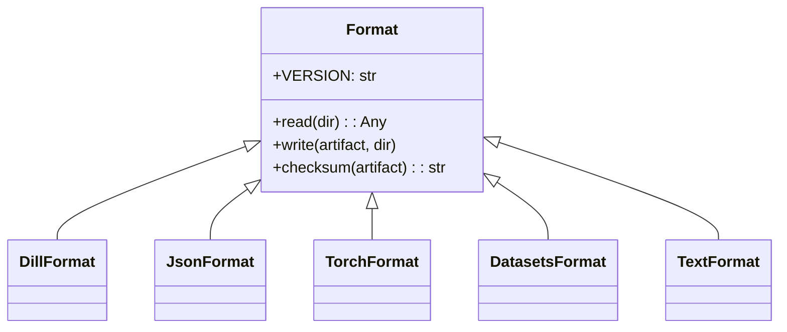
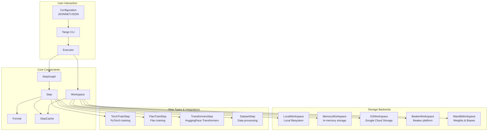

<!-- source: DeepWiki mcp.deepwiki.com · repo allenai/tango · page 1.1 Core Concepts · fetched 2026-10-26 -->

# Core Concepts

<details>
<summary>Relevant source files</summary>

The following files were used as context for generating this wiki page:

- [CHANGELOG.md](CHANGELOG.md)
- [docs/source/api/components/workspace.rst](docs/source/api/components/workspace.rst)
- [tango/__init__.py](tango/__init__.py)
- [tango/executor.py](tango/executor.py)
- [tango/step.py](tango/step.py)
- [tango/step_cache.py](tango/step_cache.py)
- [tango/step_graph.py](tango/step_graph.py)
- [tango/version.py](tango/version.py)
- [tango/workspace.py](tango/workspace.py)
- [tests/executor_test.py](tests/executor_test.py)
- [tests/main_test.py](tests/main_test.py)
- [tests/step_test.py](tests/step_test.py)

</details>


This document provides an overview of the fundamental concepts and components that make up the Tango framework. Tango is a Python library for choreographing machine learning research, designed to make experiments more reproducible, efficient, and manageable through step-based computation and caching.

## The Building Blocks of Tango

Tango organizes computation into reusable, cacheable units called Steps that can be composed into directed acyclic graphs (DAGs). These Step graphs are executed by Executors, which manage how and where Steps run. Results are stored in Workspaces using StepCaches, and are serialized and deserialized using Formats.



Sources: [tango/step.py:115-152](), [tango/step_graph.py:12-34](), [tango/executor.py:101-111](), [tango/workspace.py:108-119](), [tango/step_cache.py:18-29]()

## Steps: The Atomic Units of Computation

Steps are the fundamental building blocks in Tango. A Step represents a single unit of computation with well-defined inputs and outputs. Each Step can depend on other Steps, forming a directed acyclic graph of computations.

### Anatomy of a Step



A Step is defined by:

- **DETERMINISTIC**: Whether the step produces the same output given the same inputs (default: `True`)
- **CACHEABLE**: Whether the step's output should be cached (default: inferred from `DETERMINISTIC`)
- **VERSION**: Optional version string that lets you invalidate old caches when your step implementation changes
- **FORMAT**: The format used to serialize the step's result (default: `DillFormat`)
- **unique_id**: An automatically generated identifier based on the step class, inputs, and version

Steps are executed through their `run()` method, which takes typed parameters and returns a result. Steps can be executed using the `result()` method, which handles caching and dependencies automatically.

```python
@Step.register("sum")
class AdditionStep(Step):
    DETERMINISTIC = True
    CACHEABLE = True
    
    def run(self, a: int, b: int) -> int:
        return a + b
        
# To use:
step = AdditionStep(a=1, b=2)
result = step.result()  # Returns 3, caching the result
```

You can also create Steps from functions using the `@step` decorator:

```python
@step
def add(a: int, b: int) -> int:
    return a + b
```

Sources: [tango/step.py:115-152](), [tango/step.py:153-186](), [tango/step.py:385-449](), [tango/step.py:450-459](), [tango/step.py:639-672](), [tango/step.py:65-113]()

## Step Graph: Orchestrating Workflows

A `StepGraph` represents an experiment as a directed acyclic graph of steps, where each step can depend on the results of other steps. It manages the dependencies between steps and ensures they are executed in the correct order.



StepGraphs can be constructed either programmatically or from configuration files (JSON, JSONNET):

```python
# Programmatic construction
step_graph = StepGraph({
    "load_data": LoadDataStep(file_path="data.csv"),
    "process_data": ProcessDataStep(data=step_graph["load_data"]),
    "train_model": TrainModelStep(data=step_graph["process_data"]),
    "evaluate": EvaluateStep(model=step_graph["train_model"], data=step_graph["process_data"])
})

# From configuration
step_graph = StepGraph.from_file("experiment.jsonnet")
```

In configuration files, dependencies between steps are expressed using the `"ref"` syntax:

```json
{
  "steps": {
    "load_data": {
      "type": "load_dataset",
      "file_path": "data.csv"
    },
    "process_data": {
      "type": "process_dataset",
      "data": {"type": "ref", "ref": "load_data"}
    }
  }
}
```

Sources: [tango/step_graph.py:12-34](), [tango/step_graph.py:35-103](), [tango/step_graph.py:129-142](), [tango/step_graph.py:241-296]()

## Step Execution Flow

When steps are executed, Tango follows a specific flow to handle dependencies, caching, and execution:



The execution flow handles:

1. **Dependency Resolution**: Before a step is executed, all its dependencies are resolved recursively
2. **Caching**: Steps check the cache before execution to avoid redundant computation
3. **Step State Management**: The workspace tracks the state of each step (not started, running, completed, or failed)
4. **Result Storage**: After execution, the step's result is stored in the cache using the configured Format

Sources: [tango/step.py:639-672](), [tango/step.py:460-497](), [tango/executor.py:125-135](), [tango/executor.py:136-174]()

## Workspaces and Step Caching

Workspaces manage the storage of step results, intermediate artifacts, and metadata. They provide the infrastructure for step caching and experiment tracking.



Different workspace implementations provide various storage options:

- **LocalWorkspace**: Stores results on the local filesystem
- **MemoryWorkspace**: Stores results in memory (temporary)
- **BeakerWorkspace**: Stores results in Beaker (for distributed execution)
- **WandbWorkspace**: Stores results in Weights & Biases
- **GSWorkspace**: Stores results in Google Cloud Storage

Workspaces track runs, which are collections of steps executed together with a unique name and timestamp.

Sources: [tango/workspace.py:108-119](), [tango/workspace.py:120-140](), [tango/workspace.py:178-199](), [tango/workspace.py:307-319](), [tango/step_cache.py:18-29](), [tango/workspace.py:36-70]()

## Executors: Running Steps

Executors are responsible for running steps, managing their execution environment, and handling parallelism. They interact with Workspaces to store results and track step states.



The default `Executor` runs steps sequentially, while specialized executors provide additional capabilities:

- **MulticoreExecutor**: Runs steps in parallel using multiple CPU cores
- **BeakerExecutor**: Executes steps on Beaker's cloud infrastructure

When executing a StepGraph, the executor:
1. Determines the execution order based on dependencies
2. Checks for cached results
3. Executes steps that aren't cached
4. Handles failures and reports on execution status

Sources: [tango/executor.py:101-111](), [tango/executor.py:125-135](), [tango/executor.py:136-174](), [tango/executor.py:24-98]()

## Formats: Serialization and Deserialization

Formats define how step results are serialized to and deserialized from storage. Different formats support different types of data.



Common formats include:

- **DillFormat**: General-purpose Python object serialization (default)
- **JsonFormat**: For JSON-serializable data
- **TorchFormat**: For PyTorch models and tensors
- **TextFormat**: For plain text output

Each step can specify which format should be used to store its results through the `FORMAT` class variable.

Sources: [tango/step.py:170-172]()

## Complete Tango System Architecture

The full Tango architecture connects all these components into a cohesive system:



Sources: [tango/step.py:115-152](), [tango/step_graph.py:12-34](), [tango/executor.py:101-111](), [tango/workspace.py:108-119](), [tango/step_cache.py:18-29](), [tango/version.py:1-8]()

## Summary

The core concepts in Tango work together to provide a powerful framework for machine learning experimentation:

1. **Steps** are the atomic units of computation
2. **StepGraphs** organize steps into directed acyclic graphs
3. **Workspaces** manage storage and caching of step results
4. **Executors** run steps and handle execution flow
5. **Formats** serialize and deserialize step results

These components allow Tango to efficiently manage complex machine learning workflows, ensure reproducibility through caching, and facilitate experiment tracking.

---

