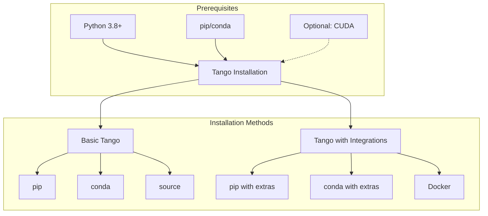
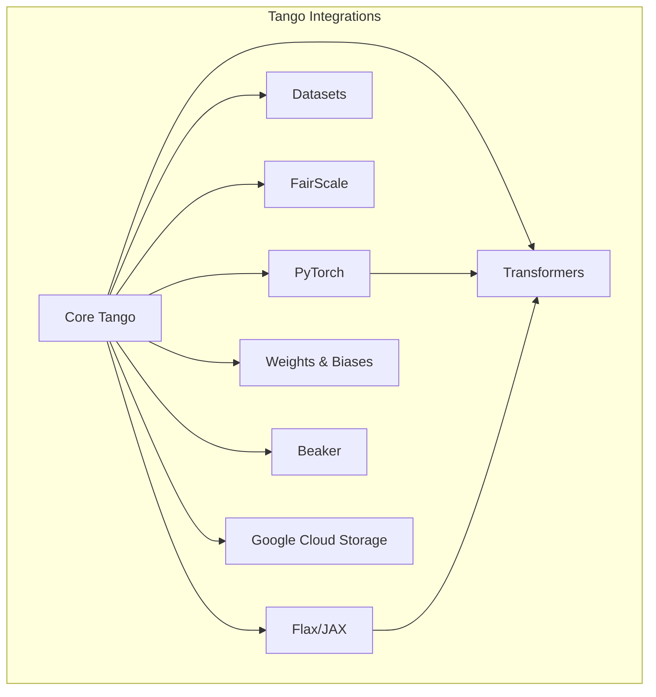
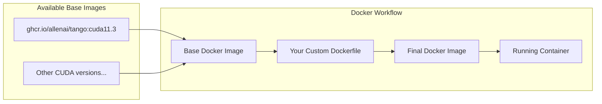

<!-- source: DeepWiki mcp.deepwiki.com · repo allenai/tango · page 1.2 Installation · fetched 2026-10-26 -->

# Installation

<details>
<summary>Relevant source files</summary>

The following files were used as context for generating this wiki page:

- [.github/workflows/main.yml](.github/workflows/main.yml)
- [Dockerfile](Dockerfile)
- [Dockerfile.test](Dockerfile.test)
- [README.md](README.md)
- [docs/source/conf.py](docs/source/conf.py)
- [docs/source/installation.md](docs/source/installation.md)
- [pyproject.toml](pyproject.toml)
- [tango/common/file_lock.py](tango/common/file_lock.py)
- [tango/integrations/torch/optim.py](tango/integrations/torch/optim.py)
- [tango/integrations/transformers/__init__.py](tango/integrations/transformers/__init__.py)

</details>


This page provides comprehensive instructions for installing AI2 Tango and its various integrations. Tango requires Python 3.8 or later and offers multiple installation methods to suit different needs. For an overview of what Tango is and its core concepts, see [Overview](#1) and [Core Concepts](#1.1).

## System Requirements

Before installing Tango, ensure your system meets the following requirements:

- Python 3.8 or later
- Sufficient disk space for caching experimental results
- Optional: GPU with CUDA support for certain integrations (PyTorch, Transformers, etc.)



Sources: [README.md:109-111](), [pyproject.toml:22]()

## Basic Installation

### Installing with pip

The simplest way to install the base Tango package is using pip:

```bash
pip install ai2-tango
```

This installs the core functionality without any additional integrations.

### Installing with conda

Tango is also available on conda-forge:

```bash
conda install tango -c conda-forge
```

Sources: [README.md:112-118](), [README.md:132-139]()

## Installing Integrations

Tango supports various integrations with popular ML frameworks and tools. You can install these integrations individually or all at once.

### Available Integrations



Sources: [pyproject.toml:42-111](), [tango/integrations/transformers/__init__.py:1-9]()

### Integration Dependencies

The table below shows the main dependencies for each integration:

| Integration | Main Dependencies |
|-------------|------------------|
| torch | torch, numpy |
| transformers | torch, numpy, datasets, transformers, sentencepiece, sacremoses |
| datasets | datasets |
| fairscale | torch, numpy, fairscale |
| flax | datasets, jax, jaxlib, flax, optax, tensorflow-cpu |
| wandb | wandb, retry |
| beaker | beaker-py |
| gs | google-cloud-storage, google-cloud-datastore |

Sources: [pyproject.toml:70-108]()

### Installing Specific Integrations with pip

To install Tango with a specific integration, use the following syntax:

```bash
pip install 'ai2-tango[integration_name]'
```

For example, to install with PyTorch integration:

```bash
pip install 'ai2-tango[torch]'
```

For the Transformers integration:

```bash
pip install 'ai2-tango[transformers]'
```

Sources: [README.md:119-125](), [tango/integrations/transformers/__init__.py:1-5]()

### Installing All Integrations with pip

To install Tango with all available integrations:

```bash
pip install 'ai2-tango[all]'
```

Note that this will install a large number of dependencies and may take some time.

Sources: [README.md:126-130](), [pyproject.toml:109-111]()

### Installing Integrations with conda

Conda users can install specific integrations using:

```bash
conda install tango-datasets -c conda-forge
conda install tango-torch -c conda-forge
conda install tango-wandb -c conda-forge
```

To install all integrations with conda:

```bash
conda install tango-all -c conda-forge
```

Sources: [README.md:140-152]()

## Installing from Source

For development or to use the latest features, you can install Tango directly from the source code:

1. Clone the repository:
   ```bash
   git clone https://github.com/allenai/tango.git
   cd tango
   ```

2. Install with the desired integrations:
   ```bash
   pip install -e '.[all]'  # For all integrations
   ```
   
   Or for a specific integration:
   ```bash
   pip install -e '.[torch]'  # Just for PyTorch integration
   ```
   
   Or for just the core package:
   ```bash
   pip install -e .
   ```

Sources: [README.md:158-182]()

## Docker Installation

Tango provides official Docker images that can be used as a base for your projects. This is especially useful for ensuring consistency across different environments or when deploying to cloud services.



### Using a Pre-built Image

You can use one of the pre-built Tango images as a base in your Dockerfile:

```Dockerfile
# Start from a prebuilt tango base image
FROM ghcr.io/allenai/tango:cuda11.3

# Install your project's additional requirements
COPY requirements.txt .
RUN /opt/conda/bin/pip install --no-cache-dir -r requirements.txt

# Install source code
COPY . .
```

### Building a Custom Image

Alternatively, you can build your own Docker image using the official Dockerfile as a starting point:

```bash
# Clone the repository
git clone https://github.com/allenai/tango.git

# Build the Docker image
cd tango
docker build -t my-tango-image .
```

Sources: [README.md:194-217](), [Dockerfile:1-15]()

## Verifying Your Installation

After installation, you can verify that Tango was installed correctly by running:

```bash
tango info
```

This command displays information about your Tango installation, including the version and installed integrations.

For a quick test, you can run the "Hello World" example from the README:

1. Create a simple step in a file named `hello.py`:
   ```python
   from tango import step

   @step()
   def hello(name: str) -> str:
       message = f"Hello, {name}!"
       print(message)
       return message
   ```

2. Create a configuration file named `hello.jsonnet`:
   ```jsonnet
   {
     steps: {
       hello: {
         type: "hello",
         name: "World",
       }
     }
   }
   ```

3. Run the example:
   ```bash
   tango run hello.jsonnet -w /tmp/workspace
   ```

Sources: [README.md:183-193](), [README.md:47-103]()

## Installation in a CI/CD Environment

For continuous integration and automated testing environments, you may want to install Tango in a non-interactive way. The GitHub Actions workflow file in the Tango repository provides examples of how to set up Tango with different integrations in an automated environment.

Key points for CI/CD installation:

- Install the base package first: `pip install ai2-tango`
- Add integrations as needed: `pip install 'ai2-tango[integration_name]'`
- For GPU testing, consider using Docker containers with appropriate CUDA support
- Use `tango --version` or `tango info` to verify the installation

Sources: [.github/workflows/main.yml:169-237](), [Dockerfile.test:1-14]()

## Troubleshooting

### Permission Issues with File Locks

Tango uses file locks for managing concurrent access to its workspace. If you encounter permission errors, they might be related to the file locking mechanism. The error message will typically mention acquiring a lock.

Tango includes a special file lock implementation that can handle read-only environments with appropriate warnings. If you're working in an environment with restricted permissions, ensure that the workspace directory is writable by your user.

Sources: [tango/common/file_lock.py:1-74]()

### Integration-Specific Issues

If you encounter issues with a specific integration, ensure that all required dependencies are installed correctly. For example, the Transformers integration requires not just the transformers package but also torch, numpy, datasets, and other dependencies.

Check the integration's requirements in the `pyproject.toml` file or using:

```bash
pip show ai2-tango
```

### Cuda Compatibility Issues

When using GPU-accelerated integrations like PyTorch, ensure that the CUDA version on your system is compatible with the installed packages. You can specify compatible CUDA versions when installing PyTorch:

```bash
pip install torch==2.0.0 --extra-index-url https://download.pytorch.org/whl/cu117
pip install 'ai2-tango[torch]'
```

Sources: [.github/workflows/main.yml:203-207]()

---

