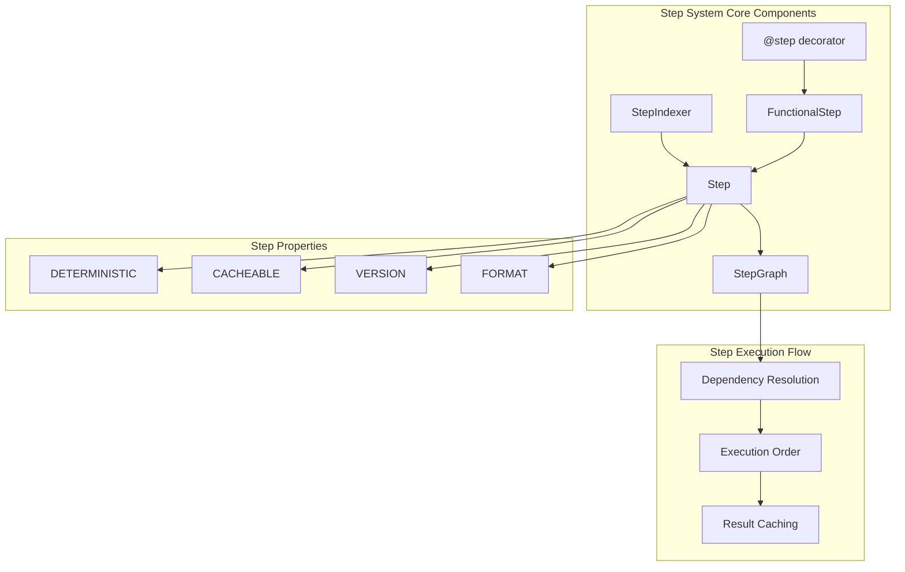
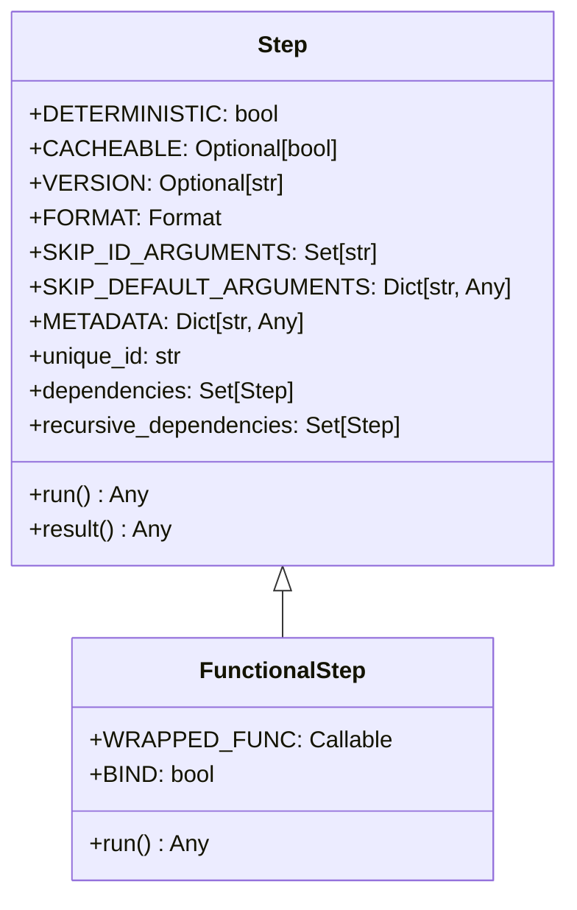
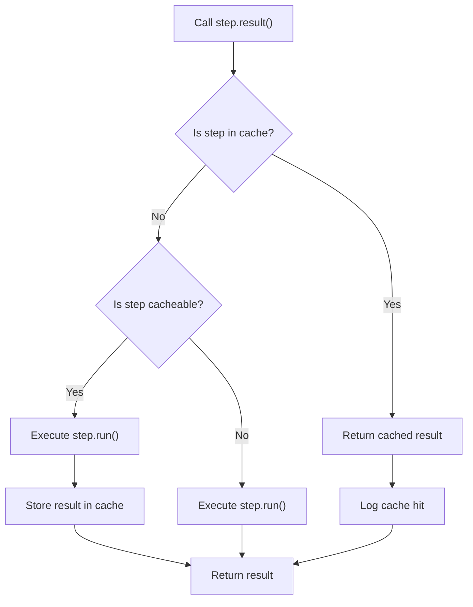
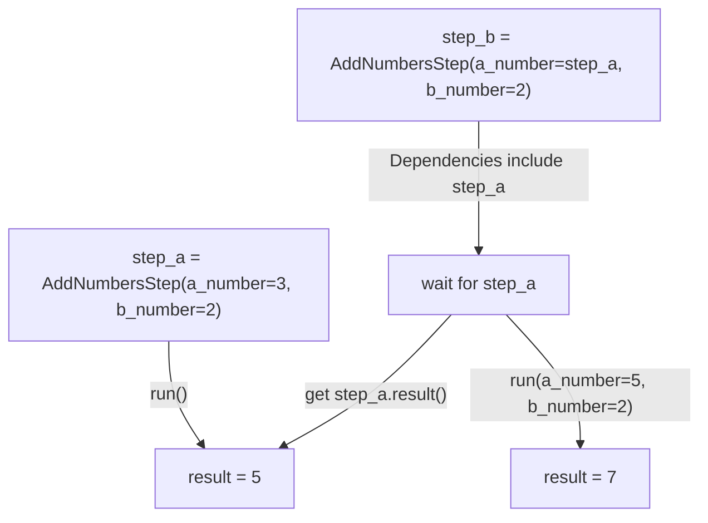
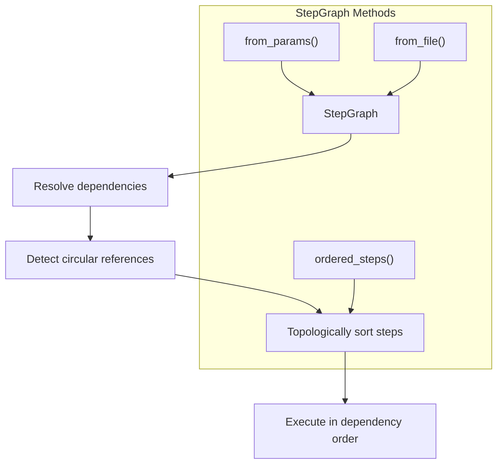
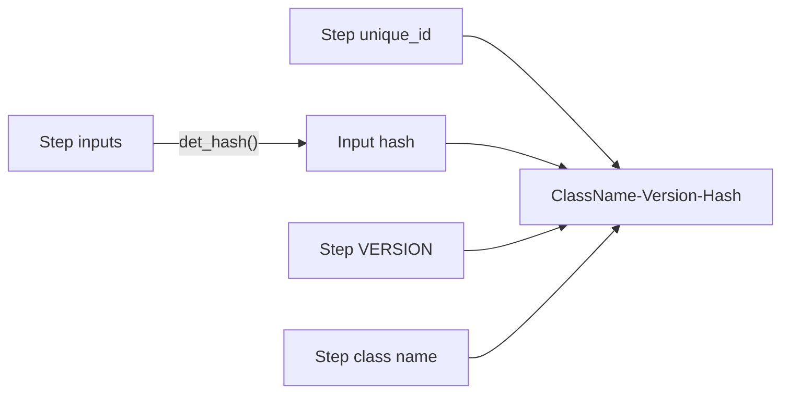
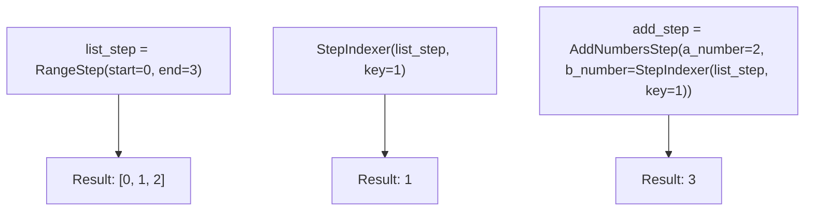

<!-- source: DeepWiki mcp.deepwiki.com · repo allenai/tango · page 2 Step System · fetched 2026-10-26 -->

# Step System

<details>
<summary>Relevant source files</summary>

The following files were used as context for generating this wiki page:

- [tango/common/testing/steps.py](tango/common/testing/steps.py)
- [tango/step.py](tango/step.py)
- [tango/step_graph.py](tango/step_graph.py)
- [tests/end_to_end/test_step_indexing.py](tests/end_to_end/test_step_indexing.py)
- [tests/step_graph_test.py](tests/step_graph_test.py)
- [tests/step_test.py](tests/step_test.py)

</details>


The Step System is the core computational framework within Tango that enables defining, organizing, and executing computational tasks. It provides a robust mechanism for creating dependency-aware, cacheable operations that can be composed into complex computation graphs. 

For information about specific step implementations, see [Steps](#2.1). For details on how step results are cached, see [Step Caching](#2.3).

## Overview of the Step System

The Step System consists of two main components:

1. **Step** - The fundamental unit of computation that performs a specific task
2. **StepGraph** - A collection of steps organized in a directed acyclic graph (DAG) based on their dependencies



Sources: [tango/step.py:115-141](), [tango/step.py:153-172](), [tango/step_graph.py:12-19]()

## The Step Class

The `Step` class is the core building block of Tango's computation model. Each step represents a discrete unit of work that takes inputs, performs computation, and produces outputs.



Sources: [tango/step.py:115-195](), [tango/step.py:785-797]()

### Key Attributes

| Attribute | Type | Description |
|-----------|------|-------------|
| `DETERMINISTIC` | `bool` | Whether the step produces the same output for the same inputs (default: `True`) |
| `CACHEABLE` | `Optional[bool]` | Whether results should be cached (default: `None`, which respects `DETERMINISTIC`) |
| `VERSION` | `Optional[str]` | Version identifier that can be used to invalidate caches when implementation changes |
| `FORMAT` | `Format` | Serialization format for step results (default: `DillFormat("gz")`) |
| `SKIP_ID_ARGUMENTS` | `Set[str]` | Arguments that don't affect the step's unique ID and caching |
| `SKIP_DEFAULT_ARGUMENTS` | `Dict[str, Any]` | Default argument values that don't affect the unique ID |
| `METADATA` | `Dict[str, Any]` | Arbitrary metadata associated with the step |

Sources: [tango/step.py:153-192]()

### Creating Steps

Steps can be created in two ways:

1. **Class-based steps** - By subclassing `Step` and implementing the `run()` method:

```python
@Step.register("add_numbers")
class AddNumbersStep(Step):
    DETERMINISTIC = True
    CACHEABLE = True

    def run(self, a_number: int, b_number: int) -> int:
        return a_number + b_number
```

2. **Function-based steps** - Using the `@step` decorator:

```python
@step(version="001")
def add(a: int, b: int) -> int:
    return a + b
```

Sources: [tango/step.py:800-855](), [tests/common/testing/steps.py:68-74]()

## Step Execution and Caching

When a step is invoked, Tango follows this process:



Sources: [tango/step.py:639-671](), [tango/step.py:460-498]()

The `result()` method is the primary way to execute a step. It handles:
1. Checking if the result is already in the cache
2. Running the step if necessary
3. Caching the result if the step is cacheable
4. Replacing any step dependencies with their results before execution

Sources: [tango/step.py:639-671]()

## Step Dependencies

Steps can depend on other steps, creating a directed acyclic graph of computation. When a step depends on another step, the dependent step is executed first, and its result is passed as input.



Sources: [tango/step.py:694-722](), [tango/step.py:615-637]()

Dependencies are either:
1. **Automatic** - When a step is passed as an argument to another step
2. **Explicit** - Using the `step_extra_dependencies` parameter

The `dependencies` property returns a set of direct dependencies, while `recursive_dependencies` returns all dependencies including indirect ones.

Sources: [tango/step.py:724-737]()

## The StepGraph Class

`StepGraph` represents an experiment as a directed graph of steps. It manages dependency resolution and ensures steps are executed in the correct order.



Sources: [tango/step_graph.py:12-19](), [tango/step_graph.py:103-128](), [tango/step_graph.py:212-228]()

### Creating a StepGraph

`StepGraph` can be created from:
1. A configuration file (using `from_file()`)
2. A dictionary of parameters (using `from_params()`)
3. Direct construction with a dictionary of steps

```python
# From file
step_graph = StepGraph.from_file("experiment.jsonnet")

# From parameters
step_graph = StepGraph.from_params({
    "step_a": {"type": "add_numbers", "a_number": 3, "b_number": 2},
    "step_b": {"type": "add_numbers", "a_number": {"type": "ref", "ref": "step_a"}, "b_number": 5}
})

# Direct construction
step_a = AddNumbersStep(a_number=3, b_number=2, step_name="step_a")
step_b = AddNumbersStep(a_number=step_a, b_number=5, step_name="step_b")
step_graph = StepGraph({"step_a": step_a, "step_b": step_b})
```

Sources: [tango/step_graph.py:20-34](), [tango/step_graph.py:103-128](), [tango/step_graph.py:241-243]()

### Dependency Resolution

`StepGraph` resolves dependencies by:
1. Finding all referenced steps in the configuration
2. Checking for unsatisfiable dependencies
3. Determining the correct execution order using topological sorting
4. Detecting circular dependencies

Sources: [tango/step_graph.py:46-88](), [tango/step_graph.py:154-167]()

## Unique IDs and Caching

Each step has a unique ID derived from:
- The step's class name
- The step's version
- A hash of the step's inputs (for deterministic steps)
- A random string (for non-deterministic steps)



Sources: [tango/step.py:555-594]()

This unique ID is used for:
1. Caching results
2. Determining whether a step needs to be rerun when inputs change
3. Identifying steps within a workspace

The `SKIP_ID_ARGUMENTS` and `SKIP_DEFAULT_ARGUMENTS` attributes allow you to exclude certain arguments from the unique ID calculation.

Sources: [tango/step.py:175-186]()

## Step Indexing

Tango supports indexing into step results using `StepIndexer`. This is useful when a step returns a collection and only a specific element is needed by a downstream step.



Sources: [tango/step.py:860-872](), [tests/end_to_end/test_step_indexing.py:6-22]()

## Step Resources

Steps can specify resource requirements using the `StepResources` class. This is particularly useful for distributed execution environments where hardware allocation is necessary.

```python
@dataclass
class StepResources(FromParams):
    machine: Optional[str] = None
    cpu_count: Optional[float] = None
    gpu_count: Optional[int] = None
    gpu_type: Optional[str] = None
    memory: Optional[str] = None
    shared_memory: Optional[str] = None
```

Sources: [tango/step.py:65-112](), [tango/step.py:544-552]()

## Conclusion

The Step System forms the backbone of Tango's computation model. By representing computations as cacheable, dependency-aware steps organized in a graph, Tango provides a powerful framework for building complex, efficient machine learning workflows.

The key advantages of this design include:
- **Caching**: Avoiding redundant computation by storing and reusing results
- **Dependency management**: Automatically determining execution order based on data dependencies
- **Reproducibility**: Through deterministic execution and version tracking
- **Flexibility**: Supporting various execution environments and resource requirements

Sources: [tango/step.py:115-783](), [tango/step_graph.py:12-300]()

---

