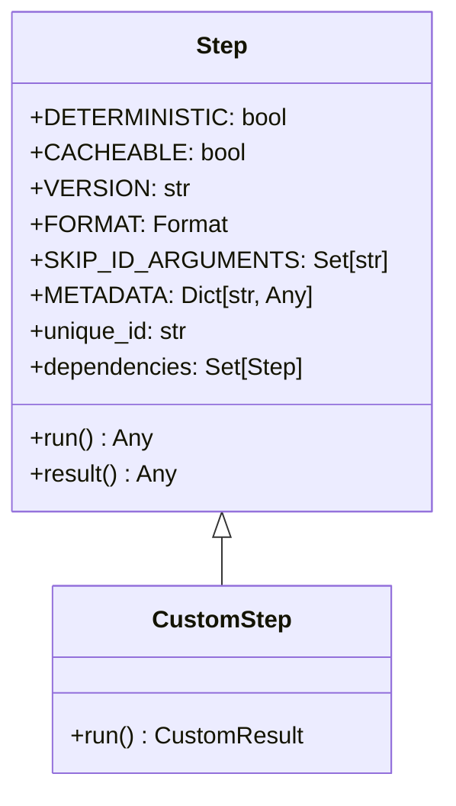
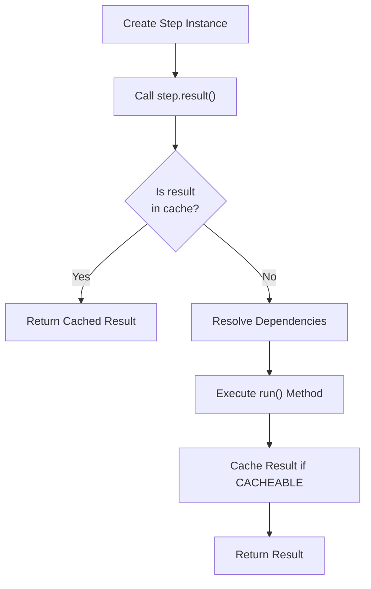
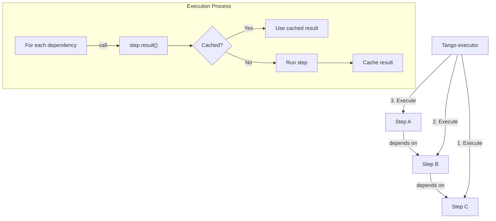

<!-- source: DeepWiki mcp.deepwiki.com · repo allenai/tango · page 2.1 Steps · fetched 2026-10-26 -->

# Steps

<details>
<summary>Relevant source files</summary>

The following files were used as context for generating this wiki page:

- [tango/common/testing/steps.py](tango/common/testing/steps.py)
- [tango/step.py](tango/step.py)
- [tango/step_graph.py](tango/step_graph.py)
- [tests/end_to_end/test_step_indexing.py](tests/end_to_end/test_step_indexing.py)
- [tests/step_graph_test.py](tests/step_graph_test.py)
- [tests/step_test.py](tests/step_test.py)

</details>


Steps are the fundamental building blocks of computation in Tango. They represent discrete, reusable, and potentially cacheable units of work that form the nodes in your experiment's computational graph. 

For information about how these Steps are organized into a dependency graph, see [StepGraph](#2.2). For details on how Step results are cached, see [Step Caching](#2.3).

## Step Anatomy

The `Step` class in Tango is a registered class that can be extended to define specific computational tasks. Each Step has:

- A `run()` method that performs the actual computation
- A unique ID for caching and identification
- Optional dependencies on other Steps
- Configuration for caching behavior, versioning, and serialization format



Sources: [tango/step.py:115-783]()

## Creating Steps

### Method 1: Subclassing Step

The most common way to create a Step is by subclassing the `Step` class:

```python
@Step.register("add_numbers")
class AddNumbersStep(Step[int]):
    DETERMINISTIC = True
    CACHEABLE = True
    VERSION = "001"
    
    def run(self, a: int, b: int) -> int:
        return a + b
```

The `run()` method must have type hints for all parameters, which allows Tango to validate inputs and handle dependencies correctly.

### Method 2: Using the @step Decorator

For simpler cases, you can use the `@step` decorator to create a functional step:

```python
@step(version="001")
def add_numbers(a: int, b: int) -> int:
    return a + b
```

This creates a subclass of `FunctionalStep` that wraps the decorated function.

Sources: [tango/step.py:785-857]()

## Key Step Attributes

Steps have several class attributes that control their behavior:

| Attribute | Description | Default |
|-----------|-------------|---------|
| `DETERMINISTIC` | Whether the step produces the same output for the same input | `True` |
| `CACHEABLE` | Whether results can be cached | `None` (determined by `DETERMINISTIC`) |
| `VERSION` | String that invalidates cache when implementation changes | `None` |
| `FORMAT` | Format used to serialize/deserialize results | `DillFormat("gz")` |
| `SKIP_ID_ARGUMENTS` | Arguments that don't affect the unique ID | `set()` |
| `SKIP_DEFAULT_ARGUMENTS` | Default arguments that don't affect the unique ID | `{}` |
| `METADATA` | Additional information about the step | `{}` |

Sources: [tango/step.py:153-191]()

## Step Lifecycle



Sources: [tango/step.py:639-671]()

## Step Dependencies

Steps can depend on other steps, with dependencies automatically resolved during execution. There are several ways to specify dependencies:

### Direct Dependencies

The most common way is to pass a Step instance as an argument to another Step:

```python
step1 = AddNumbersStep(a=1, b=2)
step2 = AddNumbersStep(a=step1, b=3)  # step2 depends on step1
```

When `step2` is executed, Tango automatically:
1. Executes `step1` (if not already executed)
2. Takes the result of `step1` (which is 3)
3. Passes this result as the `a` parameter to `step2.run()`

### Configuration References

In configuration files, dependencies are specified using references:

```json
{
  "steps": {
    "step1": {
      "type": "add_numbers",
      "a": 1,
      "b": 2
    },
    "step2": {
      "type": "add_numbers",
      "a": {"type": "ref", "ref": "step1"},
      "b": 3
    }
  }
}
```

### Accessing Specific Elements with StepIndexer

Sometimes you need to access just one element of a step's result. `StepIndexer` allows this:

```python
# In Python
list_step = RangeOutput(start=0, end=3)  # Returns [0, 1, 2]
add_step = AddNumbersStep(a=2, b=StepIndexer(list_step, 1))  # Uses element 1 (which is 1)
```

In configuration:
```json
{
  "steps": {
    "list": {"type": "range_step", "start": 0, "end": 3},
    "added": {
      "type": "add_numbers",
      "a_number": 2,
      "b_number": {"type": "ref", "ref": "list", "key": 1}
    }
  }
}
```

Sources: [tango/step.py:860-871](), [tango/step_graph.py:145-192]()

## Dependency Resolution



Sources: [tango/step.py:615-637](), [tango/step_graph.py:66-89]()

## Step Execution and Caching

When you call `step.result()`, Tango:

1. Checks if the step is cacheable (`step.cache_results` is `True`)
2. If cacheable, checks if the result is already in the cache using the step's unique ID
3. If found in cache, returns the cached result
4. Otherwise:
   - Resolves dependencies by calling `result()` on any step parameters
   - Creates a working directory for the step if it's cacheable
   - Calls the step's `run()` method with the resolved parameters
   - Stores the result in the cache if the step is cacheable

The unique ID used for caching is generated based on:
- The step's class name
- Its `VERSION` (if specified)
- A deterministic hash of its inputs (for `DETERMINISTIC=True` steps)
- A random string (for `DETERMINISTIC=False` steps)

Sources: [tango/step.py:555-593]()

## Step Resources

Steps can specify resource requirements using the `step_resources` parameter:

```python
from tango.step import StepResources

step = MyStep(
    input_data="input",
    step_resources=StepResources(
        cpu_count=2,
        gpu_count=1, 
        gpu_type="NVIDIA A100-SXM-80GB",
        memory="8GiB"
    )
)
```

Available resource specifications include:

| Resource | Description | Example |
|----------|-------------|---------|
| `machine` | Executor-dependent machine specification | `"local"` |
| `cpu_count` | Minimum number of logical CPU cores | `4`, `0.5` |
| `gpu_count` | Minimum number of GPUs | `1` |
| `gpu_type` | Type of GPU required | `"NVIDIA A100-SXM-80GB"` |
| `memory` | Minimum system memory | `"8GiB"`, `"1024m"` |
| `shared_memory` | Size of `/dev/shm` | `"2.5GiB"` |

Sources: [tango/step.py:64-112](), [tango/step.py:544-552]()

## Step Metadata

You can add metadata to steps using the `step_metadata` parameter or by setting the `METADATA` class attribute:

```python
@Step.register("my_step")
class MyStep(Step):
    METADATA = {"creator": "AI2", "purpose": "Data processing"}
    
    def run(self, data: str) -> str:
        return process(data)

step = MyStep(
    data="input",
    step_metadata={"dataset": "mydata", "version": "1.0"}
)
```

The final metadata combines the class `METADATA` with the instance `step_metadata`, with the latter taking precedence.

Sources: [tango/step.py:198-139]()

## Example Step Implementations

### Basic Example: Adding Numbers

```python
@Step.register("add_numbers")
class AddNumbersStep(Step[int]):
    DETERMINISTIC = True
    CACHEABLE = True
    
    def run(self, a_number: int, b_number: int) -> int:
        return a_number + b_number

step = AddNumbersStep(a_number=1, b_number=2)
result = step.result()  # result = 3
```

### Steps with Dependencies

```python
@Step.register("string")
class StringStep(Step[str]):
    def run(self, result: str) -> str:
        return result

@Step.register("concat_strings")
class ConcatStringsStep(Step[str]):
    def run(self, string1: str, string2: str, join_with: str = " ") -> str:
        return join_with.join([string1, string2])

step1 = StringStep(result="Hello")
step2 = StringStep(result="World")
concat = ConcatStringsStep(string1=step1, string2=step2)
result = concat.result()  # result = "Hello World"
```

### Working with Step Indexers

```python
@Step.register("range_step")
class RangeOutput(Step[List[int]]):
    def run(self, start: int, end: int) -> List[int]:
        return list(range(start, end))

range_step = RangeOutput(start=0, end=3)  # Returns [0, 1, 2]
add_step = AddNumbersStep(
    a_number=2, 
    b_number=StepIndexer(range_step, 1)  # Gets element at index 1
)
result = add_step.result()  # result = 3 (2 + 1)
```

Sources: [tango/common/testing/steps.py:13-160](), [tests/end_to_end/test_step_indexing.py:1-21]()

---

