<!-- source: DeepWiki mcp.deepwiki.com · repo allenai/tango · page 2.2 StepGraph · fetched 2026-10-26 -->

# StepGraph

<details>
<summary>Relevant source files</summary>

The following files were used as context for generating this wiki page:

- [tango/common/testing/steps.py](tango/common/testing/steps.py)
- [tango/step.py](tango/step.py)
- [tango/step_graph.py](tango/step_graph.py)
- [tests/end_to_end/test_step_indexing.py](tests/end_to_end/test_step_indexing.py)
- [tests/step_graph_test.py](tests/step_graph_test.py)
- [tests/step_test.py](tests/step_test.py)

</details>


## Purpose and Scope

The `StepGraph` class is a core component of the Tango framework that represents an experiment as a directed graph of computational steps. It manages dependencies between steps, ensures they are executed in a valid order, and provides a dictionary-like interface for accessing steps by name. This page explains how `StepGraph` works, how to create and manipulate it, and how it fits into the larger Tango architecture.

For information about individual Steps, see [Steps](#2.1). For information about Step caching, see [Step Caching](#2.3).

Sources: [tango/step_graph.py:12-13]()

## Overview of StepGraph

`StepGraph` sits at the heart of Tango's computational model, acting as the structure that organizes steps into a coherent workflow. It is responsible for analyzing dependencies between steps, detecting circular references, and establishing a valid execution order.

### Core Functionality

- Represents an experiment as a directed acyclic graph (DAG) of steps
- Manages dependencies between steps
- Ensures steps are executed in a valid order
- Provides dictionary-like access to steps by name
- Detects circular dependencies and missing steps
- Supports serialization to and from configuration files

Sources: [tango/step_graph.py:12-18](), [tango/step_graph.py:19-34]()

## StepGraph in the Tango Architecture

The following diagram illustrates where `StepGraph` fits within Tango's core architecture:

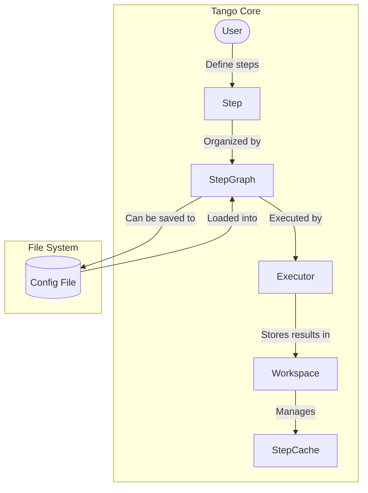

Sources: [tango/step_graph.py](), [tango/step.py:115-151]()

## Creating a StepGraph

There are multiple ways to create a `StepGraph`:

### 1. Direct Construction

You can create a `StepGraph` directly from a dictionary of steps:

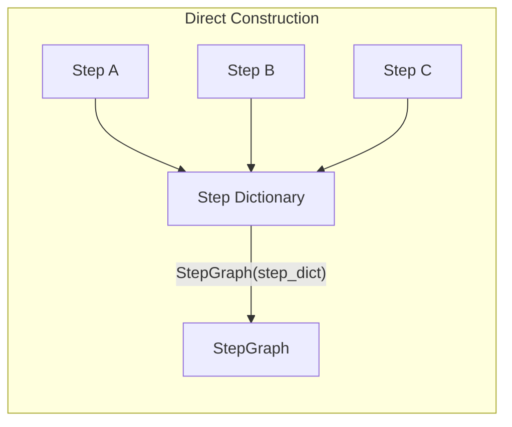

This approach requires all dependencies to be present in the dictionary.

Sources: [tango/step_graph.py:20-34](), [tests/step_graph_test.py:58-68]()

### 2. From Parameters

The most common way to create a `StepGraph` is from a parameters dictionary using `from_params`:

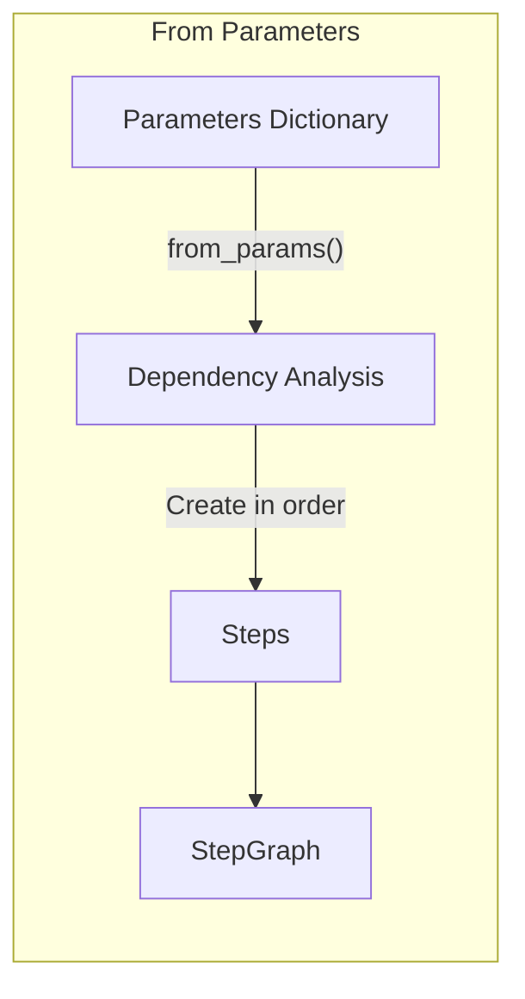

This method resolves dependencies automatically and constructs steps in the correct order.

Sources: [tango/step_graph.py:104-128](), [tests/step_graph_test.py:19-40]()

### 3. From Configuration File

You can also load a `StepGraph` from a configuration file using `from_file`:

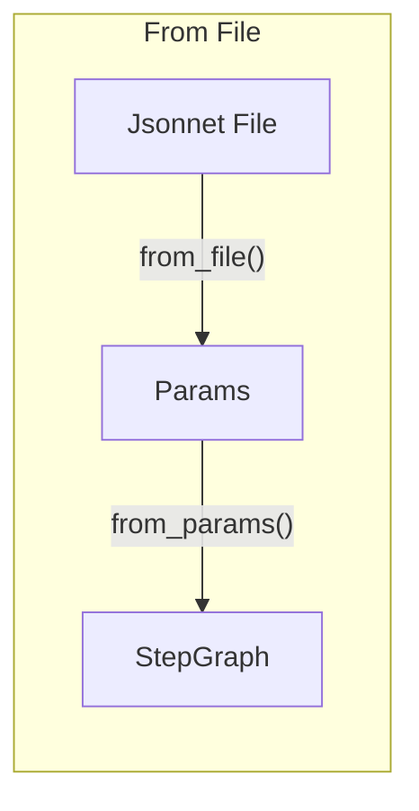

This method is commonly used when running experiments through the CLI.

Sources: [tango/step_graph.py:241-243](), [tests/step_graph_test.py:42-45]()

## Structure and Representation

The `StepGraph` can be viewed as a directed acyclic graph where:

- Nodes are individual `Step` objects
- Edges represent dependencies between steps
- Step names serve as identifiers for nodes

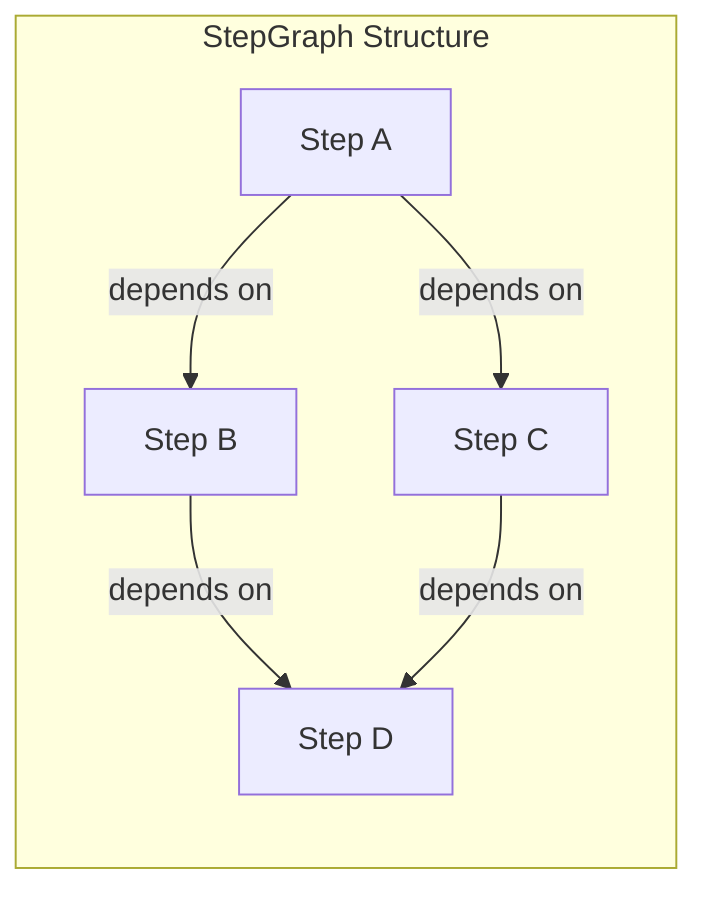

Sources: [tango/step_graph.py:12-18](), [tango/step_graph.py:214-228]()

## Dependency Management

One of the main functions of `StepGraph` is to manage dependencies between steps and determine the correct execution order.

### Identifying Dependencies

`StepGraph` identifies dependencies by:
1. Examining step inputs to find references to other steps
2. Creating a dependency graph based on these references
3. Validating that all dependencies can be satisfied

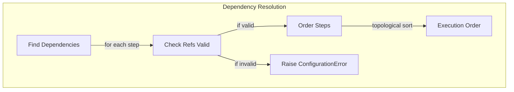

Sources: [tango/step_graph.py:46-64](), [tango/step_graph.py:154-167]()

### Resolving Dependencies

When resolving dependencies, `StepGraph`:
1. Ensures no circular dependencies exist
2. Checks that all referenced steps are defined
3. Constructs steps in dependency order
4. Replaces step references with actual step objects

Sources: [tango/step_graph.py:66-89](), [tango/step_graph.py:170-192]()

## Execution Order

`StepGraph` determines a valid execution order for steps through topological sorting:

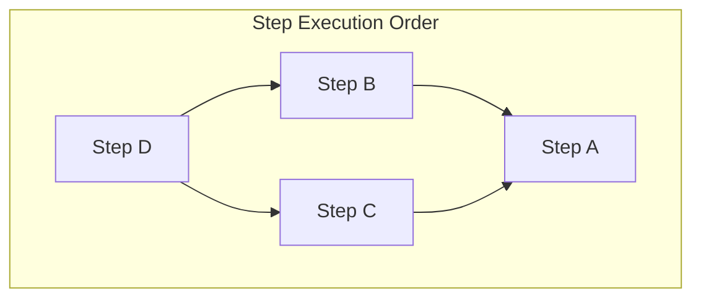

The `ordered_steps` method returns steps in an order that respects dependencies:

```python
# Example of execution order
ordered_steps = StepGraph.ordered_steps(step_dict)
```

Sources: [tango/step_graph.py:213-228](), [tests/step_graph_test.py:18-40]()

## StepGraph Interface

`StepGraph` implements the `Mapping` interface, allowing dictionary-like access to steps:

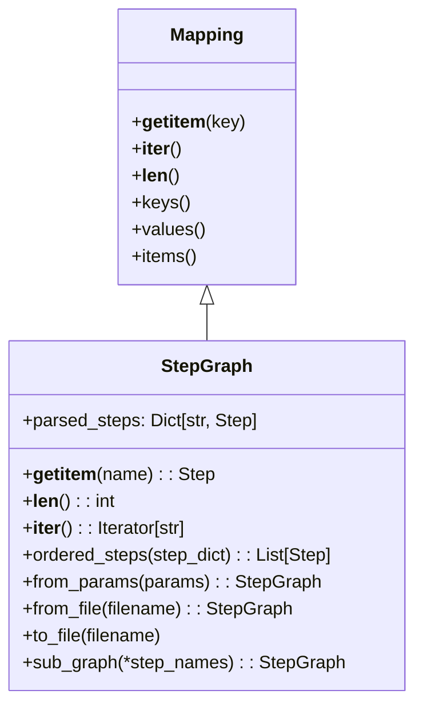

This allows you to access steps by name using dictionary syntax:

```python
# Example of StepGraph usage
step = step_graph["step_name"]
```

Sources: [tango/step_graph.py:12-18](), [tango/step_graph.py:194-210]()

## Serialization and Configuration

`StepGraph` supports serialization to and from configuration files:

### From Configuration to StepGraph

When loading a `StepGraph` from a configuration file:
1. The file is parsed into a `Params` object
2. Step dependencies are identified and validated
3. Steps are created in dependency order
4. References between steps are resolved

Sources: [tango/step_graph.py:241-243](), [tests/step_graph_test.py:42-45]()

### From StepGraph to Configuration

The `to_file` method serializes a `StepGraph` back to a configuration file:

```python
# Save StepGraph to a configuration file
step_graph.to_file("experiment.jsonnet")
```

This is useful for:
- Sharing experiments with others
- Running experiments through the CLI
- Storing experiment configurations

Sources: [tango/step_graph.py:245-296](), [tests/step_graph_test.py:70-95]()

## Special Features

### Step Indexing

`StepGraph` supports step indexing, which allows accessing specific elements of a step's output:

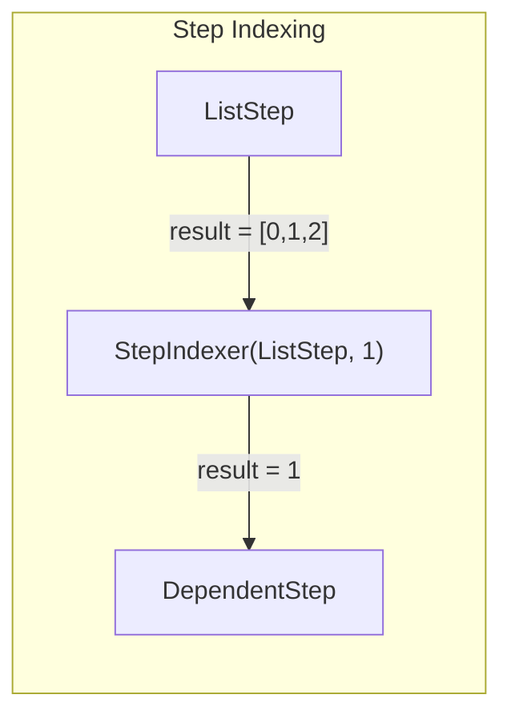

This is especially useful when a step returns a collection and only a specific element is needed by a dependent step.

Sources: [tango/step.py:860-871](), [tests/end_to_end/test_step_indexing.py:1-22]()

### Forced Dependencies

You can specify additional dependencies that aren't directly used by a step using `step_extra_dependencies`:

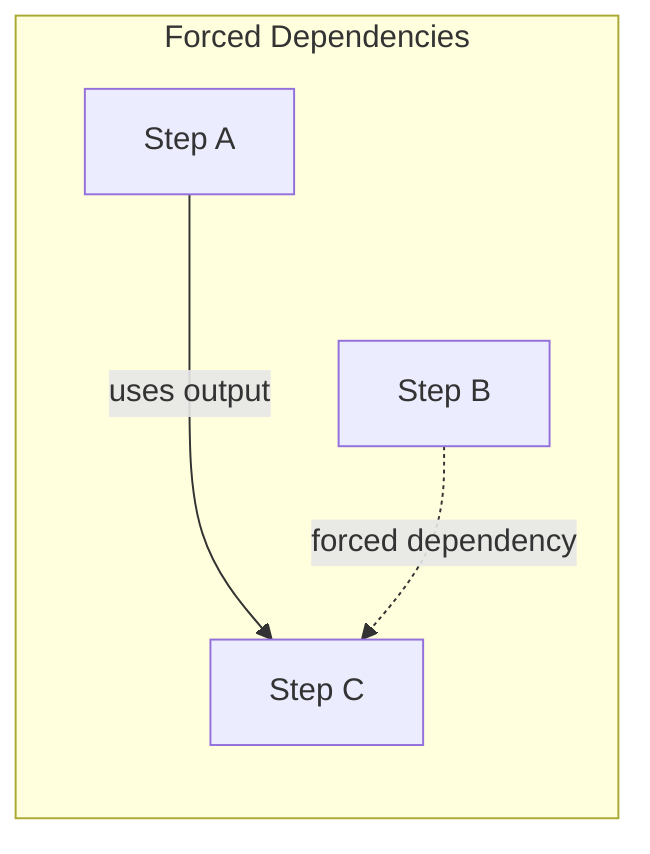

This ensures certain steps are run before others, even if their outputs aren't directly used.

Sources: [tango/step.py:133-144](), [tests/step_graph_test.py:110-129]()

## Working with StepGraph

### Creating a Subgraph

You can extract a portion of a `StepGraph` using the `sub_graph` method:

```python
# Create a subgraph containing only specified steps and their dependencies
sub_graph = step_graph.sub_graph("step1", "step2")
```

This is useful for running only a subset of an experiment.

Sources: [tango/step_graph.py:130-142]()

### Finding Uncacheable Leaf Steps

The `uncacheable_leaf_steps` method returns steps that are at the end of the dependency chain and are not cacheable:

```python
# Get steps that are leaves and not cacheable
uncacheable_steps = step_graph.uncacheable_leaf_steps()
```

This is useful for identifying steps that need to be re-run every time.

Sources: [tango/step_graph.py:230-238]()

## Integration with Executor

The `StepGraph` is primarily used by the `Executor` to determine the order in which to execute steps:

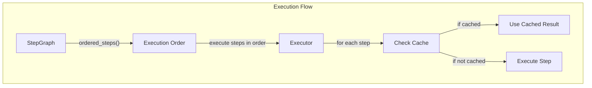

For more information on how steps are executed, see [Executors](#4).

Sources: [tango/step_graph.py:213-228]()

## Common Pitfalls and Debugging

### Circular Dependencies

If you create a circular dependency between steps, `StepGraph` will raise a `ConfigurationError`:

```python
# This will raise a ConfigurationError
# StepA depends on StepB, which depends on StepA
```

### Missing Dependencies

If a step references another step that doesn't exist, `StepGraph` will raise a `ConfigurationError`:

```python
# This will raise a ConfigurationError if "missing_step" is not defined
```

Sources: [tango/step_graph.py:46-64](), [tango/step_graph.py:66-89](), [tests/step_graph_test.py:64-68]()

## Conclusion

`StepGraph` is a fundamental component of the Tango framework that manages dependencies between steps and ensures they are executed in the correct order. It provides a way to represent experiments as directed acyclic graphs and supports serialization to and from configuration files. Understanding how `StepGraph` works is essential for creating complex workflows in Tango.

---

