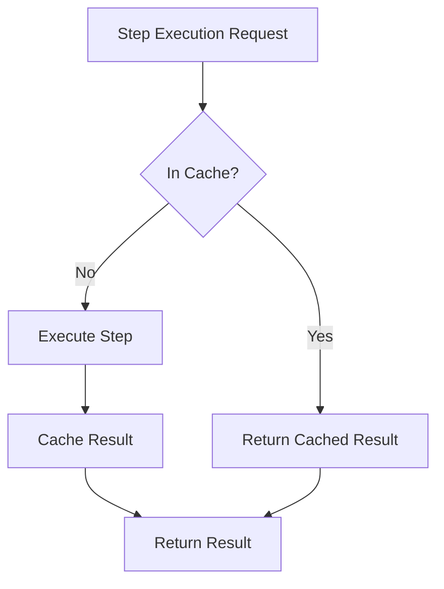
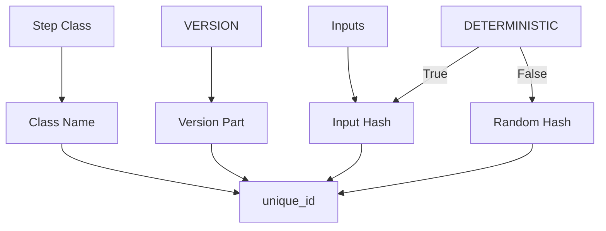
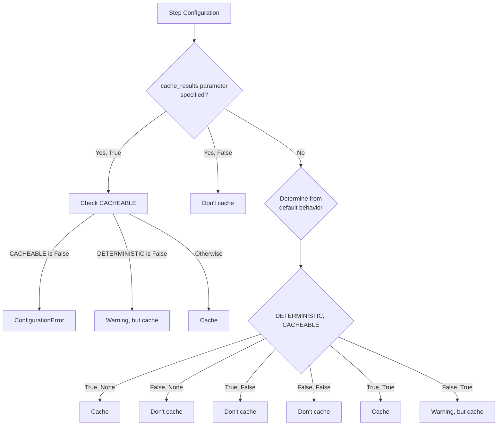
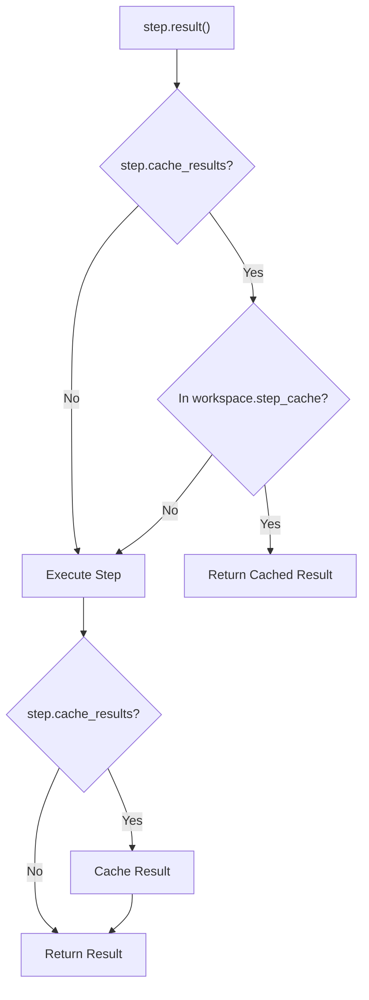

<!-- source: DeepWiki mcp.deepwiki.com · repo allenai/tango · page 2.3 Step Caching · fetched 2026-10-26 -->

# Step Caching

<details>
<summary>Relevant source files</summary>

The following files were used as context for generating this wiki page:

- [tango/__init__.py](tango/__init__.py)
- [tango/executor.py](tango/executor.py)
- [tango/step.py](tango/step.py)
- [tango/step_cache.py](tango/step_cache.py)
- [tango/step_graph.py](tango/step_graph.py)
- [tests/step_test.py](tests/step_test.py)

</details>


Step caching is a core feature of Tango that allows the framework to avoid redundant computation by storing and reusing the results of previously executed steps. This page describes how step caching works in Tango, including how steps are uniquely identified, how caching decisions are made, and how cached results are stored and retrieved.

For information about step implementation, see [Steps](#2.1). For workspace storage options, see [Workspaces](#3).

## Overview of Step Caching

Tango's step caching system provides the ability to store and retrieve step results based on unique step identifiers. When a step is executed, Tango first checks if its result is already in the cache. If found, the cached result is used directly without re-executing the step.


Sources: [tango/step.py:639-672](), [tango/executor.py:125-135]()

## Step Uniqueness and Caching Decision

Each step in Tango has a unique identifier based on its class name, version, and inputs. This unique ID determines whether a step's output is already in the cache.

### Unique ID Generation

The unique ID of a step is generated as follows:


Sources: [tango/step.py:555-594]()

The unique ID is formatted as `$class_name-$version-$hash`, where:
- `$class_name` is the name of the step class
- `$version` is an optional version string defined by `Step.VERSION`
- `$hash` is either:
  - A deterministic hash of the step's inputs if the step is marked as deterministic
  - A random string if the step is not deterministic

### Caching Decision Logic

Tango uses several attributes to determine whether a step's results should be cached:

| Attribute | Description |
|-----------|-------------|
| `Step.DETERMINISTIC` | Indicates whether the step produces the same output given the same inputs |
| `Step.CACHEABLE` | Explicitly controls whether the step should be cached |
| `cache_results` | Property computed from `DETERMINISTIC` and `CACHEABLE` |

The `cache_results` property is determined as follows:


Sources: [tango/step.py:238-273]()

## StepCache Implementation

The `StepCache` class is the core interface for caching step results. It acts as a mapping from step instances to their results.

```mermaid
classDiagram
    class Registrable {
        +register(name, constructor)
        +by_name(name)
    }
    
    class StepCache {
        +__getitem__(step) Any
        +__setitem__(step, value)
        +__delitem__(step)
        +__contains__(step) bool
        +__len__() int
    }
    
    Registrable <|-- StepCache
    
    StepCache <|-- "MemoryStepCache"
    StepCache <|-- "Other implementations"
    
    class CacheMetadata {
        +step: str
        +format: Format
    }
```
Sources: [tango/step_cache.py:18-60]()

## Caching Process and Workflow

When you run a step using the `result()` method, Tango follows this workflow:


Sources: [tango/step.py:639-672]()

### Step Result Access and Caching

The `Step.result()` method is the main entry point for accessing a step's output. It implements the caching logic:

1. Check if the step should be cached (`step.cache_results`)
2. If cacheable, check if the result is already in the cache
3. If not in cache, execute the step and store the result
4. Return the result (either from cache or from execution)

In a typical Tango execution flow, steps are executed in an order that respects their dependencies. For each step, the executor checks if the result is already in the cache before executing it.

Sources: [tango/executor.py:125-135](), [tango/step.py:639-672]()

## Advanced Caching Features

### Skipping Arguments for Caching

Tango provides ways to control which arguments affect the step's unique ID:

1. `SKIP_ID_ARGUMENTS`: Arguments that should not affect the unique ID
2. `SKIP_DEFAULT_ARGUMENTS`: Arguments that should only affect the unique ID when they differ from their default values

```python
class MyStep(Step):
    # Don't include 'batch_size' in the unique ID calculation
    SKIP_ID_ARGUMENTS = {"batch_size"}
    
    # Include 'learning_rate' in unique ID only when not 0.001
    SKIP_DEFAULT_ARGUMENTS = {"learning_rate": 0.001}
    
    def run(self, batch_size: int, learning_rate: float = 0.001) -> Model:
        # ...
```

Sources: [tango/step.py:174-186]()

### Version-Based Cache Invalidation

The `VERSION` attribute allows for invalidating the cache when a step's implementation changes:

```python
class MyModelTrainer(Step):
    VERSION = "001"  # Change this when the implementation changes
    # ...
```

When you update the `VERSION`, steps with the new version will create new cache entries, while preserving the old cached results for steps with the previous version.

Sources: [tango/step.py:164-168]()

## Integration with Tango Architecture

The step caching system integrates with other Tango components as follows:

```mermaid
flowchart TD
    subgraph "Step System"
        Step --> StepGraph
        Step --> unique_id
    end
    
    subgraph "Caching System"
        unique_id --> StepCache
        StepCache --> Format["Format (serialization)"]
    end
    
    subgraph "Execution System"
        StepGraph --> Executor
        Executor --> StepCache
    end
    
    subgraph "Storage System"
        StepCache --> Workspace
        Workspace --> "Storage Backend"
    end
```
Sources: [tango/step.py](), [tango/step_cache.py](), [tango/executor.py]()

## Best Practices

### When to Enable or Disable Caching

- **Enable caching** for:
  - Computationally expensive steps
  - Steps with deterministic outputs
  - Steps that are frequently re-used in different experiments

- **Disable caching** for:
  - Steps with large outputs that are not reused
  - Steps that have their own caching mechanism (e.g., dataset loading steps)
  - Steps where freshness of data is important

### Handling Non-Deterministic Steps

When a step is non-deterministic but you want to cache its results:

1. Set `DETERMINISTIC = False` to indicate the non-deterministic nature
2. Set `CACHEABLE = True` to enable caching despite non-determinism
3. Be aware that this might cause unexpected behavior, as warned by Tango

Sources: [tango/step.py:153-162](), [tango/step_graph.py:90-101]()

### Cache Invalidation

Invalidate the cache when:
1. The step implementation changes significantly (update `VERSION`)
2. Input parameters change (automatic via unique ID)
3. Dependencies change (automatic via dependencies in unique ID calculation)

Sources: [tango/step.py:164-168]()

This caching system is a powerful feature of Tango that helps make machine learning experiments more efficient and reproducible by avoiding redundant computation.

---

