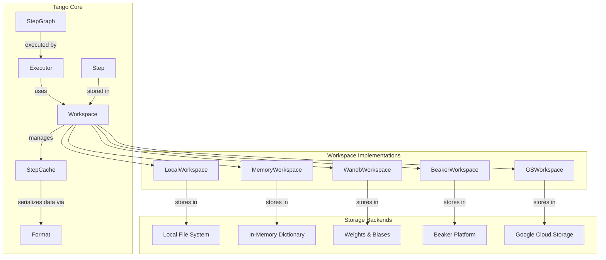
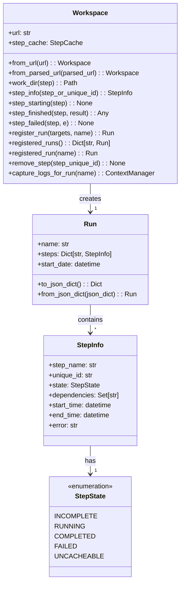
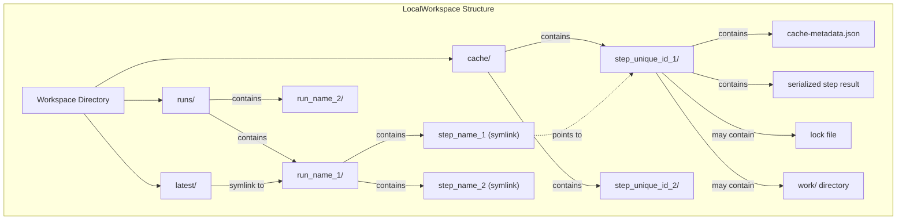
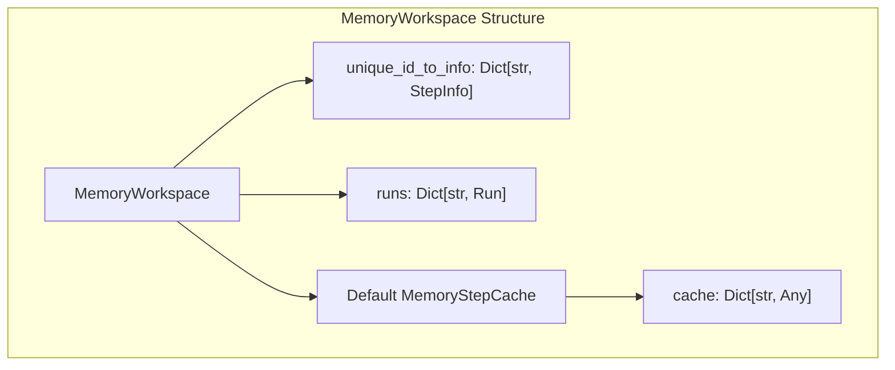
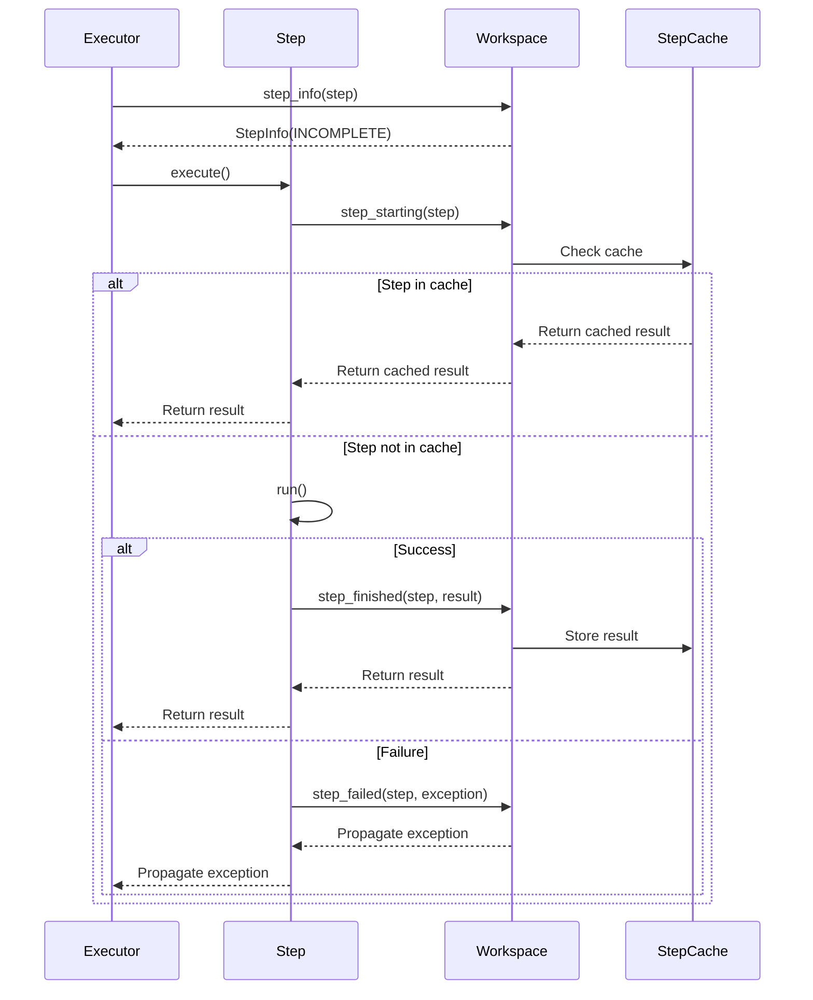

<!-- source: DeepWiki mcp.deepwiki.com · repo allenai/tango · page 3 Workspaces · fetched 2026-10-26 -->

# Workspaces

<details>
<summary>Relevant source files</summary>

The following files were used as context for generating this wiki page:

- [docs/source/api/components/workspace.rst](docs/source/api/components/workspace.rst)
- [tango/integrations/wandb/workspace.py](tango/integrations/wandb/workspace.py)
- [tango/step_caches/local_step_cache.py](tango/step_caches/local_step_cache.py)
- [tango/step_caches/memory_step_cache.py](tango/step_caches/memory_step_cache.py)
- [tango/workspace.py](tango/workspace.py)
- [tango/workspaces/local_workspace.py](tango/workspaces/local_workspace.py)
- [tango/workspaces/memory_workspace.py](tango/workspaces/memory_workspace.py)
- [tests/executor_test.py](tests/executor_test.py)
- [tests/integrations/beaker/workspace_test.py](tests/integrations/beaker/workspace_test.py)
- [tests/main_test.py](tests/main_test.py)
- [tests/workspaces/local_workspace_test.py](tests/workspaces/local_workspace_test.py)

</details>


Workspaces in Tango provide the infrastructure for storing, retrieving, and managing step results and metadata. They act as a persistence layer for the Tango framework, allowing step outputs to be cached and reused across runs. For information about steps themselves, see [Step System](#2) and for how results are stored, see [Formats](#8.1).

## Overview

A Workspace is one of the core components in Tango's architecture that handles:

1. Storing and retrieving results of step executions
2. Tracking step execution state (running, completed, failed)
3. Managing runs (collections of target steps)
4. Providing work directories for steps that need temporary storage

The base `Workspace` class is abstract and provides an interface that all concrete workspace implementations must follow. Tango comes with built-in workspace implementations for different storage backends, from local filesystem storage to cloud services.

### Workspace in the Tango Architecture



Sources: [tango/workspace.py:108-119](), [tango/workspaces/local_workspace.py:31-53](), [tango/workspaces/memory_workspace.py:18-27](), [tango/integrations/wandb/workspace.py:27-65]()

## Workspace Interface

The `Workspace` abstract base class defines the interface that all workspace implementations must implement:



Sources: [tango/workspace.py:108-461]()

### Key Methods

1. **`step_cache`**: Returns a `StepCache` instance used to store and retrieve step results.
   ```python
   @property
   @abstractmethod
   def step_cache(self) -> StepCache:
       """
       A :class:`.StepCache` to store step results in
       """
       raise NotImplementedError()
   ```

2. **`step_info`**: Gets information about a step.
   ```python
   @abstractmethod
   def step_info(self, step_or_unique_id: Union[Step, str]) -> StepInfo:
       """
       Returns a :class:`~tango.step_info.StepInfo` for a given step.
       """
       raise NotImplementedError()
   ```

3. **Step Lifecycle Methods**:
   - `step_starting`: Called when a step starts execution
   - `step_finished`: Called when a step completes successfully
   - `step_failed`: Called when a step fails

4. **Run Management**:
   - `register_run`: Registers a collection of target steps as a run
   - `registered_runs`: Returns all registered runs
   - `registered_run`: Returns a specific run by name

Sources: [tango/workspace.py:177-184](), [tango/workspace.py:200-210](), [tango/workspace.py:269-306](), [tango/workspace.py:308-395]()

## Workspace Implementations

Tango provides several concrete workspace implementations:

### LocalWorkspace

The `LocalWorkspace` stores all data in a local directory, organizing step results and run information in a structured manner.



Key features:
- Stores step results in a `cache/` directory
- Organizes runs in a `runs/` directory
- Provides a `latest/` symlink to the most recent run
- Uses file locks to prevent concurrent modification
- Captures logs for each run

Sources: [tango/workspaces/local_workspace.py:29-478]()

### MemoryWorkspace

The `MemoryWorkspace` stores all data in memory:



Key features:
- All data stored in dictionaries in memory
- No persistence across program restarts
- Useful for debugging or quick prototyping

Sources: [tango/workspaces/memory_workspace.py:18-133](), [tango/step_caches/memory_step_cache.py:12-54]()

### Cloud Workspaces

Tango also provides workspaces that integrate with cloud services:

1. **WandbWorkspace**: Integrates with Weights & Biases for experiment tracking.
   - Tracks Tango runs as W&B runs
   - Stores step results as W&B artifacts
   - Provides integration with W&B experiment tracking features

2. **BeakerWorkspace**: Integrates with AI2's Beaker platform.

3. **GSWorkspace**: Integrates with Google Cloud Storage.

Sources: [tango/integrations/wandb/workspace.py:27-462](), [tests/integrations/beaker/workspace_test.py:10-52]()

## Step Execution Flow with Workspaces

The workspace plays a critical role in the step execution flow:



Sources: [tango/workspace.py:269-306](), [tango/executor.py]() (not provided in snippets)

## Run Management

Workspaces manage runs, which are collections of target steps that a user wants to execute. Each run has:

- A unique name
- A collection of steps
- A start date

```python
@dataclass
class Run(FromParams):
    """
    Stores information about a single Tango run.
    """

    name: str
    """
    The name of the run
    """

    steps: Dict[str, StepInfo]
    """
    A mapping from step names to :class:`~tango.step_info.StepInfo`, for all the target steps in the run.
    """

    start_date: datetime
    """
    The time at which the run was registered in the workspace.
    """
```

When registering a run, the workspace:
1. Creates a unique name if one is not provided
2. Records information about all target steps and their dependencies
3. Creates the necessary storage structures
4. Returns a `Run` object representing the registered run

Sources: [tango/workspace.py:36-70](), [tango/workspace.py:308-318]()

## Using Workspaces

### Creating a Workspace

Workspaces can be created directly or from a URL:

```python
# Direct instantiation
workspace = LocalWorkspace("/path/to/workspace")

# From URL
workspace = Workspace.from_url("local:///path/to/workspace")
workspace = Workspace.from_url("memory://")
workspace = Workspace.from_url("wandb://entity/project")
```

Sources: [tango/workspace.py:150-166](), [tests/main_test.py:140-146](), [tests/main_test.py:151-158]()

### Executing Steps with a Workspace

Steps are typically executed by an Executor, which uses the workspace for caching:

```python
workspace = LocalWorkspace("/path/to/workspace")
step = AdditionStep(a=1, b=2)
executor = Executor(workspace)
result = executor.execute_step(step)
```

Sources: [tests/executor_test.py:19-28]()

### Accessing Step Results

Results can be accessed directly from the workspace:

```python
result = workspace.step_result("step_name")
result = workspace.step_result_for_run("run_name", "step_name")
```

Sources: [tango/workspace.py:397-420]()

## Conclusion

Workspaces are a crucial part of Tango's architecture, providing a flexible and extensible system for storing and managing step results and metadata. They enable efficient caching and reuse of computation, support for distributed execution, and integration with various storage backends and cloud services.

The `LocalWorkspace` is suitable for most use cases, while the `MemoryWorkspace` is useful for testing and debugging. Cloud workspaces provide integration with cloud storage and experiment tracking platforms for more advanced use cases.

---

