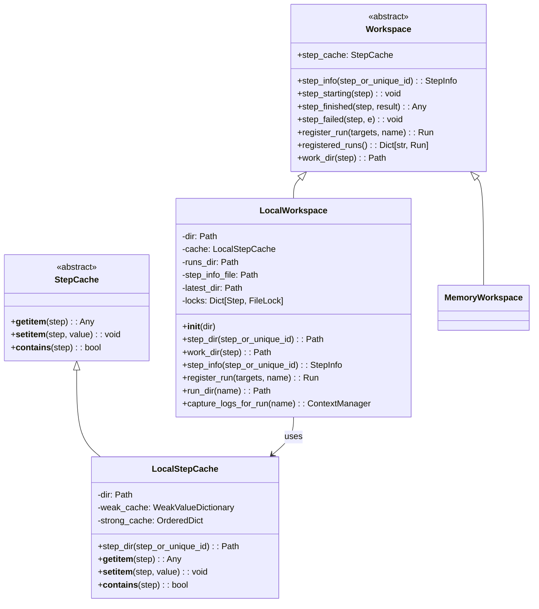
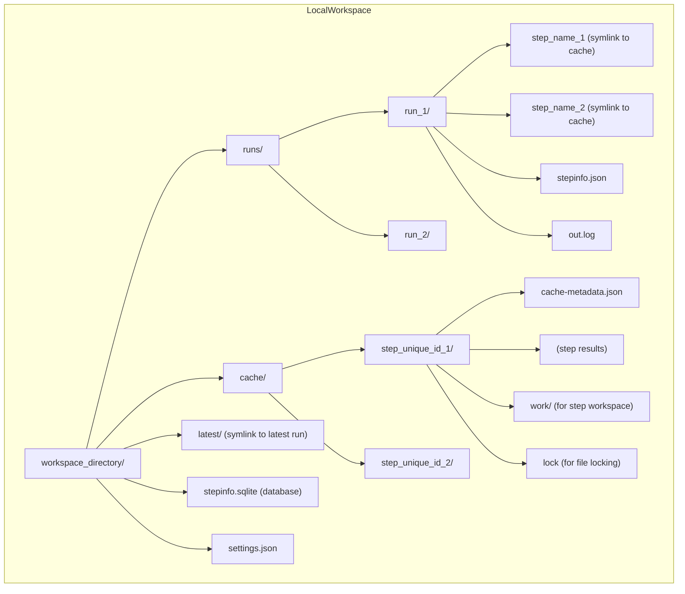
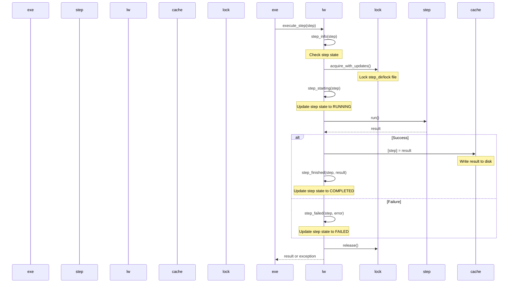
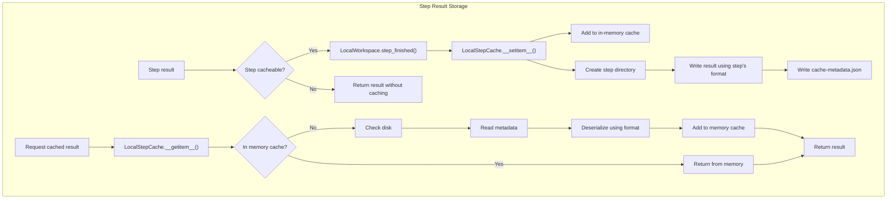

<!-- source: DeepWiki mcp.deepwiki.com · repo allenai/tango · page 3.1 Local Workspace · fetched 2026-10-26 -->

# Local Workspace

<details>
<summary>Relevant source files</summary>

The following files were used as context for generating this wiki page:

- [docs/source/api/components/workspace.rst](docs/source/api/components/workspace.rst)
- [tango/integrations/wandb/workspace.py](tango/integrations/wandb/workspace.py)
- [tango/step_caches/local_step_cache.py](tango/step_caches/local_step_cache.py)
- [tango/step_caches/memory_step_cache.py](tango/step_caches/memory_step_cache.py)
- [tango/workspace.py](tango/workspace.py)
- [tango/workspaces/local_workspace.py](tango/workspaces/local_workspace.py)
- [tango/workspaces/memory_workspace.py](tango/workspaces/memory_workspace.py)
- [tests/executor_test.py](tests/executor_test.py)
- [tests/integrations/beaker/workspace_test.py](tests/integrations/beaker/workspace_test.py)
- [tests/main_test.py](tests/main_test.py)
- [tests/workspaces/local_workspace_test.py](tests/workspaces/local_workspace_test.py)

</details>


## Purpose and Overview

The `LocalWorkspace` is a concrete implementation of Tango's `Workspace` interface that stores all data on the local filesystem. This is the default workspace type that Tango uses when none is specified, making it the most commonly used workspace implementation. It's designed for single-machine jobs or for multiple machines that share access to the same network file system (NFS).

For information about cloud-based workspaces (Google Cloud Storage, W&B, Beaker), see [Cloud Workspaces](#3.2).

Sources: [tango/workspaces/local_workspace.py:29-34](), [tango/workspace.py:108-116]()

## Architecture and Relationship to Base Classes

### Workspace Hierarchy Diagram



Sources: [tango/workspace.py:108-121](), [tango/workspaces/local_workspace.py:29-53](), [tango/step_caches/local_step_cache.py:19-28]()

## Directory Structure

### LocalWorkspace Directory Layout



The `LocalWorkspace` creates and manages this directory structure:

- **`cache/`**: Contains subdirectories for each cached step, named by unique step ID
- **`runs/`**: Contains one subdirectory per registered run
- **`latest/`**: Symlink to the most recently created run directory
- **`stepinfo.sqlite`**: SQLite database storing metadata about steps
- **`settings.json`**: Configuration information for the workspace

Sources: [tango/workspaces/local_workspace.py:32-44](), [tango/workspaces/local_workspace.py:55-94]()

## Key Components

### LocalStepCache

The `LocalWorkspace` delegates caching of step results to a `LocalStepCache` instance, which:

1. Stores step results on disk in the `cache/` directory
2. Maintains both memory caches (weak references and LRU) for fast access to recent results
3. Uses the step's format to serialize and deserialize data

### StepInfo Database

Step state information is stored in an SQLite database (`stepinfo.sqlite`). This includes:

- Step state (INCOMPLETE, RUNNING, COMPLETED, FAILED)
- Start and end times
- Error messages
- Dependencies

### File Locking

To prevent concurrent modification of step data, `LocalWorkspace` uses file locks (via `FileLock`) when a step is running.

Sources: [tango/workspaces/local_workspace.py:57-64](), [tango/step_caches/local_step_cache.py:36-51]()

## Initialization and Configuration

### Creating a LocalWorkspace

```python
from tango.workspaces import LocalWorkspace

# Create directly
workspace = LocalWorkspace("/path/to/workspace")

# Or use the factory method
from tango.workspace import Workspace
workspace = Workspace.from_url("local:///path/to/workspace")

# You can also use a plain path (local scheme is implicit)
workspace = Workspace.from_url("/path/to/workspace")
```

Sources: [tango/workspaces/local_workspace.py:55-94](), [tango/workspace.py:150-166]()

## Step Execution Workflow

### Step Execution Flow



When a step is executed in a `LocalWorkspace`:

1. The workspace acquires a lock for the step
2. Step state is updated to RUNNING
3. The step executes
4. On success:
   - The result is stored in the cache
   - Step state is updated to COMPLETED
5. On failure:
   - Error information is recorded
   - Step state is updated to FAILED
6. The lock is released

Sources: [tango/workspaces/local_workspace.py:236-323]()

## Run Registration and Management

When you register a run in a `LocalWorkspace`:

1. A new directory is created under `runs/`
2. Symlinks are created from step names to their cache directories
3. Step information is stored in `stepinfo.json`
4. The `latest/` symlink is updated to point to the new run

```python
# Register a run
run = workspace.register_run([step1, step2], name="my_experiment")

# Later, access the result of a step in that run
result = workspace.step_result_for_run("my_experiment", "step1")
```

Sources: [tango/workspaces/local_workspace.py:339-370](), [tango/workspace.py:397-420]()

## Workspace Operations

### Key Methods

| Method | Purpose |
|--------|---------|
| `step_info(step_or_unique_id)` | Get information about a step |
| `step_starting(step)` | Mark a step as running |
| `step_finished(step, result)` | Mark a step as completed and store its result |
| `step_failed(step, error)` | Mark a step as failed and store error information |
| `register_run(targets, name)` | Register a new run with specified target steps |
| `registered_runs()` | Get a dictionary of all registered runs |
| `registered_run(name)` | Get information about a specific run |
| `work_dir(step)` | Get a directory where a step can store temporary data |
| `remove_step(step_unique_id)` | Remove a step from the cache |

Sources: [tango/workspaces/local_workspace.py:182-338](), [tango/workspace.py:201-428]()

## Step Caching and Storage

### Caching Workflow



The `LocalWorkspace` uses a two-level caching strategy:

1. **Memory cache**: Maintains recently used results in memory for fast access
   - Weak references for objects that support weak referencing
   - LRU cache for the most recently used objects

2. **Disk cache**: Persistent storage of all step results
   - Each step gets its own directory named by its unique ID
   - Results are serialized using the step's format
   - Metadata is stored in `cache-metadata.json`

Sources: [tango/step_caches/local_step_cache.py:42-132](), [tango/workspaces/local_workspace.py:285-303]()

## Logging and Error Handling

`LocalWorkspace` provides built-in support for logging with the `capture_logs_for_run()` method, which captures logs to a file in the run directory (`out.log`).

When steps fail, error information is captured and stored in the step's info record, making it accessible for later inspection.

Sources: [tango/workspaces/local_workspace.py:476-477](), [tango/workspace.py:430-458]()

## Comparison with Other Workspace Types

| Feature | LocalWorkspace | MemoryWorkspace | Cloud Workspaces |
|---------|---------------|-----------------|------------------|
| **Persistence** | On disk | In-memory only | Remote storage |
| **Sharing** | Local filesystem or NFS | Single process only | Cross-machine or cloud |
| **Speed** | Fast (local I/O) | Fastest (memory only) | Depends on network |
| **Typical use** | Local development, NFS clusters | Testing, short experiments | Production, distributed teams |
| **Setup complexity** | Simple | Minimal | More complex |

Sources: [tango/workspace.py:108-119](), [tango/workspaces/memory_workspace.py:18-23](), [tango/workspaces/local_workspace.py:32-44]()

## Common Gotchas and Troubleshooting

- **Locked steps**: If a process crashes while a step is running, the step may remain locked. In this case, you may need to manually delete the lock file.
- **State inconsistencies**: The workspace attempts to fix inconsistent states (like steps marked RUNNING but not actually running), but in some cases manual intervention may be required.
- **Symlink issues**: On Windows, creating symlinks may require elevated permissions.

Sources: [tango/workspaces/local_workspace.py:207-223](), [tango/workspaces/local_workspace.py:246-252]()

---

