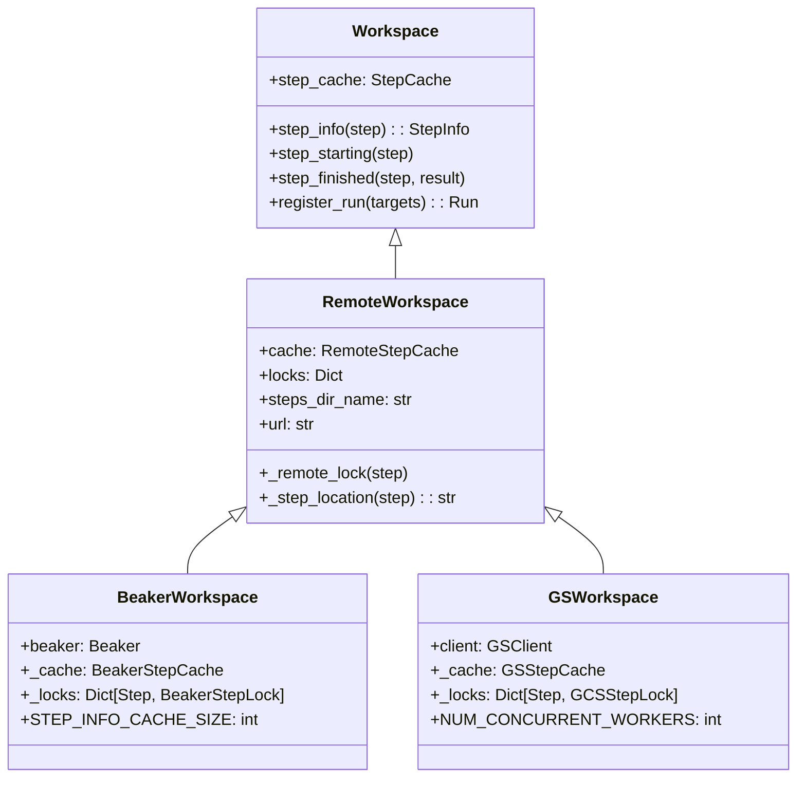
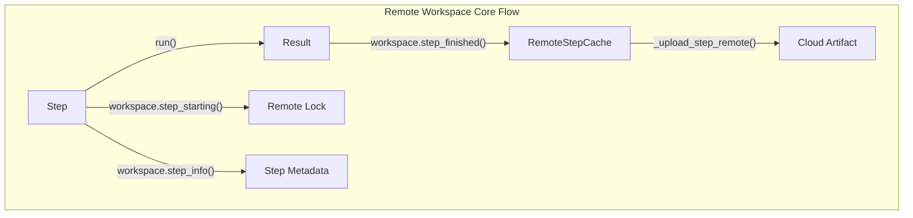
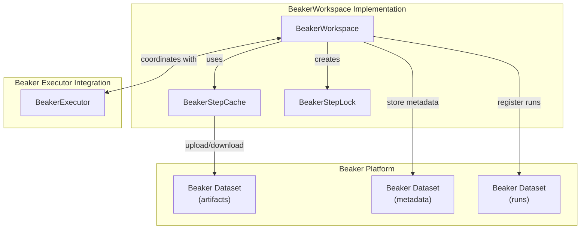
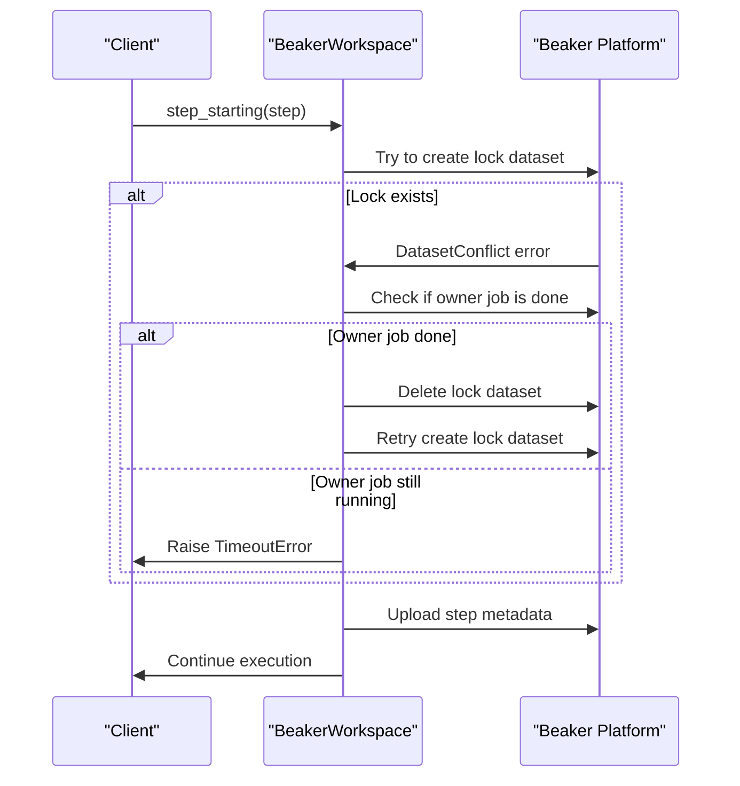
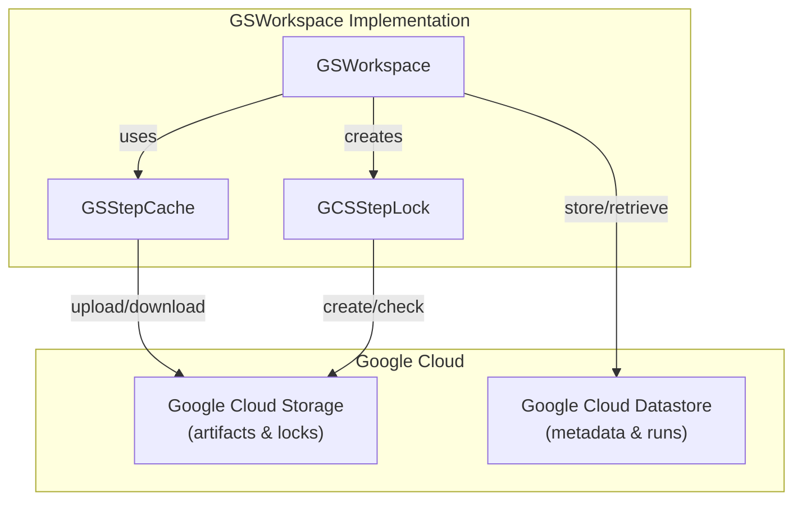
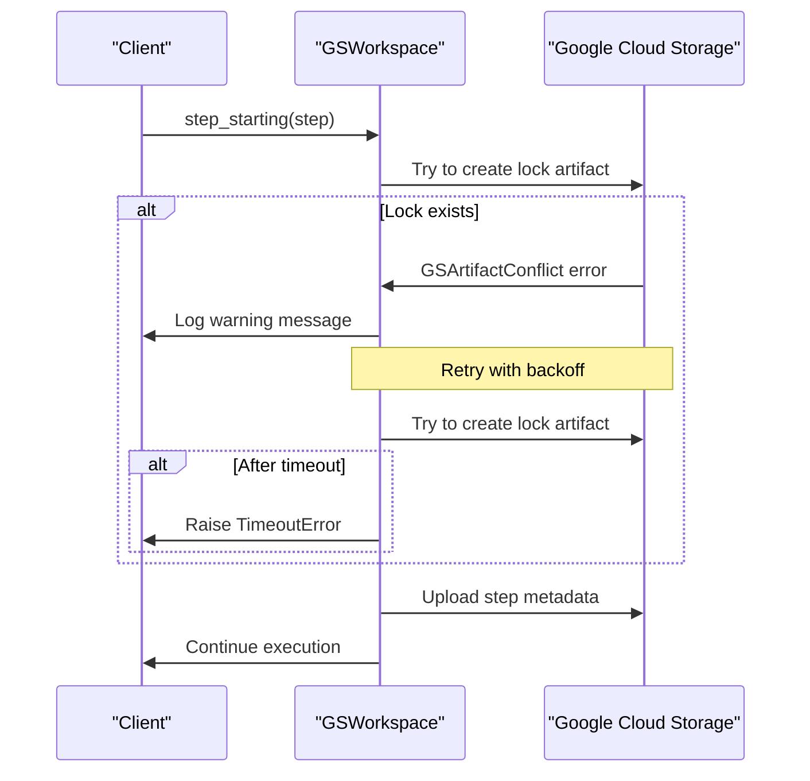
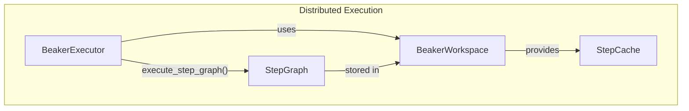

<!-- source: DeepWiki mcp.deepwiki.com · repo allenai/tango · page 3.2 Cloud Workspaces · fetched 2026-10-26 -->

# Cloud Workspaces

<details>
<summary>Relevant source files</summary>

The following files were used as context for generating this wiki page:

- [tango/integrations/beaker/common.py](tango/integrations/beaker/common.py)
- [tango/integrations/beaker/executor.py](tango/integrations/beaker/executor.py)
- [tango/integrations/beaker/step_cache.py](tango/integrations/beaker/step_cache.py)
- [tango/integrations/beaker/workspace.py](tango/integrations/beaker/workspace.py)
- [tango/integrations/gs/common.py](tango/integrations/gs/common.py)
- [tango/integrations/gs/step_cache.py](tango/integrations/gs/step_cache.py)
- [tango/integrations/gs/workspace.py](tango/integrations/gs/workspace.py)
- [tango/step_info.py](tango/step_info.py)
- [tango/workspaces/remote_workspace.py](tango/workspaces/remote_workspace.py)
- [tests/integrations/beaker/conftest.py](tests/integrations/beaker/conftest.py)
- [tests/integrations/gs/step_cache_test.py](tests/integrations/gs/step_cache_test.py)
- [tests/integrations/gs/workspace_test.py](tests/integrations/gs/workspace_test.py)

</details>


This page documents Tango's cloud workspace implementations, which store step artifacts and metadata in remote cloud storage services rather than on local disk. Cloud workspaces enable distributed execution, team collaboration, and persistence beyond local machines. For information about local storage options, see [Local Workspace](#3.1).

## Overview

Cloud workspaces in Tango extend the base `Workspace` class through the `RemoteWorkspace` abstract class, providing implementations that store step artifacts, metadata, and run information in remote storage systems. Currently, Tango offers two cloud workspace implementations:

1. **BeakerWorkspace** - Stores artifacts on the Beaker platform (AI2's experiment tracking system)
2. **GSWorkspace** - Stores artifacts on Google Cloud Storage



Sources: [tango/workspaces/remote_workspace.py:24-252](), [tango/integrations/beaker/workspace.py:37-430](), [tango/integrations/gs/workspace.py:38-487]()

## Common Remote Workspace Features

All remote workspace implementations share these key features:

1. **Remote storage of artifacts**: Step results are serialized and stored in cloud storage
2. **Distributed locking**: Prevents concurrent modification of steps across environments
3. **Cache management**: Local caches for performance with remote storage for persistence
4. **Run tracking**: Experiment runs are registered and tracked in the cloud

The `RemoteWorkspace` base class implements common functionality, while each concrete implementation handles the specifics of its cloud service.



Sources: [tango/workspaces/remote_workspace.py:92-191]()

## BeakerWorkspace

The `BeakerWorkspace` stores artifacts on Beaker, an experiment tracking platform developed by AI2. It's particularly well-suited for integration with the `BeakerExecutor` for distributed execution.

### Configuration

BeakerWorkspace can be created in several ways:

```python
# From URL
workspace = Workspace.from_url("beaker://ai2/my-workspace")

# Direct instantiation
workspace = BeakerWorkspace("ai2/my-workspace")

# From config params
workspace = Workspace.from_params({
    "type": "beaker",
    "workspace": "ai2/my-workspace"
})
```

The constructor accepts these parameters:

| Parameter | Type | Description |
|-----------|------|-------------|
| workspace | str | Name or ID of the Beaker workspace |
| max_workers | Optional[int] | Number of concurrent workers for operations |
| **kwargs | dict | Additional arguments for Beaker client |

Sources: [tango/integrations/beaker/workspace.py:37-59](), [tango/integrations/beaker/workspace.py:82-92]()

### Architecture



BeakerWorkspace stores:
- Step artifacts as Beaker datasets
- Step metadata in dataset JSON files
- Lock information using dataset existence
- Run information in dedicated datasets

Sources: [tango/integrations/beaker/workspace.py:149-176](), [tango/integrations/beaker/workspace.py:212-232]()

### Beaker Step Locking

The `BeakerStepLock` mechanism ensures exclusive access to steps:



The lock mechanism checks if a lock dataset exists, and if the lock belongs to a completed experiment, it can be safely deleted.

Sources: [tango/integrations/beaker/common.py:65-187]()

## GSWorkspace

The `GSWorkspace` stores artifacts on Google Cloud Storage with metadata in Google Cloud Datastore.

### Configuration

GSWorkspace can be created in several ways:

```python
# From URL
workspace = Workspace.from_url("gs://my-bucket/path")

# Direct instantiation
workspace = GSWorkspace("my-bucket/path")

# From config params
workspace = Workspace.from_params({
    "type": "gs",
    "workspace": "my-bucket/path",
    "project": "my-gcp-project"  # Optional
})
```

The constructor accepts these parameters:

| Parameter | Type | Description |
|-----------|------|-------------|
| workspace | str | Name of GCS bucket/folder |
| project | Optional[str] | Google project ID |
| credentials | Optional[Union[str, Credentials]] | GCP credentials |

Sources: [tango/integrations/gs/workspace.py:38-90](), [tango/integrations/gs/workspace.py:103-114]()

### Authentication

GSWorkspace supports multiple authentication methods:

1. **Explicit credentials path**: Path to a credentials JSON file
2. **Credentials JSON string**: Raw JSON string with credentials
3. **Credentials object**: `google.auth.credentials.Credentials` instance
4. **Default credentials**: From `gcloud auth application-default login`

The credentials are used to authenticate with both Google Cloud Storage and Google Cloud Datastore.

Sources: [tango/integrations/gs/common.py:399-451]()

### Architecture



GSWorkspace stores:
- Step artifacts in Google Cloud Storage blobs
- Step metadata in Google Cloud Datastore
- Lock information using GCS artifacts
- Run information in Google Cloud Datastore

Sources: [tango/integrations/gs/workspace.py:133-181](), [tango/integrations/gs/workspace.py:276-336]()

### Google Cloud Step Locking

The `GCSStepLock` mechanism ensures exclusive access to steps:



Sources: [tango/integrations/gs/common.py:458-519]()

## Usage with Executors

Cloud workspaces work particularly well with distributed executors:

1. **BeakerWorkspace + BeakerExecutor**: For execution on Beaker's cloud infrastructure
2. **GSWorkspace + MulticoreExecutor**: For local execution with cloud storage



When using `BeakerExecutor` with `BeakerWorkspace`, steps can be executed on Beaker's infrastructure while artifacts are stored in Beaker datasets. Similarly, `GSWorkspace` can be used with any executor that can access Google Cloud Storage.

Sources: [tango/integrations/beaker/executor.py:178-329]()

## Best Practices

1. **Authentication management**:
   - For Beaker: Set up Beaker CLI authentication
   - For GCS: Use application default credentials or provide explicit credentials

2. **Cost awareness**:
   - Be mindful of storage costs for large artifacts
   - Use appropriate configuration settings to avoid excessive transfers

3. **Executor pairing**:
   - Use `BeakerWorkspace` with `BeakerExecutor` for full Beaker integration
   - Use `GSWorkspace` with executors that can access Google Cloud Storage

4. **Concurrent operations**:
   - Both workspace implementations support configurable concurrency
   - Adjust `NUM_CONCURRENT_WORKERS` for performance tuning

Sources: [tango/integrations/gs/workspace.py:66-67](), [tango/integrations/beaker/workspace.py:49-50]()

## Advanced Features

### Step Removal

Both cloud workspace implementations support removing steps from cache and remote storage:

```python
# Remove a step by unique_id
workspace.remove_step(step_unique_id)
```

This removes:
- Step artifacts from cloud storage
- Step metadata from storage/database
- Step from the local cache

Sources: [tango/workspaces/remote_workspace.py:177-191](), [tango/integrations/beaker/workspace.py:424-430](), [tango/integrations/gs/workspace.py:471-479]()

### Step Info Caching

Both workspace implementations cache step information locally to improve performance:

- `BeakerWorkspace` uses both memory and disk caching with a configurable cache size
- `GSWorkspace` leverages Google Datastore for fast metadata queries

This reduces the need for frequent remote API calls and improves overall performance.

Sources: [tango/integrations/beaker/workspace.py:114-148]()

## Conclusion

Cloud workspaces provide Tango with the ability to scale beyond a single machine, enabling collaboration and distributed execution. Choose between `BeakerWorkspace` and `GSWorkspace` based on your existing infrastructure and needs.

For distributed execution with cloud workspaces, see [Distributed Execution](#4.2).

---

