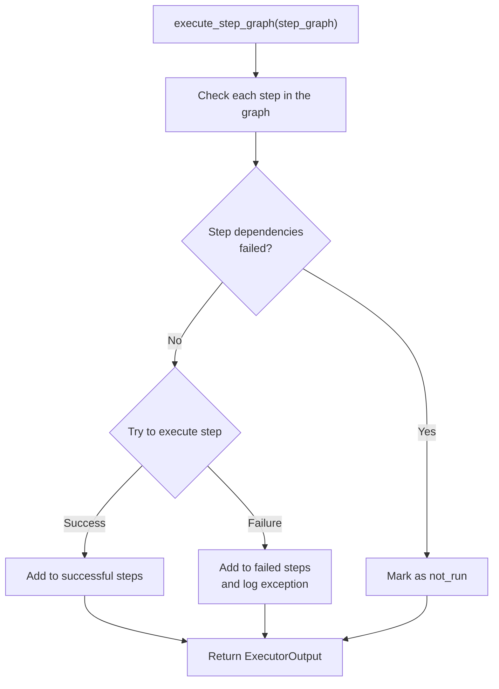
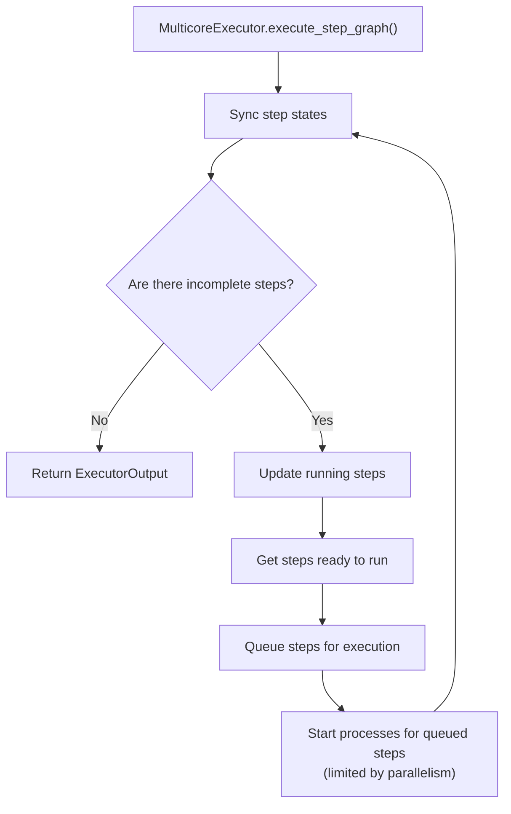
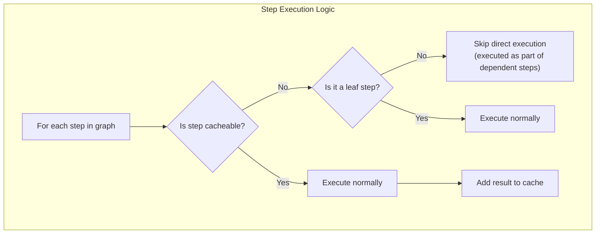
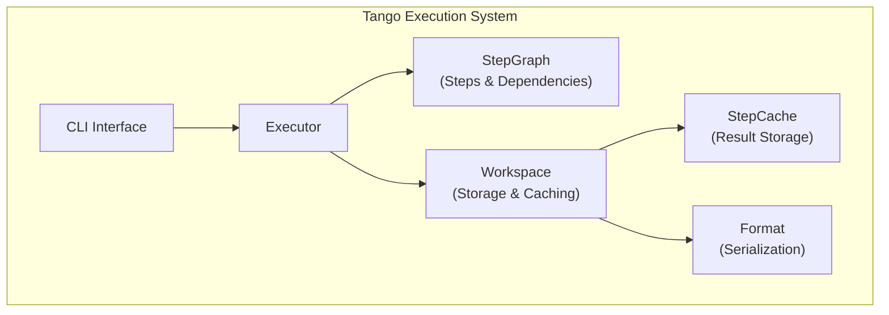

<!-- source: DeepWiki mcp.deepwiki.com · repo allenai/tango · page 4 Executors · fetched 2026-10-26 -->

# Executors

<details>
<summary>Relevant source files</summary>

The following files were used as context for generating this wiki page:

- [docs/source/api/components/executor.rst](docs/source/api/components/executor.rst)
- [docs/source/api/components/format.rst](docs/source/api/components/format.rst)
- [docs/source/api/components/index.rst](docs/source/api/components/index.rst)
- [docs/source/api/components/step.rst](docs/source/api/components/step.rst)
- [docs/source/api/components/step_cache.rst](docs/source/api/components/step_cache.rst)
- [docs/source/api/components/step_graph.rst](docs/source/api/components/step_graph.rst)
- [docs/source/examples/euler.md](docs/source/examples/euler.md)
- [examples/eval_p3/eval.py](examples/eval_p3/eval.py)
- [tango/__init__.py](tango/__init__.py)
- [tango/common/testing/__init__.py](tango/common/testing/__init__.py)
- [tango/executor.py](tango/executor.py)
- [tango/executors/multicore_executor.py](tango/executors/multicore_executor.py)
- [tango/step_cache.py](tango/step_cache.py)

</details>


The Tango Executor system is responsible for running Steps and managing their execution flow. Executors determine how steps are executed (serially, in parallel, or distributed) and work closely with Workspaces to cache step results. This page documents the Executor system components, implementations, and usage patterns.

For information about Steps, see [Step System](#2) and for Workspaces, see [Workspaces](#3).

## What is an Executor?

An Executor in Tango is a class that takes a StepGraph (collection of steps with their dependencies) and executes each step in the appropriate order, handling dependencies, caching, and error conditions. Executors are designed to be configurable and extensible, with different implementations for different execution environments and requirements.

```mermaid
classDiagram
    class "Executor" {
        +workspace: Workspace
        +include_package: Optional[Sequence[str]]
        +parallelism: Optional[int]
        +execute_step(step: Step)
        +execute_step_graph(step_graph: StepGraph) ExecutorOutput
        +execute_sub_graph_for_steps(step_graph, *step_names) ExecutorOutput
    }
    
    class "ExecutorOutput" {
        +successful: Dict[str, ExecutionMetadata]
        +failed: Dict[str, ExecutionMetadata]
        +not_run: Dict[str, ExecutionMetadata]
        +display()
    }
    
    class "ExecutionMetadata" {
        +logs_location: Optional[str]
        +result_location: Optional[str]
    }
    
    class "MulticoreExecutor" {
        +execute_step_graph(step_graph: StepGraph) ExecutorOutput
        +_get_state(step: Step) StepState
    }
    
    "Executor" <|-- "MulticoreExecutor"
    "Executor" --> "ExecutorOutput" : returns
    "ExecutorOutput" --> "ExecutionMetadata" : contains
```

Sources: [tango/executor.py:101-192](), [tango/executors/multicore_executor.py:19-315]()

## Executor Workflow

When executing a StepGraph, the Executor follows this general workflow:



The key responsibilities of an Executor include:

1. **Dependency Resolution**: Ensuring steps run only when their dependencies are satisfied
2. **Caching Integration**: Checking if a step result is already cached before execution
3. **Error Handling**: Managing failures and continuing with unaffected steps
4. **Result Tracking**: Keeping track of which steps succeeded, failed, or weren't run

Sources: [tango/executor.py:136-174]()

## Base Executor Implementation

The default Executor implementation (registered as "default") executes steps sequentially. It provides the foundational behavior that other Executor implementations build upon.

```python
# Basic usage of the default Executor
executor = Executor(workspace, include_package=["my_package"])
result = executor.execute_step_graph(step_graph)
result.display()  # Shows execution results in a table
```

Key methods of the base Executor:

1. **execute_step**: Executes a single step, ensuring results are cached if appropriate
2. **execute_step_graph**: Executes all steps in a StepGraph, handling dependencies and failures
3. **execute_sub_graph_for_steps**: Executes a subset of a StepGraph starting from specific steps

Sources: [tango/executor.py:101-192]()

## Executor Implementations

Tango provides multiple Executor implementations for different execution environments:

### Default Executor

The default Executor runs steps sequentially in a single process. It's suitable for simple workflows or when resource usage needs to be controlled.

Limitations:
- No parallelism (the `parallelism` parameter is ignored)
- All steps run in the same process

### MulticoreExecutor

The MulticoreExecutor runs steps in parallel using multiple processes, which can significantly improve performance for workflows with independent steps.

```python
# Using MulticoreExecutor with 4 parallel processes
from tango.executor import Executor
executor = Executor.by_name("multicore")(workspace, parallelism=4)
result = executor.execute_step_graph(step_graph)
```

Key features:
- Configurable level of parallelism
- Spawns separate processes for each step using the Tango CLI
- Maintains dependency ordering while maximizing parallelism
- Synchronizes step states between processes



Sources: [tango/executors/multicore_executor.py:42-308]()

## ExecutorOutput

The `ExecutorOutput` class provides a structured way to understand the results of executing a StepGraph. It contains:

1. **successful**: Dictionary mapping step names to `ExecutionMetadata` for steps that completed successfully
2. **failed**: Dictionary mapping step names to `ExecutionMetadata` for steps that failed
3. **not_run**: Dictionary mapping step names to `ExecutionMetadata` for steps that weren't run (usually due to failed dependencies)

The `display()` method creates a rich table showing the status of each step:

```
┏━━━━━━━━━━━━━┳━━━━━━━━━━━━━┳━━━━━━━━━━━━━━━━━━━━━━━━━━━━━━━━━━━━━━━━━━━━┓
┃ Step Name   ┃ Status      ┃ Cached Result                             ┃
┡━━━━━━━━━━━━━╇━━━━━━━━━━━━━╇━━━━━━━━━━━━━━━━━━━━━━━━━━━━━━━━━━━━━━━━━━━━┩
│ step1       │ ✓ succeeded │ workspace/cache/Step1-abc123              │
│ step2       │ ✗ failed    │ workspace/logs/Step2-def456               │
│ step3       │ - not run   │ N/A                                       │
└─────────────┴─────────────┴───────────────────────────────────────────┘
```

Sources: [tango/executor.py:38-98]()

## Using Executors

Executors are typically used through Tango's CLI, which handles executor creation and configuration. However, they can also be used programmatically:

```python
from tango import Workspace, Executor, StepGraph
from tango.common.params import Params

# Create a workspace
workspace = Workspace.from_url("local://./workspace")

# Load a step graph from a config file
step_graph = StepGraph.from_params(Params.from_file("config.jsonnet"))

# Create an executor
executor = Executor.by_name("multicore")(
    workspace=workspace,
    include_package=["my_package"],
    parallelism=4
)

# Execute the step graph
result = executor.execute_step_graph(step_graph)

# Display the results
result.display()
```

Sources: [tango/common/testing/__init__.py:81-117](), [docs/source/examples/euler.md:1-139]()

## Advanced Features

### Handling Uncacheable Steps

Tango makes a distinction between cacheable and uncacheable steps:

- **Cacheable steps**: Results are stored in the step cache and can be reused
- **Uncacheable steps**: Results are not stored (e.g., steps with side effects like printing to console)

Executors handle uncacheable steps specially:
- Uncacheable steps that are required by other steps are executed as part of their dependent steps
- Uncacheable leaf steps (those not required by any other step) are executed normally



Sources: [tango/executor.py:156-160](), [tango/executors/multicore_executor.py:100-118]()

### Parallelism Configuration

The `parallelism` parameter controls how many steps can run simultaneously:

- **Default Executor**: Ignores the `parallelism` parameter (always 1)
- **MulticoreExecutor**: Uses `parallelism` to limit the number of concurrent processes
  - Setting `parallelism` to 0 will disable parallel execution
  - Setting `parallelism` to -1 will use the number of CPU cores (up to 32)

Sources: [tango/executors/multicore_executor.py:25-40](), [tango/executor.py:145-150]()

## Relationship with Other Components

Executors work closely with other Tango components:



1. **StepGraph**: Provides the structure of steps and their dependencies
2. **Workspace**: Manages the storage and retrieval of step results
3. **StepCache**: Stores and retrieves step results
4. **Format**: Handles serialization and deserialization of step results

Sources: [tango/executor.py:101-124](), [tango/step_cache.py:18-59]()

## Summary

Executors are a key component in Tango's execution system, responsible for running steps in the correct order and managing their results. The base Executor provides sequential execution, while the MulticoreExecutor enables parallel execution for improved performance. By understanding and configuring Executors appropriately, you can optimize your Tango workflows for different execution environments and requirements.

---

