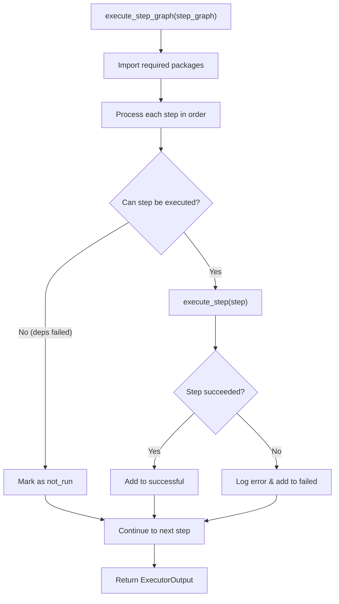
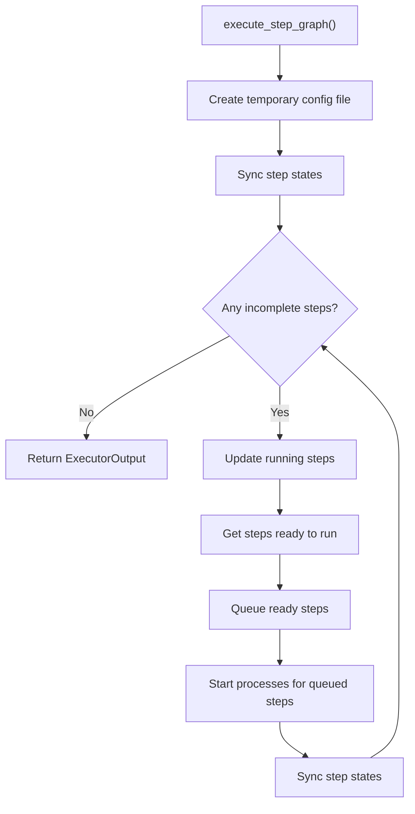
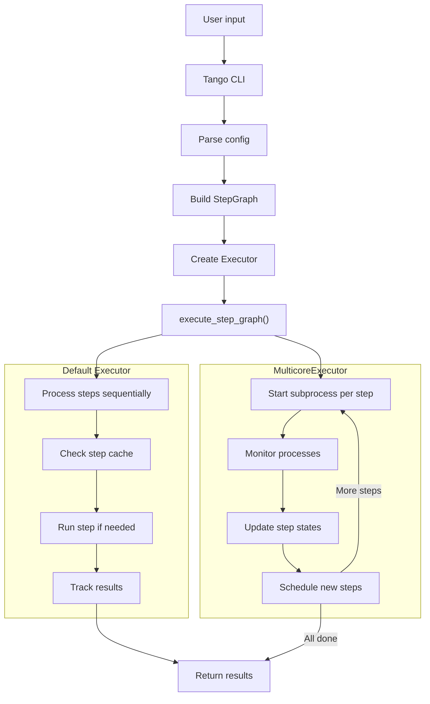

<!-- source: DeepWiki mcp.deepwiki.com · repo allenai/tango · page 4.1 Local Executors · fetched 2026-10-26 -->

# Local Executors

<details>
<summary>Relevant source files</summary>

The following files were used as context for generating this wiki page:

- [docs/source/examples/euler.md](docs/source/examples/euler.md)
- [examples/eval_p3/eval.py](examples/eval_p3/eval.py)
- [tango/__init__.py](tango/__init__.py)
- [tango/common/testing/__init__.py](tango/common/testing/__init__.py)
- [tango/executor.py](tango/executor.py)
- [tango/executors/multicore_executor.py](tango/executors/multicore_executor.py)
- [tango/step_cache.py](tango/step_cache.py)

</details>


## Introduction

Local Executors in Tango are responsible for running steps and their dependencies on the local machine. This document explains how to use and configure local executors, focusing on the default `Executor` and the multicore implementation that enables parallel execution. For information about distributed execution on remote infrastructure, see [Distributed Execution](#4.2).

## The Executor Hierarchy

Executors in Tango are responsible for running steps and managing their execution lifecycle. They determine how steps are scheduled, executed, and how their results are cached.

```mermaid
classDiagram
    class "Registrable" {
        +register(name, constructor)
        +by_name(name)
    }
    
    class "Executor" {
        +workspace: Workspace
        +include_package: Optional[Sequence[str]]
        +parallelism: Optional[int]
        +execute_step(step: Step)
        +execute_step_graph(step_graph: StepGraph)
        +execute_sub_graph_for_steps(step_graph, *step_names)
    }
    
    class "MulticoreExecutor" {
        +num_tries_to_sync_states: int
        +wait_seconds_to_sync_states: int
        +_get_state(step: Step)
    }
    
    "Registrable" <|-- "Executor"
    "Executor" <|-- "MulticoreExecutor"
```

Sources: [tango/executor.py:101-192](), [tango/executors/multicore_executor.py:19-32]()

## Base Executor

The base `Executor` class provides the core functionality for executing steps and step graphs. It is registered as the "default" executor in Tango.

### Key Features

- Sequential execution of steps
- Dependency tracking and management
- Caching of step results based on step configuration
- Error handling and reporting

### Core Methods

1. **`execute_step(step)`**: Executes a single step, importing any required packages and ensuring the result is cached if applicable.

2. **`execute_step_graph(step_graph, run_name=None)`**: Executes all steps in a step graph in order. If a step fails, its dependent steps are not run, but unrelated steps still execute.

3. **`execute_sub_graph_for_steps(step_graph, *step_names)`**: Executes a subset of a step graph, containing only the specified steps and their dependencies.

### Results Tracking

The base executor produces an `ExecutorOutput` instance which contains information about all steps, categorized as:

- **`successful`**: Steps that ran successfully or were found in the cache
- **`failed`**: Steps that failed during execution
- **`not_run`**: Steps that were ignored (usually due to failed dependencies)



Sources: [tango/executor.py:124-174]()

## MulticoreExecutor

The `MulticoreExecutor` extends the base `Executor` to enable parallel execution of steps across multiple CPU cores. It is registered as the "multicore" executor in Tango.

### Key Features

- Parallel execution of multiple steps
- Configurable level of parallelism
- Dynamic scheduling based on step dependencies
- Synchronization between processes

### Configuration Parameters

| Parameter | Type | Default | Description |
|-----------|------|---------|-------------|
| `workspace` | Workspace | *required* | The workspace to use for caching step results |
| `include_package` | Optional[Sequence[str]] | None | Additional packages to import before executing steps |
| `parallelism` | Optional[int] | 1 | Number of steps to execute in parallel (set to negative value to use all available CPU cores) |
| `num_tries_to_sync_states` | int | 3 | Number of attempts to synchronize step states |
| `wait_seconds_to_sync_states` | int | 3 | Seconds to wait between synchronization attempts |

### How It Works

The `MulticoreExecutor` spawns separate processes for each step, up to the configured level of parallelism. Steps are executed as soon as their dependencies are satisfied, allowing for efficient parallel execution of independent steps.



For each step execution, the `MulticoreExecutor`:

1. Creates a subprocess using the `tango` CLI
2. Passes the step configuration via a temporary file
3. Monitors the process status
4. Updates the step state based on the process result
5. Continues execution with the next steps once dependencies are satisfied

Sources: [tango/executors/multicore_executor.py:42-308]()

## Using Local Executors

### Basic Usage with Default Executor

The default executor runs steps sequentially:

```python
from tango import Workspace, Executor, StepGraph

# Create a workspace and a step graph
workspace = Workspace.from_url("local://path/to/workspace")
step_graph = StepGraph(...)

# Create and use the default executor
executor = Executor(workspace=workspace)
result = executor.execute_step_graph(step_graph)
```

### Parallel Execution with MulticoreExecutor

For parallel execution, use the `MulticoreExecutor`:

```python
from tango import Workspace, Executor, StepGraph

# Create a workspace and a step graph
workspace = Workspace.from_url("local://path/to/workspace")
step_graph = StepGraph(...)

# Create a multicore executor with 4 parallel processes
executor = Executor.by_name("multicore")(workspace=workspace, parallelism=4)
result = executor.execute_step_graph(step_graph)
```

### Via Command Line

When using the Tango CLI, you can specify the executor type and parallelism:

```bash
tango run config.jsonnet -w local://path/to/workspace --multicore --parallelism 4
```

Sources: [tango/common/testing/__init__.py:81-117](), [docs/source/examples/euler.md:11-59]()

## Execution Flow

The local executor execution flow involves several steps:



Sources: [tango/executor.py:136-174](), [tango/executors/multicore_executor.py:42-308]()

## Best Practices

### Choosing an Executor

- Use the **default executor** for simple workflows or when steps have complex dependencies
- Use the **MulticoreExecutor** when:
  - You have many independent steps that can run in parallel
  - Your steps are computationally intensive
  - You have sufficient CPU cores and memory

### Optimizing Parallelism

- Set `parallelism` based on your available CPU cores and the nature of your workload
- For CPU-bound tasks, setting `parallelism` to the number of CPU cores is often optimal
- For I/O-bound tasks, you might benefit from higher parallelism
- Setting `parallelism` to a negative value automatically uses all available CPU cores

### Handling Failures

The `ExecutorOutput` provides detailed information about which steps succeeded, failed, or weren't run. Use this to diagnose issues in your workflow:

```python
executor_output = executor.execute_step_graph(step_graph)

# Check for failures
if executor_output.failed:
    print(f"Failed steps: {list(executor_output.failed.keys())}")

# Display execution summary
executor_output.display()
```

Sources: [tango/executor.py:52-98](), [tango/executors/multicore_executor.py:25-40]()

## Limitations

- The default executor does not support parallelism (will log a warning if `parallelism` is set)
- `MulticoreExecutor` works only on the local machine (for distributed execution across machines, see [Distributed Execution](#4.2))
- Parallel execution introduces additional overhead for process creation and synchronization
- Each separate process requires its own memory, which can increase overall memory usage

Sources: [tango/executor.py:146-150](), [tango/executors/multicore_executor.py:30-40]()

---

