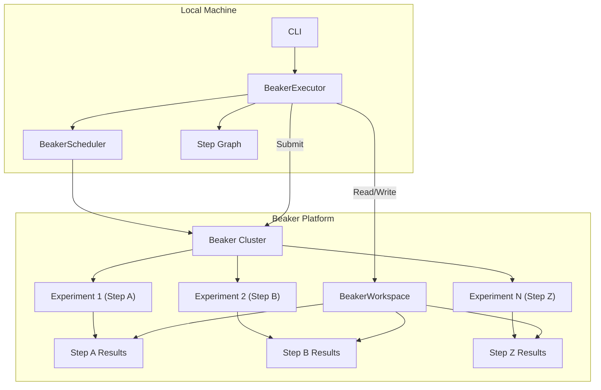
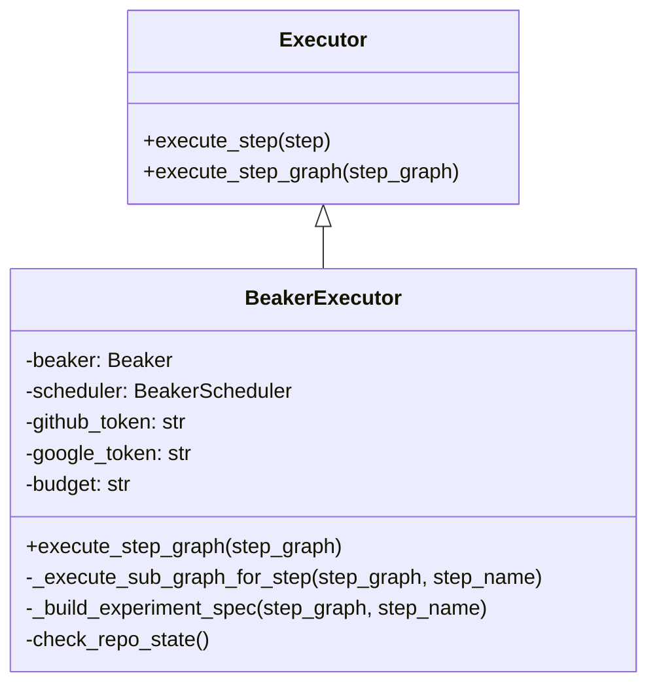
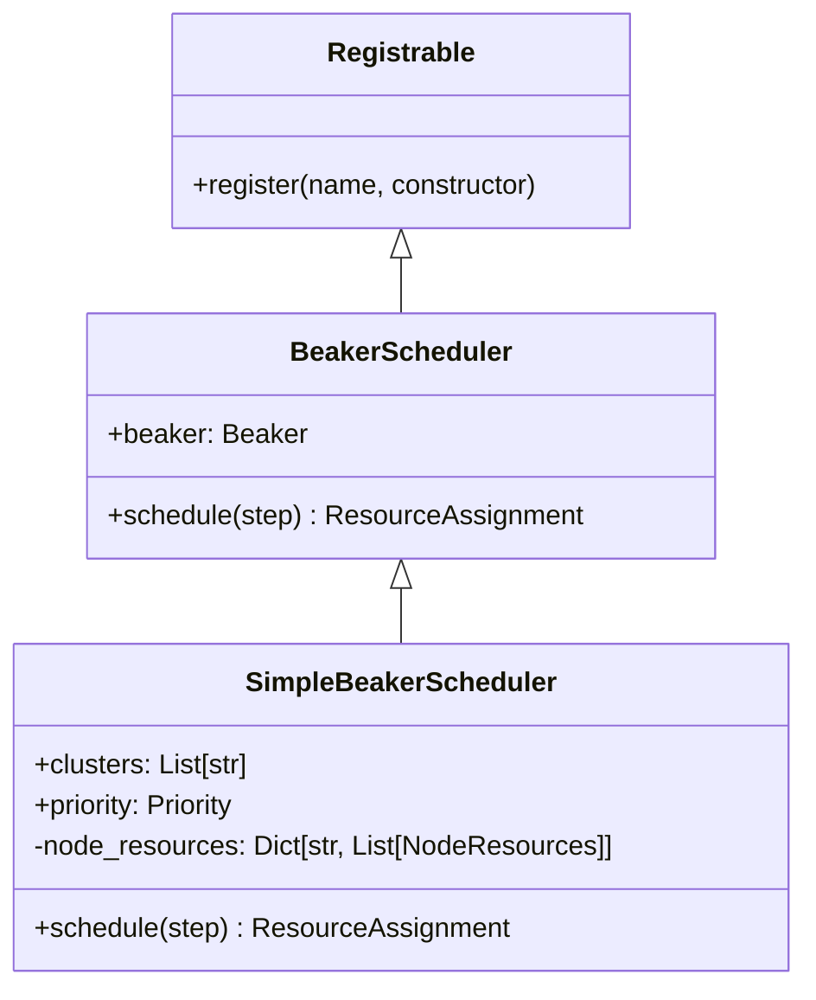
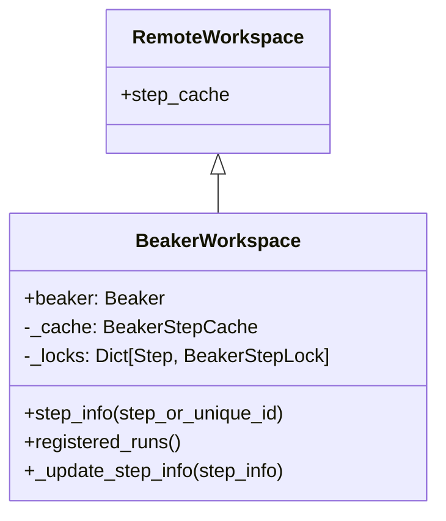
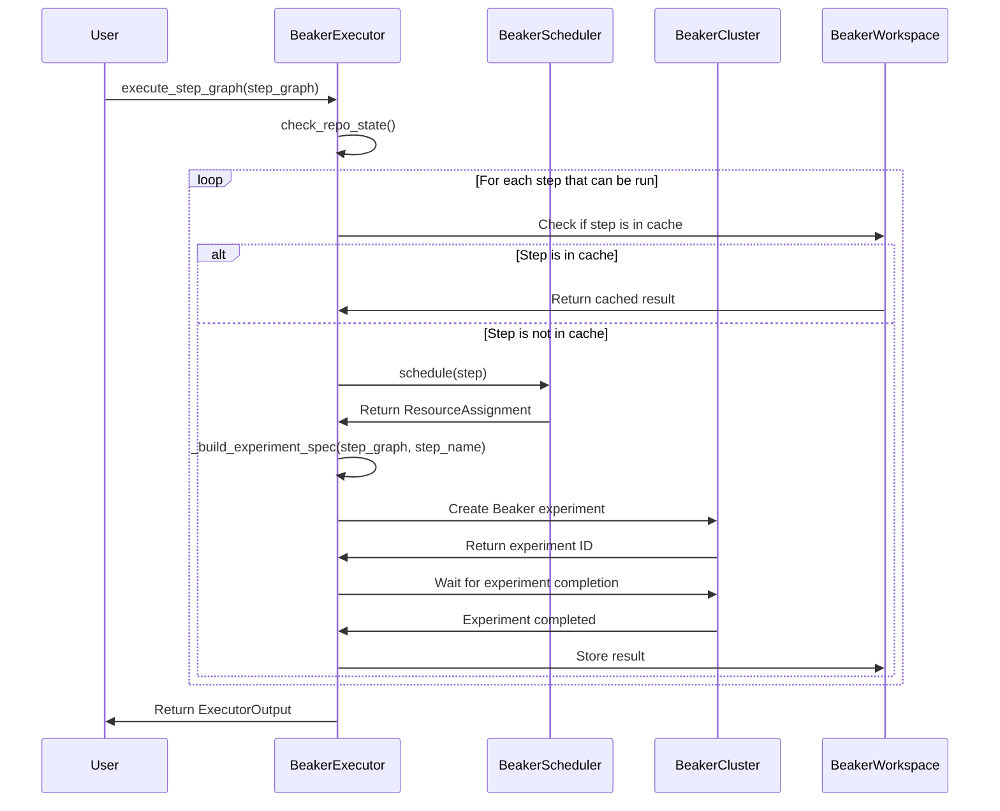
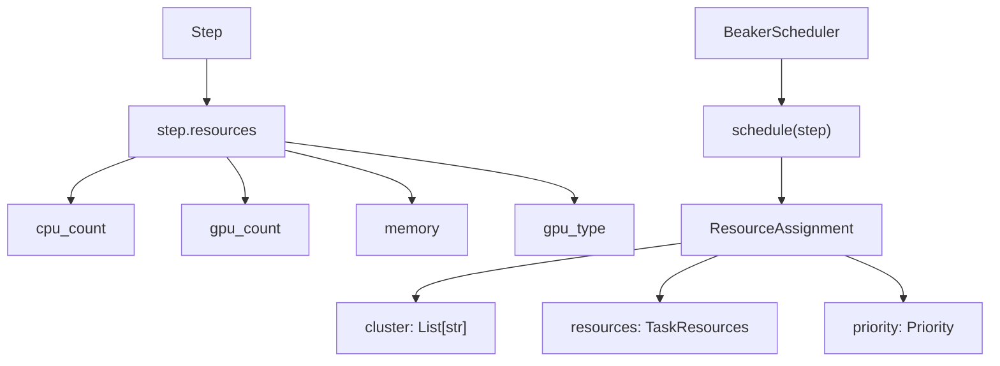
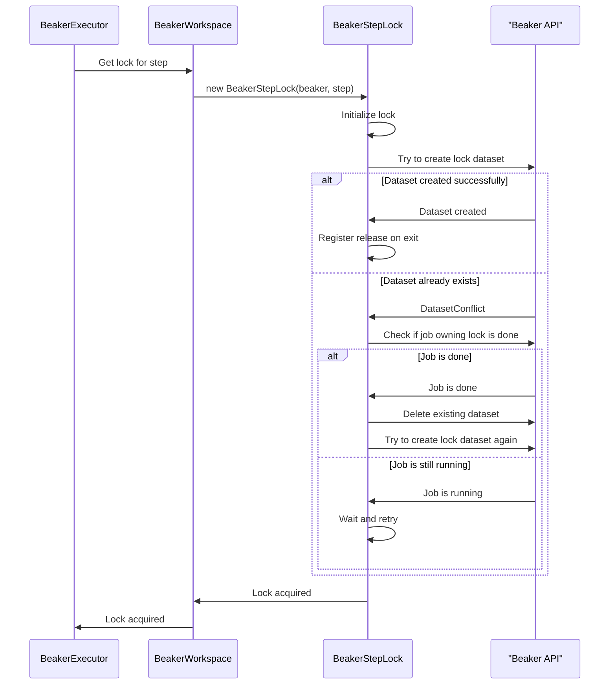

<!-- source: DeepWiki mcp.deepwiki.com · repo allenai/tango · page 4.2 Distributed Execution · fetched 2026-10-26 -->

# Distributed Execution

<details>
<summary>Relevant source files</summary>

The following files were used as context for generating this wiki page:

- [tango/integrations/beaker/common.py](tango/integrations/beaker/common.py)
- [tango/integrations/beaker/executor.py](tango/integrations/beaker/executor.py)
- [tango/integrations/beaker/step_cache.py](tango/integrations/beaker/step_cache.py)
- [tango/integrations/beaker/workspace.py](tango/integrations/beaker/workspace.py)
- [tango/step_info.py](tango/step_info.py)
- [tests/integrations/beaker/conftest.py](tests/integrations/beaker/conftest.py)

</details>


This document details how Tango supports distributed execution of steps through its integration with Beaker, allowing machine learning workflows to run on remote clusters rather than on a local machine. This enables users to execute computationally intensive steps on machines with appropriate hardware (e.g., GPUs) while orchestrating the overall workflow from their local environment.

For information about local execution on a single machine, see [Local Executors](#4.1).

## Overview

The Tango distributed execution system enables:

1. Running steps on remote clusters with specialized hardware (GPUs, high memory)
2. Parallel execution of independent steps across multiple machines
3. Resource scheduling based on step requirements
4. Integration with remote storage for artifacts and results

## Architecture

The distributed execution architecture in Tango follows a client-server model where the client (local machine) orchestrates the execution of steps, and the server (Beaker) performs the actual computation.



Sources: [tango/integrations/beaker/executor.py:178-252](). [tango/integrations/beaker/workspace.py:37-48]()

## Key Components

### BeakerExecutor

The `BeakerExecutor` is the main class responsible for executing steps on the Beaker platform. It's registered under the name "beaker" and orchestrates the distributed execution process.



Sources: [tango/integrations/beaker/executor.py:178-182](), [tango/integrations/beaker/executor.py:329-373]()

### BeakerScheduler

The `BeakerScheduler` determines which resources and priority to assign to each step. The default implementation is `SimpleBeakerScheduler`.



Sources: [tango/integrations/beaker/executor.py:92-127](), [tango/integrations/beaker/executor.py:128-175]()

### BeakerWorkspace

The `BeakerWorkspace` provides storage for step artifacts and results on Beaker's cloud storage.



Sources: [tango/integrations/beaker/workspace.py:37-48](), [tango/integrations/beaker/workspace.py:49-75]()

## Execution Flow

The execution flow for distributed runs involves multiple steps coordinated between the local machine and Beaker:



Sources: [tango/integrations/beaker/executor.py:512-696](), [tango/integrations/beaker/executor.py:713-841]()

## Resource Scheduling

Resource scheduling is a key component of distributed execution. The `BeakerScheduler` assigns resources to steps based on their requirements.



Sources: [tango/integrations/beaker/executor.py:71-91](), [tango/integrations/beaker/executor.py:128-175]()

## Step Locking

To prevent concurrent execution of the same step by multiple processes, Tango uses a locking mechanism implemented by the `BeakerStepLock` class:



Sources: [tango/integrations/beaker/common.py:65-187]()

## Configuration

To use the `BeakerExecutor`, you need to specify it in your configuration:

```yaml
executor:
  type: beaker
  beaker_workspace: ai2/my-workspace
  clusters:
    - ai2/general-cirrascale
  budget: my-budget-id
  github_token: ${GITHUB_TOKEN}  # Or set as environment variable
```

For GPU-intensive steps, you can configure a Docker image with CUDA support:

```yaml
executor:
  type: beaker
  beaker_workspace: ai2/my-workspace
  docker_image: ghcr.io/allenai/pytorch:1.12.0-cuda11.3-python3.9
  venv_name: base
  clusters:
    - ai2/gpu-cluster
  budget: my-budget-id
```

Sources: [tango/integrations/beaker/executor.py:178-252](), [tango/integrations/beaker/executor.py:329-373]()

## Step Resource Requirements

Steps can specify their resource requirements using the `step_resources` parameter:

```json
{
  "steps": {
    "train": {
      "type": "torch::train",
      "step_resources": {
        "gpu_count": 1,
        "gpu_type": "v100",
        "cpu_count": 4,
        "memory": "16GB"
      }
    }
  }
}
```

Sources: [tango/integrations/beaker/executor.py:154-175]()

## Requirements and Limitations

The `BeakerExecutor` has several important requirements:

1. **GitHub Repository**: The executor requires a clean Git repository with a GitHub remote. All changes must be committed and pushed before running.

2. **GitHub Token**: A GitHub personal access token with the "repo" scope is required to authenticate with GitHub when cloning the repository.

3. **Dependencies Management**: The executor recreates the Python environment on Beaker for each step, so dependencies must be specified in a requirements file or environment file.

4. **Appropriate Workspace**: Steps executed on Beaker need their results saved somewhere accessible, so a remote workspace like `BeakerWorkspace` is typically used.

5. **Budget Assignment**: A Beaker budget ID must be specified to track resource usage.

Sources: [tango/integrations/beaker/executor.py:475-485](), [tango/integrations/beaker/executor.py:440-447](), [tango/integrations/beaker/executor.py:369-372]()

## Best Practices

When using distributed execution with Tango, consider these best practices:

1. **Specify Resource Requirements**: Use the `step_resources` parameter to specify what each step needs.

2. **Use Remote Workspaces**: The `BeakerWorkspace` is designed to work with the `BeakerExecutor`.

3. **Keep Git Repository Clean**: Commit and push all changes before running distributed experiments.

4. **Provide Environment Information**: Use a `requirements.txt` or `environment.yml` file to specify dependencies.

5. **Use GPU-Ready Images**: For GPU steps, use Docker images with CUDA support.

6. **NFS Drives**: If using a `LocalWorkspace`, ensure it points to an NFS drive accessible from Beaker nodes.

Sources: [tango/integrations/beaker/executor.py:374-401](), [tango/integrations/beaker/executor.py:486-511]()

## Common Error Scenarios

The distributed execution system may encounter several error types:

| Error Type | Description | Recovery |
|------------|-------------|----------|
| `ResourceAssignmentError` | Cannot find enough free resources | Waits and retries |
| `UnrecoverableResourceAssignmentError` | Cannot find resources matching specifications | Fails execution |
| `StepFailedError` | Step execution failed on Beaker | Marks step as failed |
| `RunCancelled` | Execution was cancelled | Stops all running steps |

Sources: [tango/integrations/beaker/executor.py:52-68](), [tango/integrations/beaker/executor.py:584-598]()

---

