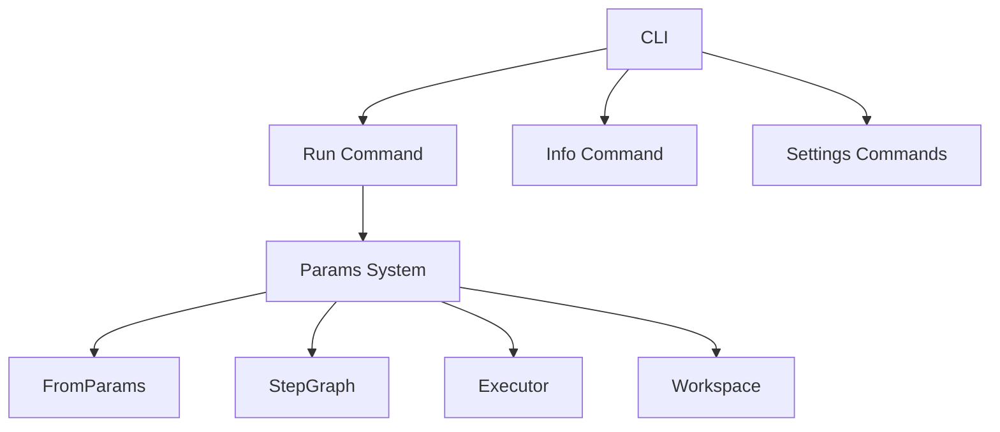
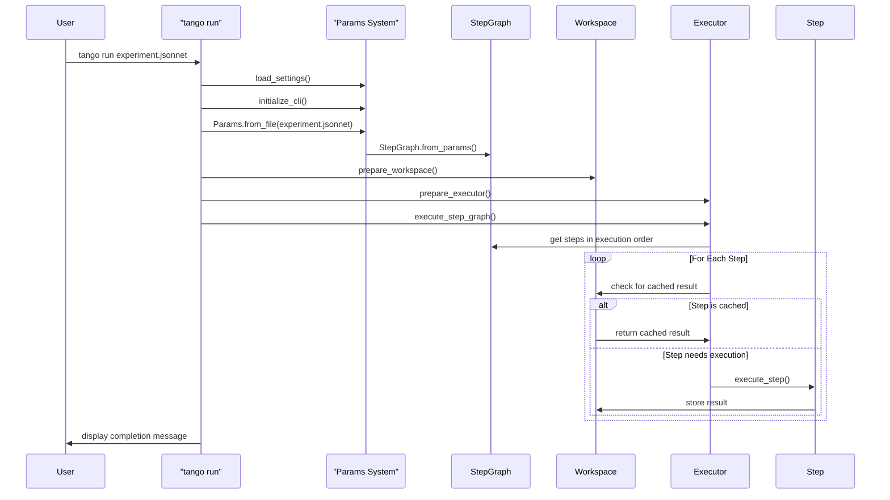
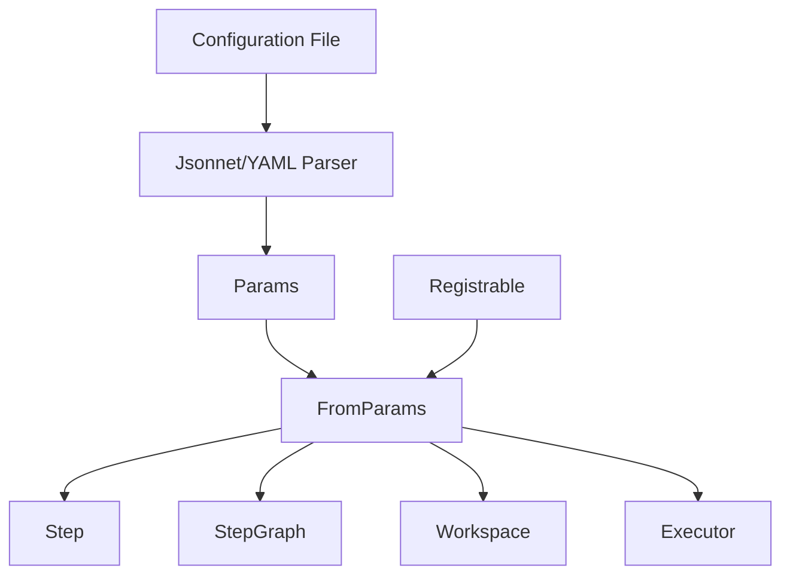
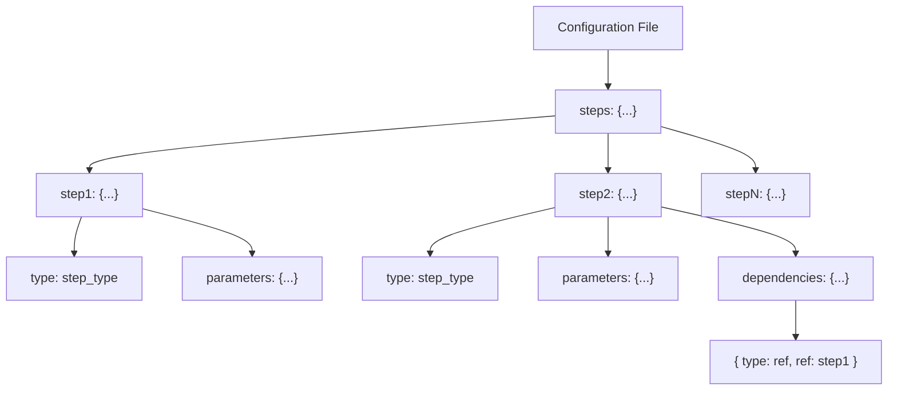
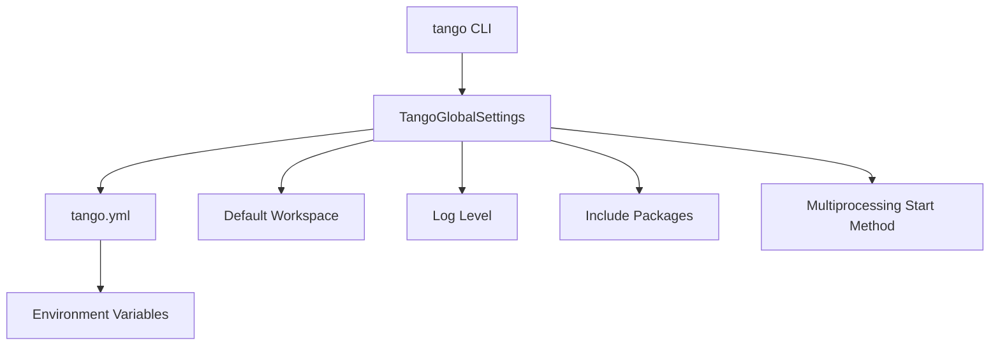
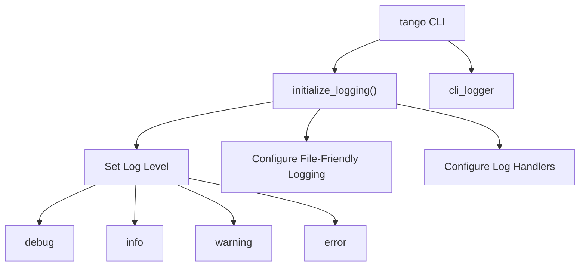

<!-- source: DeepWiki mcp.deepwiki.com · repo allenai/tango · page 5 CLI and Configuration · fetched 2026-10-26 -->

# CLI and Configuration

<details>
<summary>Relevant source files</summary>

The following files were used as context for generating this wiki page:

- [docs/source/api/logging.rst](docs/source/api/logging.rst)
- [tango/__main__.py](tango/__main__.py)
- [tango/common/from_params.py](tango/common/from_params.py)
- [tango/common/logging.py](tango/common/logging.py)
- [tango/common/params.py](tango/common/params.py)
- [tango/integrations/flax/train.py](tango/integrations/flax/train.py)
- [tango/steps/print.py](tango/steps/print.py)
- [tests/common/from_params_test.py](tests/common/from_params_test.py)

</details>


This document covers Tango's command-line interface (CLI) and configuration system, which are the primary ways users interact with the Tango framework. The CLI enables running experiments, managing settings, and retrieving information about the Tango installation. The configuration system provides a flexible way to define experiments using JSON, Jsonnet, or YAML files, along with a sophisticated parameter handling system for type safety and validation.

For information about specific step implementations, see [Steps](#2). For information about workspaces, see [Workspaces](#3).

## Overview

Tango's CLI and configuration system consists of several key components:

**CLI Components Diagram**



Sources: [tango/__main__.py:1-665]()

## Command-Line Interface

The Tango CLI is installed as the `tango` command and provides several subcommands for working with the framework:

```
Usage: tango [OPTIONS] COMMAND [ARGS]...

Options:
  --version                       Show the version and exit.
  --settings FILE                 Path to a global tango.yml settings file.
  --log-level [debug|info|warning|error]
                                  Set the global log level.
  --file-friendly-logging         Outputs progress bar status on separate lines and slows refresh rate.
  --start-method [fork|spawn|forkserver]
                                  Set the multiprocessing start method.
  --help                          Show this message and exit.

Commands:
  info      Get info about the current tango installation.
  run       Run a tango experiment.
  settings  Commands for initializing and updating global settings.
```

Sources: [tango/__main__.py:22-37](), [tango/__main__.py:119-146]()

### The `run` Command

The `run` command is the primary way to execute Tango experiments. It takes a configuration file as input and executes the steps defined in that file.

```
Usage: tango run [OPTIONS] EXPERIMENT

  Run a tango experiment.

  EXPERIMENT is the path to experiment's JSON/Jsonnet/YAML configuration file.

Options:
  -w, --workspace PATH            A workspace path or URL.
  -o, --overrides TEXT            A JSON(NET) string used to override fields in the experiment config.
  -i, --include-package TEXT      Python packages or modules to import for tango components.
  -j, --parallelism INTEGER       The maximum number of steps to run in parallel.
  -s, --step-name TEXT            Execute a particular step (and its dependencies) in the experiment.
  -n, --name TEXT                 Specify the name for this run.
  -D, --ext-var TEXT              JSONNET external variables to use when loading the experiment config.
  --help                          Show this message and exit.
```

Sources: [tango/__main__.py:177-252](), [tango/__main__.py:594-661]()

### The `info` Command

The `info` command provides information about the Tango installation, including available integrations and loaded settings.

```
Usage: tango info [OPTIONS]

  Get info about the current tango installation.
```

Sources: [tango/__main__.py:346-387]()

### The `settings` Command

The `settings` command is used to manage global settings for Tango.

```
Usage: tango settings [OPTIONS] COMMAND [ARGS]...

  Commands for initializing and updating global settings.

Commands:
  init  Initialize the settings file.
  set   Set a value in the settings file.
```

Sources: [tango/__main__.py:390-591]()

## CLI Execution Flow

The following diagram illustrates the flow of executing a Tango experiment using the CLI:

**Tango CLI Execution Flow**



Sources: [tango/__main__.py:594-661]()

## Parameter System

Tango's parameter system is built around two main classes:

1. `Params` - A dictionary-like class that adds parameter validation and logging
2. `FromParams` - A mixin that allows objects to be constructed from parameter dictionaries

**Parameter System Diagram**



Sources: [tango/common/params.py:1-568](), [tango/common/from_params.py:1-878]()

### Params

The `Params` class is a `MutableMapping` that represents a parameter dictionary with a history, and contains functionality around parameter passing and validation. Key features include:

- Parameter validation for discrete choices
- Logging all parameter reads, including default values
- Consuming parameters as they are read to ensure no extras are passed
- Support for nested dictionaries

```python
# Example usage of Params
params = Params({"learning_rate": 0.001, "model": {"hidden_size": 768}})
learning_rate = params.pop_float("learning_rate")  # Returns 0.001
model_params = params.pop("model")  # Returns a new Params object
```

Sources: [tango/common/params.py:204-568]()

### FromParams

The `FromParams` mixin gives a `from_params` method to classes, allowing them to be instantiated from configuration parameters. This is the core mechanism for creating objects from configuration files.

```python
# Example of FromParams usage
class Model(FromParams):
    def __init__(self, hidden_size: int, num_layers: int = 12):
        self.hidden_size = hidden_size
        self.num_layers = num_layers

# Can be instantiated from a params object
model = Model.from_params({"hidden_size": 768})
```

Key features:
- Uses type annotations to validate and convert parameters
- Recursively constructs nested objects
- Handles complex types like `List`, `Dict`, `Optional`, etc.
- Integrates with the `Registrable` pattern for dynamic class loading

Sources: [tango/common/from_params.py:677-878]()

## Configuration Files

Tango uses configuration files to define experiments. These can be in JSON, Jsonnet, or YAML format.

**Configuration File Structure**



Sources: [tango/common/params.py:453-507]()

### Basic Structure

A configuration file defines the steps in an experiment, their dependencies, and their parameters. Here's a simple example:

```jsonnet
{
  "steps": {
    "dataset": {
      "type": "load_dataset",
      "path": "imdb"
    },
    "model": {
      "type": "build_model",
      "input_dim": 768
    },
    "train": {
      "type": "train",
      "model": { "type": "ref", "ref": "model" },
      "dataset": { "type": "ref", "ref": "dataset" },
      "learning_rate": 0.001
    }
  }
}
```

The `steps` object contains named steps, each with a `type` field specifying the registered step type and additional parameters specific to that step. Steps can depend on the results of other steps using references (`{ "type": "ref", "ref": "step_name" }`).

Sources: [tango/common/params.py:453-507]()

### Jsonnet Features

Tango uses Jsonnet as its primary configuration language, which adds several powerful features over plain JSON:

- **Variables**: Define and reuse values throughout the configuration
- **Functions**: Define reusable configuration components
- **Imports**: Import other Jsonnet files to reuse configuration
- **Conditionals**: Use conditional expressions for dynamic configuration
- **Arithmetic**: Perform calculations in the configuration

Example with Jsonnet features:

```jsonnet
local base_learning_rate = 0.001;
local hidden_size = 768;

{
  "steps": {
    "dataset": {
      "type": "load_dataset",
      "path": "imdb"
    },
    "model": {
      "type": "build_model",
      "hidden_size": hidden_size
    },
    "train": {
      "type": "train",
      "model": { "type": "ref", "ref": "model" },
      "dataset": { "type": "ref", "ref": "dataset" },
      "learning_rate": base_learning_rate * 0.1
    }
  }
}
```

Sources: [tango/common/params.py:453-507](), [tango/__main__.py:231-239]()

## Global Settings

Tango supports global settings that can be configured via a settings file or command-line options.

**Settings Management Flow**



Sources: [tango/__main__.py:390-591]()

### Settings File

The global settings file is a YAML file (typically named `tango.yml`) that contains default settings for Tango. You can create and manage this file using the `tango settings` commands:

```bash
# Initialize settings file
tango settings init

# Set default workspace
tango settings set workspace ./my_workspace

# Add packages to automatically import
tango settings set include_package my_package

# Set log level
tango settings set log_level info

# Set multiprocessing start method
tango settings set multiprocessing_start_method spawn
```

Sources: [tango/__main__.py:398-560]()

### Environment Variables

Tango also recognizes several environment variables that can override settings:

- `TANGO_LOG_LEVEL` - Set global log level (debug, info, warning, error)
- `FILE_FRIENDLY_LOGGING` - Enable file-friendly logging (true, false)
- `TANGO_CONSOLE_WIDTH` - Set console width for logging

Sources: [tango/common/logging.py:130-155]()

## Logging

Tango has a sophisticated logging system that allows configuring log levels, formatting, and output destinations.

**Logging System**



Sources: [tango/common/logging.py:493-608](), [tango/common/logging.py:445-456]()

### Log Levels

You can set the log level using the `--log-level` option:

```bash
tango --log-level info run experiment.jsonnet
```

Available log levels are:
- `debug` - Show all messages, including debug information
- `info` - Show informational messages and above
- `warning` - Show only warnings and errors
- `error` - Show only errors

Sources: [tango/common/logging.py:493-608](), [tango/__main__.py:126-130]()

### File-Friendly Logging

For logging to files (especially useful when running on remote servers or job queues), you can enable file-friendly logging:

```bash
tango --file-friendly-logging run experiment.jsonnet
```

This:
- Removes special styling characters from log messages
- Adds newlines to progress bar output
- Slows down progress bar updates for cleaner logs

Sources: [tango/common/logging.py:106-128](), [tango/__main__.py:131-135]()

## Advanced Configuration Features

### Parameter Overrides

When running an experiment, you can override parameters in the configuration file using the `-o` option:

```bash
tango run experiment.jsonnet -o '{"steps.model.learning_rate": 0.01}'
```

This uses a dot notation to specify nested parameters. You can also override entire objects:

```bash
tango run experiment.jsonnet -o '{"steps.model": {"type": "transformer", "hidden_size": 1024}}'
```

Sources: [tango/__main__.py:198-204](), [tango/common/params.py:83-125]()

### External Variables

You can pass external variables to Jsonnet configuration files using the `-D` option:

```bash
tango run experiment.jsonnet -D pretrained_model=gpt2
```

This sets the `pretrained_model` variable in the Jsonnet environment, which can be accessed using `std.extVar()`:

```jsonnet
{
  "steps": {
    "model": {
      "type": "transformer",
      "pretrained_model": std.extVar("pretrained_model")
    }
  }
}
```

Sources: [tango/__main__.py:231-239](), [tango/__main__.py:607-615]()

### Include Package

To use custom steps or other Tango components, you need to import the Python packages that define them:

```bash
tango run experiment.jsonnet -i my_package -i another_package
```

This imports the specified packages before running the experiment, allowing Tango to discover registered components like steps, workspaces, and executors.

Sources: [tango/__main__.py:205-210](), [tango/__main__.py:621-625]()

## Summary

Tango's CLI and configuration system provides a flexible and powerful way to define and run experiments. The key components are:

1. **CLI**: Command-line interface for running experiments and managing settings
2. **Params**: Parameter handling system for validation and type safety
3. **FromParams**: Mechanism for creating objects from configuration parameters
4. **Configuration Files**: JSON/Jsonnet/YAML files defining experiment steps
5. **Global Settings**: System-wide settings for default behavior

These components work together to provide a consistent and type-safe way to define and run experiments, making Tango both powerful and user-friendly.

Sources: [tango/__main__.py:1-665](), [tango/common/params.py:1-568](), [tango/common/from_params.py:1-878](), [tango/common/logging.py:1-781]()

---

