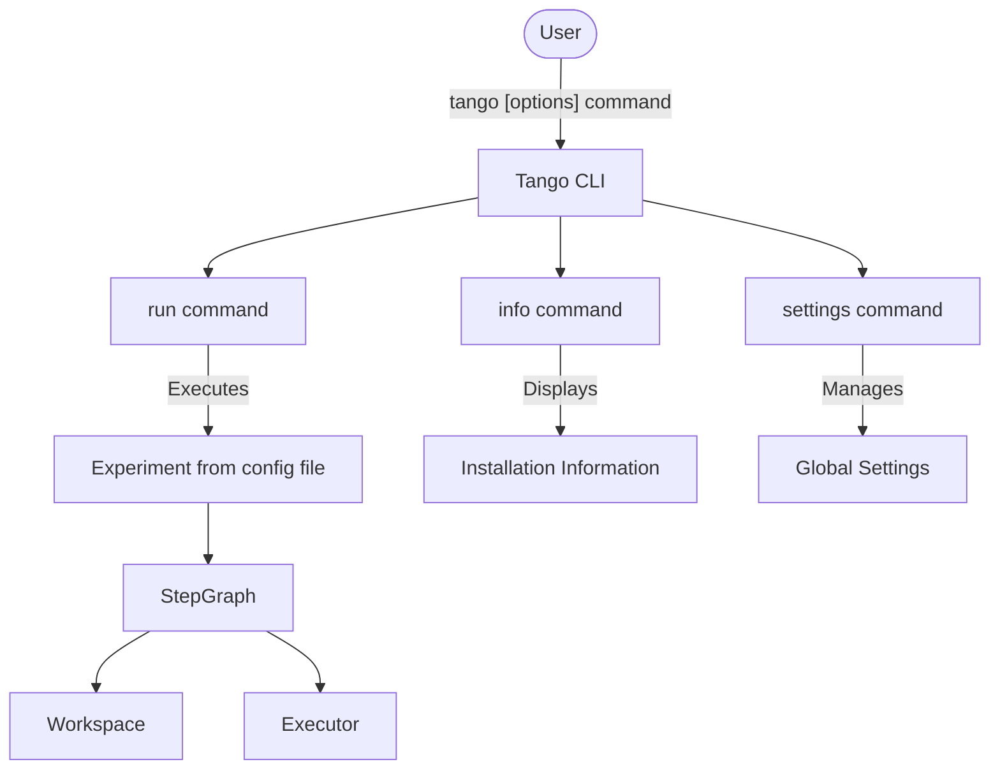
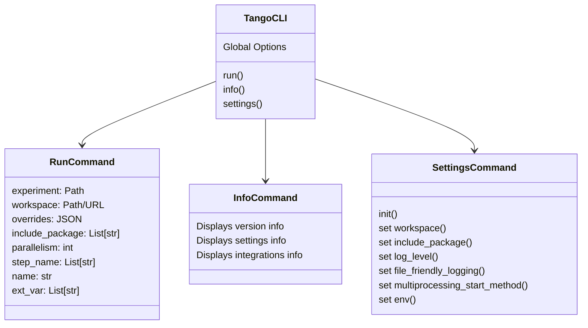
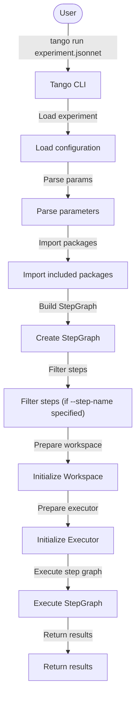

<!-- source: DeepWiki mcp.deepwiki.com · repo allenai/tango · page 5.1 Command-line Interface · fetched 2026-10-26 -->

# Command-line Interface

<details>
<summary>Relevant source files</summary>

The following files were used as context for generating this wiki page:

- [docs/source/api/logging.rst](docs/source/api/logging.rst)
- [tango/__main__.py](tango/__main__.py)
- [tango/common/logging.py](tango/common/logging.py)
- [tango/steps/print.py](tango/steps/print.py)

</details>


This document provides a detailed overview of Tango's command-line interface (CLI), including all available commands, options, and how to use them effectively. The CLI serves as the primary method for running Tango experiments and managing workspaces. For information about configuration files used with the CLI, see [Configuration Files](#5.2).

## Overview

Tango's command-line interface provides a set of tools to run experiments, manage settings, and get information about your installation. The CLI is designed to be intuitive and offers features for both basic and advanced usage.



**Diagram: Tango CLI Command Structure**

Sources: [tango/__main__.py:96-175](tango/__main__.py:96-175), [tango/__main__.py:390-456](tango/__main__.py:390-456)

## Basic Usage

The CLI can be invoked using the `tango` command followed by an optional set of global options and a command. The basic syntax is:

```
tango [OPTIONS] COMMAND [ARGS]...
```

### Global Options

The following global options can be used with any command:

| Option | Description |
|--------|-------------|
| `--version` | Show the version and exit |
| `--settings FILE` | Path to a global tango.yml settings file |
| `--log-level [debug\|info\|warning\|error]` | Set the global log level |
| `--file-friendly-logging` | Outputs progress bar status on separate lines and slows refresh rate |
| `--start-method [fork\|spawn\|forkserver]` | Set the multiprocessing start method |

Sources: [tango/__main__.py:118-141](tango/__main__.py:118-141)

## Available Commands

Tango offers three main commands:



**Diagram: Tango CLI Command Classes**

Sources: [tango/__main__.py:177-232](tango/__main__.py:177-232), [tango/__main__.py:346-388](tango/__main__.py:346-388), [tango/__main__.py:390-591](tango/__main__.py:390-591)

### The `run` Command

The `run` command is used to execute a Tango experiment:

```
tango run [OPTIONS] EXPERIMENT
```

Where `EXPERIMENT` is the path to experiment's JSON/Jsonnet/YAML configuration file.

#### Options for `run`

| Option | Short | Description |
|--------|-------|-------------|
| `--workspace` | `-w` | A workspace path or URL. If not specified, the workspace from any global settings file will be used, if found, otherwise an ephemeral MemoryWorkspace. |
| `--overrides` | `-o` | A JSON(NET) string used to override fields in the experiment config. Use dot syntax to specify nested fields. |
| `--include-package` | `-i` | Python packages or modules to import for tango components. Can be specified multiple times. |
| `--parallelism` | `-j` | The maximum number of steps to run in parallel (for executors that support this). |
| `--step-name` | `-s` | Execute a particular step (and its dependencies) in the experiment. Can be specified multiple times. |
| `--name` | `-n` | Specify the name for this run. |
| `--ext-var` | `-D` | JSONNET external variables to use when loading the experiment config. For example, `--ext-var 'pretrained_model=gpt2'`. Can be specified multiple times. |

Sources: [tango/__main__.py:177-232](tango/__main__.py:177-232), [tango/__main__.py:594-661](tango/__main__.py:594-661)

### The `info` Command

The `info` command provides information about the current Tango installation:

```
tango info
```

This command displays:
- Tango version and Python version
- Settings information (if a settings file is loaded)
- Installed integrations and their status

Sources: [tango/__main__.py:346-388](tango/__main__.py:346-388)

### The `settings` Command

The `settings` command is used to initialize and manage global settings:

```
tango settings COMMAND [ARGS]...
```

#### Subcommands for `settings`

- `init`: Initialize the settings file
  ```
  tango settings init [OPTIONS]
  ```
  Options:
  - `--path`, `-p`: The path to write the settings to
  - `--force`, `-f`: Force overwrite the file if it exists

- `set`: Set a value in the settings file
  ```
  tango settings set SUBCOMMAND [ARGS]...
  ```
  
  Subcommands:
  - `workspace`: Set the default workspace path or URL
  - `include_package`: Set or add modules to automatically import on 'tango run'
  - `log_level`: Set the log level
  - `file_friendly_logging`: Toggle file friendly logging mode
  - `multiprocessing_start_method`: Set the Python multiprocessing start method
  - `env`: Add or update an environment variable

Sources: [tango/__main__.py:390-591](tango/__main__.py:390-591)

## CLI Execution Flow

The following diagram illustrates how the `run` command processes and executes an experiment:



**Diagram: Tango Run Command Execution Flow**

Sources: [tango/__main__.py:594-661](tango/__main__.py:594-661)

## Logging Configuration

Tango provides detailed control over logging through the CLI. The logging system is configurable through:

1. Global options:
   - `--log-level [debug|info|warning|error]`
   - `--file-friendly-logging`

2. Environment variables:
   - `TANGO_LOG_LEVEL`
   - `FILE_FRIENDLY_LOGGING`

3. Settings file:
   - `log_level` field
   - `file_friendly_logging` field

When `--file-friendly-logging` is enabled, progress bar output is modified to be more readable in log files, printing on separate lines and updating less frequently.

Sources: [tango/common/logging.py:493-570](tango/common/logging.py:493-570), [tango/common/logging.py:106-128](tango/common/logging.py:106-128)

## Global Settings Management

Tango stores global settings in a YAML file, which can be initialized and modified using the `settings` command. These settings provide default values for various Tango operations.

```mermaid
flowchart TD
    Settings["TangoGlobalSettings"] --> Workspace["workspace"]
    Settings --> IncludePackage["include_package"]
    Settings --> LogLevel["log_level"]
    Settings --> FileFriendlyLogging["file_friendly_logging"]
    Settings --> StartMethod["multiprocessing_start_method"]
    Settings --> Environment["environment"]
    
    CLI([CLI]) -->|"settings init"| CreateSettings["Create settings file"]
    CLI -->|"settings set workspace"| SetWorkspace["Set workspace"]
    CLI -->|"settings set include_package"| SetIncludePackage["Set packages"]
    CLI -->|"settings set log_level"| SetLogLevel["Set log level"]
    CLI -->|"settings set file_friendly_logging"| SetFileLogging["Set file logging"]
    CLI -->|"settings set multiprocessing_start_method"| SetStartMethod["Set start method"]
    CLI -->|"settings set env"| SetEnv["Set environment variables"]
```



**Diagram: Tango Settings Management**

Sources: [tango/__main__.py:398-591](tango/__main__.py:398-591)

## Example Usage

Here are some common usage examples of the Tango CLI:

### Running an Experiment

Basic usage:
```
tango run experiment.jsonnet
```

With a specific workspace:
```
tango run -w ./workspace experiment.jsonnet
```

Running specific steps:
```
tango run -s step1 -s step2 experiment.jsonnet
```

With overrides:
```
tango run -o '{"training.batch_size": 16}' experiment.jsonnet
```

With parallelism:
```
tango run -j 4 experiment.jsonnet
```

### Managing Settings

Initialize settings:
```
tango settings init
```

Set default workspace:
```
tango settings set workspace ./my_workspace
```

Set log level:
```
tango settings set log_level debug
```

Add packages to automatically import:
```
tango settings set include_package my_tango_steps -a
```

Sources: [tango/__main__.py:1-666](tango/__main__.py:1-666)

## Advanced Features

### Environment Variables for Configuration

Tango supports using environment variables to configure its behavior:

| Environment Variable | Description |
|----------------------|-------------|
| `TANGO_LOG_LEVEL` | Sets the global log level |
| `FILE_FRIENDLY_LOGGING` | Enables file-friendly logging |
| `TANGO_CONSOLE_WIDTH` | Sets the console width for logging |
| `TANGO_CLI_LOGGER_ENABLED` | Enables/disables the CLI logger |

Sources: [tango/common/logging.py:129-156](tango/common/logging.py:129-156)

### Worker Process Logging

When running steps in parallel, Tango provides facilities for proper logging from worker processes. This is handled automatically by the executor but can be manually configured if needed.

Sources: [tango/common/logging.py:537-552](tango/common/logging.py:537-552)

## Conclusion

The Tango CLI provides a powerful and flexible interface for running experiments, managing workspaces, and configuring the framework. By understanding the available commands and options, you can effectively leverage Tango for your machine learning workflows.

For more information about how to create configuration files for use with the Tango CLI, see [Configuration Files](#5.2).

---

