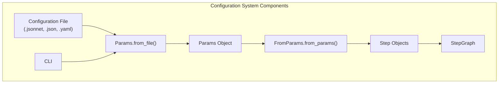
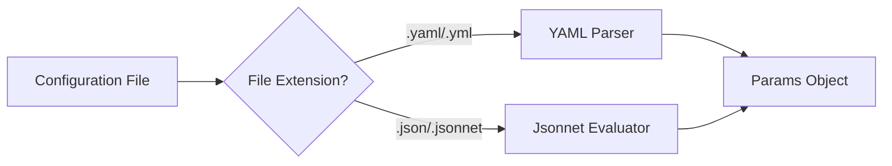
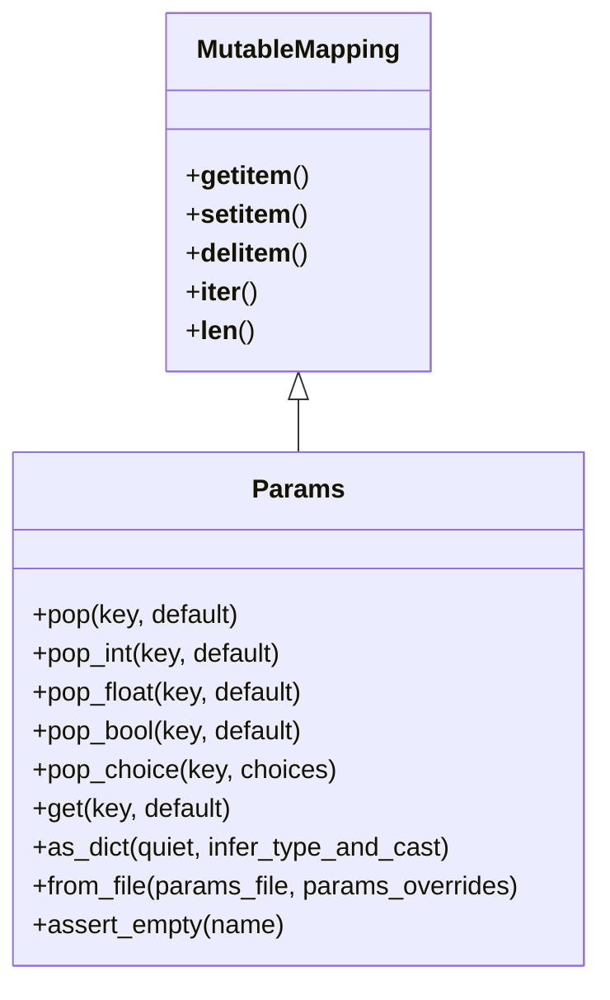
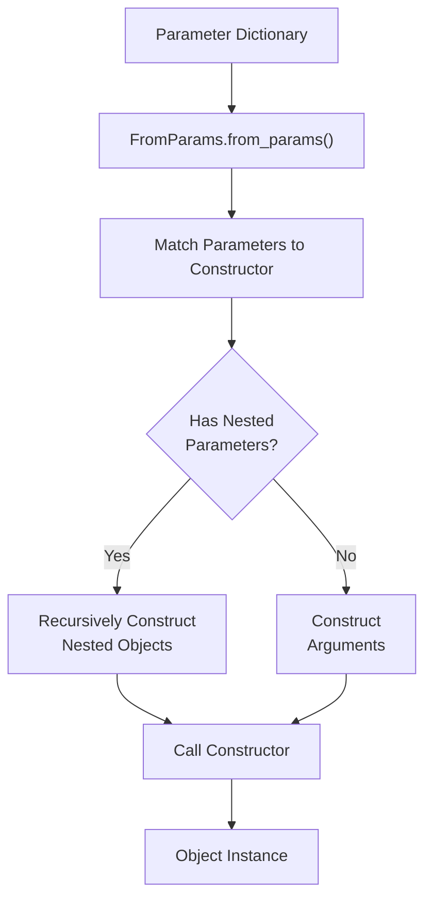
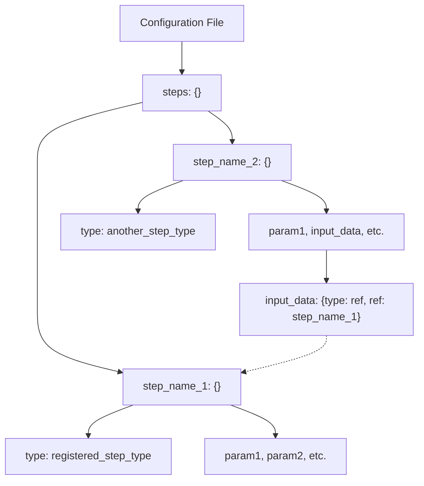
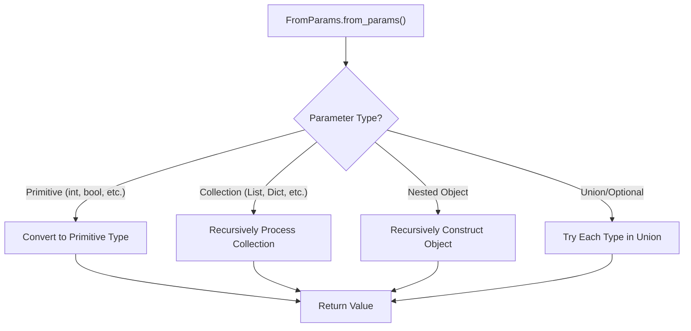
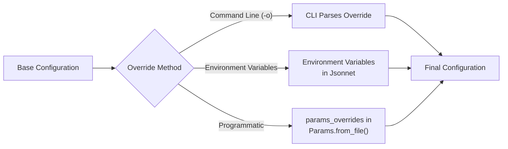
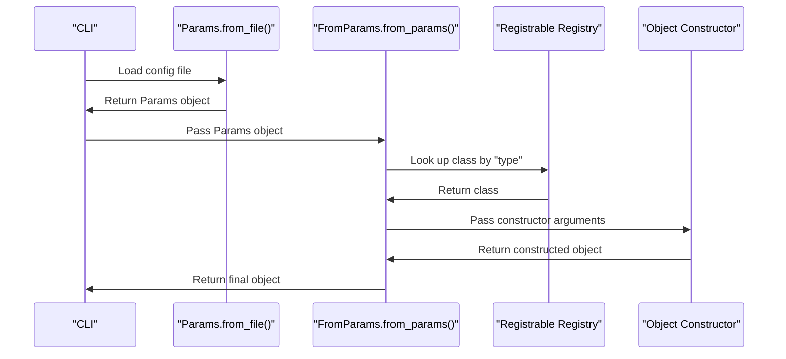

<!-- source: DeepWiki mcp.deepwiki.com · repo allenai/tango · page 5.2 Configuration Files · fetched 2026-10-26 -->

# Configuration Files

<details>
<summary>Relevant source files</summary>

The following files were used as context for generating this wiki page:

- [docs/source/_static/step_graph.png](docs/source/_static/step_graph.png)
- [docs/source/examples/eval_p3.md](docs/source/examples/eval_p3.md)
- [docs/source/examples/index.rst](docs/source/examples/index.rst)
- [docs/source/index.md](docs/source/index.md)
- [examples/euler/README.md](examples/euler/README.md)
- [examples/eval_p3/README.md](examples/eval_p3/README.md)
- [tango/common/from_params.py](tango/common/from_params.py)
- [tango/common/params.py](tango/common/params.py)
- [tango/integrations/flax/train.py](tango/integrations/flax/train.py)
- [tests/common/from_params_test.py](tests/common/from_params_test.py)

</details>


This page documents Tango's configuration file system, which allows users to define complex machine learning experiments declaratively. Configuration files define steps, their parameters, and dependencies between steps. For information about running experiments using these configurations, see [Command-line Interface](#5.1).

## Overview

Tango supports configuration files in multiple formats, with Jsonnet being the recommended format due to its powerful features for reuse and modularity. These configuration files define the experimental workflow as a directed acyclic graph of steps.



Sources: [tango/common/params.py:454-508](), [tango/common/from_params.py:677-830]()

## Supported File Formats

Tango supports three primary formats for configuration files:

| Format | File Extension | Features |
|--------|---------------|----------|
| Jsonnet | `.jsonnet` | Superset of JSON with variables, functions, imports, conditionals |
| JSON | `.json` | Standard key-value format |
| YAML | `.yml`, `.yaml` | Human-readable alternative to JSON |

When loading a configuration file, Tango automatically detects the format based on the file extension and parses it appropriately.



Sources: [tango/common/params.py:489-497]()

## Core Components

The configuration system in Tango is built around two main classes:

1. `Params`: A mutable mapping (dictionary-like) class that represents parameters with validation and tracking capabilities
2. `FromParams`: A mixin class that allows objects to be instantiated from parameter dictionaries

### The Params Class

`Params` is a dictionary-like object that adds parameter validation, logging, and type conversion capabilities. It implements the Python `MutableMapping` interface, allowing it to behave like a standard dictionary while providing additional functionality.



Sources: [tango/common/params.py:204-568]()

### The FromParams Mechanism

The `FromParams` mixin adds a `from_params` method to classes, which constructs an object from a parameter dictionary by matching parameter names to constructor arguments.



Sources: [tango/common/from_params.py:677-830]()

## Configuration Structure

A typical Tango configuration file has the following structure:

```jsonnet
{
  "steps": {
    "step_name_1": {
      "type": "registered_step_type",
      "param1": value1,
      "param2": value2
    },
    "step_name_2": {
      "type": "another_step_type",
      "param1": value1,
      "input_data": {
        "type": "ref",
        "ref": "step_name_1"
      }
    }
  }
}
```

This structure defines:
- Named steps in the experiment
- The type of each step (which must be registered in Tango)
- Parameters for each step
- Dependencies between steps using `{"type": "ref", "ref": "step_name"}` syntax



Sources: [tango/common/from_params.py:353-376](), [examples/eval_p3/config.jsonnet]()

## Parameter Types and Validation

Tango supports various parameter types and provides validation methods to ensure parameters are of the correct type and have acceptable values.

### Basic Parameter Types

The `Params` class offers methods for retrieving and validating parameters of different types:

| Method | Description |
|--------|-------------|
| `pop(key, default)` | Retrieve and remove a parameter |
| `pop_int(key, default)` | Retrieve, convert to int, and remove |
| `pop_float(key, default)` | Retrieve, convert to float, and remove |
| `pop_bool(key, default)` | Retrieve, convert to bool, and remove |
| `pop_choice(key, choices)` | Ensure parameter is one of the allowed choices |

Sources: [tango/common/params.py:239-360]()

### Complex Parameter Types

The `FromParams` mechanism can handle complex parameter types, including:

- Primitive types (int, float, bool, str)
- Collections (List, Dict, Set, Tuple)
- Nested objects (via recursive FromParams construction)
- Special types like Optional, Union, and Lazy



Sources: [tango/common/from_params.py:353-674]()

## Parameter Overrides

Tango allows overriding configuration parameters without modifying the original file using several mechanisms:

1. **Command-line overrides**: Using the `-o` or `--overrides` flag
   ```bash
   tango run config.jsonnet -o "steps.train_model.learning_rate=0.01"
   ```

2. **Environment variables**: Available in Jsonnet files
   ```jsonnet
   {
     "steps": {
       "train_model": {
         "batch_size": std.parseInt(std.extVar("BATCH_SIZE"))
       }
     }
   }
   ```

3. **Programmatic overrides**: By passing `params_overrides` to `Params.from_file()`



Sources: [tango/common/params.py:128-136](), [tango/common/params.py:498-504]()

## Params and FromParams Integration

The `Params` and `FromParams` classes work together to create objects from configuration files. Here's how they interact in practice:



Sources: [tango/common/from_params.py:677-830](), [tango/common/params.py:454-508]()

## Advanced Jsonnet Features

Jsonnet offers several advanced features that make configuration more powerful:

### Variables and Functions

```jsonnet
local base_model = "bert-base-uncased";
local make_optimizer(lr) = {
  "type": "adam",
  "lr": lr
};

{
  "steps": {
    "train": {
      "model": {
        "type": "bert",
        "pretrained_model_name": base_model
      },
      "optimizer": make_optimizer(1e-5)
    }
  }
}
```

### Imports and Reuse

```jsonnet
local common = import 'common.libsonnet';

{
  "steps": {
    "train": {
      "model": common.models.bert,
      "optimizer": common.optimizers.adam
    }
  }
}
```

### Conditionals and Loops

```jsonnet
{
  "steps": {
    "train": {
      "batch_size": if std.extVar("ENVIRONMENT") == "production" then 64 else 16,
      "datasets": [
        {
          "name": dataset_name,
          "path": "data/" + dataset_name
        }
        for dataset_name in ["train", "dev", "test"]
      ]
    }
  }
}
```

Sources: [examples/eval_p3/config.jsonnet]()

## Error Handling

Tango provides detailed error messages when configuration files have issues:

1. **Missing required parameters**: Raises `ConfigurationError` with the parameter name
2. **Type conversion errors**: Raises `TypeError` with the parameter name and expected type
3. **Validation errors**: Raises `ConfigurationError` with details about the validation failure
4. **Unused parameters**: Warns about parameters that were not consumed

Sources: [tango/common/from_params.py:347-352](), [tango/common/params.py:250-255](), [tango/common/params.py:417-425]()

## Common Patterns and Best Practices

1. **Use Jsonnet for complex configurations**: Take advantage of variables, functions, and imports
2. **Keep common parameters in separate files**: Use Jsonnet imports to share configuration across experiments
3. **Use descriptive step names**: Makes dependencies easier to understand
4. **Validate all parameters**: Use `assert_empty()` to ensure no unexpected parameters
5. **Provide helpful error messages**: When validation fails, explain why

Sources: [examples/eval_p3/config.jsonnet]()

## Real-World Example

Here's a simplified example from the `eval_p3` example configuration:

```jsonnet
{
  "steps": {
    "dataset": {
      "type": "load_dataset",
      "path": "xsum",
      "split": "test[:100]"
    },
    "generate": {
      "type": "transformers::run_generation_dataset",
      "model_name": "bigscience/T0_3B",
      "dataset": {"type": "ref", "ref": "dataset"},
      "prompt_template": "Summarize: {{text}}",
      "input_column": "document",
      "output_column": "summary"
    },
    "evaluate": {
      "type": "rouge_score",
      "predictions": {"type": "ref", "ref": "generate"},
      "references": {"type": "ref", "ref": "dataset.summary"}
    }
  }
}
```

In this example:
- `dataset` loads the xsum dataset
- `generate` uses the dataset to generate summaries with a T0 model
- `evaluate` computes ROUGE scores between the generated summaries and references

The dependencies are expressed using references with the `{"type": "ref", "ref": "step_name"}` syntax.

Sources: [examples/eval_p3/config.jsonnet]()

---

