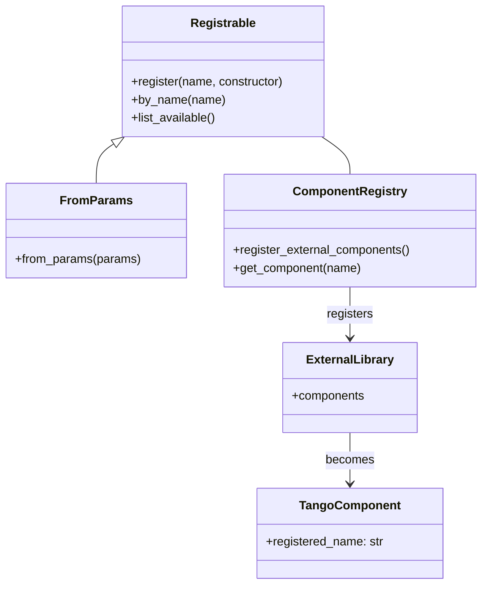
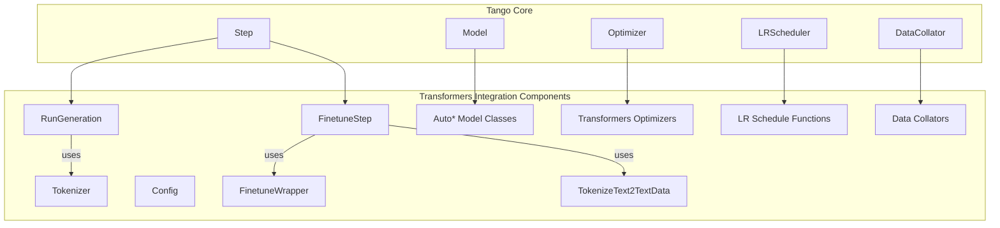
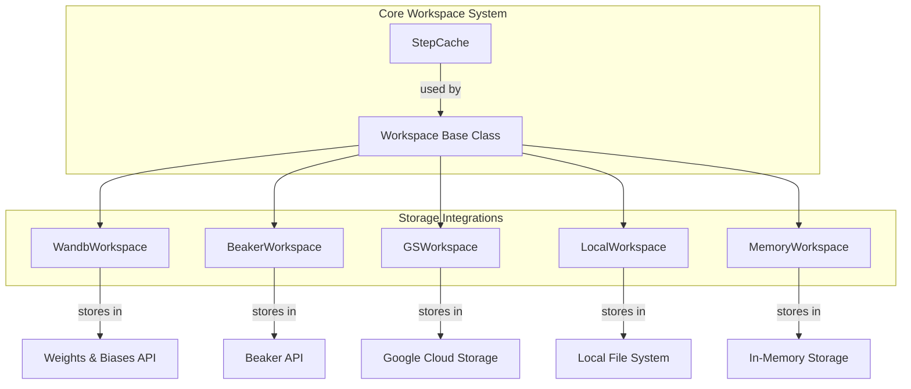
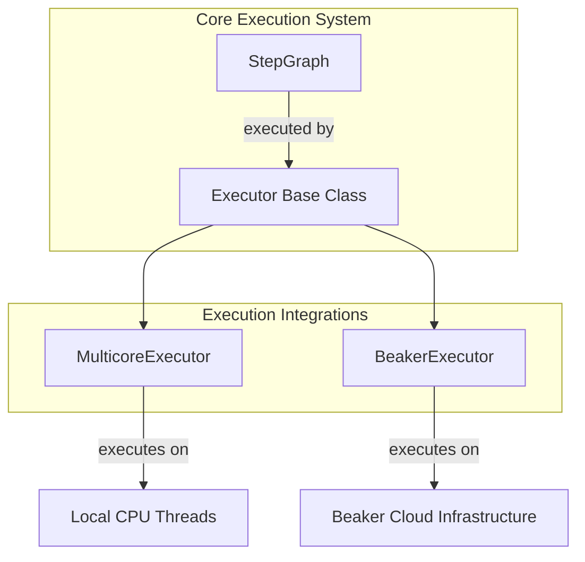

<!-- source: DeepWiki mcp.deepwiki.com · repo allenai/tango · page 6 Integrations · fetched 2026-10-26 -->

# Integrations

<details>
<summary>Relevant source files</summary>

The following files were used as context for generating this wiki page:

- [.github/workflows/main.yml](.github/workflows/main.yml)
- [pyproject.toml](pyproject.toml)
- [tango/common/file_lock.py](tango/common/file_lock.py)
- [tango/integrations/torch/optim.py](tango/integrations/torch/optim.py)
- [tango/integrations/transformers/__init__.py](tango/integrations/transformers/__init__.py)

</details>


This page provides an overview of Tango's integration ecosystem, which extends core functionality to work with popular machine learning frameworks and services. These integrations allow Tango to seamlessly interact with external libraries and tools while maintaining its step-based workflow paradigm.

For information about the core architecture, see [Overview](#1) and [Core Concepts](#1.1).

## Integration Architecture

Tango's integration system follows a modular design pattern that allows external libraries to be registered with Tango's core components. Each integration wraps third-party libraries to make them compatible with Tango's step system, workspace management, and configuration interfaces.

```mermaid
graph TD
    subgraph "Tango Core System"
        Core["Core Framework"]
        Registry["Component Registry"]
        Step["Step Base Class"]
        FromParams["FromParams Interface"]
        Registrable["Registrable Base Class"]
    end
    
    subgraph "Integration Layer"
        IntegrationLoader["Integration Loader"]
        Registry --> IntegrationLoader
        IntegrationLoader --> PyTorchInt["PyTorch Integration"]
        IntegrationLoader --> TransformersInt["Transformers Integration"]
        IntegrationLoader --> FlaxInt["Flax Integration"]
        IntegrationLoader --> DatasetsInt["Datasets Integration"]
        IntegrationLoader --> WandbInt["Weights & Biases Integration"]
        IntegrationLoader --> BeakerInt["Beaker Integration"]
        IntegrationLoader --> GSInt["Google Storage Integration"]
        IntegrationLoader --> FairscaleInt["Fairscale Integration"]
    end
    
    subgraph "External Libraries"
        PyTorchInt --> PyTorch["PyTorch Library"]
        TransformersInt --> Transformers["Hugging Face Transformers"]
        FlaxInt --> Flax["Flax/JAX"]
        DatasetsInt --> HFDatasets["Hugging Face Datasets"]
        WandbInt --> Wandb["Weights & Biases API"]
        BeakerInt --> Beaker["Beaker API"]
        GSInt --> GS["Google Cloud Storage"]
        FairscaleInt --> Fairscale["Fairscale Library"]
    end
    
    PyTorchInt --> |"Extends"| TorchTrainStep["TorchTrainStep"]
    TransformersInt --> |"Extends"| RunGeneration["RunGeneration"]
    WandbInt --> |"Extends"| WandbWorkspace["WandbWorkspace"]
    BeakerInt --> |"Extends"| BeakerExecutor["BeakerExecutor"]
    GSInt --> |"Extends"| GSWorkspace["GSWorkspace"]
    
    Core --> Step
    Core --> FromParams
    Core --> Registrable
```



Sources: [tango/integrations/transformers/__init__.py:1-171](), [pyproject.toml:42-111]()

## Available Integrations

Tango provides integrations with several popular libraries and services. Each integration is available as an optional dependency.

| Integration | Purpose | Installation | Key Components |
|------------|---------|-------------|----------------|
| PyTorch | Deep learning framework | `pip install tango[torch]` | Models, Optimizers, DataLoaders |
| Transformers | Hugging Face Transformers | `pip install tango[transformers]` | Tokenizers, Models, Text generation |
| Datasets | Hugging Face Datasets | `pip install tango[datasets]` | Dataset loading and processing |
| Flax | JAX-based neural networks | `pip install tango[flax]` | Flax models and training |
| Fairscale | Scaling PyTorch models | `pip install tango[fairscale]` | Model parallelism, sharding |
| Weights & Biases | Experiment tracking | `pip install tango[wandb]` | Experiment logging, artifact storage |
| Beaker | Distributed execution | `pip install tango[beaker]` | Remote execution, step orchestration |
| Google Storage | Cloud storage | `pip install tango[gs]` | Remote artifact storage |

You can install all integrations with `pip install tango[all]`.

Sources: [pyproject.toml:42-111]()

## Integration Registration Pattern

Tango uses a registration pattern to make external library components available through its configuration system. This allows users to reference external components in configuration files using a consistent naming scheme.



Sources: [tango/integrations/torch/optim.py:1-89](), [tango/integrations/transformers/__init__.py:1-171]()

## Integration Usage Examples

### PyTorch Integration

The PyTorch integration allows Tango to work with PyTorch models, optimizers, and data loaders. It registers all standard PyTorch components with Tango's registry system.

For example, to use a PyTorch optimizer in a Tango configuration:

```json
{
  "optimizer": {
    "type": "torch::Adam",
    "lr": 0.001
  }
}
```

Key components from the PyTorch integration:
- Models (`torch::Module`)
- Optimizers (`torch::Adam`, `torch::SGD`, etc.)
- Learning rate schedulers (`torch::StepLR`, `torch::CosineAnnealingLR`, etc.)
- Data loaders and collators

Sources: [tango/integrations/torch/optim.py:1-89]()

### Transformers Integration

The Transformers integration provides components for working with Hugging Face Transformers models, tokenizers, and data processors. It registers all "auto" model classes and other components.



Example usage pattern for a transformers model in Tango:

```json
{
  "model": {
    "type": "transformers::AutoModelForCausalLM::from_pretrained",
    "pretrained_model_name_or_path": "gpt2"
  },
  "tokenizer": {
    "type": "transformers::Tokenizer",
    "pretrained_model_name_or_path": "gpt2"
  }
}
```

Sources: [tango/integrations/transformers/__init__.py:1-171]()

### Storage Integrations

Tango provides integrations with various storage backends, which extend the `Workspace` class. These include:

1. **Weights & Biases (W&B)**: For experiment tracking and artifact storage
2. **Beaker**: For AI2's experiment platform
3. **Google Cloud Storage (GS)**: For storing artifacts in Google Cloud



Sources: [.github/workflows/main.yml:16-24](), [tango/common/file_lock.py:1-74]()

## Execution Integrations

Tango also integrates with execution platforms to run steps:

1. **Multicore Executor**: Runs steps in parallel on a local machine
2. **Beaker Executor**: Distributes steps to run on Beaker's cloud infrastructure

These integrations extend the base `Executor` class and provide different execution strategies.



Sources: [.github/workflows/main.yml:22-23]()

## Extending with Custom Integrations

Tango can be extended with custom integrations by following the registration pattern used by the built-in integrations. This typically involves:

1. Creating a new Python package in the `tango.integrations` namespace
2. Subclassing core Tango components like `Step`, `Workspace`, or `Executor`
3. Registering external components using the `Registrable.register()` mechanism

The registration process typically follows this pattern:

```python
# Registering external components with Tango
for name, cls in external_library.__dict__.items():
    if isinstance(cls, type) and issubclass(cls, base_class):
        Registrable.register("namespace::" + name)(cls)
```

Sources: [tango/integrations/torch/optim.py:70-88]()

## Recommended Integration Usage

For most users, we recommend the following approach to using Tango integrations:

1. Install only the integrations you need to minimize dependencies
2. Use the namespaced registration names (e.g., `"torch::Adam"`) in your configuration files
3. Import integration modules before using their components to ensure registration

Example import pattern:

```python
# Ensure transformers components are registered
from tango.integrations.transformers import *
from tango.integrations.torch import Model

# Now you can use components from these integrations
model = Model.from_params({
    "type": "transformers::AutoModelForCausalLM::from_pretrained",
    "pretrained_model_name_or_path": "gpt2"
})
```

Sources: [tango/integrations/transformers/__init__.py:144-170]()

---

