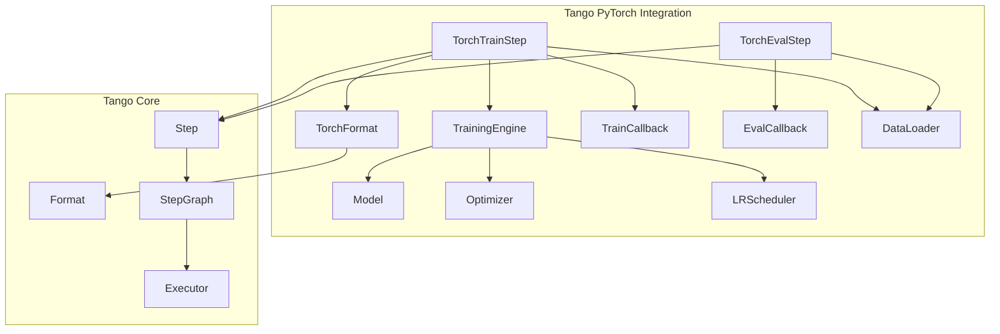
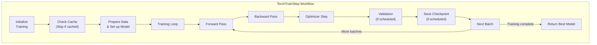
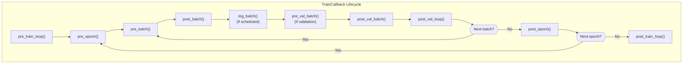
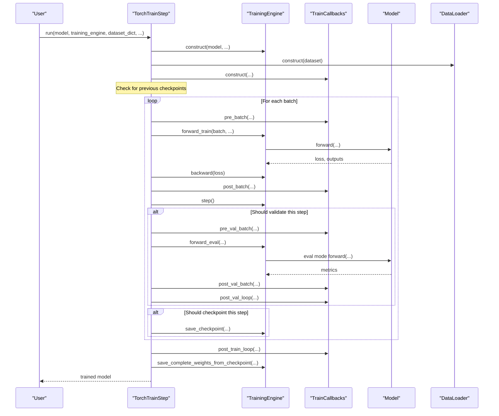
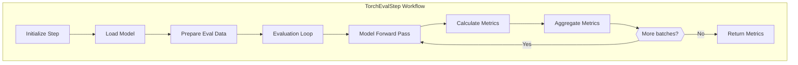

<!-- source: DeepWiki mcp.deepwiki.com · repo allenai/tango · page 6.1 PyTorch · fetched 2026-10-26 -->

# PyTorch

<details>
<summary>Relevant source files</summary>

The following files were used as context for generating this wiki page:

- [docs/source/api/integrations/torch.rst](docs/source/api/integrations/torch.rst)
- [tango/integrations/torch/__init__.py](tango/integrations/torch/__init__.py)
- [tango/integrations/torch/eval.py](tango/integrations/torch/eval.py)
- [tango/integrations/torch/model.py](tango/integrations/torch/model.py)
- [tango/integrations/torch/train.py](tango/integrations/torch/train.py)
- [tango/integrations/torch/train_callback.py](tango/integrations/torch/train_callback.py)
- [tango/integrations/torch/train_config.py](tango/integrations/torch/train_config.py)
- [tango/integrations/wandb/torch_train_callback.py](tango/integrations/wandb/torch_train_callback.py)
- [tests/integrations/torch/train_callback_test.py](tests/integrations/torch/train_callback_test.py)

</details>


This document covers Tango's integration with PyTorch, focusing on components that make it easier to train and evaluate PyTorch models within the Tango workflow system. If you're looking for information about other ML framework integrations, see [Transformers](#6.2), [Flax Integration](#6.2.1), or [Hugging Face Datasets](#6.5).

## Overview

Tango's PyTorch integration provides a streamlined way to incorporate PyTorch-based machine learning models into Tango workflows. The integration includes a training loop step, evaluation step, and various utility components that make it easy to work with PyTorch models, optimizers, data loaders, and more within the Tango ecosystem.



Sources: [tango/integrations/torch/__init__.py:12-16](), [tango/integrations/torch/train.py:32-76](), [tango/integrations/torch/eval.py:20-54]()

## Installation

To use the PyTorch integration with Tango, you need to install Tango with the PyTorch extra:

```bash
pip install tango[torch]
```

Alternatively, you can install PyTorch separately. Make sure you install the correct version of PyTorch for your operating system and CUDA version. See the PyTorch website for detailed installation instructions.

Sources: [tango/integrations/torch/__init__.py:3-10]()

## Core Components

### TorchTrainStep

`TorchTrainStep` is the primary component for training PyTorch models in Tango. It's registered as a Step under the name "torch::train" and provides a comprehensive training loop with support for:

- Gradient accumulation
- Distributed training
- GPU support
- Validation during training
- Checkpointing
- Configurable optimizers and learning rate schedulers
- Callbacks for custom behavior



Sources: [tango/integrations/torch/train.py:33-351]()

### TorchEvalStep

`TorchEvalStep` is a dedicated component for evaluating PyTorch models. It's registered as a Step under the name "torch::eval" and provides a streamlined evaluation loop with support for:

- GPU usage
- Metric calculation and aggregation
- Custom evaluation callbacks

Sources: [tango/integrations/torch/eval.py:20-190]()

### Model

The `Model` class serves as a base class for PyTorch models in Tango. It inherits from both `torch.nn.Module` and Tango's `Registrable` class, allowing models to be registered and constructed from configuration.

Sources: [tango/integrations/torch/model.py:6-12]()

### TrainingEngine

The `TrainingEngine` handles the core training logic, including:

- Forward and backward passes
- Optimizer steps
- Loading and saving checkpoints

The default implementation is `TorchTrainingEngine`, which handles standard PyTorch training workflows.

Sources: [tango/integrations/torch/__init__.py:160-162]()

### TrainCallback

`TrainCallback` provides hooks into the training process, allowing for customization of behavior at various points in the training loop:

- Before/after training loop
- Before/after epochs
- Before/after batches
- Before/after validation
- During logging



Sources: [tango/integrations/torch/train_callback.py:16-141]()

A notable example is the `StopEarlyCallback`, which implements early stopping based on validation metrics:

Sources: [tango/integrations/torch/train_callback.py:225-269]()

### TrainConfig

The `TrainConfig` class encapsulates the parameters for `TorchTrainStep`, making it easier to pass configuration information to callbacks and other components.

Sources: [tango/integrations/torch/train_config.py:8-215]()

## Training with PyTorch in Tango

### Basic Training Workflow

The training workflow in Tango's PyTorch integration follows these steps:

1. Initialize model, data loaders, training engine, and callbacks
2. Check for existing checkpoints to resume from
3. Set up distributed training (if configured)
4. Iterate through training batches:
   - Forward pass through model
   - Calculate loss
   - Backward pass to compute gradients
   - Optimizer step (with gradient accumulation if configured)
   - Run validation (if scheduled)
   - Save checkpoints (if scheduled)
5. Return the best model (based on validation metrics)



Sources: [tango/integrations/torch/train.py:81-209](), [tango/integrations/torch/train.py:353-807]()

### Distributed Training

Tango's PyTorch integration supports distributed training out of the box. Set the `device_count` parameter to the number of GPUs you want to use:

- When `device_count > 1`, distributed data parallel training is activated
- Distributed processes communicate using PyTorch's distributed module
- Each process handles a portion of the data

Sources: [tango/integrations/torch/train.py:44-52](), [tango/integrations/torch/train.py:184-320]()

### Gradient Accumulation

Gradient accumulation allows training with effectively larger batch sizes than would fit in GPU memory:

- Set the `grad_accum` parameter to the number of gradient accumulation steps
- Each "batch" consists of multiple "micro batches"
- Gradients are accumulated over micro batches before the optimizer step

Sources: [tango/integrations/torch/train.py:143-149](), [tango/integrations/torch/train.py:613-642]()

## Customizing Training

### Using TrainCallbacks

TrainCallbacks provide a powerful way to customize the training process. Examples include:

1. Logging metrics to external services
2. Implementing early stopping
3. Visualizing model outputs
4. Custom validation metric aggregation

The `WandbTrainCallback` is an example that logs training metrics to Weights & Biases:

Sources: [tango/integrations/wandb/torch_train_callback.py:14-215]()

### Early Stopping

The `StopEarlyCallback` allows you to stop training early when a metric stops improving:

```python
callbacks = [
    {"type": "torch::stop_early", "patience": 10}
]
```

When the callback detects that the validation metric hasn't improved for `patience` steps, it raises a `StopEarly` exception that the training loop catches to stop training gracefully.

Sources: [tango/integrations/torch/train_callback.py:225-269](), [tango/integrations/torch/train.py:779-783]()

## Evaluation with PyTorch in Tango

The `TorchEvalStep` provides a streamlined way to evaluate PyTorch models:

1. Load the model and evaluation data
2. Run inference on each batch
3. Calculate and aggregate metrics
4. Return the final metrics

You can customize metric aggregation using `EvalCallback` or by setting `auto_aggregate_metrics=False`.



Sources: [tango/integrations/torch/eval.py:59-190]()

## Example Usage

Here's a basic example of how to use the PyTorch integration in Tango:

```jsonnet
// train.jsonnet
{
  "steps": {
    "data": {
      "type": "generate_data"
    },
    "train": {
      "type": "torch::train",
      "model": {
        "type": "basic_regression"
      },
      "training_engine": {
        "type": "torch::training_engine",
        "optimizer": {
          "type": "torch::adam",
          "lr": 0.001
        }
      },
      "dataset_dict": {"type": "ref", "ref": "data"},
      "train_dataloader": {
        "type": "torch::dataloader",
        "batch_size": 8
      },
      "validation_split": "validation",
      "train_epochs": 5
    }
  }
}
```

Sources: [tango/integrations/torch/__init__.py:76-77]()

## Integration with Other Components

### Weights & Biases Integration

The PyTorch integration works well with the Weights & Biases integration in Tango:

- Use `WandbTrainCallback` to log training metrics to W&B
- Use `WandbWorkspace` to store models and artifacts in W&B

Sources: [tango/integrations/wandb/torch_train_callback.py:14-215]()

## Tips and Best Practices

### Debugging

When debugging a training loop that's causing errors on a GPU, set the environment variable `CUDA_LAUNCH_BLOCKING=1`. This ensures that the stack traces show where the error actually happened.

You can also use a custom `TrainCallback` to log each batch before they are passed into the model to see the exact inputs causing issues.

Sources: [tango/integrations/torch/__init__.py:120-127]()

### Stopping Early

You can stop the "torch::train" step early using a custom `TrainCallback`. Your callback just needs to raise the `StopEarly` exception.

Sources: [tango/integrations/torch/__init__.py:129-133](), [tango/integrations/torch/train.py:779-783]()

### Handling Validation Metrics

By default, validation metrics are aggregated by averaging across batches. This is correct for metrics like loss or accuracy but may not be for metrics like F1. If you need custom aggregation:

1. Set `auto_aggregate_val_metric=False` in `TorchTrainStep`
2. Handle aggregation in your model or using a `TrainCallback`

Sources: [tango/integrations/torch/train.py:54-64](), [tango/integrations/torch/train.py:705-714]()

---

